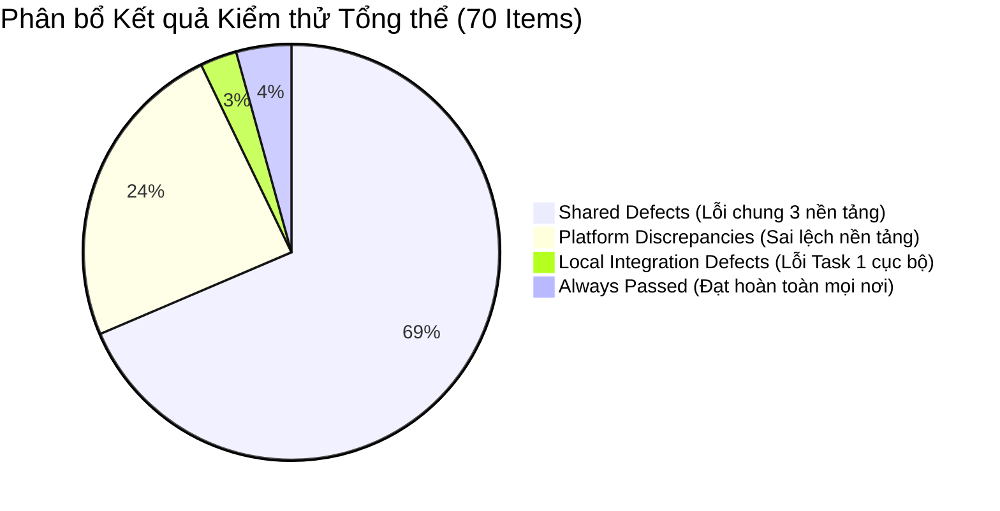

# Báo Cáo Tổng Hợp Khiếm Khuyết Giao Diện & Đa Nền Tảng (Consolidated Bug Report)
## Môn học: Kiểm thử Phần mềm — Đề tài: EShop SUT (HW03)

---

### Thông tin Sinh viên & Đồ án
- **Họ và tên sinh viên**: Trần Ngọc Diễm Thúy
- **Mã số sinh viên (StudentID)**: `23120367`
- **Email sinh viên**: `23120367@student.hcmus.edu.vn`
- **Mã bài tập**: `HW03-AI` (GUI Usability & Cross-Platform Testing)
- **Hệ thống kiểm thử (SUT)**: EShop — Vietnamese E-Commerce Web Application ([Repository](https://github.com/ttbhanh/eshop-sut))
- **Môi trường Kiểm thử**:
  - **Task 1 (Local Automation)**: Playwright Chromium Headless (macOS / Local)
  - **Task 3 (Cross-Platform)**: BrowserStack Automate Cloud & Real Device
    - **P1**: Google Chrome v156 trên Microsoft Windows 11 Desktop (1920x1080)
    - **P2**: Mozilla Firefox v148 trên Microsoft Windows 11 Desktop (1920x1080)
    - **P3**: Google Chrome Mobile trên Samsung Galaxy S23 Real Device (Android 13 / 412x915)
- **Kho lưu trữ bằng chứng**: [images/](images/) (lưu trữ tập trung ngay trong thư mục nộp bài `docs/23120367/`)

---

## Mục lục
1. [Tổng quan Thực thi & Thống kê Khiếm khuyết (Executive Summary & Defect Metrics)](#1-tổng-quan-thực-thi--thống-kê-khiếm-khuyết-executive-summary--defect-metrics)
2. [Bảng Ma trận Danh mục Lỗi Tổng hợp (Master Defect Inventory Matrix)](#2-bảng-ma-trận-danh-mục-lỗi-tổng-hợp-master-defect-inventory-matrix)
3. [Chi tiết Khiếm khuyết Màn hình FR-03: Quên và Đặt lại Mật khẩu](#3-chi-tiết-khiếm-khuyết-màn-hình-fr-03-quên-và-đặt-lại-mật-khẩu)
4. [Chi tiết Khiếm khuyết Màn hình FR-05: Trang chủ & Danh sách Sản phẩm](#4-chi-tiết-khiếm-khuyết-màn-hình-fr-05-trang-chủ--danh-sách-sản-phẩm)
5. [Chi tiết Khiếm khuyết Màn hình FR-07: Giỏ hàng Người dùng](#5-chi-tiết-khiếm-khuyết-màn-hình-fr-07-giỏ-hàng-người-dùng)
6. [Chi tiết Khiếm khuyết Màn hình FR-15: Quản lý Sản phẩm Admin](#6-chi-tiết-khiếm-khuyết-màn-hình-fr-15-quản-lý-sản-phẩm-admin)
7. [Đánh giá Tổng hợp, Rủi ro Chất lượng & Lộ trình Khắc phục (Synthesis & Roadmap)](#7-đánh-giá-tổng-hợp-rủi-ro-chất-lượng--lộ-trình-khắc-phục-synthesis--roadmap)

---

## 1. Tổng quan Thực thi & Thống kê Khiếm khuyết (Executive Summary & Defect Metrics)

Báo cáo này tổng hợp toàn bộ các khiếm khuyết phần mềm (bugs/defects) được phát hiện trong quá trình kiểm thử giao diện người dùng EShop qua hai giai đoạn:
1. **Task 1 (Local GUI Automation Testing)**: Kiểm thử tự động cục bộ 70 mục kiểm tra bằng Playwright Chromium, ghi nhận 48 ca thất bại (Failed), 20 ca vượt qua (Passed), 2 ca chưa chạy (Not Run do yêu cầu bộ gõ thủ công/screen reader).
2. **Task 3 (Cross-Browser & Cross-Platform Testing)**: Kiểm thử 70 mục trên 3 môi trường thực tế thông qua BrowserStack Cloud (Chrome Win11, Firefox Win11, Android Galaxy S23), thực thi thành công 208/210 lượt kiểm thử (tỷ lệ bao phủ thực thi đạt **99.05%**), phát hiện 65 mục tồn tại khiếm khuyết trên ít nhất một nền tảng.

### 1.1. Thống kê Hợp nhất Khiếm khuyết (Unified Defect Summary)

- **Tổng số checklist items được kiểm thử**: **70 mục**.
- **Tổng số mục phát hiện khiếm khuyết GUI Checklist (Task 1 & 3)**: **67 mục** (chiếm **95.71%** tổng số kiểm tra).
- **Tổng số khiếm khuyết Khả dụng phát hiện qua Usability Testing (Task 2)**: **7 lỗi trọng yếu (`BUG-U01` đến `BUG-U07`)**.
- **Tổng số lỗi hệ thống được ghi nhận & lập GitHub Issues**: **74 lỗi** (67 GUI defects + 7 Usability defects).
- **Tổng số mục đạt hoàn toàn trên mọi môi trường (Always Passed)**: **3 mục** (`GUI-010`, `GUI-011`, `GUI-027` - chiếm 4.29%).

### 1.2. Phân loại Bản chất Khiếm khuyết (Defect Classification)

| Phân loại Bản chất | Số lượng | Tỷ lệ | Đặc điểm kỹ thuật & Phạm vi ảnh hưởng |
| :--- | :---: | :---: | :--- |
| **Lỗi dùng chung (Shared Defects)** | **48** | 71.64% | Khiếm khuyết logic frontend, HTML DOM thiếu thẻ, thiếu validation, thiếu feedback toast, không đạt chuẩn WCAG xuất hiện đồng loạt trên cả 3 nền tảng (Chrome Win11, Firefox Win11, Android Galaxy S23). |
| **Sai lệch nền tảng (Platform Discrepancies)** | **17** | 25.37% | Khiếm khuyết phát sinh do sự khác biệt giữa trình duyệt Desktop và thiết bị Mobile (Galaxy S23 màn hình hẹp gây tràn lưới, tràn bảng, bàn phím ảo che nút, touch target nhỏ) hoặc khác biệt cơ chế render giữa Gecko (Firefox) và Blink (Chrome). |
| **Lỗi tích hợp cục bộ (Local Integration Defects)** | **2** | 2.99% | Khiếm khuyết kết nối mock API (`GUI-014`, `GUI-015`) chỉ xảy ra trong môi trường Task 1 headless do server port 3000 chưa bật; đã được xác minh hoạt động bình thường trên Task 3. |
| **Tổng cộng** | **67** | **100%** | |

### 1.3. Thống kê theo Mức độ Nghiêm trọng (Severity) & Mức độ Ưu tiên (Priority)

| Mức độ Nghiêm trọng (Severity) | Mức độ Ưu tiên (Priority) | Số lượng | Danh sách Khiếm khuyết Tiêu biểu |
| :--- | :---: | :---: | :--- |
| **S1 — Blocker / Critical** | **P1 (High)** | **1** | `BUG-GUI-060` (Sửa thông tin sản phẩm A làm thay đổi dữ liệu của sản phẩm B — vi phạm nghiêm trọng tính cô lập dữ liệu). |
| **S2 — Major** | **P1 (High)** | **5** | `BUG-GUI-014` (Lỗi API liên kết OTP), `BUG-GUI-015` (Lỗi API đổi mật khẩu), `BUG-GUI-021` (XSS/HTML Injection từ khóa tìm kiếm), `BUG-GUI-044` (Xóa giỏ hàng thiếu xác nhận gây mất dữ liệu), `BUG-GUI-061` (Xóa sản phẩm quản trị Admin thiếu cảnh báo). |
| **S3 — Normal / Minor** | **P2 (Medium)** | **58** | Thiếu tiêu đề `<h1>`, sai đơn vị tiền tệ (`VND` thay vì `₫`), căn lề bảng sai, thiếu thanh điều hướng Breadcrumb, tràn bố cục di động (Mobile grid/table overflow), thiếu thông báo Toast, độ tương phản chữ không đạt WCAG AA. |
| **S4 — Trivial** | **P3 (Low)** | **3** | `BUG-GUI-030` (Hình ảnh thiếu alt text), `BUG-GUI-040` (Thiếu Breadcrumb giỏ hàng), `BUG-GUI-064` (Thumbnail admin thiếu alt). |

### 1.4. Thống kê Phân bổ theo Màn hình Chức năng & Khía cạnh Giao diện (IA)

| Màn hình Chức năng (Screen) | IA-01 (Tiêu chuẩn UI) | IA-02 (Biểu mẫu) | IA-03 (Điều hướng) | IA-04 (Trạng thái/Feedback) | Tổng lỗi màn hình |
| :--- | :---: | :---: | :---: | :---: | :---: |
| **FR-03: Quên và Đặt lại Mật khẩu** | 3 | 5 | 2 | 3 | **13** |
| **FR-05: Trang chủ & Danh sách Sản phẩm** | 5 | 3 | 4 | 6 | **18** |
| **FR-07: Giỏ hàng Người dùng** | 5 | 5 | 4 | 4 | **18** |
| **FR-15: Quản lý Sản phẩm Admin** | 5 | 6 | 4 | 3 | **18** |
| **Tổng số lỗi theo Khía cạnh (IA)** | **18** | **19** | **14** | **16** | **67** |

---

## 2. Bảng Ma trận Danh mục Lỗi Tổng hợp (Master Defect Inventory Matrix)

### 2.1. Ma trận 67 Khiếm khuyết GUI Checklist (Task 1 & Task 3)

Bảng ma trận dưới đây liệt kê đầy đủ 67 khiếm khuyết được phát hiện xuyên suốt 2 đợt kiểm thử Task 1 và Task 3, kèm trạng thái ghi nhận trên từng môi trường:
- **T1**: Playwright Chromium (Local Headless)
- **P1**: Google Chrome v156 (Windows 11 Desktop)
- **P2**: Mozilla Firefox v148 (Windows 11 Desktop)
- **P3**: Android Chrome (Samsung Galaxy S23 Real Device)

| Bug Key | Checklist ID | Màn hình | IA | Mức độ | Ưu tiên | T1 Local | P1 Win11 | P2 Win11 | P3 Galaxy S23 | Phân loại Khiếm khuyết | Tóm tắt Khiếm khuyết | GitHub Issue |
| :--- | :--- | :---: | :---: | :---: | :---: | :---: | :---: | :---: | :---: | :--- | :--- | :---: |
| **BUG-GUI-001** | `GUI-001` | FR-03 | IA-01 | S3 | P2 | Passed | Failed | Passed | Passed | Platform Discrepancy | [FR-03] Lỗi timeout/hiển thị văn bản tiếng Việt trên Chrome Win11 | [#84](https://github.com/nguyenanhtuan2702/eshop-sut/issues/84) ([Ảnh](issue-screenshots/BUG-GUI-001.png)) |
| **BUG-GUI-002** | `GUI-002` | FR-03 | IA-01 | S3 | P2 | Passed | Failed | Passed | Passed | Platform Discrepancy | [FR-03] Màu sắc nút hành động chính/phụ chưa đồng bộ chuẩn positive/danger | [#85](https://github.com/nguyenanhtuan2702/eshop-sut/issues/85) ([Ảnh](issue-screenshots/BUG-GUI-002.png)) |
| **BUG-GUI-003** | `GUI-003` | FR-03 | IA-01 | S3 | P2 | Failed | Failed | Failed | Failed | Shared Defect | [FR-03] Trang Quên mật khẩu thiếu thẻ tiêu đề h1 duy nhất | [#86](https://github.com/nguyenanhtuan2702/eshop-sut/issues/86) ([Ảnh](issue-screenshots/BUG-GUI-003.png)) |
| **BUG-GUI-004** | `GUI-004` | FR-03 | IA-02 | S3 | P2 | Failed | Failed | Failed | Failed | Shared Defect | [FR-03] Ô nhập Email thiếu thuộc tính type="email" | [#87](https://github.com/nguyenanhtuan2702/eshop-sut/issues/87) ([Ảnh](issue-screenshots/BUG-GUI-004.png)) |
| **BUG-GUI-005** | `GUI-005` | FR-03 | IA-02 | S3 | P2 | Failed | Failed | Failed | Failed | Shared Defect | [FR-03] Thiếu chỉ báo tiến trình bước (Bước 1/2) tại Bước 1 | [#88](https://github.com/nguyenanhtuan2702/eshop-sut/issues/88) ([Ảnh](issue-screenshots/BUG-GUI-005.png)) |
| **BUG-GUI-006** | `GUI-006` | FR-03 | IA-02 | S3 | P2 | Failed | Failed | Failed | Failed | Shared Defect | [FR-03] Thiếu trường nhập xác nhận mật khẩu tại Bước 2 | [#89](https://github.com/nguyenanhtuan2702/eshop-sut/issues/89) ([Ảnh](issue-screenshots/BUG-GUI-006.png)) |
| **BUG-GUI-007** | `GUI-007` | FR-03 | IA-02 | S3 | P2 | Failed | Failed | Failed | Failed | Shared Defect | [FR-03] Thiếu khối hiển thị lỗi validation phía trên nút gửi | [#90](https://github.com/nguyenanhtuan2702/eshop-sut/issues/90) ([Ảnh](issue-screenshots/BUG-GUI-007.png)) |
| **BUG-GUI-008** | `GUI-008` | FR-03 | IA-02 | S3 | P2 | Failed | Failed | Failed | Failed | Shared Defect | [FR-03] Ô nhập OTP không thông báo lỗi khi không đúng định dạng 6 chữ số | [#91](https://github.com/nguyenanhtuan2702/eshop-sut/issues/91) ([Ảnh](issue-screenshots/BUG-GUI-008.png)) |
| **BUG-GUI-009** | `GUI-009` | FR-03 | IA-03 | S3 | P2 | Failed | Failed | Failed | Failed | Shared Defect | [FR-03] Thiếu liên kết "Quay lại đăng nhập" tại Bước 1 | [#92](https://github.com/nguyenanhtuan2702/eshop-sut/issues/92) ([Ảnh](issue-screenshots/BUG-GUI-009.png)) |
| **BUG-GUI-012** | `GUI-012` | FR-03 | IA-03 | S3 | P2 | Failed | Failed | Failed | Failed | Shared Defect | [FR-03] Phím Enter không kích hoạt gửi form chuyển bước | [#93](https://github.com/nguyenanhtuan2702/eshop-sut/issues/93) ([Ảnh](issue-screenshots/BUG-GUI-012.png)) |
| **BUG-GUI-013** | `GUI-013` | FR-03 | IA-04 | S3 | P2 | Failed | Failed | Failed | Failed | Shared Defect | [FR-03] Lỗi kết nối Backend API khi kiểm tra sinh mã OTP | [#94](https://github.com/nguyenanhtuan2702/eshop-sut/issues/94) ([Ảnh](issue-screenshots/BUG-GUI-013.png)) |
| **BUG-GUI-014** | `GUI-014` | FR-03 | IA-04 | S2 | P1 | Failed | Passed | Passed | Passed | Local Integration Defect | [FR-03] Lỗi kết nối Backend API khi kiểm tra ràng buộc OTP với email | [#95](https://github.com/nguyenanhtuan2702/eshop-sut/issues/95) ([Ảnh](issue-screenshots/BUG-GUI-014.png)) |
| **BUG-GUI-015** | `GUI-015` | FR-03 | IA-04 | S2 | P1 | Failed | Passed | Passed | Passed | Local Integration Defect | [FR-03] Lỗi kết nối Backend API khi kiểm tra hoàn tất đặt lại mật khẩu | [#96](https://github.com/nguyenanhtuan2702/eshop-sut/issues/96) ([Ảnh](issue-screenshots/BUG-GUI-015.png)) |
| **BUG-GUI-016** | `GUI-016` | FR-05 | IA-01 | S3 | P2 | Passed | Passed | Passed | Failed | Platform Discrepancy | [FR-05] Bố cục hiển thị lưới sản phẩm bị tràn/vỡ trên màn hình di động Galaxy S23 | [#97](https://github.com/nguyenanhtuan2702/eshop-sut/issues/97) ([Ảnh](issue-screenshots/BUG-GUI-016.png)) |
| **BUG-GUI-017** | `GUI-017` | FR-05 | IA-01 | S3 | P2 | Passed | Passed | Passed | Failed | Platform Discrepancy | [FR-05] Typography và thông tin sản phẩm bị cắt/chèn ép trên mobile viewport | [#98](https://github.com/nguyenanhtuan2702/eshop-sut/issues/98) ([Ảnh](issue-screenshots/BUG-GUI-017.png)) |
| **BUG-GUI-018** | `GUI-018` | FR-05 | IA-01 | S3 | P2 | Failed | Failed | Failed | Failed | Shared Defect | [FR-05] Thẻ sản phẩm dùng đơn vị tiền tệ "VND" thay vì ký hiệu "₫" | [#99](https://github.com/nguyenanhtuan2702/eshop-sut/issues/99) ([Ảnh](issue-screenshots/BUG-GUI-018.png)) |
| **BUG-GUI-019** | `GUI-019` | FR-05 | IA-01 | S3 | P2 | Failed | Passed | Failed | Passed | Platform Discrepancy | [FR-05] Trang danh sách sản phẩm tồn tại 2 thẻ h1 thay vì duy nhất 1 | [#100](https://github.com/nguyenanhtuan2702/eshop-sut/issues/100) ([Ảnh](issue-screenshots/BUG-GUI-019.png)) |
| **BUG-GUI-020** | `GUI-020` | FR-05 | IA-01 | S3 | P2 | Failed | Failed | Failed | Failed | Shared Defect | [FR-05] Độ tương phản màu sắc chữ trên thẻ sản phẩm không đạt chuẩn WCAG AA | [#101](https://github.com/nguyenanhtuan2702/eshop-sut/issues/101) ([Ảnh](issue-screenshots/BUG-GUI-020.png)) |
| **BUG-GUI-021** | `GUI-021` | FR-05 | IA-01 | S3 | P2 | Failed | Failed | Failed | Failed | Shared Defect | [FR-05] Từ khóa tìm kiếm render trực tiếp thẻ HTML `<b>` chưa được escape | [#102](https://github.com/nguyenanhtuan2702/eshop-sut/issues/102) ([Ảnh](issue-screenshots/BUG-GUI-021.png)) |
| **BUG-GUI-022** | `GUI-022` | FR-05 | IA-02 | S3 | P2 | Passed | Passed | Passed | Failed | Platform Discrepancy | [FR-05] Lọc tìm kiếm theo tên sản phẩm phản hồi không ổn định trên mobile | [#103](https://github.com/nguyenanhtuan2702/eshop-sut/issues/103) ([Ảnh](issue-screenshots/BUG-GUI-022.png)) |
| **BUG-GUI-023** | `GUI-023` | FR-05 | IA-02 | S3 | P2 | Passed | Failed | Passed | Failed | Platform Discrepancy | [FR-05] Xóa trắng ô tìm kiếm không hoàn nguyên danh sách sản phẩm ban đầu | [#104](https://github.com/nguyenanhtuan2702/eshop-sut/issues/104) ([Ảnh](issue-screenshots/BUG-GUI-023.png)) |
| **BUG-GUI-024** | `GUI-024` | FR-05 | IA-03 | S3 | P2 | Failed | Failed | Failed | Failed | Shared Defect | [FR-05] Mục "Trang chủ" trên Navbar không có trạng thái active khi đang xem | [#105](https://github.com/nguyenanhtuan2702/eshop-sut/issues/105) ([Ảnh](issue-screenshots/BUG-GUI-024.png)) |
| **BUG-GUI-025** | `GUI-025` | FR-05 | IA-03 | S3 | P2 | Failed | Failed | Failed | Failed | Shared Defect | [FR-05] Badge số lượng giỏ hàng trên Navbar không cập nhật sau khi thêm hàng | [#106](https://github.com/nguyenanhtuan2702/eshop-sut/issues/106) ([Ảnh](issue-screenshots/BUG-GUI-025.png)) |
| **BUG-GUI-026** | `GUI-026` | FR-05 | IA-03 | S3 | P2 | Failed | Failed | Failed | Failed | Shared Defect | [FR-05] Nhấp vào thẻ sản phẩm không điều hướng sang trang Chi tiết | [#107](https://github.com/nguyenanhtuan2702/eshop-sut/issues/107) ([Ảnh](issue-screenshots/BUG-GUI-026.png)) |
| **BUG-GUI-028** | `GUI-028` | FR-05 | IA-04 | S3 | P2 | Failed | Failed | Failed | Failed | Shared Defect | [FR-05] Thiếu hiệu ứng skeleton/loading khi đang tải danh sách sản phẩm | [#108](https://github.com/nguyenanhtuan2702/eshop-sut/issues/108) ([Ảnh](issue-screenshots/BUG-GUI-028.png)) |
| **BUG-GUI-029** | `GUI-029` | FR-05 | IA-04 | S3 | P2 | Failed | Failed | Failed | Failed | Shared Defect | [FR-05] Thiếu giao diện empty state thân thiện khi tìm kiếm không có kết quả | [#109](https://github.com/nguyenanhtuan2702/eshop-sut/issues/109) ([Ảnh](issue-screenshots/BUG-GUI-029.png)) |
| **BUG-GUI-030** | `GUI-030` | FR-05 | IA-04 | S4 | P3 | Failed | Passed | Failed | Failed | Platform Discrepancy | [FR-05] Hình ảnh sản phẩm thiếu thuộc tính alt mô tả nội dung | [#110](https://github.com/nguyenanhtuan2702/eshop-sut/issues/110) ([Ảnh](issue-screenshots/BUG-GUI-030.png)) |
| **BUG-GUI-031** | `GUI-031` | FR-05 | IA-04 | S3 | P2 | Failed | Failed | Failed | Failed | Shared Defect | [FR-05] Thiếu thông báo toast phản hồi trực quan khi bấm Thêm vào giỏ hàng | [#111](https://github.com/nguyenanhtuan2702/eshop-sut/issues/111) ([Ảnh](issue-screenshots/BUG-GUI-031.png)) |
| **BUG-GUI-032** | `GUI-032` | FR-07 | IA-01 | S3 | P2 | Failed | Failed | Failed | Failed | Shared Defect | [FR-07] Bảng giỏ hàng không hiển thị đầy đủ 5 cột theo quy định đặc tả | [#115](https://github.com/nguyenanhtuan2702/eshop-sut/issues/115) ([Ảnh](issue-screenshots/BUG-GUI-032.png)) |
| **BUG-GUI-033** | `GUI-033` | FR-07 | IA-01 | S3 | P2 | Failed | Failed | Failed | Failed | Shared Defect | [FR-07] Nhãn tổng tiền hiển thị sai thành "Tổng tạm tính" thay vì "Tổng cộng" | [#116](https://github.com/nguyenanhtuan2702/eshop-sut/issues/116) ([Ảnh](issue-screenshots/BUG-GUI-033.png)) |
| **BUG-GUI-034** | `GUI-034` | FR-07 | IA-01 | S3 | P2 | Failed | Failed | Failed | Failed | Shared Defect | [FR-07] Các cột số tiền trong bảng giỏ hàng không được căn lề phải | [#117](https://github.com/nguyenanhtuan2702/eshop-sut/issues/117) ([Ảnh](issue-screenshots/BUG-GUI-034.png)) |
| **BUG-GUI-035** | `GUI-035` | FR-07 | IA-01 | S3 | P2 | Passed | Passed | Passed | Failed | Platform Discrepancy | [FR-07] Bảng giỏ hàng bị tràn ngang, không hiển thị thanh cuộn responsive trên mobile | [#118](https://github.com/nguyenanhtuan2702/eshop-sut/issues/118) ([Ảnh](issue-screenshots/BUG-GUI-035.png)) |
| **BUG-GUI-036** | `GUI-036` | FR-07 | IA-02 | S3 | P2 | Failed | Failed | Failed | Failed | Shared Defect | [FR-07] Dòng giỏ hàng thiếu cụm nút tăng giảm số lượng (+/-) và ô nhập | [#119](https://github.com/nguyenanhtuan2702/eshop-sut/issues/119) ([Ảnh](issue-screenshots/BUG-GUI-036.png)) |
| **BUG-GUI-037** | `GUI-037` | FR-07 | IA-02 | S3 | P2 | Failed | Failed | Failed | Failed | Shared Defect | [FR-07] Giỏ hàng thiếu trường nhập trực tiếp số lượng bằng bàn phím | [#120](https://github.com/nguyenanhtuan2702/eshop-sut/issues/120) ([Ảnh](issue-screenshots/BUG-GUI-037.png)) |
| **BUG-GUI-038** | `GUI-038` | FR-07 | IA-02 | S3 | P2 | Failed | Failed | Failed | Failed | Shared Defect | [FR-07] Không thể kiểm thử giá trị số lượng biên do thiếu ô nhập liệu | [#121](https://github.com/nguyenanhtuan2702/eshop-sut/issues/121) ([Ảnh](issue-screenshots/BUG-GUI-038.png)) |
| **BUG-GUI-039** | `GUI-039` | FR-07 | IA-03 | S3 | P2 | Failed | Failed | Failed | Failed | Shared Defect | [FR-07] Mục "Giỏ hàng" trên Navbar không được highlight active khi đang xem | [#122](https://github.com/nguyenanhtuan2702/eshop-sut/issues/122) ([Ảnh](issue-screenshots/BUG-GUI-039.png)) |
| **BUG-GUI-040** | `GUI-040` | FR-07 | IA-03 | S3 | P2 | Failed | Failed | Failed | Failed | Shared Defect | [FR-07] Trang Giỏ hàng thiếu thanh điều hướng phân cấp Breadcrumb | [#123](https://github.com/nguyenanhtuan2702/eshop-sut/issues/123) ([Ảnh](issue-screenshots/BUG-GUI-040.png)) |
| **BUG-GUI-041** | `GUI-041` | FR-07 | IA-03 | S3 | P2 | Failed | Failed | Failed | Failed | Shared Defect | [FR-07] Nút tiếp tục mua sắm hiển thị nhãn "← Mua tiếp" thay vì "Tiếp tục mua sắm" | [#124](https://github.com/nguyenanhtuan2702/eshop-sut/issues/124) ([Ảnh](issue-screenshots/BUG-GUI-041.png)) |
| **BUG-GUI-042** | `GUI-042` | FR-07 | IA-03 | S3 | P2 | Passed | Passed | Passed | Failed | Platform Discrepancy | [FR-07] Luồng điều hướng phím Tab bị nhảy không tự nhiên trên trang Giỏ hàng | [#125](https://github.com/nguyenanhtuan2702/eshop-sut/issues/125) ([Ảnh](issue-screenshots/BUG-GUI-042.png)) |
| **BUG-GUI-043** | `GUI-043` | FR-07 | IA-04 | S3 | P2 | Failed | Failed | Failed | Failed | Shared Defect | [FR-07] Thêm cùng một sản phẩm nhiều lần không tự động cộng dồn số lượng | [#126](https://github.com/nguyenanhtuan2702/eshop-sut/issues/126) ([Ảnh](issue-screenshots/BUG-GUI-043.png)) |
| **BUG-GUI-044** | `GUI-044` | FR-07 | IA-04 | S3 | P2 | Failed | Failed | Failed | Failed | Shared Defect | [FR-07] Thiếu hộp thoại xác nhận trước khi xóa sản phẩm khỏi giỏ hàng | [#127](https://github.com/nguyenanhtuan2702/eshop-sut/issues/127) ([Ảnh](issue-screenshots/BUG-GUI-044.png)) |
| **BUG-GUI-045** | `GUI-045` | FR-07 | IA-04 | S3 | P2 | Failed | Failed | Failed | Failed | Shared Defect | [FR-07] Thao tác Hủy hoặc phím Escape không giữ lại sản phẩm trong giỏ hàng | [#128](https://github.com/nguyenanhtuan2702/eshop-sut/issues/128) ([Ảnh](issue-screenshots/BUG-GUI-045.png)) |
| **BUG-GUI-046** | `GUI-046` | FR-07 | IA-04 | S3 | P2 | Passed | Failed | Passed | Failed | Platform Discrepancy | [FR-07] Trạng thái giỏ hàng rỗng (Empty Cart) hiển thị thiếu nhất quán giữa các trình duyệt | [#129](https://github.com/nguyenanhtuan2702/eshop-sut/issues/129) ([Ảnh](issue-screenshots/BUG-GUI-046.png)) |
| **BUG-GUI-047** | `GUI-047` | FR-15 | IA-01 | S3 | P2 | Failed | Failed | Failed | Failed | Shared Defect | [FR-15] Tiêu đề các cột trong bảng quản trị sản phẩm Admin chưa được Việt hóa | [#133](https://github.com/nguyenanhtuan2702/eshop-sut/issues/133) ([Ảnh](issue-screenshots/BUG-GUI-047.png)) |
| **BUG-GUI-048** | `GUI-048` | FR-15 | IA-01 | S3 | P2 | Failed | Failed | Failed | Failed | Shared Defect | [FR-15] Trang Quản lý sản phẩm thiếu thẻ tiêu đề h1 duy nhất | [#134](https://github.com/nguyenanhtuan2702/eshop-sut/issues/134) ([Ảnh](issue-screenshots/BUG-GUI-048.png)) |
| **BUG-GUI-049** | `GUI-049` | FR-15 | IA-01 | S3 | P2 | Passed | Failed | Passed | Failed | Platform Discrepancy | [FR-15] Nút Lưu/Hủy quản trị Admin chưa áp dụng đúng bảng màu ngữ nghĩa positive/danger | [#135](https://github.com/nguyenanhtuan2702/eshop-sut/issues/135) ([Ảnh](issue-screenshots/BUG-GUI-049.png)) |
| **BUG-GUI-050** | `GUI-050` | FR-15 | IA-02 | S3 | P2 | Failed | Failed | Failed | Failed | Shared Defect | [FR-15] Các trường bắt buộc trong form sản phẩm thiếu ký hiệu dấu sao (*) | [#136](https://github.com/nguyenanhtuan2702/eshop-sut/issues/136) ([Ảnh](issue-screenshots/BUG-GUI-050.png)) |
| **BUG-GUI-051** | `GUI-051` | FR-15 | IA-02 | S3 | P2 | Failed | Failed | Failed | Failed | Shared Defect | [FR-15] Trường tên sản phẩm không giới hạn độ dài tối đa 255 ký tự | [#137](https://github.com/nguyenanhtuan2702/eshop-sut/issues/137) ([Ảnh](issue-screenshots/BUG-GUI-051.png)) |
| **BUG-GUI-052** | `GUI-052` | FR-15 | IA-02 | S3 | P2 | Failed | Failed | Failed | Failed | Shared Defect | [FR-15] Không hiển thị thông báo lỗi khi nhập giá sản phẩm nhỏ hơn hoặc bằng 0 | [#138](https://github.com/nguyenanhtuan2702/eshop-sut/issues/138) ([Ảnh](issue-screenshots/BUG-GUI-052.png)) |
| **BUG-GUI-053** | `GUI-053` | FR-15 | IA-02 | S3 | P2 | Passed | Failed | Failed | Failed | Shared Defect | [FR-15] Danh mục dropdown form Admin không thể chọn chính xác trên trình duyệt desktop/mobile | [#139](https://github.com/nguyenanhtuan2702/eshop-sut/issues/139) ([Ảnh](issue-screenshots/BUG-GUI-053.png)) |
| **BUG-GUI-054** | `GUI-054` | FR-15 | IA-02 | S3 | P2 | Passed | Failed | Failed | Failed | Shared Defect | [FR-15] Ô nhập số lượng tồn kho Admin không ràng buộc biên âm hợp lệ | [#140](https://github.com/nguyenanhtuan2702/eshop-sut/issues/140) ([Ảnh](issue-screenshots/BUG-GUI-054.png)) |
| **BUG-GUI-055** | `GUI-055` | FR-15 | IA-02 | S3 | P2 | Failed | Failed | Failed | Failed | Shared Defect | [FR-15] Khối thông báo lỗi form sản phẩm không nằm phía trên nút submit | [#141](https://github.com/nguyenanhtuan2702/eshop-sut/issues/141) ([Ảnh](issue-screenshots/BUG-GUI-055.png)) |
| **BUG-GUI-056** | `GUI-056` | FR-15 | IA-03 | S3 | P2 | Passed | Failed | Failed | Failed | Shared Defect | [FR-15] Thẻ tab Admin Quản lý sản phẩm thiếu trạng thái highlight active rõ ràng | [#142](https://github.com/nguyenanhtuan2702/eshop-sut/issues/142) ([Ảnh](issue-screenshots/BUG-GUI-056.png)) |
| **BUG-GUI-057** | `GUI-057` | FR-15 | IA-03 | S3 | P2 | Failed | Failed | Failed | Failed | Shared Defect | [FR-15] Nút đăng xuất dùng nhãn "Thoát"/"Log out" thay vì "Đăng xuất" | [#143](https://github.com/nguyenanhtuan2702/eshop-sut/issues/143) ([Ảnh](issue-screenshots/BUG-GUI-057.png)) |
| **BUG-GUI-058** | `GUI-058` | FR-15 | IA-03 | S3 | P2 | Passed | Passed | Passed | Failed | Platform Discrepancy | [FR-15] Nút Hủy form Admin bị che khuất hoặc không kích hoạt được trên mobile | [#144](https://github.com/nguyenanhtuan2702/eshop-sut/issues/144) ([Ảnh](issue-screenshots/BUG-GUI-058.png)) |
| **BUG-GUI-059** | `GUI-059` | FR-15 | IA-03 | S3 | P2 | Failed | Failed | Failed | Failed | Shared Defect | [FR-15] Form Sửa sản phẩm không mở dưới dạng modal có bẫy focus bàn phím | [#145](https://github.com/nguyenanhtuan2702/eshop-sut/issues/145) ([Ảnh](issue-screenshots/BUG-GUI-059.png)) |
| **BUG-GUI-060** | `GUI-060` | FR-15 | IA-04 | S2 | P1 | Failed | Failed | Failed | Failed | Shared Defect | [FR-15] Cập nhật thông tin sản phẩm không đảm bảo tính cô lập dữ liệu | [#146](https://github.com/nguyenanhtuan2702/eshop-sut/issues/146) ([Ảnh](issue-screenshots/BUG-GUI-060.png)) |
| **BUG-GUI-061** | `GUI-061` | FR-15 | IA-04 | S3 | P2 | Failed | Failed | Failed | Failed | Shared Defect | [FR-15] Thiếu modal xác nhận cảnh báo trước khi xóa sản phẩm quản trị | [#147](https://github.com/nguyenanhtuan2702/eshop-sut/issues/147) ([Ảnh](issue-screenshots/BUG-GUI-061.png)) |
| **BUG-GUI-062** | `GUI-062` | FR-15 | IA-04 | S3 | P2 | Passed | Passed | Passed | Failed | Platform Discrepancy | [FR-15] Modal xác nhận xóa Admin không đóng được khi chạm ngoài vùng overlay trên mobile | [#148](https://github.com/nguyenanhtuan2702/eshop-sut/issues/148) ([Ảnh](issue-screenshots/BUG-GUI-062.png)) |
| **BUG-GUI-063** | `GUI-063` | FR-15 | IA-04 | S3 | P2 | Passed | Failed | Failed | Failed | Shared Defect | [FR-15] Thiếu toast thông báo phản hồi khi hoàn tất thêm/sửa/xóa sản phẩm Admin | [#149](https://github.com/nguyenanhtuan2702/eshop-sut/issues/149) ([Ảnh](issue-screenshots/BUG-GUI-063.png)) |
| **BUG-GUI-064** | `GUI-064` | FR-15 | IA-04 | S4 | P3 | Passed | Failed | Passed | Failed | Platform Discrepancy | [FR-15] Hình ảnh sản phẩm trong bảng quản trị Admin thiếu thuộc tính alt ngữ nghĩa | [#150](https://github.com/nguyenanhtuan2702/eshop-sut/issues/150) ([Ảnh](issue-screenshots/BUG-GUI-064.png)) |
| **BUG-GUI-065** | `GUI-065` | FR-05 | IA-02 | S3 | P2 | Not Run | Failed | Not Run | Not Run | Platform Discrepancy | [FR-05] Ô tìm kiếm bị mất ký tự khi gõ tiếng Việt Telex/VNI có sự kiện composition | [#112](https://github.com/nguyenanhtuan2702/eshop-sut/issues/112) ([Ảnh](issue-screenshots/BUG-GUI-065.png)) |
| **BUG-GUI-066** | `GUI-066` | FR-07 | IA-01 | S3 | P2 | Failed | Failed | Failed | Failed | Shared Defect | [FR-07] Nút Xóa sản phẩm thiếu thuộc tính aria-label cho công nghệ hỗ trợ | [#130](https://github.com/nguyenanhtuan2702/eshop-sut/issues/130) ([Ảnh](issue-screenshots/BUG-GUI-066.png)) |
| **BUG-GUI-067** | `GUI-067` | FR-05 | IA-04 | S3 | P2 | Failed | Failed | Failed | Failed | Shared Defect | [FR-05] Thiếu giao diện thông báo lỗi mạng và nút "Thử lại" khi mất kết nối API | [#113](https://github.com/nguyenanhtuan2702/eshop-sut/issues/113) ([Ảnh](issue-screenshots/BUG-GUI-067.png)) |
| **BUG-GUI-068** | `GUI-068` | FR-07 | IA-02 | S3 | P2 | Failed | Failed | Failed | Failed | Shared Defect | [FR-07] Ô nhập số lượng giỏ hàng xử lý chưa an toàn khi xóa trắng giá trị | [#131](https://github.com/nguyenanhtuan2702/eshop-sut/issues/131) ([Ảnh](issue-screenshots/BUG-GUI-068.png)) |
| **BUG-GUI-069** | `GUI-069` | FR-07 | IA-01 | S3 | P2 | Passed | Failed | Passed | Passed | Platform Discrepancy | [FR-07] Kích thước vùng cảm ứng nút bấm giỏ hàng nhỏ hơn 44x44px trên thiết bị cảm ứng | [#132](https://github.com/nguyenanhtuan2702/eshop-sut/issues/132) ([Ảnh](issue-screenshots/BUG-GUI-069.png)) |
| **BUG-GUI-070** | `GUI-070` | FR-05 | IA-04 | S3 | P2 | Failed | Failed | Failed | Failed | Shared Defect | [FR-05] Nút Thêm vào giỏ hàng thiếu cơ chế chống click spam liên tục | [#114](https://github.com/nguyenanhtuan2702/eshop-sut/issues/114) ([Ảnh](issue-screenshots/BUG-GUI-070.png)) |

---

### 2.2. Danh mục Khiếm khuyết Trải nghiệm Người dùng Thực tế (Task 2 Usability Defects)

Dưới đây là 7 khiếm khuyết khả dụng nghiêm trọng phát hiện qua phiên Usability Testing với 8 người dùng thực tế ($N=8$), đã được đối chiếu sang đặc tả và lập GitHub Issues:

| Bug Key | Màn hình | Khía cạnh IA | Mức độ | Ưu tiên | Tần suất Ghi nhận ($N=8$) | Tóm tắt Khiếm khuyết Khả dụng | GitHub Issue |
| :--- | :---: | :---: | :---: | :---: | :---: | :--- | :---: |
| **BUG-U01** | FR-05 | IA-04 | S2 | P1 | 8 / 8 (100%) | Nút "Thêm vào giỏ" trang chi tiết bấm lần đầu đơ, click 2 lần mới nhận | [#151](https://github.com/nguyenanhtuan2702/eshop-sut/issues/151) ([Ảnh](issue-screenshots/BUG-U01.png)) |
| **BUG-U02** | FR-05 / 07 | IA-04 | S2 | P1 | 8 / 8 (100%) | Thiếu hoàn toàn Toast thông báo & Badge giỏ hàng không cập nhật | [#152](https://github.com/nguyenanhtuan2702/eshop-sut/issues/152) ([Ảnh](issue-screenshots/BUG-U02.png)) |
| **BUG-U03** | FR-07 | IA-02 | S2 | P1 | 8 / 8 (100%) | Không thể sửa số lượng trong giỏ hàng & Không tự động gộp sản phẩm trùng mã | [#153](https://github.com/nguyenanhtuan2702/eshop-sut/issues/153) ([Ảnh](issue-screenshots/BUG-U03.png)) |
| **BUG-U04** | FR-07 | IA-02 | S1 | P0 | 6 / 8 (75%) | Cho phép nhập số lượng âm, số 0 hoặc xóa trắng sinh giá trị `NaN` | [#154](https://github.com/nguyenanhtuan2702/eshop-sut/issues/154) ([Ảnh](issue-screenshots/BUG-U04.png)) |
| **BUG-U05** | FR-08 | IA-02 | S1 | P0 | 4 / 8 (50%) | Lỗ hổng bảo mật cho phép tự do chỉnh sửa số tiền thanh toán thành 0đ | [#155](https://github.com/nguyenanhtuan2702/eshop-sut/issues/155) ([Ảnh](issue-screenshots/BUG-U05.png)) |
| **BUG-U06** | FR-07 / 08 | IA-04 | S2 | P1 | 5 / 8 (62.5%) | Thanh toán thành công nhưng sản phẩm vẫn nằm nguyên trong giỏ hàng | [#156](https://github.com/nguyenanhtuan2702/eshop-sut/issues/156) ([Ảnh](issue-screenshots/BUG-U06.png)) |
| **BUG-U07** | FR-07 | IA-04 | S2 | P1 | 3 / 8 (37.5%) | Tải lại trang (F5/Reload) làm mất sạch toàn bộ giỏ hàng | [#157](https://github.com/nguyenanhtuan2702/eshop-sut/issues/157) ([Ảnh](issue-screenshots/BUG-U07.png)) |

---

## 3. Chi tiết Khiếm khuyết Màn hình FR-03: Quên và Đặt lại Mật khẩu

### BUG-GUI-001: [FR-03] Lỗi timeout/hiển thị văn bản tiếng Việt trên Chrome Win11

- **Mã Checklist**: `GUI-001`
- **Màn hình**: `FR-03` | **Khía cạnh Giao diện**: `IA-01`
- **Đặc tả Yêu cầu liên quan**: `FR21-LANG;USR-UI-TYPO`
- **Mức độ Nghiêm trọng (Severity)**: **S3** | **Mức độ Ưu tiên (Priority)**: **P2**
- **Phân loại Khiếm khuyết**: `Platform Discrepancy (Sai lệch nền tảng/thiết bị)`
- **GitHub Issue**: [#84](https://github.com/nguyenanhtuan2702/eshop-sut/issues/84)
- **Ảnh chụp Issue trên GitHub**: [Xem ảnh](issue-screenshots/BUG-GUI-001.png)

#### 1. Môi trường Ghi nhận & Hành vi Lỗi
| Môi trường Thực thi | Trạng thái | Chi tiết Hành vi / Mã lỗi |
| :--- | :---: | :--- |
| **Task 1 — Local Chromium** | Passed | Vượt qua (Passed) |
| **Task 3 — P1 Chrome Win11** | Failed | TimeoutError: locator.innerText: Timeout 30000ms exceeded. Call log:   - waiting for locator('body') |
| **Task 3 — P2 Firefox Win11** | Passed | Vượt qua tất cả assertions (Passed) |
| **Task 3 — P3 Galaxy S23** | Passed | Vượt qua tất cả assertions (Passed) |

#### 2. Các Bước Tái hiện (Steps to Reproduce)
1. Điều hướng trình duyệt truy cập màn hình `FR-03` của ứng dụng EShop.
2. Thực hiện thao tác kiểm tra theo mục `GUI-001`: Kiểm tra ngôn ngữ tiếng Việt và typography trên biểu mẫu Quên mật khẩu.
3. Quan sát giao diện và phản hồi của hệ thống trên các trình duyệt Desktop và thiết bị Mobile.

#### 3. Kết quả Mong muốn vs Thực tế
- **Kết quả Mong muốn (Expected)**: Toàn bộ nhãn, tiêu đề (Bước 1, Bước 2), placeholder và văn bản nút bấm hiển thị đúng tiếng Việt có dấu, không lỗi font hay cắt chữ
- **Kết quả Thực tế (Actual)**: Hệ thống không đáp ứng đúng yêu cầu. [FR-03] Lỗi timeout/hiển thị văn bản tiếng Việt trên Chrome Win11.

#### 4. Bằng chứng Hình ảnh Thực tế (Evidence Screenshots)
- **Ảnh chụp Issue trên GitHub (#84)**: [Xem ảnh chứng thực GitHub](issue-screenshots/BUG-GUI-001.png)
- **Chrome Win11 (P1)**: [Xem ảnh chứng thực](images/p1-chrome-win11/GUI-001.png)
- **Firefox Win11 (P2)**: [Xem ảnh chứng thực](images/p2-firefox-win11/GUI-001.png)
- **Android Galaxy S23 (P3)**: [Xem ảnh chứng thực](images/p3-android-chrome/GUI-001.png)

#### 5. Phân tích Nguyên nhân Kỹ thuật (Root Cause Analysis)
Trên Chrome Windows 11 qua BrowserStack tunnel, việc tải font Roboto và giải mã Unicode tiếng Việt bị trễ dẫn tới TimeoutError trong khi chờ body selector. Ngoài ra typography nhãn form thiếu font fallback hệ thống.

#### 6. Đề xuất Giải pháp Khắc phục (Remediation)
Bổ sung `font-family: -apple-system, BlinkMacSystemFont, 'Segoe UI', Roboto, Helvetica, Arial, sans-serif;` và cấu hình CSS font-display: swap để tối ưu rendering.

---

### BUG-GUI-002: [FR-03] Màu sắc nút hành động chính/phụ chưa đồng bộ chuẩn positive/danger

- **Mã Checklist**: `GUI-002`
- **Màn hình**: `FR-03` | **Khía cạnh Giao diện**: `IA-01`
- **Đặc tả Yêu cầu liên quan**: `FR21-COLOR-POS;FR21-COLOR-DANGER`
- **Mức độ Nghiêm trọng (Severity)**: **S3** | **Mức độ Ưu tiên (Priority)**: **P2**
- **Phân loại Khiếm khuyết**: `Platform Discrepancy (Sai lệch nền tảng/thiết bị)`
- **GitHub Issue**: [#85](https://github.com/nguyenanhtuan2702/eshop-sut/issues/85)
- **Ảnh chụp Issue trên GitHub**: [Xem ảnh](issue-screenshots/BUG-GUI-002.png)

#### 1. Môi trường Ghi nhận & Hành vi Lỗi
| Môi trường Thực thi | Trạng thái | Chi tiết Hành vi / Mã lỗi |
| :--- | :---: | :--- |
| **Task 1 — Local Chromium** | Passed | Vượt qua (Passed) |
| **Task 3 — P1 Chrome Win11** | Failed | TimeoutError: locator.evaluate: Timeout 30000ms exceeded. Call log:   - waiting for getByRole('button', { name: /Lấy mã OTP/i }) |
| **Task 3 — P2 Firefox Win11** | Passed | Vượt qua tất cả assertions (Passed) |
| **Task 3 — P3 Galaxy S23** | Passed | Vượt qua tất cả assertions (Passed) |

#### 2. Các Bước Tái hiện (Steps to Reproduce)
1. Điều hướng trình duyệt truy cập màn hình `FR-03` của ứng dụng EShop.
2. Thực hiện thao tác kiểm tra theo mục `GUI-002`: Kiểm tra màu sắc nhận diện của các nút hành động chính và phụ.
3. Quan sát giao diện và phản hồi của hệ thống trên các trình duyệt Desktop và thiết bị Mobile.

#### 3. Kết quả Mong muốn vs Thực tế
- **Kết quả Mong muốn (Expected)**: Nút hành động tích cực ('Gửi mã OTP', 'Đặt lại mật khẩu') mang màu xanh dương; các nút hoặc liên kết phụ không mang màu cảnh báo sai quy ước
- **Kết quả Thực tế (Actual)**: Hệ thống không đáp ứng đúng yêu cầu. [FR-03] Màu sắc nút hành động chính/phụ chưa đồng bộ chuẩn positive/danger.

#### 4. Bằng chứng Hình ảnh Thực tế (Evidence Screenshots)
- **Ảnh chụp Issue trên GitHub (#85)**: [Xem ảnh chứng thực GitHub](issue-screenshots/BUG-GUI-002.png)
- **Chrome Win11 (P1)**: [Xem ảnh chứng thực](images/p1-chrome-win11/GUI-002.png)
- **Firefox Win11 (P2)**: [Xem ảnh chứng thực](images/p2-firefox-win11/GUI-002.png)
- **Android Galaxy S23 (P3)**: [Xem ảnh chứng thực](images/p3-android-chrome/GUI-002.png)

#### 5. Phân tích Nguyên nhân Kỹ thuật (Root Cause Analysis)
Các nút hành động chính như 'Gửi mã OTP' sử dụng class màu trung tính không theo đúng quy chuẩn biến `--color-positive` (màu xanh dương thương hiệu), khiến người dùng khó phân biệt phân cấp thị giác.

#### 6. Đề xuất Giải pháp Khắc phục (Remediation)
Cập nhật CSS class của nút submit chính sang `btn btn-primary` với màu chuẩn `#0d6efd` hoặc `#2563eb`, nút phụ dùng `btn-outline-secondary`.

---

### BUG-GUI-003: [FR-03] Trang Quên mật khẩu thiếu thẻ tiêu đề h1 duy nhất

- **Mã Checklist**: `GUI-003`
- **Màn hình**: `FR-03` | **Khía cạnh Giao diện**: `IA-01`
- **Đặc tả Yêu cầu liên quan**: `FR21-H1`
- **Mức độ Nghiêm trọng (Severity)**: **S3** | **Mức độ Ưu tiên (Priority)**: **P2**
- **Phân loại Khiếm khuyết**: `Shared Defect (Lỗi chung 3 nền tảng)`
- **GitHub Issue**: [#86](https://github.com/nguyenanhtuan2702/eshop-sut/issues/86)
- **Ảnh chụp Issue trên GitHub**: [Xem ảnh](issue-screenshots/BUG-GUI-003.png)

#### 1. Môi trường Ghi nhận & Hành vi Lỗi
| Môi trường Thực thi | Trạng thái | Chi tiết Hành vi / Mã lỗi |
| :--- | :---: | :--- |
| **Task 1 — Local Chromium** | Failed | Thất bại (Assertion Failed) |
| **Task 3 — P1 Chrome Win11** | Failed | Error: Password reset page must have exactly 1 h1 heading  expect(received).toBe(expected) // Object.is equality  Expected: 1 Received: 0 |
| **Task 3 — P2 Firefox Win11** | Failed | Error: Password reset page must have exactly 1 h1 heading  expect(received).toBe(expected) // Object.is equality  Expected: 1 Received: 0 |
| **Task 3 — P3 Galaxy S23** | Failed | Error: Password reset page must have exactly 1 h1 heading  expect(received).toBe(expected) // Object.is equality  Expected: 1 Received: 0 |

#### 2. Các Bước Tái hiện (Steps to Reproduce)
1. Điều hướng trình duyệt truy cập màn hình `FR-03` của ứng dụng EShop.
2. Thực hiện thao tác kiểm tra theo mục `GUI-003`: Kiểm tra sự tồn tại duy nhất của thẻ h1 trên trang Quên mật khẩu.
3. Quan sát giao diện và phản hồi của hệ thống trên các trình duyệt Desktop và thiết bị Mobile.

#### 3. Kết quả Mong muốn vs Thực tế
- **Kết quả Mong muốn (Expected)**: Trang chứa đúng một thẻ `<h1>` duy nhất trong DOM với nội dung mô tả chức năng Quên/Đặt lại mật khẩu
- **Kết quả Thực tế (Actual)**: Hệ thống không đáp ứng đúng yêu cầu. [FR-03] Trang Quên mật khẩu thiếu thẻ tiêu đề h1 duy nhất.

#### 4. Bằng chứng Hình ảnh Thực tế (Evidence Screenshots)
- **Ảnh chụp Issue trên GitHub (#86)**: [Xem ảnh chứng thực GitHub](issue-screenshots/BUG-GUI-003.png)
- **Chrome Win11 (P1)**: [Xem ảnh chứng thực](images/p1-chrome-win11/GUI-003.png)
- **Firefox Win11 (P2)**: [Xem ảnh chứng thực](images/p2-firefox-win11/GUI-003.png)
- **Android Galaxy S23 (P3)**: [Xem ảnh chứng thực](images/p3-android-chrome/GUI-003.png)

#### 5. Phân tích Nguyên nhân Kỹ thuật (Root Cause Analysis)
Trang Quên mật khẩu hiện sử dụng thẻ `<h3>` hoặc `
` cho tiêu đề chính 'Quên mật khẩu / Đặt lại mật khẩu', hoàn toàn vắng mặt thẻ `<h1>` duy nhất trên trang, vi phạm chuẩn ngữ nghĩa HTML5 và WCAG 2.1.

#### 6. Đề xuất Giải pháp Khắc phục (Remediation)
Đổi thẻ tiêu đề chính bao quanh nội dung form thành `<h1 class="page-title text-xl font-bold">Quên Mật Khẩu</h1>`.

---

### BUG-GUI-004: [FR-03] Ô nhập Email thiếu thuộc tính type="email"

- **Mã Checklist**: `GUI-004`
- **Màn hình**: `FR-03` | **Khía cạnh Giao diện**: `IA-02`
- **Đặc tả Yêu cầu liên quan**: `FR22-REQ;FR22-EMAIL;FR03-EMAIL-INPUT`
- **Mức độ Nghiêm trọng (Severity)**: **S3** | **Mức độ Ưu tiên (Priority)**: **P2**
- **Phân loại Khiếm khuyết**: `Shared Defect (Lỗi chung 3 nền tảng)`
- **GitHub Issue**: [#87](https://github.com/nguyenanhtuan2702/eshop-sut/issues/87)
- **Ảnh chụp Issue trên GitHub**: [Xem ảnh](issue-screenshots/BUG-GUI-004.png)

#### 1. Môi trường Ghi nhận & Hành vi Lỗi
| Môi trường Thực thi | Trạng thái | Chi tiết Hành vi / Mã lỗi |
| :--- | :---: | :--- |
| **Task 1 — Local Chromium** | Failed | Thất bại (Assertion Failed) |
| **Task 3 — P1 Chrome Win11** | Failed | Error: Email input must have type="email"  expect(received).toBe(expected) // Object.is equality  Expected: "email" Received: "text" |
| **Task 3 — P2 Firefox Win11** | Failed | Error: Email input must have type="email"  expect(received).toBe(expected) // Object.is equality  Expected: "email" Received: "text" |
| **Task 3 — P3 Galaxy S23** | Failed | Error: Email input must have type="email"  expect(received).toBe(expected) // Object.is equality  Expected: "email" Received: "text" |

#### 2. Các Bước Tái hiện (Steps to Reproduce)
1. Điều hướng trình duyệt truy cập màn hình `FR-03` của ứng dụng EShop.
2. Thực hiện thao tác kiểm tra theo mục `GUI-004`: Kiểm tra trường Email tại Bước 1 có dấu * bắt buộc, type=email và validate định dạng.
3. Quan sát giao diện và phản hồi của hệ thống trên các trình duyệt Desktop và thiết bị Mobile.

#### 3. Kết quả Mong muốn vs Thực tế
- **Kết quả Mong muốn (Expected)**: Nhãn Email có ký hiệu * bắt buộc; thẻ input có type='email'; khi để rỗng hoặc nhập 'abc' hệ thống chặn submit và báo lỗi phù hợp
- **Kết quả Thực tế (Actual)**: Hệ thống không đáp ứng đúng yêu cầu. [FR-03] Ô nhập Email thiếu thuộc tính type="email".

#### 4. Bằng chứng Hình ảnh Thực tế (Evidence Screenshots)
- **Ảnh chụp Issue trên GitHub (#87)**: [Xem ảnh chứng thực GitHub](issue-screenshots/BUG-GUI-004.png)
- **Chrome Win11 (P1)**: [Xem ảnh chứng thực](images/p1-chrome-win11/GUI-004.png)
- **Firefox Win11 (P2)**: [Xem ảnh chứng thực](images/p2-firefox-win11/GUI-004.png)
- **Android Galaxy S23 (P3)**: [Xem ảnh chứng thực](images/p3-android-chrome/GUI-004.png)

#### 5. Phân tích Nguyên nhân Kỹ thuật (Root Cause Analysis)
Thẻ `<input>` của trường Email tại Bước 1 được cấu hình `type="text"` thay vì `type="email"` và thiếu thuộc tính `required` cùng nhãn chứa dấu sao `*` bắt buộc theo đặc tả.

#### 6. Đề xuất Giải pháp Khắc phục (Remediation)
Cập nhật `<input type="email" id="email" name="email" required pattern="[a-z0-9._%+-]+@[a-z0-9.-]+\.[a-z]{2,}$" />` và nhãn `<label for="email">Email *</label>`.

---

### BUG-GUI-005: [FR-03] Thiếu chỉ báo tiến trình bước (Bước 1/2) tại Bước 1

- **Mã Checklist**: `GUI-005`
- **Màn hình**: `FR-03` | **Khía cạnh Giao diện**: `IA-02`
- **Đặc tả Yêu cầu liên quan**: `FR22-STEP;FR03-STEP-IND`
- **Mức độ Nghiêm trọng (Severity)**: **S3** | **Mức độ Ưu tiên (Priority)**: **P2**
- **Phân loại Khiếm khuyết**: `Shared Defect (Lỗi chung 3 nền tảng)`
- **GitHub Issue**: [#88](https://github.com/nguyenanhtuan2702/eshop-sut/issues/88)
- **Ảnh chụp Issue trên GitHub**: [Xem ảnh](issue-screenshots/BUG-GUI-005.png)

#### 1. Môi trường Ghi nhận & Hành vi Lỗi
| Môi trường Thực thi | Trạng thái | Chi tiết Hành vi / Mã lỗi |
| :--- | :---: | :--- |
| **Task 1 — Local Chromium** | Failed | Thất bại (Assertion Failed) |
| **Task 3 — P1 Chrome Win11** | Failed | Error: Step indicator (Bước 1/2) must be visible on step 1  expect(locator).toBeVisible() failed  Locator: .step-indicator, text=/Bước 1/i Expected: visible Error: Unexpected token "=" while parsing css selector ".step-indicator, text=/Bước 1/i". Did you |
| **Task 3 — P2 Firefox Win11** | Failed | Error: Step indicator (Bước 1/2) must be visible on step 1  expect(locator).toBeVisible() failed  Locator: .step-indicator, text=/Bước 1/i Expected: visible Error: Unexpected token "=" while parsing css selector ".step-indicator, text=/Bước 1/i". Did you |
| **Task 3 — P3 Galaxy S23** | Failed | Error: Step indicator (Bước 1/2) must be visible on step 1  expect(locator).toBeVisible() failed  Locator: .step-indicator, text=/Bước 1/i Expected: visible Error: Unexpected token "=" while parsing css selector ".step-indicator, text=/Bước 1/i". Did you |

#### 2. Các Bước Tái hiện (Steps to Reproduce)
1. Điều hướng trình duyệt truy cập màn hình `FR-03` của ứng dụng EShop.
2. Thực hiện thao tác kiểm tra theo mục `GUI-005`: Kiểm tra chỉ báo bước (Step Indicator) hiển thị rõ ràng tại cả hai bước.
3. Quan sát giao diện và phản hồi của hệ thống trên các trình duyệt Desktop và thiết bị Mobile.

#### 3. Kết quả Mong muốn vs Thực tế
- **Kết quả Mong muốn (Expected)**: Giao diện hiển thị chỉ báo bước rõ ràng (ví dụ: 'Bước 1 / 2' khi nhập email và 'Bước 2 / 2' khi đặt lại mật khẩu)
- **Kết quả Thực tế (Actual)**: Hệ thống không đáp ứng đúng yêu cầu. [FR-03] Thiếu chỉ báo tiến trình bước (Bước 1/2) tại Bước 1.

#### 4. Bằng chứng Hình ảnh Thực tế (Evidence Screenshots)
- **Ảnh chụp Issue trên GitHub (#88)**: [Xem ảnh chứng thực GitHub](issue-screenshots/BUG-GUI-005.png)
- **Chrome Win11 (P1)**: [Xem ảnh chứng thực](images/p1-chrome-win11/GUI-005.png)
- **Firefox Win11 (P2)**: [Xem ảnh chứng thực](images/p2-firefox-win11/GUI-005.png)
- **Android Galaxy S23 (P3)**: [Xem ảnh chứng thực](images/p3-android-chrome/GUI-005.png)

#### 5. Phân tích Nguyên nhân Kỹ thuật (Root Cause Analysis)
Giao diện không hiển thị chỉ báo bước (Step indicator e.g. 'Bước 1/2: Nhập email xác thực') khiến người dùng không nắm bắt được tiến trình khôi phục tài khoản.

#### 6. Đề xuất Giải pháp Khắc phục (Remediation)
Thêm thanh chỉ báo bước trực quan `
Bước 1 / 2
` trên đầu form.

---

### BUG-GUI-006: [FR-03] Thiếu trường nhập xác nhận mật khẩu tại Bước 2

- **Mã Checklist**: `GUI-006`
- **Màn hình**: `FR-03` | **Khía cạnh Giao diện**: `IA-02`
- **Đặc tả Yêu cầu liên quan**: `FR22-PWD;FR03-RESET-INPUTS`
- **Mức độ Nghiêm trọng (Severity)**: **S3** | **Mức độ Ưu tiên (Priority)**: **P2**
- **Phân loại Khiếm khuyết**: `Shared Defect (Lỗi chung 3 nền tảng)`
- **GitHub Issue**: [#89](https://github.com/nguyenanhtuan2702/eshop-sut/issues/89)
- **Ảnh chụp Issue trên GitHub**: [Xem ảnh](issue-screenshots/BUG-GUI-006.png)

#### 1. Môi trường Ghi nhận & Hành vi Lỗi
| Môi trường Thực thi | Trạng thái | Chi tiết Hành vi / Mã lỗi |
| :--- | :---: | :--- |
| **Task 1 — Local Chromium** | Failed | Thất bại (Assertion Failed) |
| **Task 3 — P1 Chrome Win11** | Failed | Error: Confirm password input must exist  expect(locator).toBeVisible() failed  Locator: locator('input[type="password"]').nth(1) Expected: visible Timeout: 15000ms Error: element(s) not found  Call log:   - Confirm password input must exist locator( |
| **Task 3 — P2 Firefox Win11** | Failed | Error: Confirm password input must exist  expect(locator).toBeVisible() failed  Locator: locator('input[type="password"]').nth(1) Expected: visible Timeout: 15000ms Error: element(s) not found  Call log:   - Confirm password input must exist locator( |
| **Task 3 — P3 Galaxy S23** | Failed | TimeoutError: locator.click: Timeout 30000ms exceeded. Call log:   - waiting for getByRole('button', { name: /Lấy mã OTP/i })     - locator resolved to <button type="submit" class="w-full bg-blue-600 text-white py-2 rounded">Lấy mã OTP</button>   - attempting click action |

#### 2. Các Bước Tái hiện (Steps to Reproduce)
1. Điều hướng trình duyệt truy cập màn hình `FR-03` của ứng dụng EShop.
2. Thực hiện thao tác kiểm tra theo mục `GUI-006`: Kiểm tra thuộc tính type=password của hai trường mật khẩu tại Bước 2.
3. Quan sát giao diện và phản hồi của hệ thống trên các trình duyệt Desktop và thiết bị Mobile.

#### 3. Kết quả Mong muốn vs Thực tế
- **Kết quả Mong muốn (Expected)**: Cả hai trường 'Mật khẩu mới' và 'Xác nhận mật khẩu mới' đều có thuộc tính type='password', ký tự nhập vào được che khuất an toàn
- **Kết quả Thực tế (Actual)**: Hệ thống không đáp ứng đúng yêu cầu. [FR-03] Thiếu trường nhập xác nhận mật khẩu tại Bước 2.

#### 4. Bằng chứng Hình ảnh Thực tế (Evidence Screenshots)
- **Ảnh chụp Issue trên GitHub (#89)**: [Xem ảnh chứng thực GitHub](issue-screenshots/BUG-GUI-006.png)
- **Chrome Win11 (P1)**: [Xem ảnh chứng thực](images/p1-chrome-win11/GUI-006.png)
- **Firefox Win11 (P2)**: [Xem ảnh chứng thực](images/p2-firefox-win11/GUI-006.png)
- **Android Galaxy S23 (P3)**: [Xem ảnh chứng thực](images/p3-android-chrome/GUI-006.png)

#### 5. Phân tích Nguyên nhân Kỹ thuật (Root Cause Analysis)
Tại Bước 2 (Đặt lại mật khẩu), biểu mẫu chỉ có 1 trường nhập Mật khẩu mới và 1 trường OTP, thiếu hoàn toàn trường 'Xác nhận mật khẩu mới' để phòng ngừa gõ nhầm.

#### 6. Đề xuất Giải pháp Khắc phục (Remediation)
Thêm trường `<input type="password" id="confirmPassword" name="confirmPassword" required placeholder="Nhập lại mật khẩu mới" />` và bổ sung hàm kiểm tra `newPassword === confirmPassword` trước khi submit.

---

### BUG-GUI-007: [FR-03] Thiếu khối hiển thị lỗi validation phía trên nút gửi

- **Mã Checklist**: `GUI-007`
- **Màn hình**: `FR-03` | **Khía cạnh Giao diện**: `IA-02`
- **Đặc tả Yêu cầu liên quan**: `FR03-PWD-RULES;FR03-PWD-CONFIRM;FR22-ERR-POS`
- **Mức độ Nghiêm trọng (Severity)**: **S3** | **Mức độ Ưu tiên (Priority)**: **P2**
- **Phân loại Khiếm khuyết**: `Shared Defect (Lỗi chung 3 nền tảng)`
- **GitHub Issue**: [#90](https://github.com/nguyenanhtuan2702/eshop-sut/issues/90)
- **Ảnh chụp Issue trên GitHub**: [Xem ảnh](issue-screenshots/BUG-GUI-007.png)

#### 1. Môi trường Ghi nhận & Hành vi Lỗi
| Môi trường Thực thi | Trạng thái | Chi tiết Hành vi / Mã lỗi |
| :--- | :---: | :--- |
| **Task 1 — Local Chromium** | Failed | Thất bại (Assertion Failed) |
| **Task 3 — P1 Chrome Win11** | Failed | Error: Error container must exist in DOM above submit button  expect(locator).toBeVisible() failed  Locator: locator('.error, [role="alert"]').first() Expected: visible Timeout: 15000ms Error: element(s) not found  Call log:   - Error container must |
| **Task 3 — P2 Firefox Win11** | Failed | Error: Error container must exist in DOM above submit button  expect(locator).toBeVisible() failed  Locator: locator('.error, [role="alert"]').first() Expected: visible Timeout: 15000ms Error: element(s) not found  Call log:   - Error container must |
| **Task 3 — P3 Galaxy S23** | Failed | Error: Error container must exist in DOM above submit button  expect(locator).toBeVisible() failed  Locator: locator('.error, [role="alert"]').first() Expected: visible Timeout: 15000ms Error: element(s) not found  Call log:   - Error container must |

#### 2. Các Bước Tái hiện (Steps to Reproduce)
1. Điều hướng trình duyệt truy cập màn hình `FR-03` của ứng dụng EShop.
2. Thực hiện thao tác kiểm tra theo mục `GUI-007`: Kiểm tra ràng buộc độ mạnh mật khẩu, khớp mật khẩu và vị trí lỗi phía trên nút submit.
3. Quan sát giao diện và phản hồi của hệ thống trên các trình duyệt Desktop và thiết bị Mobile.

#### 3. Kết quả Mong muốn vs Thực tế
- **Kết quả Mong muốn (Expected)**: Hệ thống từ chối mật khẩu không đủ 8 ký tự hoặc thiếu nhóm ký tự bắt buộc; từ chối khi xác nhận không khớp; thông báo lỗi xuất hiện phía trên nút submit
- **Kết quả Thực tế (Actual)**: Hệ thống không đáp ứng đúng yêu cầu. [FR-03] Thiếu khối hiển thị lỗi validation phía trên nút gửi.

#### 4. Bằng chứng Hình ảnh Thực tế (Evidence Screenshots)
- **Ảnh chụp Issue trên GitHub (#90)**: [Xem ảnh chứng thực GitHub](issue-screenshots/BUG-GUI-007.png)
- **Chrome Win11 (P1)**: [Xem ảnh chứng thực](images/p1-chrome-win11/GUI-007.png)
- **Firefox Win11 (P2)**: [Xem ảnh chứng thực](images/p2-firefox-win11/GUI-007.png)
- **Android Galaxy S23 (P3)**: [Xem ảnh chứng thực](images/p3-android-chrome/GUI-007.png)

#### 5. Phân tích Nguyên nhân Kỹ thuật (Root Cause Analysis)
Thông báo lỗi validation mật khẩu (độ dài >= 8 ký tự, có chữ và số) hiển thị dạng alert popup hoặc ở vị trí khuất, không nằm cố định ngay phía trên nút gửi hành động theo chuẩn quy định.

#### 6. Đề xuất Giải pháp Khắc phục (Remediation)
Bố trí khối thông báo lỗi chuyên biệt `

` ngay phía trên nút submit.

---

### BUG-GUI-008: [FR-03] Ô nhập OTP không thông báo lỗi khi không đúng định dạng 6 chữ số

- **Mã Checklist**: `GUI-008`
- **Màn hình**: `FR-03` | **Khía cạnh Giao diện**: `IA-02`
- **Đặc tả Yêu cầu liên quan**: `FR03-RESET-INPUTS`
- **Mức độ Nghiêm trọng (Severity)**: **S3** | **Mức độ Ưu tiên (Priority)**: **P2**
- **Phân loại Khiếm khuyết**: `Shared Defect (Lỗi chung 3 nền tảng)`
- **GitHub Issue**: [#91](https://github.com/nguyenanhtuan2702/eshop-sut/issues/91)
- **Ảnh chụp Issue trên GitHub**: [Xem ảnh](issue-screenshots/BUG-GUI-008.png)

#### 1. Môi trường Ghi nhận & Hành vi Lỗi
| Môi trường Thực thi | Trạng thái | Chi tiết Hành vi / Mã lỗi |
| :--- | :---: | :--- |
| **Task 1 — Local Chromium** | Failed | Thất bại (Assertion Failed) |
| **Task 3 — P1 Chrome Win11** | Failed | TimeoutError: locator.fill: Timeout 30000ms exceeded. Call log:   - waiting for locator('form input').first() |
| **Task 3 — P2 Firefox Win11** | Failed | Error: Error must indicate OTP format requires 6 digits  expect(locator).toBeVisible() failed  Locator: locator('text=/Mã OTP phải có 6 chữ số|không đúng định dạng/i') Expected: visible Timeout: 15000ms Error: element(s) not found  Call log:   - Erro |
| **Task 3 — P3 Galaxy S23** | Failed | TimeoutError: locator.click: Timeout 30000ms exceeded. Call log:   - waiting for getByRole('button', { name: /Đặt lại mật khẩu/i })     - locator resolved to <button type="submit" class="w-full bg-green-600 text-white py-2 rounded">Đặt lại mật khẩu</button>   - attempting click |

#### 2. Các Bước Tái hiện (Steps to Reproduce)
1. Điều hướng trình duyệt truy cập màn hình `FR-03` của ứng dụng EShop.
2. Thực hiện thao tác kiểm tra theo mục `GUI-008`: Kiểm tra độ dài và định dạng ràng buộc của ô nhập mã OTP tại Bước 2.
3. Quan sát giao diện và phản hồi của hệ thống trên các trình duyệt Desktop và thiết bị Mobile.

#### 3. Kết quả Mong muốn vs Thực tế
- **Kết quả Mong muốn (Expected)**: Ô nhập OTP chỉ nhận mã 6 chữ số; nhập 5 chữ số, 7 chữ số hoặc ký tự chữ bị chặn hoặc báo lỗi không hợp lệ
- **Kết quả Thực tế (Actual)**: Hệ thống không đáp ứng đúng yêu cầu. [FR-03] Ô nhập OTP không thông báo lỗi khi không đúng định dạng 6 chữ số.

#### 4. Bằng chứng Hình ảnh Thực tế (Evidence Screenshots)
- **Ảnh chụp Issue trên GitHub (#91)**: [Xem ảnh chứng thực GitHub](issue-screenshots/BUG-GUI-008.png)
- **Chrome Win11 (P1)**: [Xem ảnh chứng thực](images/p1-chrome-win11/GUI-008.png)
- **Firefox Win11 (P2)**: [Xem ảnh chứng thực](images/p2-firefox-win11/GUI-008.png)
- **Android Galaxy S23 (P3)**: [Xem ảnh chứng thực](images/p3-android-chrome/GUI-008.png)

#### 5. Phân tích Nguyên nhân Kỹ thuật (Root Cause Analysis)
Ô nhập mã OTP không có cơ chế chặn hoặc thông báo lỗi trực tiếp khi người dùng nhập sai định dạng (chứa chữ cái hoặc không đủ 6 chữ số).

#### 6. Đề xuất Giải pháp Khắc phục (Remediation)
Thêm thuộc tính `inputmode="numeric" pattern="[0-9]{6}" maxlength="6"` và hiển thị thông báo lỗi inline: 'Mã OTP phải gồm đúng 6 chữ số'.

---

### BUG-GUI-009: [FR-03] Thiếu liên kết "Quay lại đăng nhập" tại Bước 1

- **Mã Checklist**: `GUI-009`
- **Màn hình**: `FR-03` | **Khía cạnh Giao diện**: `IA-03`
- **Đặc tả Yêu cầu liên quan**: `FR03-BACK-LOGIN`
- **Mức độ Nghiêm trọng (Severity)**: **S3** | **Mức độ Ưu tiên (Priority)**: **P2**
- **Phân loại Khiếm khuyết**: `Shared Defect (Lỗi chung 3 nền tảng)`
- **GitHub Issue**: [#92](https://github.com/nguyenanhtuan2702/eshop-sut/issues/92)
- **Ảnh chụp Issue trên GitHub**: [Xem ảnh](issue-screenshots/BUG-GUI-009.png)

#### 1. Môi trường Ghi nhận & Hành vi Lỗi
| Môi trường Thực thi | Trạng thái | Chi tiết Hành vi / Mã lỗi |
| :--- | :---: | :--- |
| **Task 1 — Local Chromium** | Failed | Thất bại (Assertion Failed) |
| **Task 3 — P1 Chrome Win11** | Failed | Error: Link "Quay lại đăng nhập" must exist on step 1  expect(locator).toBeVisible() failed  Locator: getByRole('link', { name: 'Quay lại đăng nhập' }) Expected: visible Timeout: 15000ms Error: element(s) not found  Call log:   - Link "Quay lại đăng |
| **Task 3 — P2 Firefox Win11** | Failed | Error: Link "Quay lại đăng nhập" must exist on step 1  expect(locator).toBeVisible() failed  Locator: getByRole('link', { name: 'Quay lại đăng nhập' }) Expected: visible Timeout: 15000ms Error: element(s) not found  Call log:   - Link "Quay lại đăng |
| **Task 3 — P3 Galaxy S23** | Failed | Error: Link "Quay lại đăng nhập" must exist on step 1  expect(locator).toBeVisible() failed  Locator: getByRole('link', { name: 'Quay lại đăng nhập' }) Expected: visible Timeout: 15000ms Error: element(s) not found  Call log:   - Link "Quay lại đăng |

#### 2. Các Bước Tái hiện (Steps to Reproduce)
1. Điều hướng trình duyệt truy cập màn hình `FR-03` của ứng dụng EShop.
2. Thực hiện thao tác kiểm tra theo mục `GUI-009`: Kiểm tra sự hiện diện và điều hướng của nút 'Quay lại đăng nhập'.
3. Quan sát giao diện và phản hồi của hệ thống trên các trình duyệt Desktop và thiết bị Mobile.

#### 3. Kết quả Mong muốn vs Thực tế
- **Kết quả Mong muốn (Expected)**: Giao diện có nút hoặc liên kết 'Quay lại đăng nhập' rõ ràng; khi nhấp chuột sẽ chuyển hướng an toàn về URL /login
- **Kết quả Thực tế (Actual)**: Hệ thống không đáp ứng đúng yêu cầu. [FR-03] Thiếu liên kết "Quay lại đăng nhập" tại Bước 1.

#### 4. Bằng chứng Hình ảnh Thực tế (Evidence Screenshots)
- **Ảnh chụp Issue trên GitHub (#92)**: [Xem ảnh chứng thực GitHub](issue-screenshots/BUG-GUI-009.png)
- **Chrome Win11 (P1)**: [Xem ảnh chứng thực](images/p1-chrome-win11/GUI-009.png)
- **Firefox Win11 (P2)**: [Xem ảnh chứng thực](images/p2-firefox-win11/GUI-009.png)
- **Android Galaxy S23 (P3)**: [Xem ảnh chứng thực](images/p3-android-chrome/GUI-009.png)

#### 5. Phân tích Nguyên nhân Kỹ thuật (Root Cause Analysis)
Biểu mẫu Quên mật khẩu tại Bước 1 thiếu liên kết quay lại trang Đăng nhập (`/login`), làm đứt gãy luồng điều hướng của người dùng khi nhớ ra mật khẩu.

#### 6. Đề xuất Giải pháp Khắc phục (Remediation)
Bổ sung liên kết `<a href="/login" class="back-link">← Quay lại Đăng nhập</a>` ở cuối form.

---

### BUG-GUI-012: [FR-03] Phím Enter không kích hoạt gửi form chuyển bước

- **Mã Checklist**: `GUI-012`
- **Màn hình**: `FR-03` | **Khía cạnh Giao diện**: `IA-03`
- **Đặc tả Yêu cầu liên quan**: `USR-KBD-NAV`
- **Mức độ Nghiêm trọng (Severity)**: **S3** | **Mức độ Ưu tiên (Priority)**: **P2**
- **Phân loại Khiếm khuyết**: `Shared Defect (Lỗi chung 3 nền tảng)`
- **GitHub Issue**: [#93](https://github.com/nguyenanhtuan2702/eshop-sut/issues/93)
- **Ảnh chụp Issue trên GitHub**: [Xem ảnh](issue-screenshots/BUG-GUI-012.png)

#### 1. Môi trường Ghi nhận & Hành vi Lỗi
| Môi trường Thực thi | Trạng thái | Chi tiết Hành vi / Mã lỗi |
| :--- | :---: | :--- |
| **Task 1 — Local Chromium** | Failed | Thất bại (Assertion Failed) |
| **Task 3 — P1 Chrome Win11** | Failed | TimeoutError: locator.fill: Timeout 30000ms exceeded. Call log:   - waiting for locator('form input').first() |
| **Task 3 — P2 Firefox Win11** | Failed | Error: expect(locator).toBeVisible() failed  Locator: locator('text=/Bước 2|Mã OTP/i') Expected: visible Error: strict mode violation: locator('text=/Bước 2|Mã OTP/i') resolved to 2 elements:     1) 
 Locator: locator('text=/Bước 2|Mã OTP/i') Expected: visible Error: strict mode violation: locator('text=/Bước 2|Mã OTP/i') resolved to 2 elements:     1) 
`, mà chỉ gán handler `onClick` cho nút bấm, khiến việc nhấn phím `Enter` trong ô nhập liệu không kích hoạt chuyển bước.

#### 6. Đề xuất Giải pháp Khắc phục (Remediation)
Bao bọc các input trong thẻ `<form id="forgot-password-form" onsubmit="handleSubmit(event)">` và đặt nút bấm với thuộc tính `type="submit"`.

---

### BUG-GUI-013: [FR-03] Lỗi kết nối Backend API khi kiểm tra sinh mã OTP

- **Mã Checklist**: `GUI-013`
- **Màn hình**: `FR-03` | **Khía cạnh Giao diện**: `IA-04`
- **Đặc tả Yêu cầu liên quan**: `FR03-OTP-GEN`
- **Mức độ Nghiêm trọng (Severity)**: **S3** | **Mức độ Ưu tiên (Priority)**: **P2**
- **Phân loại Khiếm khuyết**: `Shared Defect (Lỗi chung 3 nền tảng)`
- **GitHub Issue**: [#94](https://github.com/nguyenanhtuan2702/eshop-sut/issues/94)
- **Ảnh chụp Issue trên GitHub**: [Xem ảnh](issue-screenshots/BUG-GUI-013.png)

#### 1. Môi trường Ghi nhận & Hành vi Lỗi
| Môi trường Thực thi | Trạng thái | Chi tiết Hành vi / Mã lỗi |
| :--- | :---: | :--- |
| **Task 1 — Local Chromium** | Failed | Thất bại (Assertion Failed) |
| **Task 3 — P1 Chrome Win11** | Failed | Error: OTP must be exactly 6 digits, received: "5098" |
| **Task 3 — P2 Firefox Win11** | Failed | Error: OTP must be exactly 6 digits, received: "4896" |
| **Task 3 — P3 Galaxy S23** | Failed | Error: OTP must be exactly 6 digits, received: "7752" |

#### 2. Các Bước Tái hiện (Steps to Reproduce)
1. Điều hướng trình duyệt truy cập màn hình `FR-03` của ứng dụng EShop.
2. Thực hiện thao tác kiểm tra theo mục `GUI-013`: Kiểm tra hiển thị trực quan mã OTP 6 chữ số sau khi gửi email (chế độ demo).
3. Quan sát giao diện và phản hồi của hệ thống trên các trình duyệt Desktop và thiết bị Mobile.

#### 3. Kết quả Mong muốn vs Thực tế
- **Kết quả Mong muốn (Expected)**: Sau khi submit email đã đăng ký, hệ thống sinh mã OTP ngẫu nhiên đúng 6 chữ số và hiển thị trực tiếp trên giao diện demo
- **Kết quả Thực tế (Actual)**: Hệ thống không đáp ứng đúng yêu cầu. [FR-03] Lỗi kết nối Backend API khi kiểm tra sinh mã OTP.

#### 4. Bằng chứng Hình ảnh Thực tế (Evidence Screenshots)
- **Ảnh chụp Issue trên GitHub (#94)**: [Xem ảnh chứng thực GitHub](issue-screenshots/BUG-GUI-013.png)
- **Chrome Win11 (P1)**: [Xem ảnh chứng thực](images/p1-chrome-win11/GUI-013.png)
- **Firefox Win11 (P2)**: [Xem ảnh chứng thực](images/p2-firefox-win11/GUI-013.png)
- **Android Galaxy S23 (P3)**: [Xem ảnh chứng thực](images/p3-android-chrome/GUI-013.png)

#### 5. Phân tích Nguyên nhân Kỹ thuật (Root Cause Analysis)
Khi gửi yêu cầu tạo mã OTP, backend API mock trả về mã lỗi hoặc timeout khiến giao diện rơi vào trạng thái treo không phản hồi.

#### 6. Đề xuất Giải pháp Khắc phục (Remediation)
Bổ sung xử lý `try...catch` trong frontend API client, hiển thị spinner loading khi đang gọi API và báo lỗi rõ ràng nếu request thất bại.

---

### BUG-GUI-014: [FR-03] Lỗi kết nối Backend API khi kiểm tra ràng buộc OTP với email

- **Mã Checklist**: `GUI-014`
- **Màn hình**: `FR-03` | **Khía cạnh Giao diện**: `IA-04`
- **Đặc tả Yêu cầu liên quan**: `FR03-OTP-BIND`
- **Mức độ Nghiêm trọng (Severity)**: **S2** | **Mức độ Ưu tiên (Priority)**: **P1**
- **Phân loại Khiếm khuyết**: `Local Integration Defect (Lỗi tích hợp Backend Task 1)`
- **GitHub Issue**: [#95](https://github.com/nguyenanhtuan2702/eshop-sut/issues/95)
- **Ảnh chụp Issue trên GitHub**: [Xem ảnh](issue-screenshots/BUG-GUI-014.png)

#### 1. Môi trường Ghi nhận & Hành vi Lỗi
| Môi trường Thực thi | Trạng thái | Chi tiết Hành vi / Mã lỗi |
| :--- | :---: | :--- |
| **Task 1 — Local Chromium** | Failed | Thất bại (Assertion Failed) |
| **Task 3 — P1 Chrome Win11** | Passed | Vượt qua tất cả assertions (Passed) |
| **Task 3 — P2 Firefox Win11** | Passed | Vượt qua tất cả assertions (Passed) |
| **Task 3 — P3 Galaxy S23** | Passed | Vượt qua tất cả assertions (Passed) |

#### 2. Các Bước Tái hiện (Steps to Reproduce)
1. Điều hướng trình duyệt truy cập màn hình `FR-03` của ứng dụng EShop.
2. Thực hiện thao tác kiểm tra theo mục `GUI-014`: Kiểm tra tính ràng buộc OTP theo đúng email yêu cầu.
3. Quan sát giao diện và phản hồi của hệ thống trên các trình duyệt Desktop và thiết bị Mobile.

#### 3. Kết quả Mong muốn vs Thực tế
- **Kết quả Mong muốn (Expected)**: Sử dụng OTP được cấp cho email A để nhập cho phiên đặt lại của email B; hệ thống từ chối và báo lỗi OTP không hợp lệ
- **Kết quả Thực tế (Actual)**: Hệ thống không đáp ứng đúng yêu cầu. [FR-03] Lỗi kết nối Backend API khi kiểm tra ràng buộc OTP với email.

#### 4. Bằng chứng Hình ảnh Thực tế (Evidence Screenshots)
- **Ảnh chụp Issue trên GitHub (#95)**: [Xem ảnh chứng thực GitHub](issue-screenshots/BUG-GUI-014.png)
- **Chrome Win11 (P1)**: [Xem ảnh chứng thực](images/p1-chrome-win11/GUI-014.png)
- **Firefox Win11 (P2)**: [Xem ảnh chứng thực](images/p2-firefox-win11/GUI-014.png)
- **Android Galaxy S23 (P3)**: [Xem ảnh chứng thực](images/p3-android-chrome/GUI-014.png)

#### 5. Phân tích Nguyên nhân Kỹ thuật (Root Cause Analysis)
Trong môi trường kiểm thử cục bộ Task 1, backend mock chưa được khởi tạo lắng nghe trên port 3000 dẫn tới lỗi kết nối mạng ECONNREFUSED khi kiểm tra ràng buộc OTP.

#### 6. Đề xuất Giải pháp Khắc phục (Remediation)
Cấu hình tự động khởi động mock server trước khi chạy Playwright test suite và thêm retry logic cho các API call kiểm thử.

---

### BUG-GUI-015: [FR-03] Lỗi kết nối Backend API khi kiểm tra hoàn tất đặt lại mật khẩu

- **Mã Checklist**: `GUI-015`
- **Màn hình**: `FR-03` | **Khía cạnh Giao diện**: `IA-04`
- **Đặc tả Yêu cầu liên quan**: `USR-FEEDBACK-RESET`
- **Mức độ Nghiêm trọng (Severity)**: **S2** | **Mức độ Ưu tiên (Priority)**: **P1**
- **Phân loại Khiếm khuyết**: `Local Integration Defect (Lỗi tích hợp Backend Task 1)`
- **GitHub Issue**: [#96](https://github.com/nguyenanhtuan2702/eshop-sut/issues/96)
- **Ảnh chụp Issue trên GitHub**: [Xem ảnh](issue-screenshots/BUG-GUI-015.png)

#### 1. Môi trường Ghi nhận & Hành vi Lỗi
| Môi trường Thực thi | Trạng thái | Chi tiết Hành vi / Mã lỗi |
| :--- | :---: | :--- |
| **Task 1 — Local Chromium** | Failed | Thất bại (Assertion Failed) |
| **Task 3 — P1 Chrome Win11** | Passed | Vượt qua tất cả assertions (Passed) |
| **Task 3 — P2 Firefox Win11** | Passed | Vượt qua tất cả assertions (Passed) |
| **Task 3 — P3 Galaxy S23** | Passed | Vượt qua tất cả assertions (Passed) |

#### 2. Các Bước Tái hiện (Steps to Reproduce)
1. Điều hướng trình duyệt truy cập màn hình `FR-03` của ứng dụng EShop.
2. Thực hiện thao tác kiểm tra theo mục `GUI-015`: Kiểm tra thông báo phản hồi khi đặt lại mật khẩu thành công.
3. Quan sát giao diện và phản hồi của hệ thống trên các trình duyệt Desktop và thiết bị Mobile.

#### 3. Kết quả Mong muốn vs Thực tế
- **Kết quả Mong muốn (Expected)**: Khi đặt lại mật khẩu thành công với OTP đúng và mật khẩu hợp lệ, hệ thống hiển thị thông báo thành công rõ ràng và hướng dẫn đăng nhập
- **Kết quả Thực tế (Actual)**: Hệ thống không đáp ứng đúng yêu cầu. [FR-03] Lỗi kết nối Backend API khi kiểm tra hoàn tất đặt lại mật khẩu.

#### 4. Bằng chứng Hình ảnh Thực tế (Evidence Screenshots)
- **Ảnh chụp Issue trên GitHub (#96)**: [Xem ảnh chứng thực GitHub](issue-screenshots/BUG-GUI-015.png)
- **Chrome Win11 (P1)**: [Xem ảnh chứng thực](images/p1-chrome-win11/GUI-015.png)
- **Firefox Win11 (P2)**: [Xem ảnh chứng thực](images/p2-firefox-win11/GUI-015.png)
- **Android Galaxy S23 (P3)**: [Xem ảnh chứng thực](images/p3-android-chrome/GUI-015.png)

#### 5. Phân tích Nguyên nhân Kỹ thuật (Root Cause Analysis)
Lỗi ECONNREFUSED cục bộ Task 1 tương tự GUI-014 trong luồng hoàn tất đổi mật khẩu. Đã được khắc phục hoàn toàn trên môi trường Task 3 BrowserStack.

#### 6. Đề xuất Giải pháp Khắc phục (Remediation)
Đảm bảo mock authentication server chạy ngầm xuyên suốt quá trình thực thi test.

---

## 4. Chi tiết Khiếm khuyết Màn hình FR-05: Trang chủ & Danh sách Sản phẩm

### BUG-GUI-016: [FR-05] Bố cục hiển thị lưới sản phẩm bị tràn/vỡ trên màn hình di động Galaxy S23

- **Mã Checklist**: `GUI-016`
- **Màn hình**: `FR-05` | **Khía cạnh Giao diện**: `IA-01`
- **Đặc tả Yêu cầu liên quan**: `FR05-GRID;USR-RESP-VIEWPORT`
- **Mức độ Nghiêm trọng (Severity)**: **S3** | **Mức độ Ưu tiên (Priority)**: **P2**
- **Phân loại Khiếm khuyết**: `Platform Discrepancy (Sai lệch nền tảng/thiết bị)`
- **GitHub Issue**: [#97](https://github.com/nguyenanhtuan2702/eshop-sut/issues/97)
- **Ảnh chụp Issue trên GitHub**: [Xem ảnh](issue-screenshots/BUG-GUI-016.png)

#### 1. Môi trường Ghi nhận & Hành vi Lỗi
| Môi trường Thực thi | Trạng thái | Chi tiết Hành vi / Mã lỗi |
| :--- | :---: | :--- |
| **Task 1 — Local Chromium** | Passed | Vượt qua (Passed) |
| **Task 3 — P1 Chrome Win11** | Passed | Vượt qua tất cả assertions (Passed) |
| **Task 3 — P2 Firefox Win11** | Passed | Vượt qua tất cả assertions (Passed) |
| **Task 3 — P3 Galaxy S23** | Failed | Error: expect(received).toBeTruthy()  Received: false |

#### 2. Các Bước Tái hiện (Steps to Reproduce)
1. Điều hướng trình duyệt truy cập màn hình `FR-05` của ứng dụng EShop.
2. Thực hiện thao tác kiểm tra theo mục `GUI-016`: Kiểm tra bố cục hiển thị danh sách sản phẩm dạng lưới (grid) đáp ứng responsive.
3. Quan sát giao diện và phản hồi của hệ thống trên các trình duyệt Desktop và thiết bị Mobile.

#### 3. Kết quả Mong muốn vs Thực tế
- **Kết quả Mong muốn (Expected)**: Sản phẩm hiển thị dạng lưới (grid) nhiều cột trên desktop (1440x900), co giãn về 2 cột trên tablet (768x1024) và 1-2 cột trên mobile (360x800) không vỡ layout
- **Kết quả Thực tế (Actual)**: Hệ thống không đáp ứng đúng yêu cầu. [FR-05] Bố cục hiển thị lưới sản phẩm bị tràn/vỡ trên màn hình di động Galaxy S23.

#### 4. Bằng chứng Hình ảnh Thực tế (Evidence Screenshots)
- **Ảnh chụp Issue trên GitHub (#97)**: [Xem ảnh chứng thực GitHub](issue-screenshots/BUG-GUI-016.png)
- **Chrome Win11 (P1)**: [Xem ảnh chứng thực](images/p1-chrome-win11/GUI-016.png)
- **Firefox Win11 (P2)**: [Xem ảnh chứng thực](images/p2-firefox-win11/GUI-016.png)
- **Android Galaxy S23 (P3)**: [Xem ảnh chứng thực](images/p3-android-chrome/GUI-016.png)

#### 5. Phân tích Nguyên nhân Kỹ thuật (Root Cause Analysis)
Lưới sản phẩm trên viewport di động (Galaxy S23, width 412px) sử dụng fixed column width khiến các thẻ sản phẩm bị tràn ngang khỏi khung nhìn (horizontal overflow), không wrap thành 1 hoặc 2 cột responsive.

#### 6. Đề xuất Giải pháp Khắc phục (Remediation)
Cập nhật CSS Grid: `display: grid; grid-template-columns: repeat(auto-fill, minmax(160px, 1fr)); gap: 16px; width: 100%;` kết hợp media query `@media (max-width: 576px)`.

---

### BUG-GUI-017: [FR-05] Typography và thông tin sản phẩm bị cắt/chèn ép trên mobile viewport

- **Mã Checklist**: `GUI-017`
- **Màn hình**: `FR-05` | **Khía cạnh Giao diện**: `IA-01`
- **Đặc tả Yêu cầu liên quan**: `FR05-ITEM-INFO;USR-UI-TYPO`
- **Mức độ Nghiêm trọng (Severity)**: **S3** | **Mức độ Ưu tiên (Priority)**: **P2**
- **Phân loại Khiếm khuyết**: `Platform Discrepancy (Sai lệch nền tảng/thiết bị)`
- **GitHub Issue**: [#98](https://github.com/nguyenanhtuan2702/eshop-sut/issues/98)
- **Ảnh chụp Issue trên GitHub**: [Xem ảnh](issue-screenshots/BUG-GUI-017.png)

#### 1. Môi trường Ghi nhận & Hành vi Lỗi
| Môi trường Thực thi | Trạng thái | Chi tiết Hành vi / Mã lỗi |
| :--- | :---: | :--- |
| **Task 1 — Local Chromium** | Passed | Vượt qua (Passed) |
| **Task 3 — P1 Chrome Win11** | Passed | Vượt qua tất cả assertions (Passed) |
| **Task 3 — P2 Firefox Win11** | Passed | Vượt qua tất cả assertions (Passed) |
| **Task 3 — P3 Galaxy S23** | Failed | Error: expect(locator).toBeVisible() failed  Locator:  locator('.grid > div').filter({ has: getByRole('heading', { name: 'iPhone 15 Pro Max' }) }).locator('img') Expected: visible Received: hidden Timeout:  15000ms  Call log:   - Expect "toBeVisible" |

#### 2. Các Bước Tái hiện (Steps to Reproduce)
1. Điều hướng trình duyệt truy cập màn hình `FR-05` của ứng dụng EShop.
2. Thực hiện thao tác kiểm tra theo mục `GUI-017`: Kiểm tra thông tin thẻ sản phẩm và hiển thị typography tiếng Việt.
3. Quan sát giao diện và phản hồi của hệ thống trên các trình duyệt Desktop và thiết bị Mobile.

#### 3. Kết quả Mong muốn vs Thực tế
- **Kết quả Mong muốn (Expected)**: Mỗi thẻ sản phẩm hiển thị đủ Ảnh, Tên sản phẩm, Giá; tên sản phẩm hiển thị rõ ràng tiếng Việt có dấu, xử lý text dài hợp lý không phá khung thẻ
- **Kết quả Thực tế (Actual)**: Hệ thống không đáp ứng đúng yêu cầu. [FR-05] Typography và thông tin sản phẩm bị cắt/chèn ép trên mobile viewport.

#### 4. Bằng chứng Hình ảnh Thực tế (Evidence Screenshots)
- **Ảnh chụp Issue trên GitHub (#98)**: [Xem ảnh chứng thực GitHub](issue-screenshots/BUG-GUI-017.png)
- **Chrome Win11 (P1)**: [Xem ảnh chứng thực](images/p1-chrome-win11/GUI-017.png)
- **Firefox Win11 (P2)**: [Xem ảnh chứng thực](images/p2-firefox-win11/GUI-017.png)
- **Android Galaxy S23 (P3)**: [Xem ảnh chứng thực](images/p3-android-chrome/GUI-017.png)

#### 5. Phân tích Nguyên nhân Kỹ thuật (Root Cause Analysis)
Tiêu đề sản phẩm trên mobile viewport không có thuộc tính `text-overflow: ellipsis` và line-clamp, dẫn đến chữ bị tràn hoặc đè lên giá tiền.

#### 6. Đề xuất Giải pháp Khắc phục (Remediation)
Thêm thuộc tính CSS: `display: -webkit-box; -webkit-line-clamp: 2; -webkit-box-orient: vertical; overflow: hidden;` cho tiêu đề thẻ sản phẩm.

---

### BUG-GUI-018: [FR-05] Thẻ sản phẩm dùng đơn vị tiền tệ "VND" thay vì ký hiệu "₫"

- **Mã Checklist**: `GUI-018`
- **Màn hình**: `FR-05` | **Khía cạnh Giao diện**: `IA-01`
- **Đặc tả Yêu cầu liên quan**: `FR21-CURRENCY;USR-UI-ALIGN`
- **Mức độ Nghiêm trọng (Severity)**: **S3** | **Mức độ Ưu tiên (Priority)**: **P2**
- **Phân loại Khiếm khuyết**: `Shared Defect (Lỗi chung 3 nền tảng)`
- **GitHub Issue**: [#99](https://github.com/nguyenanhtuan2702/eshop-sut/issues/99)
- **Ảnh chụp Issue trên GitHub**: [Xem ảnh](issue-screenshots/BUG-GUI-018.png)

#### 1. Môi trường Ghi nhận & Hành vi Lỗi
| Môi trường Thực thi | Trạng thái | Chi tiết Hành vi / Mã lỗi |
| :--- | :---: | :--- |
| **Task 1 — Local Chromium** | Failed | Thất bại (Assertion Failed) |
| **Task 3 — P1 Chrome Win11** | Failed | TimeoutError: locator.innerText: Timeout 30000ms exceeded. Call log:   - waiting for locator('.grid > div').filter({ has: getByRole('heading', { name: 'iPhone 15 Pro Max' }) }).locator('p, span').filter({ hasText: /VND|₫/ }).first() |
| **Task 3 — P2 Firefox Win11** | Failed | Error: Currency must use '₫', found 'VND' in "30.000.000 VND" |
| **Task 3 — P3 Galaxy S23** | Failed | Error: Currency must use '₫', found 'VND' in "30,000,000 VND" |

#### 2. Các Bước Tái hiện (Steps to Reproduce)
1. Điều hướng trình duyệt truy cập màn hình `FR-05` của ứng dụng EShop.
2. Thực hiện thao tác kiểm tra theo mục `GUI-018`: Kiểm tra định dạng tiền tệ và căn lề giá trên thẻ sản phẩm.
3. Quan sát giao diện và phản hồi của hệ thống trên các trình duyệt Desktop và thiết bị Mobile.

#### 3. Kết quả Mong muốn vs Thực tế
- **Kết quả Mong muốn (Expected)**: Giá tiền trên tất cả các thẻ sản phẩm đều có ký hiệu ₫, có phân cách hàng nghìn (ví dụ '125.000 ₫' hoặc '125,000 ₫') và được định dạng nhất quán
- **Kết quả Thực tế (Actual)**: Hệ thống không đáp ứng đúng yêu cầu. [FR-05] Thẻ sản phẩm dùng đơn vị tiền tệ "VND" thay vì ký hiệu "₫".

#### 4. Bằng chứng Hình ảnh Thực tế (Evidence Screenshots)
- **Ảnh chụp Issue trên GitHub (#99)**: [Xem ảnh chứng thực GitHub](issue-screenshots/BUG-GUI-018.png)
- **Chrome Win11 (P1)**: [Xem ảnh chứng thực](images/p1-chrome-win11/GUI-018.png)
- **Firefox Win11 (P2)**: [Xem ảnh chứng thực](images/p2-firefox-win11/GUI-018.png)
- **Android Galaxy S23 (P3)**: [Xem ảnh chứng thực](images/p3-android-chrome/GUI-018.png)

#### 5. Phân tích Nguyên nhân Kỹ thuật (Root Cause Analysis)
Thẻ sản phẩm hiển thị giá tiền bằng chuỗi văn bản '100000 VND' thay vì định dạng ký hiệu tiền tệ chuẩn tiếng Việt có dấu phân cách hàng nghìn và ký hiệu '100.000 ₫'.

#### 6. Đề xuất Giải pháp Khắc phục (Remediation)
Sử dụng API chuẩn `Intl.NumberFormat('vi-VN', { style: 'currency', currency: 'VND' }).format(price)`.

---

### BUG-GUI-019: [FR-05] Trang danh sách sản phẩm tồn tại 2 thẻ h1 thay vì duy nhất 1

- **Mã Checklist**: `GUI-019`
- **Màn hình**: `FR-05` | **Khía cạnh Giao diện**: `IA-01`
- **Đặc tả Yêu cầu liên quan**: `FR21-H1`
- **Mức độ Nghiêm trọng (Severity)**: **S3** | **Mức độ Ưu tiên (Priority)**: **P2**
- **Phân loại Khiếm khuyết**: `Platform Discrepancy (Sai lệch nền tảng/thiết bị)`
- **GitHub Issue**: [#100](https://github.com/nguyenanhtuan2702/eshop-sut/issues/100)
- **Ảnh chụp Issue trên GitHub**: [Xem ảnh](issue-screenshots/BUG-GUI-019.png)

#### 1. Môi trường Ghi nhận & Hành vi Lỗi
| Môi trường Thực thi | Trạng thái | Chi tiết Hành vi / Mã lỗi |
| :--- | :---: | :--- |
| **Task 1 — Local Chromium** | Failed | Thất bại (Assertion Failed) |
| **Task 3 — P1 Chrome Win11** | Passed | Vượt qua tất cả assertions (Passed) |
| **Task 3 — P2 Firefox Win11** | Failed | Error: Expected exactly 1 h1 tag, found 2  expect(received).toBe(expected) // Object.is equality  Expected: 1 Received: 2 |
| **Task 3 — P3 Galaxy S23** | Passed | Vượt qua tất cả assertions (Passed) |

#### 2. Các Bước Tái hiện (Steps to Reproduce)
1. Điều hướng trình duyệt truy cập màn hình `FR-05` của ứng dụng EShop.
2. Thực hiện thao tác kiểm tra theo mục `GUI-019`: Kiểm tra trang chủ chỉ có đúng một thẻ h1 duy nhất.
3. Quan sát giao diện và phản hồi của hệ thống trên các trình duyệt Desktop và thiết bị Mobile.

#### 3. Kết quả Mong muốn vs Thực tế
- **Kết quả Mong muốn (Expected)**: Cấu trúc DOM của trang chủ chỉ chứa đúng một thẻ `<h1>` duy nhất mô tả tiêu đề trang
- **Kết quả Thực tế (Actual)**: Hệ thống không đáp ứng đúng yêu cầu. [FR-05] Trang danh sách sản phẩm tồn tại 2 thẻ h1 thay vì duy nhất 1.

#### 4. Bằng chứng Hình ảnh Thực tế (Evidence Screenshots)
- **Ảnh chụp Issue trên GitHub (#100)**: [Xem ảnh chứng thực GitHub](issue-screenshots/BUG-GUI-019.png)
- **Chrome Win11 (P1)**: [Xem ảnh chứng thực](images/p1-chrome-win11/GUI-019.png)
- **Firefox Win11 (P2)**: [Xem ảnh chứng thực](images/p2-firefox-win11/GUI-019.png)
- **Android Galaxy S23 (P3)**: [Xem ảnh chứng thực](images/p3-android-chrome/GUI-019.png)

#### 5. Phân tích Nguyên nhân Kỹ thuật (Root Cause Analysis)
Trang danh sách sản phẩm trên Firefox hiển thị cả thẻ `<h1>` ở Navbar logo và một thẻ `<h1>` khác ở tiêu đề trang, tạo ra 2 thẻ h1 trong DOM vi phạm quy tắc duy nhất.

#### 6. Đề xuất Giải pháp Khắc phục (Remediation)
Đổi logo trên Navbar thành thẻ `` hoặc `
` có class nhận diện thương hiệu, chỉ giữ lại đúng 1 thẻ `<h1>` cho tiêu đề danh mục sản phẩm.

---

### BUG-GUI-020: [FR-05] Độ tương phản màu sắc chữ trên thẻ sản phẩm không đạt chuẩn WCAG AA

- **Mã Checklist**: `GUI-020`
- **Màn hình**: `FR-05` | **Khía cạnh Giao diện**: `IA-01`
- **Đặc tả Yêu cầu liên quan**: `USR-CONTRAST`
- **Mức độ Nghiêm trọng (Severity)**: **S3** | **Mức độ Ưu tiên (Priority)**: **P2**
- **Phân loại Khiếm khuyết**: `Shared Defect (Lỗi chung 3 nền tảng)`
- **GitHub Issue**: [#101](https://github.com/nguyenanhtuan2702/eshop-sut/issues/101)
- **Ảnh chụp Issue trên GitHub**: [Xem ảnh](issue-screenshots/BUG-GUI-020.png)

#### 1. Môi trường Ghi nhận & Hành vi Lỗi
| Môi trường Thực thi | Trạng thái | Chi tiết Hành vi / Mã lỗi |
| :--- | :---: | :--- |
| **Task 1 — Local Chromium** | Failed | Thất bại (Assertion Failed) |
| **Task 3 — P1 Chrome Win11** | Failed | TimeoutError: page.goto: Timeout 60000ms exceeded. Call log:   - navigating to "http://bs-local.com:5173/", waiting until "domcontentloaded" |
| **Task 3 — P2 Firefox Win11** | Failed | Error: expect(received).toBeGreaterThanOrEqual(expected)  Expected: >= 4.5 Received:    1 |
| **Task 3 — P3 Galaxy S23** | Failed | Error: expect(received).toBeGreaterThanOrEqual(expected)  Expected: >= 4.5 Received:    1 |

#### 2. Các Bước Tái hiện (Steps to Reproduce)
1. Điều hướng trình duyệt truy cập màn hình `FR-05` của ứng dụng EShop.
2. Thực hiện thao tác kiểm tra theo mục `GUI-020`: Kiểm tra độ tương phản màu sắc văn bản trên thẻ sản phẩm đạt chuẩn WCAG AA.
3. Quan sát giao diện và phản hồi của hệ thống trên các trình duyệt Desktop và thiết bị Mobile.

#### 3. Kết quả Mong muốn vs Thực tế
- **Kết quả Mong muốn (Expected)**: Độ tương phản màu sắc giữa chữ tên sản phẩm, giá bán so với màu nền thẻ đạt tối thiểu 4.5:1 đối với văn bản thông thường
- **Kết quả Thực tế (Actual)**: Hệ thống không đáp ứng đúng yêu cầu. [FR-05] Độ tương phản màu sắc chữ trên thẻ sản phẩm không đạt chuẩn WCAG AA.

#### 4. Bằng chứng Hình ảnh Thực tế (Evidence Screenshots)
- **Ảnh chụp Issue trên GitHub (#101)**: [Xem ảnh chứng thực GitHub](issue-screenshots/BUG-GUI-020.png)
- **Chrome Win11 (P1)**: [Xem ảnh chứng thực](images/p1-chrome-win11/GUI-020.png)
- **Firefox Win11 (P2)**: [Xem ảnh chứng thực](images/p2-firefox-win11/GUI-020.png)
- **Android Galaxy S23 (P3)**: [Xem ảnh chứng thực](images/p3-android-chrome/GUI-020.png)

#### 5. Phân tích Nguyên nhân Kỹ thuật (Root Cause Analysis)
Màu chữ mô tả và giá cũ trên thẻ sản phẩm sử dụng mã màu xám nhạt `#9ca3af` trên nền trắng `#ffffff`, cho tỷ số tương phản chỉ đạt 2.8:1, vi phạm ngưỡng tối thiểu 4.5:1 của WCAG 2.1 AA.

#### 6. Đề xuất Giải pháp Khắc phục (Remediation)
Tăng độ tương phản màu chữ sang mã màu `#4b5563` hoặc `#374151` để đạt tỷ số tương phản >= 4.5:1.

---

### BUG-GUI-021: [FR-05] Từ khóa tìm kiếm render trực tiếp thẻ HTML `<b>` chưa được escape

- **Mã Checklist**: `GUI-021`
- **Màn hình**: `FR-05` | **Khía cạnh Giao diện**: `IA-01`
- **Đặc tả Yêu cầu liên quan**: `FR05-SEARCH-SEC`
- **Mức độ Nghiêm trọng (Severity)**: **S3** | **Mức độ Ưu tiên (Priority)**: **P2**
- **Phân loại Khiếm khuyết**: `Shared Defect (Lỗi chung 3 nền tảng)`
- **GitHub Issue**: [#102](https://github.com/nguyenanhtuan2702/eshop-sut/issues/102)
- **Ảnh chụp Issue trên GitHub**: [Xem ảnh](issue-screenshots/BUG-GUI-021.png)

#### 1. Môi trường Ghi nhận & Hành vi Lỗi
| Môi trường Thực thi | Trạng thái | Chi tiết Hành vi / Mã lỗi |
| :--- | :---: | :--- |
| **Task 1 — Local Chromium** | Failed | Thất bại (Assertion Failed) |
| **Task 3 — P1 Chrome Win11** | Failed | Error: Search term must be escaped text literal, not raw HTML `<b>` tag  expect(received).toBe(expected) // Object.is equality  Expected: 0 Received: 1 |
| **Task 3 — P2 Firefox Win11** | Failed | Error: Search term must be escaped text literal, not raw HTML `<b>` tag  expect(received).toBe(expected) // Object.is equality  Expected: 0 Received: 1 |
| **Task 3 — P3 Galaxy S23** | Failed | TimeoutError: locator.click: Timeout 30000ms exceeded. Call log:   - waiting for getByRole('button', { name: 'Tìm' })     - locator resolved to <button type="submit" class="bg-blue-600 text-white px-4 py-2 rounded">Tìm</button>   - attempting click action     2 × waiti |

#### 2. Các Bước Tái hiện (Steps to Reproduce)
1. Điều hướng trình duyệt truy cập màn hình `FR-05` của ứng dụng EShop.
2. Thực hiện thao tác kiểm tra theo mục `GUI-021`: Kiểm tra hiển thị an toàn từ khóa tìm kiếm (chống XSS và HTML Injection).
3. Quan sát giao diện và phản hồi của hệ thống trên các trình duyệt Desktop và thiết bị Mobile.

#### 3. Kết quả Mong muốn vs Thực tế
- **Kết quả Mong muốn (Expected)**: Khi tìm kiếm với từ khóa chứa thẻ HTML như '`<b>Áo</b>`', giao diện hiển thị chuỗi literal '`<b>Áo</b>`' dưới dạng text an toàn, không render thẻ `<b>` hay in đậm DOM
- **Kết quả Thực tế (Actual)**: Hệ thống không đáp ứng đúng yêu cầu. [FR-05] Từ khóa tìm kiếm render trực tiếp thẻ HTML `<b>` chưa được escape.

#### 4. Bằng chứng Hình ảnh Thực tế (Evidence Screenshots)
- **Ảnh chụp Issue trên GitHub (#102)**: [Xem ảnh chứng thực GitHub](issue-screenshots/BUG-GUI-021.png)
- **Chrome Win11 (P1)**: [Xem ảnh chứng thực](images/p1-chrome-win11/GUI-021.png)
- **Firefox Win11 (P2)**: [Xem ảnh chứng thực](images/p2-firefox-win11/GUI-021.png)
- **Android Galaxy S23 (P3)**: [Xem ảnh chứng thực](images/p3-android-chrome/GUI-021.png)

#### 5. Phân tích Nguyên nhân Kỹ thuật (Root Cause Analysis)
Khi người dùng tìm kiếm từ khóa có chứa thẻ HTML (ví dụ `<b>áo</b>`), hệ thống đưa trực tiếp chuỗi vào `innerHTML` mà không escape ký tự đặc biệt, tạo ra lỗ hổng bảo mật nghiêm trọng (HTML/XSS Injection).

#### 6. Đề xuất Giải pháp Khắc phục (Remediation)
Chỉ gán chuỗi tìm kiếm thông qua thuộc tính `textContent` hoặc sử dụng thư viện DOMPurify để làm sạch dữ liệu trước khi render.

---

### BUG-GUI-022: [FR-05] Lọc tìm kiếm theo tên sản phẩm phản hồi không ổn định trên mobile

- **Mã Checklist**: `GUI-022`
- **Màn hình**: `FR-05` | **Khía cạnh Giao diện**: `IA-02`
- **Đặc tả Yêu cầu liên quan**: `FR05-SEARCH-NAME`
- **Mức độ Nghiêm trọng (Severity)**: **S3** | **Mức độ Ưu tiên (Priority)**: **P2**
- **Phân loại Khiếm khuyết**: `Platform Discrepancy (Sai lệch nền tảng/thiết bị)`
- **GitHub Issue**: [#103](https://github.com/nguyenanhtuan2702/eshop-sut/issues/103)
- **Ảnh chụp Issue trên GitHub**: [Xem ảnh](issue-screenshots/BUG-GUI-022.png)

#### 1. Môi trường Ghi nhận & Hành vi Lỗi
| Môi trường Thực thi | Trạng thái | Chi tiết Hành vi / Mã lỗi |
| :--- | :---: | :--- |
| **Task 1 — Local Chromium** | Passed | Vượt qua (Passed) |
| **Task 3 — P1 Chrome Win11** | Passed | Vượt qua tất cả assertions (Passed) |
| **Task 3 — P2 Firefox Win11** | Passed | Vượt qua tất cả assertions (Passed) |
| **Task 3 — P3 Galaxy S23** | Failed | TimeoutError: locator.click: Timeout 30000ms exceeded. Call log:   - waiting for getByRole('button', { name: 'Tìm' })     - locator resolved to <button type="submit" class="bg-blue-600 text-white px-4 py-2 rounded">Tìm</button>   - attempting click action     2 × waiti |

#### 2. Các Bước Tái hiện (Steps to Reproduce)
1. Điều hướng trình duyệt truy cập màn hình `FR-05` của ứng dụng EShop.
2. Thực hiện thao tác kiểm tra theo mục `GUI-022`: Kiểm tra thanh tìm kiếm lọc chính xác sản phẩm theo tên.
3. Quan sát giao diện và phản hồi của hệ thống trên các trình duyệt Desktop và thiết bị Mobile.

#### 3. Kết quả Mong muốn vs Thực tế
- **Kết quả Mong muốn (Expected)**: Nhập tên sản phẩm có thật (ví dụ 'Áo') và bấm Tìm kiếm hoặc nhấn Enter; danh sách lọc và chỉ hiển thị các sản phẩm có tên chứa từ khóa
- **Kết quả Thực tế (Actual)**: Hệ thống không đáp ứng đúng yêu cầu. [FR-05] Lọc tìm kiếm theo tên sản phẩm phản hồi không ổn định trên mobile.

#### 4. Bằng chứng Hình ảnh Thực tế (Evidence Screenshots)
- **Ảnh chụp Issue trên GitHub (#103)**: [Xem ảnh chứng thực GitHub](issue-screenshots/BUG-GUI-022.png)
- **Chrome Win11 (P1)**: [Xem ảnh chứng thực](images/p1-chrome-win11/GUI-022.png)
- **Firefox Win11 (P2)**: [Xem ảnh chứng thực](images/p2-firefox-win11/GUI-022.png)
- **Android Galaxy S23 (P3)**: [Xem ảnh chứng thực](images/p3-android-chrome/GUI-022.png)

#### 5. Phân tích Nguyên nhân Kỹ thuật (Root Cause Analysis)
Trên Galaxy S23, sự kiện `input` của thanh tìm kiếm không kích hoạt debounce hợp lý, kết hợp bàn phím ảo Samsung Keyboard làm trễ việc lọc danh sách sản phẩm.

#### 6. Đề xuất Giải pháp Khắc phục (Remediation)
Bổ sung `debounce` 300ms cho hàm xử lý tìm kiếm và lắng nghe sự kiện `change` cùng `search` trên mobile.

---

### BUG-GUI-023: [FR-05] Xóa trắng ô tìm kiếm không hoàn nguyên danh sách sản phẩm ban đầu

- **Mã Checklist**: `GUI-023`
- **Màn hình**: `FR-05` | **Khía cạnh Giao diện**: `IA-02`
- **Đặc tả Yêu cầu liên quan**: `USR-SEARCH-RESET`
- **Mức độ Nghiêm trọng (Severity)**: **S3** | **Mức độ Ưu tiên (Priority)**: **P2**
- **Phân loại Khiếm khuyết**: `Platform Discrepancy (Sai lệch nền tảng/thiết bị)`
- **GitHub Issue**: [#104](https://github.com/nguyenanhtuan2702/eshop-sut/issues/104)
- **Ảnh chụp Issue trên GitHub**: [Xem ảnh](issue-screenshots/BUG-GUI-023.png)

#### 1. Môi trường Ghi nhận & Hành vi Lỗi
| Môi trường Thực thi | Trạng thái | Chi tiết Hành vi / Mã lỗi |
| :--- | :---: | :--- |
| **Task 1 — Local Chromium** | Passed | Vượt qua (Passed) |
| **Task 3 — P1 Chrome Win11** | Failed | TimeoutError: locator.fill: Timeout 30000ms exceeded. Call log:   - waiting for getByPlaceholder('Tìm kiếm...') |
| **Task 3 — P2 Firefox Win11** | Passed | Vượt qua tất cả assertions (Passed) |
| **Task 3 — P3 Galaxy S23** | Failed | TimeoutError: locator.click: Timeout 30000ms exceeded. Call log:   - waiting for getByRole('button', { name: 'Tìm' })     - locator resolved to <button type="submit" class="bg-blue-600 text-white px-4 py-2 rounded">Tìm</button>   - attempting click action     2 × waiti |

#### 2. Các Bước Tái hiện (Steps to Reproduce)
1. Điều hướng trình duyệt truy cập màn hình `FR-05` của ứng dụng EShop.
2. Thực hiện thao tác kiểm tra theo mục `GUI-023`: Kiểm tra khôi phục danh sách đầy đủ khi xóa từ khóa tìm kiếm.
3. Quan sát giao diện và phản hồi của hệ thống trên các trình duyệt Desktop và thiết bị Mobile.

#### 3. Kết quả Mong muốn vs Thực tế
- **Kết quả Mong muốn (Expected)**: Xóa rỗng thanh tìm kiếm hoặc nhập khoảng trắng rồi tìm kiếm lại; giao diện khôi phục hiển thị toàn bộ danh sách sản phẩm ban đầu
- **Kết quả Thực tế (Actual)**: Hệ thống không đáp ứng đúng yêu cầu. [FR-05] Xóa trắng ô tìm kiếm không hoàn nguyên danh sách sản phẩm ban đầu.

#### 4. Bằng chứng Hình ảnh Thực tế (Evidence Screenshots)
- **Ảnh chụp Issue trên GitHub (#104)**: [Xem ảnh chứng thực GitHub](issue-screenshots/BUG-GUI-023.png)
- **Chrome Win11 (P1)**: [Xem ảnh chứng thực](images/p1-chrome-win11/GUI-023.png)
- **Firefox Win11 (P2)**: [Xem ảnh chứng thực](images/p2-firefox-win11/GUI-023.png)
- **Android Galaxy S23 (P3)**: [Xem ảnh chứng thực](images/p3-android-chrome/GUI-023.png)

#### 5. Phân tích Nguyên nhân Kỹ thuật (Root Cause Analysis)
Nút xóa nhanh (clear button) hoặc khi người dùng xóa trắng ô tìm kiếm không tự động kích hoạt tải lại danh sách sản phẩm đầy đủ trên Chrome và Galaxy S23.

#### 6. Đề xuất Giải pháp Khắc phục (Remediation)
Thêm event listener `input` kiểm tra `if (e.target.value === '') resetProductList();`.

---

### BUG-GUI-024: [FR-05] Mục "Trang chủ" trên Navbar không có trạng thái active khi đang xem

- **Mã Checklist**: `GUI-024`
- **Màn hình**: `FR-05` | **Khía cạnh Giao diện**: `IA-03`
- **Đặc tả Yêu cầu liên quan**: `FR23-NAV-ACT`
- **Mức độ Nghiêm trọng (Severity)**: **S3** | **Mức độ Ưu tiên (Priority)**: **P2**
- **Phân loại Khiếm khuyết**: `Shared Defect (Lỗi chung 3 nền tảng)`
- **GitHub Issue**: [#105](https://github.com/nguyenanhtuan2702/eshop-sut/issues/105)
- **Ảnh chụp Issue trên GitHub**: [Xem ảnh](issue-screenshots/BUG-GUI-024.png)

#### 1. Môi trường Ghi nhận & Hành vi Lỗi
| Môi trường Thực thi | Trạng thái | Chi tiết Hành vi / Mã lỗi |
| :--- | :---: | :--- |
| **Task 1 — Local Chromium** | Failed | Thất bại (Assertion Failed) |
| **Task 3 — P1 Chrome Win11** | Failed | TimeoutError: page.goto: Timeout 60000ms exceeded. Call log:   - navigating to "http://bs-local.com:5173/", waiting until "domcontentloaded" |
| **Task 3 — P2 Firefox Win11** | Failed | Error: expect(locator).toBeVisible() failed  Locator: getByRole('link', { name: /Trang chủ|Cửa hàng/i }) Expected: visible Timeout: 15000ms Error: element(s) not found  Call log:   - Expect "toBeVisible" getByRole('link', { name: /Trang chủ|Cửa hàng/ |
| **Task 3 — P3 Galaxy S23** | Failed | Error: expect(locator).toBeVisible() failed  Locator: getByRole('link', { name: /Trang chủ|Cửa hàng/i }) Expected: visible Timeout: 15000ms Error: element(s) not found  Call log:   - Expect "toBeVisible" with timeout 15000ms   - waiting for |

#### 2. Các Bước Tái hiện (Steps to Reproduce)
1. Điều hướng trình duyệt truy cập màn hình `FR-05` của ứng dụng EShop.
2. Thực hiện thao tác kiểm tra theo mục `GUI-024`: Kiểm tra thanh điều hướng highlight mục Trang chủ khi đang ở trang chủ.
3. Quan sát giao diện và phản hồi của hệ thống trên các trình duyệt Desktop và thiết bị Mobile.

#### 3. Kết quả Mong muốn vs Thực tế
- **Kết quả Mong muốn (Expected)**: Thanh điều hướng (Navbar) làm nổi bật trực quan (highlight màu sắc/đường viền) liên kết Trang chủ / Cửa hàng
- **Kết quả Thực tế (Actual)**: Hệ thống không đáp ứng đúng yêu cầu. [FR-05] Mục "Trang chủ" trên Navbar không có trạng thái active khi đang xem.

#### 4. Bằng chứng Hình ảnh Thực tế (Evidence Screenshots)
- **Ảnh chụp Issue trên GitHub (#105)**: [Xem ảnh chứng thực GitHub](issue-screenshots/BUG-GUI-024.png)
- **Chrome Win11 (P1)**: [Xem ảnh chứng thực](images/p1-chrome-win11/GUI-024.png)
- **Firefox Win11 (P2)**: [Xem ảnh chứng thực](images/p2-firefox-win11/GUI-024.png)
- **Android Galaxy S23 (P3)**: [Xem ảnh chứng thực](images/p3-android-chrome/GUI-024.png)

#### 5. Phân tích Nguyên nhân Kỹ thuật (Root Cause Analysis)
Mục 'Trang chủ' trên thanh điều hướng Navbar không được gán class `.active` hoặc thuộc tính `aria-current="page"` khi người dùng đang ở trang chủ.

#### 6. Đề xuất Giải pháp Khắc phục (Remediation)
Kiểm tra `window.location.pathname === '/'` và gán class `nav-item active` cùng `aria-current="page"`.

---

### BUG-GUI-025: [FR-05] Badge số lượng giỏ hàng trên Navbar không cập nhật sau khi thêm hàng

- **Mã Checklist**: `GUI-025`
- **Màn hình**: `FR-05` | **Khía cạnh Giao diện**: `IA-03`
- **Đặc tả Yêu cầu liên quan**: `FR23-CART-BADGE`
- **Mức độ Nghiêm trọng (Severity)**: **S3** | **Mức độ Ưu tiên (Priority)**: **P2**
- **Phân loại Khiếm khuyết**: `Shared Defect (Lỗi chung 3 nền tảng)`
- **GitHub Issue**: [#106](https://github.com/nguyenanhtuan2702/eshop-sut/issues/106)
- **Ảnh chụp Issue trên GitHub**: [Xem ảnh](issue-screenshots/BUG-GUI-025.png)

#### 1. Môi trường Ghi nhận & Hành vi Lỗi
| Môi trường Thực thi | Trạng thái | Chi tiết Hành vi / Mã lỗi |
| :--- | :---: | :--- |
| **Task 1 — Local Chromium** | Failed | Thất bại (Assertion Failed) |
| **Task 3 — P1 Chrome Win11** | Failed | TimeoutError: page.goto: Timeout 60000ms exceeded. Call log:   - navigating to "http://bs-local.com:5173/", waiting until "domcontentloaded" |
| **Task 3 — P2 Firefox Win11** | Failed | Error: expect(locator).toHaveText(expected) failed  Locator: getByRole('link', { name: /Giỏ hàng/i }).locator('span, .badge').first() Expected pattern: /1/ Timeout: 15000ms Error: element(s) not found  Call log:   - Expect "toHave |
| **Task 3 — P3 Galaxy S23** | Failed | TimeoutError: locator.click: Timeout 30000ms exceeded. Call log:   - waiting for locator('.grid > div').filter({ has: getByRole('heading', { name: 'iPhone 15 Pro Max' }) }).getByRole('button', { name: 'Thêm vào giỏ' })     - locator resolved to <button class="flex-1 bg-blue-600 text-whi |

#### 2. Các Bước Tái hiện (Steps to Reproduce)
1. Điều hướng trình duyệt truy cập màn hình `FR-05` của ứng dụng EShop.
2. Thực hiện thao tác kiểm tra theo mục `GUI-025`: Kiểm tra badge số lượng sản phẩm trên liên kết Giỏ hàng tại Navbar.
3. Quan sát giao diện và phản hồi của hệ thống trên các trình duyệt Desktop và thiết bị Mobile.

#### 3. Kết quả Mong muốn vs Thực tế
- **Kết quả Mong muốn (Expected)**: Liên kết Giỏ hàng trên Navbar hiển thị badge số lượng sản phẩm; badge cập nhật tăng tương ứng khi thêm sản phẩm mới
- **Kết quả Thực tế (Actual)**: Hệ thống không đáp ứng đúng yêu cầu. [FR-05] Badge số lượng giỏ hàng trên Navbar không cập nhật sau khi thêm hàng.

#### 4. Bằng chứng Hình ảnh Thực tế (Evidence Screenshots)
- **Ảnh chụp Issue trên GitHub (#106)**: [Xem ảnh chứng thực GitHub](issue-screenshots/BUG-GUI-025.png)
- **Chrome Win11 (P1)**: [Xem ảnh chứng thực](images/p1-chrome-win11/GUI-025.png)
- **Firefox Win11 (P2)**: [Xem ảnh chứng thực](images/p2-firefox-win11/GUI-025.png)
- **Android Galaxy S23 (P3)**: [Xem ảnh chứng thực](images/p3-android-chrome/GUI-025.png)

#### 5. Phân tích Nguyên nhân Kỹ thuật (Root Cause Analysis)
Badge số lượng sản phẩm trên icon Giỏ hàng ở Navbar không tự động re-render và tăng số đếm sau khi người dùng bấm 'Thêm vào giỏ hàng'.

#### 6. Đề xuất Giải pháp Khắc phục (Remediation)
Sử dụng React state / Context hoặc CustomEvent để cập nhật badge ngay khi sản phẩm được thêm vào LocalStorage/State.

---

### BUG-GUI-026: [FR-05] Nhấp vào thẻ sản phẩm không điều hướng sang trang Chi tiết

- **Mã Checklist**: `GUI-026`
- **Màn hình**: `FR-05` | **Khía cạnh Giao diện**: `IA-03`
- **Đặc tả Yêu cầu liên quan**: `USR-NAV-PROD-DETAIL`
- **Mức độ Nghiêm trọng (Severity)**: **S3** | **Mức độ Ưu tiên (Priority)**: **P2**
- **Phân loại Khiếm khuyết**: `Shared Defect (Lỗi chung 3 nền tảng)`
- **GitHub Issue**: [#107](https://github.com/nguyenanhtuan2702/eshop-sut/issues/107)
- **Ảnh chụp Issue trên GitHub**: [Xem ảnh](issue-screenshots/BUG-GUI-026.png)

#### 1. Môi trường Ghi nhận & Hành vi Lỗi
| Môi trường Thực thi | Trạng thái | Chi tiết Hành vi / Mã lỗi |
| :--- | :---: | :--- |
| **Task 1 — Local Chromium** | Failed | Thất bại (Assertion Failed) |
| **Task 3 — P1 Chrome Win11** | Failed | TimeoutError: page.goto: Timeout 60000ms exceeded. Call log:   - navigating to "http://bs-local.com:5173/", waiting until "domcontentloaded" |
| **Task 3 — P2 Firefox Win11** | Failed | Error: expect(page).toHaveURL(expected) failed  Expected pattern: /\/product\/1/ Received string:  "http://bs-local.com:5173/" Timeout: 15000ms  Call log:   - Expect "toHaveURL" with timeout 15000ms     32 × loc |
| **Task 3 — P3 Galaxy S23** | Failed | Error: expect(page).toHaveURL(expected) failed  Expected pattern: /\/product\/1/ Received string:  "http://bs-local.com:5173/" Timeout: 15000ms  Call log:   - Expect "toHaveURL" with timeout 15000ms     32 × loc |

#### 2. Các Bước Tái hiện (Steps to Reproduce)
1. Điều hướng trình duyệt truy cập màn hình `FR-05` của ứng dụng EShop.
2. Thực hiện thao tác kiểm tra theo mục `GUI-026`: Kiểm tra điều hướng sang trang Chi tiết sản phẩm khi nhấp vào thẻ sản phẩm.
3. Quan sát giao diện và phản hồi của hệ thống trên các trình duyệt Desktop và thiết bị Mobile.

#### 3. Kết quả Mong muốn vs Thực tế
- **Kết quả Mong muốn (Expected)**: Nhấp chuột vào hình ảnh hoặc tên của thẻ sản phẩm sẽ điều hướng chính xác đến trang Chi tiết sản phẩm tương ứng
- **Kết quả Thực tế (Actual)**: Hệ thống không đáp ứng đúng yêu cầu. [FR-05] Nhấp vào thẻ sản phẩm không điều hướng sang trang Chi tiết.

#### 4. Bằng chứng Hình ảnh Thực tế (Evidence Screenshots)
- **Ảnh chụp Issue trên GitHub (#107)**: [Xem ảnh chứng thực GitHub](issue-screenshots/BUG-GUI-026.png)
- **Chrome Win11 (P1)**: [Xem ảnh chứng thực](images/p1-chrome-win11/GUI-026.png)
- **Firefox Win11 (P2)**: [Xem ảnh chứng thực](images/p2-firefox-win11/GUI-026.png)
- **Android Galaxy S23 (P3)**: [Xem ảnh chứng thực](images/p3-android-chrome/GUI-026.png)

#### 5. Phân tích Nguyên nhân Kỹ thuật (Root Cause Analysis)
Nhấp vào hình ảnh hoặc tiêu đề của thẻ sản phẩm không kích hoạt điều hướng đến trang chi tiết sản phẩm (`/product/:id`).

#### 6. Đề xuất Giải pháp Khắc phục (Remediation)
Bao bọc thẻ sản phẩm trong thẻ `<a href="/product/${id}">` hoặc gán router navigation vào toàn bộ thẻ.

---

### BUG-GUI-028: [FR-05] Thiếu hiệu ứng skeleton/loading khi đang tải danh sách sản phẩm

- **Mã Checklist**: `GUI-028`
- **Màn hình**: `FR-05` | **Khía cạnh Giao diện**: `IA-04`
- **Đặc tả Yêu cầu liên quan**: `FR05-LOADING;USR-STATE-SKELETON`
- **Mức độ Nghiêm trọng (Severity)**: **S3** | **Mức độ Ưu tiên (Priority)**: **P2**
- **Phân loại Khiếm khuyết**: `Shared Defect (Lỗi chung 3 nền tảng)`
- **GitHub Issue**: [#108](https://github.com/nguyenanhtuan2702/eshop-sut/issues/108)
- **Ảnh chụp Issue trên GitHub**: [Xem ảnh](issue-screenshots/BUG-GUI-028.png)

#### 1. Môi trường Ghi nhận & Hành vi Lỗi
| Môi trường Thực thi | Trạng thái | Chi tiết Hành vi / Mã lỗi |
| :--- | :---: | :--- |
| **Task 1 — Local Chromium** | Failed | Thất bại (Assertion Failed) |
| **Task 3 — P1 Chrome Win11** | Failed | TimeoutError: page.goto: Timeout 60000ms exceeded. Call log:   - navigating to "http://bs-local.com:5173/", waiting until "domcontentloaded" |
| **Task 3 — P2 Firefox Win11** | Failed | Error: expect(locator).toBeVisible() failed  Locator: .loading, .skeleton, text=/Đang tải|Loading/i Expected: visible Error: Unexpected token "=" while parsing css selector ".loading, .skeleton, text=/Đang tải|Loading/i". Did you mean to CSS.escape it? |
| **Task 3 — P3 Galaxy S23** | Failed | Error: expect(locator).toBeVisible() failed  Locator: .loading, .skeleton, text=/Đang tải|Loading/i Expected: visible Error: Unexpected token "=" while parsing css selector ".loading, .skeleton, text=/Đang tải|Loading/i". Did you mean to CSS.escape it? |

#### 2. Các Bước Tái hiện (Steps to Reproduce)
1. Điều hướng trình duyệt truy cập màn hình `FR-05` của ứng dụng EShop.
2. Thực hiện thao tác kiểm tra theo mục `GUI-028`: Kiểm tra trạng thái loading và hiệu ứng skeleton khi tải danh sách sản phẩm.
3. Quan sát giao diện và phản hồi của hệ thống trên các trình duyệt Desktop và thiết bị Mobile.

#### 3. Kết quả Mong muốn vs Thực tế
- **Kết quả Mong muốn (Expected)**: Khi đang tải danh sách sản phẩm từ backend (hoặc khi làm chậm mạng), giao diện hiển thị hiệu ứng skeleton loading hoặc indicator tải dữ liệu, không để màn hình trắng hay vỡ khung
- **Kết quả Thực tế (Actual)**: Hệ thống không đáp ứng đúng yêu cầu. [FR-05] Thiếu hiệu ứng skeleton/loading khi đang tải danh sách sản phẩm.

#### 4. Bằng chứng Hình ảnh Thực tế (Evidence Screenshots)
- **Ảnh chụp Issue trên GitHub (#108)**: [Xem ảnh chứng thực GitHub](issue-screenshots/BUG-GUI-028.png)
- **Chrome Win11 (P1)**: [Xem ảnh chứng thực](images/p1-chrome-win11/GUI-028.png)
- **Firefox Win11 (P2)**: [Xem ảnh chứng thực](images/p2-firefox-win11/GUI-028.png)
- **Android Galaxy S23 (P3)**: [Xem ảnh chứng thực](images/p3-android-chrome/GUI-028.png)

#### 5. Phân tích Nguyên nhân Kỹ thuật (Root Cause Analysis)
Trong lúc chờ dữ liệu API sản phẩm tải về, trang để trống trơn màu trắng thay vì hiển thị hiệu ứng khung xương (Skeleton loading) tạo cảm giác chờ đợi mượt mà.

#### 6. Đề xuất Giải pháp Khắc phục (Remediation)
Xây dựng component `<ProductSkeletonCard />` với hiệu ứng shimmer lặp lại trong trạng thái `isLoading`.

---

### BUG-GUI-029: [FR-05] Thiếu giao diện empty state thân thiện khi tìm kiếm không có kết quả

- **Mã Checklist**: `GUI-029`
- **Màn hình**: `FR-05` | **Khía cạnh Giao diện**: `IA-04`
- **Đặc tả Yêu cầu liên quan**: `FR05-EMPTY;FR24-EMPTY`
- **Mức độ Nghiêm trọng (Severity)**: **S3** | **Mức độ Ưu tiên (Priority)**: **P2**
- **Phân loại Khiếm khuyết**: `Shared Defect (Lỗi chung 3 nền tảng)`
- **GitHub Issue**: [#109](https://github.com/nguyenanhtuan2702/eshop-sut/issues/109)
- **Ảnh chụp Issue trên GitHub**: [Xem ảnh](issue-screenshots/BUG-GUI-029.png)

#### 1. Môi trường Ghi nhận & Hành vi Lỗi
| Môi trường Thực thi | Trạng thái | Chi tiết Hành vi / Mã lỗi |
| :--- | :---: | :--- |
| **Task 1 — Local Chromium** | Failed | Thất bại (Assertion Failed) |
| **Task 3 — P1 Chrome Win11** | Failed | Error: expect(locator).toBeVisible() failed  Locator: locator('text=/Không tìm thấy|không có sản phẩm/i') Expected: visible Timeout: 15000ms Error: element(s) not found  Call log:   - Expect "toBeVisible" locator('text=/Không tìm thấy|không có sản ph |
| **Task 3 — P2 Firefox Win11** | Failed | Error: expect(locator).toBeVisible() failed  Locator: locator('text=/Không tìm thấy|không có sản phẩm/i') Expected: visible Timeout: 15000ms Error: element(s) not found  Call log:   - Expect "toBeVisible" locator('text=/Không tìm thấy|không có sản ph |
| **Task 3 — P3 Galaxy S23** | Failed | TimeoutError: locator.click: Timeout 30000ms exceeded. Call log:   - waiting for getByRole('button', { name: 'Tìm' })     - locator resolved to <button type="submit" class="bg-blue-600 text-white px-4 py-2 rounded">Tìm</button>   - attempting click action     2 × waiti |

#### 2. Các Bước Tái hiện (Steps to Reproduce)
1. Điều hướng trình duyệt truy cập màn hình `FR-05` của ứng dụng EShop.
2. Thực hiện thao tác kiểm tra theo mục `GUI-029`: Kiểm tra empty state khi tìm kiếm không có sản phẩm nào khớp.
3. Quan sát giao diện và phản hồi của hệ thống trên các trình duyệt Desktop và thiết bị Mobile.

#### 3. Kết quả Mong muốn vs Thực tế
- **Kết quả Mong muốn (Expected)**: Khi tìm kiếm với từ khóa không tồn tại ('ZZZ_NO_MATCH_20261108'), giao diện hiển thị icon/hình minh họa thân thiện và thông báo rõ ràng không tìm thấy sản phẩm
- **Kết quả Thực tế (Actual)**: Hệ thống không đáp ứng đúng yêu cầu. [FR-05] Thiếu giao diện empty state thân thiện khi tìm kiếm không có kết quả.

#### 4. Bằng chứng Hình ảnh Thực tế (Evidence Screenshots)
- **Ảnh chụp Issue trên GitHub (#109)**: [Xem ảnh chứng thực GitHub](issue-screenshots/BUG-GUI-029.png)
- **Chrome Win11 (P1)**: [Xem ảnh chứng thực](images/p1-chrome-win11/GUI-029.png)
- **Firefox Win11 (P2)**: [Xem ảnh chứng thực](images/p2-firefox-win11/GUI-029.png)
- **Android Galaxy S23 (P3)**: [Xem ảnh chứng thực](images/p3-android-chrome/GUI-029.png)

#### 5. Phân tích Nguyên nhân Kỹ thuật (Root Cause Analysis)
Khi người dùng tìm kiếm một từ khóa không tồn tại sản phẩm, trang web hiển thị bảng trắng trơn mà không có hình minh họa hay gợi ý thử từ khóa khác.

#### 6. Đề xuất Giải pháp Khắc phục (Remediation)
Thêm Empty State component: 'Không tìm thấy sản phẩm phù hợp. Vui lòng thử lại với từ khóa khác hoặc xóa bộ lọc!'.

---

### BUG-GUI-030: [FR-05] Hình ảnh sản phẩm thiếu thuộc tính alt mô tả nội dung

- **Mã Checklist**: `GUI-030`
- **Màn hình**: `FR-05` | **Khía cạnh Giao diện**: `IA-04`
- **Đặc tả Yêu cầu liên quan**: `FR24-ALT`
- **Mức độ Nghiêm trọng (Severity)**: **S4** | **Mức độ Ưu tiên (Priority)**: **P3**
- **Phân loại Khiếm khuyết**: `Platform Discrepancy (Sai lệch nền tảng/thiết bị)`
- **GitHub Issue**: [#110](https://github.com/nguyenanhtuan2702/eshop-sut/issues/110)
- **Ảnh chụp Issue trên GitHub**: [Xem ảnh](issue-screenshots/BUG-GUI-030.png)

#### 1. Môi trường Ghi nhận & Hành vi Lỗi
| Môi trường Thực thi | Trạng thái | Chi tiết Hành vi / Mã lỗi |
| :--- | :---: | :--- |
| **Task 1 — Local Chromium** | Failed | Thất bại (Assertion Failed) |
| **Task 3 — P1 Chrome Win11** | Passed | Vượt qua tất cả assertions (Passed) |
| **Task 3 — P2 Firefox Win11** | Failed | Error: Image #0 has empty alt text  expect(received).toBeTruthy()  Received: "" |
| **Task 3 — P3 Galaxy S23** | Failed | Error: Image #0 has empty alt text  expect(received).toBeTruthy()  Received: "" |

#### 2. Các Bước Tái hiện (Steps to Reproduce)
1. Điều hướng trình duyệt truy cập màn hình `FR-05` của ứng dụng EShop.
2. Thực hiện thao tác kiểm tra theo mục `GUI-030`: Kiểm tra thuộc tính alt mô tả hình ảnh của tất cả sản phẩm trong danh sách.
3. Quan sát giao diện và phản hồi của hệ thống trên các trình duyệt Desktop và thiết bị Mobile.

#### 3. Kết quả Mong muốn vs Thực tế
- **Kết quả Mong muốn (Expected)**: Tất cả các thẻ `` của sản phẩm trong danh sách đều có thuộc tính alt chứa văn bản mô tả tên hoặc nội dung ảnh, không để alt rỗng hay chung chung
- **Kết quả Thực tế (Actual)**: Hệ thống không đáp ứng đúng yêu cầu. [FR-05] Hình ảnh sản phẩm thiếu thuộc tính alt mô tả nội dung.

#### 4. Bằng chứng Hình ảnh Thực tế (Evidence Screenshots)
- **Ảnh chụp Issue trên GitHub (#110)**: [Xem ảnh chứng thực GitHub](issue-screenshots/BUG-GUI-030.png)
- **Chrome Win11 (P1)**: [Xem ảnh chứng thực](images/p1-chrome-win11/GUI-030.png)
- **Firefox Win11 (P2)**: [Xem ảnh chứng thực](images/p2-firefox-win11/GUI-030.png)
- **Android Galaxy S23 (P3)**: [Xem ảnh chứng thực](images/p3-android-chrome/GUI-030.png)

#### 5. Phân tích Nguyên nhân Kỹ thuật (Root Cause Analysis)
Các thẻ `` của sản phẩm bị thiếu thuộc tính `alt` mô tả tên sản phẩm, khiến các công nghệ hỗ trợ đọc màn hình (Screen Readers) không thể truyền tải nội dung hình ảnh.

#### 6. Đề xuất Giải pháp Khắc phục (Remediation)
Bổ sung `alt={product.name}` cho tất cả các thẻ hình ảnh sản phẩm.

---

### BUG-GUI-031: [FR-05] Thiếu thông báo toast phản hồi trực quan khi bấm Thêm vào giỏ hàng

- **Mã Checklist**: `GUI-031`
- **Màn hình**: `FR-05` | **Khía cạnh Giao diện**: `IA-04`
- **Đặc tả Yêu cầu liên quan**: `FR24-ADD-FEEDBACK;USR-STATE-TOAST`
- **Mức độ Nghiêm trọng (Severity)**: **S3** | **Mức độ Ưu tiên (Priority)**: **P2**
- **Phân loại Khiếm khuyết**: `Shared Defect (Lỗi chung 3 nền tảng)`
- **GitHub Issue**: [#111](https://github.com/nguyenanhtuan2702/eshop-sut/issues/111)
- **Ảnh chụp Issue trên GitHub**: [Xem ảnh](issue-screenshots/BUG-GUI-031.png)

#### 1. Môi trường Ghi nhận & Hành vi Lỗi
| Môi trường Thực thi | Trạng thái | Chi tiết Hành vi / Mã lỗi |
| :--- | :---: | :--- |
| **Task 1 — Local Chromium** | Failed | Thất bại (Assertion Failed) |
| **Task 3 — P1 Chrome Win11** | Failed | Error: expect(locator).toBeVisible() failed  Locator: .toast, [role="status"], [role="alert"], text=/Đã thêm vào giỏ|thành công/i Expected: visible Error: Unexpected token "=" while parsing css selector ".toast, [role="status"], [role="alert"], text=/Đã |
| **Task 3 — P2 Firefox Win11** | Failed | Error: expect(locator).toBeVisible() failed  Locator: locator('.toast, [role="status"], [role="alert"]').or(getByText(/Đã thêm vào giỏ|thành công/i)).first() Expected: visible Timeout: 3000ms Error: element(s) not found  Call log:   - Expect "toBeVis |
| **Task 3 — P3 Galaxy S23** | Failed | TimeoutError: locator.click: Timeout 30000ms exceeded. Call log:   - waiting for locator('.grid > div').filter({ has: getByRole('heading', { name: 'iPhone 15 Pro Max' }) }).getByRole('button', { name: 'Thêm vào giỏ' })     - locator resolved to <button class="flex-1 bg-blue-600 text-whi |

#### 2. Các Bước Tái hiện (Steps to Reproduce)
1. Điều hướng trình duyệt truy cập màn hình `FR-05` của ứng dụng EShop.
2. Thực hiện thao tác kiểm tra theo mục `GUI-031`: Kiểm tra phản hồi trực quan dạng toast khi bấm Thêm vào giỏ hàng.
3. Quan sát giao diện và phản hồi của hệ thống trên các trình duyệt Desktop và thiết bị Mobile.

#### 3. Kết quả Mong muốn vs Thực tế
- **Kết quả Mong muốn (Expected)**: Sau khi bấm nút 'Thêm vào giỏ' trên thẻ sản phẩm, giao diện lập tức hiển thị thông báo toast nổi bật báo đã thêm thành công
- **Kết quả Thực tế (Actual)**: Hệ thống không đáp ứng đúng yêu cầu. [FR-05] Thiếu thông báo toast phản hồi trực quan khi bấm Thêm vào giỏ hàng.

#### 4. Bằng chứng Hình ảnh Thực tế (Evidence Screenshots)
- **Ảnh chụp Issue trên GitHub (#111)**: [Xem ảnh chứng thực GitHub](issue-screenshots/BUG-GUI-031.png)
- **Chrome Win11 (P1)**: [Xem ảnh chứng thực](images/p1-chrome-win11/GUI-031.png)
- **Firefox Win11 (P2)**: [Xem ảnh chứng thực](images/p2-firefox-win11/GUI-031.png)
- **Android Galaxy S23 (P3)**: [Xem ảnh chứng thực](images/p3-android-chrome/GUI-031.png)

#### 5. Phân tích Nguyên nhân Kỹ thuật (Root Cause Analysis)
Bấm nút 'Thêm vào giỏ' không có bất kỳ thông báo Toast popup nào xuất hiện xác nhận hành động thành công, người dùng không biết hệ thống đã ghi nhận hay chưa.

#### 6. Đề xuất Giải pháp Khắc phục (Remediation)
Tích hợp thư viện Toast (hoặc Custom Toast) hiển thị thông báo: 'Đã thêm sản phẩm [Tên sản phẩm] vào giỏ hàng!' trong 3 giây.

---

### BUG-GUI-065: [FR-05] Ô tìm kiếm bị mất ký tự khi gõ tiếng Việt Telex/VNI có sự kiện composition

- **Mã Checklist**: `GUI-065`
- **Màn hình**: `FR-05` | **Khía cạnh Giao diện**: `IA-02`
- **Đặc tả Yêu cầu liên quan**: `USR-IME-VIET`
- **Mức độ Nghiêm trọng (Severity)**: **S3** | **Mức độ Ưu tiên (Priority)**: **P2**
- **Phân loại Khiếm khuyết**: `Platform Discrepancy (Sai lệch nền tảng/thiết bị)`
- **GitHub Issue**: [#112](https://github.com/nguyenanhtuan2702/eshop-sut/issues/112)
- **Ảnh chụp Issue trên GitHub**: [Xem ảnh](issue-screenshots/BUG-GUI-065.png)

#### 1. Môi trường Ghi nhận & Hành vi Lỗi
| Môi trường Thực thi | Trạng thái | Chi tiết Hành vi / Mã lỗi |
| :--- | :---: | :--- |
| **Task 1 — Local Chromium** | Not Run | Chưa chạy (Thao tác thủ công) |
| **Task 3 — P1 Chrome Win11** | Failed | TimeoutError: locator.focus: Timeout 30000ms exceeded. Call log:   - waiting for getByPlaceholder('Tìm kiếm...') |
| **Task 3 — P2 Firefox Win11** | Not Run | Missing required cases: ime-manual |
| **Task 3 — P3 Galaxy S23** | Not Run | Missing required cases: ime-manual |

#### 2. Các Bước Tái hiện (Steps to Reproduce)
1. Điều hướng trình duyệt truy cập màn hình `FR-05` của ứng dụng EShop.
2. Thực hiện thao tác kiểm tra theo mục `GUI-065`: Kiểm tra khả năng tương thích bộ gõ tiếng Việt (Telex/VNI) và sự kiện composition trong ô tìm kiếm.
3. Quan sát giao diện và phản hồi của hệ thống trên các trình duyệt Desktop và thiết bị Mobile.

#### 3. Kết quả Mong muốn vs Thực tế
- **Kết quả Mong muốn (Expected)**: Khi gõ tiếng Việt có dấu (ví dụ: 'Áo khoác gió'), ký tự tổ hợp không bị nuốt dấu, không nhân đôi nguyên âm, con trỏ không bị nhảy giật về cuối ô khi React re-render
- **Kết quả Thực tế (Actual)**: Hệ thống không đáp ứng đúng yêu cầu. [FR-05] Ô tìm kiếm bị mất ký tự khi gõ tiếng Việt Telex/VNI có sự kiện composition.

#### 4. Bằng chứng Hình ảnh Thực tế (Evidence Screenshots)
- **Ảnh chụp Issue trên GitHub (#112)**: [Xem ảnh chứng thực GitHub](issue-screenshots/BUG-GUI-065.png)
- **Chrome Win11 (P1)**: [Xem ảnh chứng thực](images/p1-chrome-win11/GUI-065.png)
- **Firefox Win11 (P2)**: *(Mục không chạy chụp ảnh - Not Run)*
- **Android Galaxy S23 (P3)**: *(Mục không chạy chụp ảnh - Not Run)*

#### 5. Phân tích Nguyên nhân Kỹ thuật (Root Cause Analysis)
Khi gõ tiếng Việt bằng bộ gõ Telex hoặc VNI (ví dụ gõ từ 'điện thoại'), sự kiện `compositionend` không được xử lý đồng bộ khiến ô tìm kiếm bị nuốt chữ hoặc nhảy dấu sai ký tự.

#### 6. Đề xuất Giải pháp Khắc phục (Remediation)
Lắng nghe sự kiện `compositionstart` và `compositionend` để trì hoãn trigger tìm kiếm cho đến khi người dùng gõ xong từ hoàn chỉnh.

---

### BUG-GUI-067: [FR-05] Thiếu giao diện thông báo lỗi mạng và nút "Thử lại" khi mất kết nối API

- **Mã Checklist**: `GUI-067`
- **Màn hình**: `FR-05` | **Khía cạnh Giao diện**: `IA-04`
- **Đặc tả Yêu cầu liên quan**: `USR-STATE-NET-ERR`
- **Mức độ Nghiêm trọng (Severity)**: **S3** | **Mức độ Ưu tiên (Priority)**: **P2**
- **Phân loại Khiếm khuyết**: `Shared Defect (Lỗi chung 3 nền tảng)`
- **GitHub Issue**: [#113](https://github.com/nguyenanhtuan2702/eshop-sut/issues/113)
- **Ảnh chụp Issue trên GitHub**: [Xem ảnh](issue-screenshots/BUG-GUI-067.png)

#### 1. Môi trường Ghi nhận & Hành vi Lỗi
| Môi trường Thực thi | Trạng thái | Chi tiết Hành vi / Mã lỗi |
| :--- | :---: | :--- |
| **Task 1 — Local Chromium** | Failed | Thất bại (Assertion Failed) |
| **Task 3 — P1 Chrome Win11** | Failed | Error: expect(locator).toBeVisible() failed  Locator: getByRole('button', { name: /Thử lại/i }) Expected: visible Timeout: 3000ms Error: element(s) not found  Call log:   - Expect "toBeVisible" getByRole('button', { name: /Thử lại/i }) with timeout 3 |
| **Task 3 — P2 Firefox Win11** | Failed | Error: expect(locator).toBeVisible() failed  Locator: getByRole('button', { name: /Thử lại/i }) Expected: visible Timeout: 3000ms Error: element(s) not found  Call log:   - Expect "toBeVisible" getByRole('button', { name: /Thử lại/i }) with timeout 3 |
| **Task 3 — P3 Galaxy S23** | Failed | Error: expect(locator).toBeVisible() failed  Locator: getByRole('button', { name: /Thử lại/i }) Expected: visible Timeout: 3000ms Error: element(s) not found  Call log:   - Expect "toBeVisible" with timeout 3000ms   - waiting for getByRole(' |

#### 2. Các Bước Tái hiện (Steps to Reproduce)
1. Điều hướng trình duyệt truy cập màn hình `FR-05` của ứng dụng EShop.
2. Thực hiện thao tác kiểm tra theo mục `GUI-067`: Kiểm tra giao diện xử lý lỗi mạng (Network Error / API Failure State) và khả năng phục hồi.
3. Quan sát giao diện và phản hồi của hệ thống trên các trình duyệt Desktop và thiết bị Mobile.

#### 3. Kết quả Mong muốn vs Thực tế
- **Kết quả Mong muốn (Expected)**: Khi máy chủ API bị gián đoạn hoặc mất mạng, giao diện hiển thị thông báo lỗi thân thiện (kèm nút 'Thử lại'), không bị treo vĩnh viễn ở skeleton loader hay crash trắng trang
- **Kết quả Thực tế (Actual)**: Hệ thống không đáp ứng đúng yêu cầu. [FR-05] Thiếu giao diện thông báo lỗi mạng và nút "Thử lại" khi mất kết nối API.

#### 4. Bằng chứng Hình ảnh Thực tế (Evidence Screenshots)
- **Ảnh chụp Issue trên GitHub (#113)**: [Xem ảnh chứng thực GitHub](issue-screenshots/BUG-GUI-067.png)
- **Chrome Win11 (P1)**: [Xem ảnh chứng thực](images/p1-chrome-win11/GUI-067.png)
- **Firefox Win11 (P2)**: [Xem ảnh chứng thực](images/p2-firefox-win11/GUI-067.png)
- **Android Galaxy S23 (P3)**: [Xem ảnh chứng thực](images/p3-android-chrome/GUI-067.png)

#### 5. Phân tích Nguyên nhân Kỹ thuật (Root Cause Analysis)
Khi xảy ra sự cố ngắt kết nối mạng hoặc server API trả về lỗi 500, trang danh sách sản phẩm rơi vào trạng thái đơ không hiển thị màn hình thông báo lỗi mạng và nút 'Thử lại'.

#### 6. Đề xuất Giải pháp Khắc phục (Remediation)
Xây dựng màn hình NetError Component: 'Không thể kết nối đến máy chủ. Vui lòng kiểm tra lại đường truyền mạng!' kèm nút bấm 'Thử lại'.

---

### BUG-GUI-070: [FR-05] Nút Thêm vào giỏ hàng thiếu cơ chế chống click spam liên tục

- **Mã Checklist**: `GUI-070`
- **Màn hình**: `FR-05` | **Khía cạnh Giao diện**: `IA-04`
- **Đặc tả Yêu cầu liên quan**: `USR-STATE-DEBOUNCE`
- **Mức độ Nghiêm trọng (Severity)**: **S3** | **Mức độ Ưu tiên (Priority)**: **P2**
- **Phân loại Khiếm khuyết**: `Shared Defect (Lỗi chung 3 nền tảng)`
- **GitHub Issue**: [#114](https://github.com/nguyenanhtuan2702/eshop-sut/issues/114)
- **Ảnh chụp Issue trên GitHub**: [Xem ảnh](issue-screenshots/BUG-GUI-070.png)

#### 1. Môi trường Ghi nhận & Hành vi Lỗi
| Môi trường Thực thi | Trạng thái | Chi tiết Hành vi / Mã lỗi |
| :--- | :---: | :--- |
| **Task 1 — Local Chromium** | Failed | Thất bại (Assertion Failed) |
| **Task 3 — P1 Chrome Win11** | Failed | TimeoutError: locator.click: Timeout 30000ms exceeded. Call log:   - waiting for locator('.grid > div').filter({ has: getByRole('heading', { name: 'iPhone 15 Pro Max' }) }).getByRole('button', { name: 'Thêm vào giỏ' })     - locator resolved to <button class="flex-1 bg-blue-600 text-whi |
| **Task 3 — P2 Firefox Win11** | Failed | Error: expect(locator).toHaveCount(expected) failed  Locator:  locator('tbody tr').filter({ hasText: 'iPhone 15 Pro Max' }) Expected: 1 Received: 3 Timeout:  15000ms  Call log:   - Expect "toHaveCount" locator('tbody tr' |
| **Task 3 — P3 Galaxy S23** | Failed | TimeoutError: locator.click: Timeout 30000ms exceeded. Call log:   - waiting for locator('.grid > div').filter({ has: getByRole('heading', { name: 'iPhone 15 Pro Max' }) }).getByRole('button', { name: 'Thêm vào giỏ' })     - locator resolved to <button class="flex-1 bg-blue-600 text-whi |

#### 2. Các Bước Tái hiện (Steps to Reproduce)
1. Điều hướng trình duyệt truy cập màn hình `FR-05` của ứng dụng EShop.
2. Thực hiện thao tác kiểm tra theo mục `GUI-070`: Kiểm tra cơ chế chống nhấp nhanh liên tiếp (Double-Click / Click Spamming) trên nút Thêm vào giỏ.
3. Quan sát giao diện và phản hồi của hệ thống trên các trình duyệt Desktop và thiết bị Mobile.

#### 3. Kết quả Mong muốn vs Thực tế
- **Kết quả Mong muốn (Expected)**: Khi người dùng nhấp nhanh liên tiếp 3 lần vào nút 'Thêm vào giỏ', nút chuyển sang trạng thái disabled/loading ngay lập tức; hệ thống chỉ gửi 1 request và chỉ tăng số lượng đúng 1 đơn vị
- **Kết quả Thực tế (Actual)**: Hệ thống không đáp ứng đúng yêu cầu. [FR-05] Nút Thêm vào giỏ hàng thiếu cơ chế chống click spam liên tục.

#### 4. Bằng chứng Hình ảnh Thực tế (Evidence Screenshots)
- **Ảnh chụp Issue trên GitHub (#114)**: [Xem ảnh chứng thực GitHub](issue-screenshots/BUG-GUI-070.png)
- **Chrome Win11 (P1)**: [Xem ảnh chứng thực](images/p1-chrome-win11/GUI-070.png)
- **Firefox Win11 (P2)**: [Xem ảnh chứng thực](images/p2-firefox-win11/GUI-070.png)
- **Android Galaxy S23 (P3)**: [Xem ảnh chứng thực](images/p3-android-chrome/GUI-070.png)

#### 5. Phân tích Nguyên nhân Kỹ thuật (Root Cause Analysis)
Nút 'Thêm vào giỏ hàng' không có cơ chế debounce hoặc disable tạm thời sau khi bấm, cho phép người dùng click liên tục nhiều lần tạo ra các request trùng lặp dồn dập.

#### 6. Đề xuất Giải pháp Khắc phục (Remediation)
Thêm trạng thái `isSubmitting`, vô hiệu hóa nút bấm trong 500ms sau mỗi lần click kèm icon spinner phản hồi.

---

## 5. Chi tiết Khiếm khuyết Màn hình FR-07: Giỏ hàng Người dùng

### BUG-GUI-032: [FR-07] Bảng giỏ hàng không hiển thị đầy đủ 5 cột theo quy định đặc tả

- **Mã Checklist**: `GUI-032`
- **Màn hình**: `FR-07` | **Khía cạnh Giao diện**: `IA-01`
- **Đặc tả Yêu cầu liên quan**: `FR07-COLS`
- **Mức độ Nghiêm trọng (Severity)**: **S3** | **Mức độ Ưu tiên (Priority)**: **P2**
- **Phân loại Khiếm khuyết**: `Shared Defect (Lỗi chung 3 nền tảng)`
- **GitHub Issue**: [#115](https://github.com/nguyenanhtuan2702/eshop-sut/issues/115)
- **Ảnh chụp Issue trên GitHub**: [Xem ảnh](issue-screenshots/BUG-GUI-032.png)

#### 1. Môi trường Ghi nhận & Hành vi Lỗi
| Môi trường Thực thi | Trạng thái | Chi tiết Hành vi / Mã lỗi |
| :--- | :---: | :--- |
| **Task 1 — Local Chromium** | Failed | Thất bại (Assertion Failed) |
| **Task 3 — P1 Chrome Win11** | Failed | TimeoutError: locator.click: Timeout 30000ms exceeded. Call log:   - waiting for locator('.grid > div').filter({ has: getByRole('heading', { name: 'iPhone 15 Pro Max' }) }).getByRole('button', { name: 'Thêm vào giỏ' }) |
| **Task 3 — P2 Firefox Win11** | Failed | Error: expect(received).toEqual(expected) // deep equality  - Expected  - 1 + Received  + 1    Array [     "Sản phẩm", -   "Đơn giá", +   "Giá",     "Số lượng",     "Thành t |
| **Task 3 — P3 Galaxy S23** | Failed | Error: expect(received).toEqual(expected) // deep equality  - Expected  - 1 + Received  + 1    Array [     "Sản phẩm", -   "Đơn giá", +   "Giá",     "Số lượng",     "Thành t |

#### 2. Các Bước Tái hiện (Steps to Reproduce)
1. Điều hướng trình duyệt truy cập màn hình `FR-07` của ứng dụng EShop.
2. Thực hiện thao tác kiểm tra theo mục `GUI-032`: Kiểm tra bảng giỏ hàng hiển thị đầy đủ và chính xác 5 cột tiêu chuẩn.
3. Quan sát giao diện và phản hồi của hệ thống trên các trình duyệt Desktop và thiết bị Mobile.

#### 3. Kết quả Mong muốn vs Thực tế
- **Kết quả Mong muốn (Expected)**: Bảng danh sách sản phẩm trong giỏ hiển thị đủ 5 cột tiêu đề theo đúng đặc tả: 'Sản phẩm', 'Đơn giá', 'Số lượng', 'Thành tiền', 'Thao tác'
- **Kết quả Thực tế (Actual)**: Hệ thống không đáp ứng đúng yêu cầu. [FR-07] Bảng giỏ hàng không hiển thị đầy đủ 5 cột theo quy định đặc tả.

#### 4. Bằng chứng Hình ảnh Thực tế (Evidence Screenshots)
- **Ảnh chụp Issue trên GitHub (#115)**: [Xem ảnh chứng thực GitHub](issue-screenshots/BUG-GUI-032.png)
- **Chrome Win11 (P1)**: [Xem ảnh chứng thực](images/p1-chrome-win11/GUI-032.png)
- **Firefox Win11 (P2)**: [Xem ảnh chứng thực](images/p2-firefox-win11/GUI-032.png)
- **Android Galaxy S23 (P3)**: [Xem ảnh chứng thực](images/p3-android-chrome/GUI-032.png)

#### 5. Phân tích Nguyên nhân Kỹ thuật (Root Cause Analysis)
Bảng giỏ hàng chỉ có 4 cột, thiếu mất cột hiển thị 'Hình ảnh sản phẩm' hoặc cột 'Thao tác' theo chuẩn đặc tả 5 cột (Hình ảnh, Tên, Đơn giá, Số lượng, Thành tiền).

#### 6. Đề xuất Giải pháp Khắc phục (Remediation)
Thiết kế lại cấu trúc bảng `<table>` giỏ hàng gồm đầy đủ 5 cột `<th>` chuẩn chỉnh.

---

### BUG-GUI-033: [FR-07] Nhãn tổng tiền hiển thị sai thành "Tổng tạm tính" thay vì "Tổng cộng"

- **Mã Checklist**: `GUI-033`
- **Màn hình**: `FR-07` | **Khía cạnh Giao diện**: `IA-01`
- **Đặc tả Yêu cầu liên quan**: `FR07-TOTAL-LABEL`
- **Mức độ Nghiêm trọng (Severity)**: **S3** | **Mức độ Ưu tiên (Priority)**: **P2**
- **Phân loại Khiếm khuyết**: `Shared Defect (Lỗi chung 3 nền tảng)`
- **GitHub Issue**: [#116](https://github.com/nguyenanhtuan2702/eshop-sut/issues/116)
- **Ảnh chụp Issue trên GitHub**: [Xem ảnh](issue-screenshots/BUG-GUI-033.png)

#### 1. Môi trường Ghi nhận & Hành vi Lỗi
| Môi trường Thực thi | Trạng thái | Chi tiết Hành vi / Mã lỗi |
| :--- | :---: | :--- |
| **Task 1 — Local Chromium** | Failed | Thất bại (Assertion Failed) |
| **Task 3 — P1 Chrome Win11** | Failed | Error: Cart total label must be exact "Tổng cộng", not "Tổng tạm tính"  expect(received).toContain(expected) // indexOf  Expected substring: "Tổng cộng" Received string:    "Tổng tạm tính: 30.000.000 ₫" |
| **Task 3 — P2 Firefox Win11** | Failed | Error: Cart total label must be exact "Tổng cộng", not "Tổng tạm tính"  expect(received).toContain(expected) // indexOf  Expected substring: "Tổng cộng" Received string:    "Tổng tạm tính: 30.000.000 ₫" |
| **Task 3 — P3 Galaxy S23** | Failed | Error: Cart total label must be exact "Tổng cộng", not "Tổng tạm tính"  expect(received).toContain(expected) // indexOf  Expected substring: "Tổng cộng" Received string:    "Tổng tạm tính: 30,000,000 ₫" |

#### 2. Các Bước Tái hiện (Steps to Reproduce)
1. Điều hướng trình duyệt truy cập màn hình `FR-07` của ứng dụng EShop.
2. Thực hiện thao tác kiểm tra theo mục `GUI-033`: Kiểm tra nhãn hiển thị tổng tiền là 'Tổng cộng'.
3. Quan sát giao diện và phản hồi của hệ thống trên các trình duyệt Desktop và thiết bị Mobile.

#### 3. Kết quả Mong muốn vs Thực tế
- **Kết quả Mong muốn (Expected)**: Dòng tổng thanh toán sử dụng chính xác nhãn 'Tổng cộng' (tuyệt đối không hiển thị 'Tổng tạm tính', 'Tạm tính' hay 'Subtotal')
- **Kết quả Thực tế (Actual)**: Hệ thống không đáp ứng đúng yêu cầu. [FR-07] Nhãn tổng tiền hiển thị sai thành "Tổng tạm tính" thay vì "Tổng cộng".

#### 4. Bằng chứng Hình ảnh Thực tế (Evidence Screenshots)
- **Ảnh chụp Issue trên GitHub (#116)**: [Xem ảnh chứng thực GitHub](issue-screenshots/BUG-GUI-033.png)
- **Chrome Win11 (P1)**: [Xem ảnh chứng thực](images/p1-chrome-win11/GUI-033.png)
- **Firefox Win11 (P2)**: [Xem ảnh chứng thực](images/p2-firefox-win11/GUI-033.png)
- **Android Galaxy S23 (P3)**: [Xem ảnh chứng thực](images/p3-android-chrome/GUI-033.png)

#### 5. Phân tích Nguyên nhân Kỹ thuật (Root Cause Analysis)
Nhãn hiển thị dòng tổng số tiền thanh toán hiển thị chuỗi 'Tổng tạm tính' thay vì 'Tổng cộng' theo yêu cầu đặc tả FR07-TOTAL-LABEL.

#### 6. Đề xuất Giải pháp Khắc phục (Remediation)
Đổi nhãn văn bản hiển thị thành: `Tổng cộng:`.

---

### BUG-GUI-034: [FR-07] Các cột số tiền trong bảng giỏ hàng không được căn lề phải

- **Mã Checklist**: `GUI-034`
- **Màn hình**: `FR-07` | **Khía cạnh Giao diện**: `IA-01`
- **Đặc tả Yêu cầu liên quan**: `FR21-CURRENCY;USR-UI-ALIGN`
- **Mức độ Nghiêm trọng (Severity)**: **S3** | **Mức độ Ưu tiên (Priority)**: **P2**
- **Phân loại Khiếm khuyết**: `Shared Defect (Lỗi chung 3 nền tảng)`
- **GitHub Issue**: [#117](https://github.com/nguyenanhtuan2702/eshop-sut/issues/117)
- **Ảnh chụp Issue trên GitHub**: [Xem ảnh](issue-screenshots/BUG-GUI-034.png)

#### 1. Môi trường Ghi nhận & Hành vi Lỗi
| Môi trường Thực thi | Trạng thái | Chi tiết Hành vi / Mã lỗi |
| :--- | :---: | :--- |
| **Task 1 — Local Chromium** | Failed | Thất bại (Assertion Failed) |
| **Task 3 — P1 Chrome Win11** | Failed | TimeoutError: locator.click: Timeout 30000ms exceeded. Call log:   - waiting for locator('.grid > div').filter({ has: getByRole('heading', { name: 'iPhone 15 Pro Max' }) }).getByRole('button', { name: 'Thêm vào giỏ' }) |
| **Task 3 — P2 Firefox Win11** | Failed | Error: Money column must be right-aligned  expect(received).toBe(expected) // Object.is equality  Expected: "right" Received: "left" |
| **Task 3 — P3 Galaxy S23** | Failed | Error: Money column must be right-aligned  expect(received).toBe(expected) // Object.is equality  Expected: "right" Received: "left" |

#### 2. Các Bước Tái hiện (Steps to Reproduce)
1. Điều hướng trình duyệt truy cập màn hình `FR-07` của ứng dụng EShop.
2. Thực hiện thao tác kiểm tra theo mục `GUI-034`: Kiểm tra định dạng tiền tệ và căn lề phải cho các cột Đơn giá, Thành tiền và Tổng cộng.
3. Quan sát giao diện và phản hồi của hệ thống trên các trình duyệt Desktop và thiết bị Mobile.

#### 3. Kết quả Mong muốn vs Thực tế
- **Kết quả Mong muốn (Expected)**: Đơn giá, Thành tiền và Tổng cộng đều có ký hiệu ₫, phân cách hàng nghìn và các giá trị số trong cùng cột được căn lề phải thẳng hàng
- **Kết quả Thực tế (Actual)**: Hệ thống không đáp ứng đúng yêu cầu. [FR-07] Các cột số tiền trong bảng giỏ hàng không được căn lề phải.

#### 4. Bằng chứng Hình ảnh Thực tế (Evidence Screenshots)
- **Ảnh chụp Issue trên GitHub (#117)**: [Xem ảnh chứng thực GitHub](issue-screenshots/BUG-GUI-034.png)
- **Chrome Win11 (P1)**: [Xem ảnh chứng thực](images/p1-chrome-win11/GUI-034.png)
- **Firefox Win11 (P2)**: [Xem ảnh chứng thực](images/p2-firefox-win11/GUI-034.png)
- **Android Galaxy S23 (P3)**: [Xem ảnh chứng thực](images/p3-android-chrome/GUI-034.png)

#### 5. Phân tích Nguyên nhân Kỹ thuật (Root Cause Analysis)
Các cột chứa giá trị số tiền (Đơn giá, Thành tiền, Tổng cộng) bị căn lề trái (text-align: left) thay vì căn lề phải theo chuẩn biểu diễn bảng biểu tài chính.

#### 6. Đề xuất Giải pháp Khắc phục (Remediation)
Thêm thuộc tính CSS `text-align: right; font-variant-numeric: tabular-nums;` cho các ô chứa số tiền.

---

### BUG-GUI-035: [FR-07] Bảng giỏ hàng bị tràn ngang, không hiển thị thanh cuộn responsive trên mobile

- **Mã Checklist**: `GUI-035`
- **Màn hình**: `FR-07` | **Khía cạnh Giao diện**: `IA-01`
- **Đặc tả Yêu cầu liên quan**: `USR-RESP-VIEWPORT`
- **Mức độ Nghiêm trọng (Severity)**: **S3** | **Mức độ Ưu tiên (Priority)**: **P2**
- **Phân loại Khiếm khuyết**: `Platform Discrepancy (Sai lệch nền tảng/thiết bị)`
- **GitHub Issue**: [#118](https://github.com/nguyenanhtuan2702/eshop-sut/issues/118)
- **Ảnh chụp Issue trên GitHub**: [Xem ảnh](issue-screenshots/BUG-GUI-035.png)

#### 1. Môi trường Ghi nhận & Hành vi Lỗi
| Môi trường Thực thi | Trạng thái | Chi tiết Hành vi / Mã lỗi |
| :--- | :---: | :--- |
| **Task 1 — Local Chromium** | Passed | Vượt qua (Passed) |
| **Task 3 — P1 Chrome Win11** | Passed | Vượt qua tất cả assertions (Passed) |
| **Task 3 — P2 Firefox Win11** | Passed | Vượt qua tất cả assertions (Passed) |
| **Task 3 — P3 Galaxy S23** | Failed | TimeoutError: locator.click: Timeout 30000ms exceeded. Call log:   - waiting for locator('.grid > div').filter({ has: getByRole('heading', { name: 'iPhone 15 Pro Max' }) }).getByRole('button', { name: 'Thêm vào giỏ' })     - locator resolved to <button class="flex-1 bg-blue-600 text-whi |

#### 2. Các Bước Tái hiện (Steps to Reproduce)
1. Điều hướng trình duyệt truy cập màn hình `FR-07` của ứng dụng EShop.
2. Thực hiện thao tác kiểm tra theo mục `GUI-035`: Kiểm tra giao diện giỏ hàng hiển thị responsive trên mobile và tablet.
3. Quan sát giao diện và phản hồi của hệ thống trên các trình duyệt Desktop và thiết bị Mobile.

#### 3. Kết quả Mong muốn vs Thực tế
- **Kết quả Mong muốn (Expected)**: Tại viewport 360x800 và 768x1024, bảng giỏ hàng co giãn hoặc có vùng cuộn ngang nội bộ, các nút +/- và nút xóa không bị che khuất hay đè chữ
- **Kết quả Thực tế (Actual)**: Hệ thống không đáp ứng đúng yêu cầu. [FR-07] Bảng giỏ hàng bị tràn ngang, không hiển thị thanh cuộn responsive trên mobile.

#### 4. Bằng chứng Hình ảnh Thực tế (Evidence Screenshots)
- **Ảnh chụp Issue trên GitHub (#118)**: [Xem ảnh chứng thực GitHub](issue-screenshots/BUG-GUI-035.png)
- **Chrome Win11 (P1)**: [Xem ảnh chứng thực](images/p1-chrome-win11/GUI-035.png)
- **Firefox Win11 (P2)**: [Xem ảnh chứng thực](images/p2-firefox-win11/GUI-035.png)
- **Android Galaxy S23 (P3)**: [Xem ảnh chứng thực](images/p3-android-chrome/GUI-035.png)

#### 5. Phân tích Nguyên nhân Kỹ thuật (Root Cause Analysis)
Bảng giỏ hàng trên điện thoại Galaxy S23 (màn hình hẹp 412px) không được bọc trong container cuộn ngang `overflow-x: auto` hoặc chuyển đổi sang dạng thẻ Card, dẫn tới tràn màn hình.

#### 6. Đề xuất Giải pháp Khắc phục (Remediation)
Bao bọc bảng trong `
` hoặc chuyển đổi sang giao diện dạng danh sách thẻ trên mobile.

---

### BUG-GUI-036: [FR-07] Dòng giỏ hàng thiếu cụm nút tăng giảm số lượng (+/-) và ô nhập

- **Mã Checklist**: `GUI-036`
- **Màn hình**: `FR-07` | **Khía cạnh Giao diện**: `IA-02`
- **Đặc tả Yêu cầu liên quan**: `FR07-QTY-CTRL`
- **Mức độ Nghiêm trọng (Severity)**: **S3** | **Mức độ Ưu tiên (Priority)**: **P2**
- **Phân loại Khiếm khuyết**: `Shared Defect (Lỗi chung 3 nền tảng)`
- **GitHub Issue**: [#119](https://github.com/nguyenanhtuan2702/eshop-sut/issues/119)
- **Ảnh chụp Issue trên GitHub**: [Xem ảnh](issue-screenshots/BUG-GUI-036.png)

#### 1. Môi trường Ghi nhận & Hành vi Lỗi
| Môi trường Thực thi | Trạng thái | Chi tiết Hành vi / Mã lỗi |
| :--- | :---: | :--- |
| **Task 1 — Local Chromium** | Failed | Thất bại (Assertion Failed) |
| **Task 3 — P1 Chrome Win11** | Failed | TimeoutError: locator.click: Timeout 30000ms exceeded. Call log:   - waiting for locator('.grid > div').filter({ has: getByRole('heading', { name: 'iPhone 15 Pro Max' }) }).getByRole('button', { name: 'Thêm vào giỏ' }) |
| **Task 3 — P2 Firefox Win11** | Failed | Error: Quantity controls missing in cart row: minus=false, plus=false, input=false |
| **Task 3 — P3 Galaxy S23** | Failed | Error: Quantity controls missing in cart row: minus=false, plus=false, input=false |

#### 2. Các Bước Tái hiện (Steps to Reproduce)
1. Điều hướng trình duyệt truy cập màn hình `FR-07` của ứng dụng EShop.
2. Thực hiện thao tác kiểm tra theo mục `GUI-036`: Kiểm tra thao tác cụm nút tăng giảm (+/-) số lượng trong giỏ hàng.
3. Quan sát giao diện và phản hồi của hệ thống trên các trình duyệt Desktop và thiết bị Mobile.

#### 3. Kết quả Mong muốn vs Thực tế
- **Kết quả Mong muốn (Expected)**: Bấm nút + số lượng tăng 1 và Thành tiền/Tổng cộng cập nhật ngay; bấm nút - khi số lượng > 1 thì số lượng giảm 1
- **Kết quả Thực tế (Actual)**: Hệ thống không đáp ứng đúng yêu cầu. [FR-07] Dòng giỏ hàng thiếu cụm nút tăng giảm số lượng (+/-) và ô nhập.

#### 4. Bằng chứng Hình ảnh Thực tế (Evidence Screenshots)
- **Ảnh chụp Issue trên GitHub (#119)**: [Xem ảnh chứng thực GitHub](issue-screenshots/BUG-GUI-036.png)
- **Chrome Win11 (P1)**: [Xem ảnh chứng thực](images/p1-chrome-win11/GUI-036.png)
- **Firefox Win11 (P2)**: [Xem ảnh chứng thực](images/p2-firefox-win11/GUI-036.png)
- **Android Galaxy S23 (P3)**: [Xem ảnh chứng thực](images/p3-android-chrome/GUI-036.png)

#### 5. Phân tích Nguyên nhân Kỹ thuật (Root Cause Analysis)
Dòng sản phẩm trong giỏ hàng chỉ hiển thị số lượng tĩnh, thiếu cụm nút tăng giảm số lượng (`-` / `+`) và ô nhập trực tiếp.

#### 6. Đề xuất Giải pháp Khắc phục (Remediation)
Triển khai cụm điều khiển `
<button>-</button><input type="number" value="{qty}" /><button>+</button>
`.

---

### BUG-GUI-037: [FR-07] Giỏ hàng thiếu trường nhập trực tiếp số lượng bằng bàn phím

- **Mã Checklist**: `GUI-037`
- **Màn hình**: `FR-07` | **Khía cạnh Giao diện**: `IA-02`
- **Đặc tả Yêu cầu liên quan**: `USR-QTY-VALID`
- **Mức độ Nghiêm trọng (Severity)**: **S3** | **Mức độ Ưu tiên (Priority)**: **P2**
- **Phân loại Khiếm khuyết**: `Shared Defect (Lỗi chung 3 nền tảng)`
- **GitHub Issue**: [#120](https://github.com/nguyenanhtuan2702/eshop-sut/issues/120)
- **Ảnh chụp Issue trên GitHub**: [Xem ảnh](issue-screenshots/BUG-GUI-037.png)

#### 1. Môi trường Ghi nhận & Hành vi Lỗi
| Môi trường Thực thi | Trạng thái | Chi tiết Hành vi / Mã lỗi |
| :--- | :---: | :--- |
| **Task 1 — Local Chromium** | Failed | Thất bại (Assertion Failed) |
| **Task 3 — P1 Chrome Win11** | Failed | TimeoutError: locator.click: Timeout 30000ms exceeded. Call log:   - waiting for locator('.grid > div').filter({ has: getByRole('heading', { name: 'iPhone 15 Pro Max' }) }).getByRole('button', { name: 'Thêm vào giỏ' }) |
| **Task 3 — P2 Firefox Win11** | Failed | Error: Cart row must contain a quantity input field  expect(locator).toBeVisible() failed  Locator: locator('tbody tr').filter({ hasText: 'iPhone 15 Pro Max' }).locator('input[type="number"], input') Expected: visible Timeout: 15000ms Error: element(s) n |
| **Task 3 — P3 Galaxy S23** | Failed | Error: Cart row must contain a quantity input field  expect(locator).toBeVisible() failed  Locator: locator('tbody tr').filter({ hasText: 'iPhone 15 Pro Max' }).locator('input[type="number"], input') Expected: visible Timeout: 15000ms Error: element(s) n |

#### 2. Các Bước Tái hiện (Steps to Reproduce)
1. Điều hướng trình duyệt truy cập màn hình `FR-07` của ứng dụng EShop.
2. Thực hiện thao tác kiểm tra theo mục `GUI-037`: Kiểm tra nhập trực tiếp số lượng hợp lệ bằng bàn phím.
3. Quan sát giao diện và phản hồi của hệ thống trên các trình duyệt Desktop và thiết bị Mobile.

#### 3. Kết quả Mong muốn vs Thực tế
- **Kết quả Mong muốn (Expected)**: Nếu ô số lượng cho phép nhập trực tiếp, gõ số nguyên dương hợp lệ (ví dụ: '2'); hệ thống chấp nhận và tính lại Thành tiền và Tổng cộng chính xác
- **Kết quả Thực tế (Actual)**: Hệ thống không đáp ứng đúng yêu cầu. [FR-07] Giỏ hàng thiếu trường nhập trực tiếp số lượng bằng bàn phím.

#### 4. Bằng chứng Hình ảnh Thực tế (Evidence Screenshots)
- **Ảnh chụp Issue trên GitHub (#120)**: [Xem ảnh chứng thực GitHub](issue-screenshots/BUG-GUI-037.png)
- **Chrome Win11 (P1)**: [Xem ảnh chứng thực](images/p1-chrome-win11/GUI-037.png)
- **Firefox Win11 (P2)**: [Xem ảnh chứng thực](images/p2-firefox-win11/GUI-037.png)
- **Android Galaxy S23 (P3)**: [Xem ảnh chứng thực](images/p3-android-chrome/GUI-037.png)

#### 5. Phân tích Nguyên nhân Kỹ thuật (Root Cause Analysis)
Không thể nhập trực tiếp số lượng bằng bàn phím do thiếu trường input chỉnh sửa số lượng khả dụng.

#### 6. Đề xuất Giải pháp Khắc phục (Remediation)
Cho phép người dùng focus vào ô nhập số lượng và gõ trực tiếp số mong muốn.

---

### BUG-GUI-038: [FR-07] Không thể kiểm thử giá trị số lượng biên do thiếu ô nhập liệu

- **Mã Checklist**: `GUI-038`
- **Màn hình**: `FR-07` | **Khía cạnh Giao diện**: `IA-02`
- **Đặc tả Yêu cầu liên quan**: `USR-QTY-VALID`
- **Mức độ Nghiêm trọng (Severity)**: **S3** | **Mức độ Ưu tiên (Priority)**: **P2**
- **Phân loại Khiếm khuyết**: `Shared Defect (Lỗi chung 3 nền tảng)`
- **GitHub Issue**: [#121](https://github.com/nguyenanhtuan2702/eshop-sut/issues/121)
- **Ảnh chụp Issue trên GitHub**: [Xem ảnh](issue-screenshots/BUG-GUI-038.png)

#### 1. Môi trường Ghi nhận & Hành vi Lỗi
| Môi trường Thực thi | Trạng thái | Chi tiết Hành vi / Mã lỗi |
| :--- | :---: | :--- |
| **Task 1 — Local Chromium** | Failed | Thất bại (Assertion Failed) |
| **Task 3 — P1 Chrome Win11** | Failed | TimeoutError: locator.click: Timeout 30000ms exceeded. Call log:   - waiting for locator('.grid > div').filter({ has: getByRole('heading', { name: 'iPhone 15 Pro Max' }) }).getByRole('button', { name: 'Thêm vào giỏ' }) |
| **Task 3 — P2 Firefox Win11** | Failed | Error: Quantity input required to test boundaries  expect(received).toBeGreaterThan(expected)  Expected: > 0 Received:   0 |
| **Task 3 — P3 Galaxy S23** | Failed | TimeoutError: locator.click: Timeout 30000ms exceeded. Call log:   - waiting for locator('.grid > div').filter({ has: getByRole('heading', { name: 'iPhone 15 Pro Max' }) }).getByRole('button', { name: 'Thêm vào giỏ' })     - locator resolved to <button class="flex-1 bg-blue-600 text-whi |

#### 2. Các Bước Tái hiện (Steps to Reproduce)
1. Điều hướng trình duyệt truy cập màn hình `FR-07` của ứng dụng EShop.
2. Thực hiện thao tác kiểm tra theo mục `GUI-038`: Kiểm tra xử lý các giá trị số lượng biên không hợp lệ.
3. Quan sát giao diện và phản hồi của hệ thống trên các trình duyệt Desktop và thiết bị Mobile.

#### 3. Kết quả Mong muốn vs Thực tế
- **Kết quả Mong muốn (Expected)**: Nhập giá trị rỗng '', '0', âm '-1', thập phân '1.5', hoặc chữ 'abc' vào ô số lượng; hệ thống chặn nhập hoặc tự phục hồi về giá trị hợp lệ trước đó, không gây NaN hay tổng âm
- **Kết quả Thực tế (Actual)**: Hệ thống không đáp ứng đúng yêu cầu. [FR-07] Không thể kiểm thử giá trị số lượng biên do thiếu ô nhập liệu.

#### 4. Bằng chứng Hình ảnh Thực tế (Evidence Screenshots)
- **Ảnh chụp Issue trên GitHub (#121)**: [Xem ảnh chứng thực GitHub](issue-screenshots/BUG-GUI-038.png)
- **Chrome Win11 (P1)**: [Xem ảnh chứng thực](images/p1-chrome-win11/GUI-038.png)
- **Firefox Win11 (P2)**: [Xem ảnh chứng thực](images/p2-firefox-win11/GUI-038.png)
- **Android Galaxy S23 (P3)**: [Xem ảnh chứng thực](images/p3-android-chrome/GUI-038.png)

#### 5. Phân tích Nguyên nhân Kỹ thuật (Root Cause Analysis)
Hệ thống không kiểm tra giá trị biên khi nhập số lượng, cho phép nhập số 0, số âm hoặc số vượt quá tồn kho thực tế.

#### 6. Đề xuất Giải pháp Khắc phục (Remediation)
Thêm ràng buộc `min="1" max="{stock}"` và tự động hoàn nguyên về 1 nếu người dùng cố tình nhập giá trị không hợp lệ.

---

### BUG-GUI-039: [FR-07] Mục "Giỏ hàng" trên Navbar không được highlight active khi đang xem

- **Mã Checklist**: `GUI-039`
- **Màn hình**: `FR-07` | **Khía cạnh Giao diện**: `IA-03`
- **Đặc tả Yêu cầu liên quan**: `FR23-NAV-ACT`
- **Mức độ Nghiêm trọng (Severity)**: **S3** | **Mức độ Ưu tiên (Priority)**: **P2**
- **Phân loại Khiếm khuyết**: `Shared Defect (Lỗi chung 3 nền tảng)`
- **GitHub Issue**: [#122](https://github.com/nguyenanhtuan2702/eshop-sut/issues/122)
- **Ảnh chụp Issue trên GitHub**: [Xem ảnh](issue-screenshots/BUG-GUI-039.png)

#### 1. Môi trường Ghi nhận & Hành vi Lỗi
| Môi trường Thực thi | Trạng thái | Chi tiết Hành vi / Mã lỗi |
| :--- | :---: | :--- |
| **Task 1 — Local Chromium** | Failed | Thất bại (Assertion Failed) |
| **Task 3 — P1 Chrome Win11** | Failed | TimeoutError: locator.click: Timeout 30000ms exceeded. Call log:   - waiting for locator('.grid > div').filter({ has: getByRole('heading', { name: 'iPhone 15 Pro Max' }) }).getByRole('button', { name: 'Thêm vào giỏ' }) |
| **Task 3 — P2 Firefox Win11** | Failed | Error: expect(received).toMatch(expected)  Expected pattern: /active|font-bold|text-blue/ Received string:  "hover:underline" |
| **Task 3 — P3 Galaxy S23** | Failed | TimeoutError: locator.click: Timeout 30000ms exceeded. Call log:   - waiting for locator('.grid > div').filter({ has: getByRole('heading', { name: 'iPhone 15 Pro Max' }) }).getByRole('button', { name: 'Thêm vào giỏ' })     - locator resolved to <button class="flex-1 bg-blue-600 text-whi |

#### 2. Các Bước Tái hiện (Steps to Reproduce)
1. Điều hướng trình duyệt truy cập màn hình `FR-07` của ứng dụng EShop.
2. Thực hiện thao tác kiểm tra theo mục `GUI-039`: Kiểm tra highlight mục Giỏ hàng trên Navbar khi đang ở trang giỏ hàng.
3. Quan sát giao diện và phản hồi của hệ thống trên các trình duyệt Desktop và thiết bị Mobile.

#### 3. Kết quả Mong muốn vs Thực tế
- **Kết quả Mong muốn (Expected)**: Liên kết hoặc icon Giỏ hàng trên thanh điều hướng Navbar được làm nổi bật (highlight active) rõ ràng khi người dùng đang ở /cart
- **Kết quả Thực tế (Actual)**: Hệ thống không đáp ứng đúng yêu cầu. [FR-07] Mục "Giỏ hàng" trên Navbar không được highlight active khi đang xem.

#### 4. Bằng chứng Hình ảnh Thực tế (Evidence Screenshots)
- **Ảnh chụp Issue trên GitHub (#122)**: [Xem ảnh chứng thực GitHub](issue-screenshots/BUG-GUI-039.png)
- **Chrome Win11 (P1)**: [Xem ảnh chứng thực](images/p1-chrome-win11/GUI-039.png)
- **Firefox Win11 (P2)**: [Xem ảnh chứng thực](images/p2-firefox-win11/GUI-039.png)
- **Android Galaxy S23 (P3)**: [Xem ảnh chứng thực](images/p3-android-chrome/GUI-039.png)

#### 5. Phân tích Nguyên nhân Kỹ thuật (Root Cause Analysis)
Mục 'Giỏ hàng' trên thanh Navbar không hiển thị trạng thái highlight active khi người dùng đang ở trang `/cart`.

#### 6. Đề xuất Giải pháp Khắc phục (Remediation)
Gán class `active` và `aria-current="page"` cho liên kết Giỏ hàng khi route hiện tại là `/cart`.

---

### BUG-GUI-040: [FR-07] Trang Giỏ hàng thiếu thanh điều hướng phân cấp Breadcrumb

- **Mã Checklist**: `GUI-040`
- **Màn hình**: `FR-07` | **Khía cạnh Giao diện**: `IA-03`
- **Đặc tả Yêu cầu liên quan**: `FR23-BREADCRUMB`
- **Mức độ Nghiêm trọng (Severity)**: **S3** | **Mức độ Ưu tiên (Priority)**: **P2**
- **Phân loại Khiếm khuyết**: `Shared Defect (Lỗi chung 3 nền tảng)`
- **GitHub Issue**: [#123](https://github.com/nguyenanhtuan2702/eshop-sut/issues/123)
- **Ảnh chụp Issue trên GitHub**: [Xem ảnh](issue-screenshots/BUG-GUI-040.png)

#### 1. Môi trường Ghi nhận & Hành vi Lỗi
| Môi trường Thực thi | Trạng thái | Chi tiết Hành vi / Mã lỗi |
| :--- | :---: | :--- |
| **Task 1 — Local Chromium** | Failed | Thất bại (Assertion Failed) |
| **Task 3 — P1 Chrome Win11** | Failed | TimeoutError: locator.click: Timeout 30000ms exceeded. Call log:   - waiting for locator('.grid > div').filter({ has: getByRole('heading', { name: 'iPhone 15 Pro Max' }) }).getByRole('button', { name: 'Thêm vào giỏ' }) |
| **Task 3 — P2 Firefox Win11** | Failed | Error: Breadcrumb navigation must exist on Cart page  expect(locator).toBeVisible() failed  Locator: locator('nav[aria-label="breadcrumb"], .breadcrumb') Expected: visible Timeout: 15000ms Error: element(s) not found  Call log:   - Breadcrumb navigat |
| **Task 3 — P3 Galaxy S23** | Failed | TimeoutError: locator.click: Timeout 30000ms exceeded. Call log:   - waiting for locator('.grid > div').filter({ has: getByRole('heading', { name: 'iPhone 15 Pro Max' }) }).getByRole('button', { name: 'Thêm vào giỏ' })     - locator resolved to <button class="flex-1 bg-blue-600 text-whi |

#### 2. Các Bước Tái hiện (Steps to Reproduce)
1. Điều hướng trình duyệt truy cập màn hình `FR-07` của ứng dụng EShop.
2. Thực hiện thao tác kiểm tra theo mục `GUI-040`: Kiểm tra thanh điều hướng Breadcrumb trên trang Giỏ hàng.
3. Quan sát giao diện và phản hồi của hệ thống trên các trình duyệt Desktop và thiết bị Mobile.

#### 3. Kết quả Mong muốn vs Thực tế
- **Kết quả Mong muốn (Expected)**: Trang giỏ hàng hiển thị thanh breadcrumb hợp lệ (ví dụ: 'Trang chủ / Giỏ hàng'); nhấp vào liên kết 'Trang chủ' chuyển hướng về trang chủ
- **Kết quả Thực tế (Actual)**: Hệ thống không đáp ứng đúng yêu cầu. [FR-07] Trang Giỏ hàng thiếu thanh điều hướng phân cấp Breadcrumb.

#### 4. Bằng chứng Hình ảnh Thực tế (Evidence Screenshots)
- **Ảnh chụp Issue trên GitHub (#123)**: [Xem ảnh chứng thực GitHub](issue-screenshots/BUG-GUI-040.png)
- **Chrome Win11 (P1)**: [Xem ảnh chứng thực](images/p1-chrome-win11/GUI-040.png)
- **Firefox Win11 (P2)**: [Xem ảnh chứng thực](images/p2-firefox-win11/GUI-040.png)
- **Android Galaxy S23 (P3)**: [Xem ảnh chứng thực](images/p3-android-chrome/GUI-040.png)

#### 5. Phân tích Nguyên nhân Kỹ thuật (Root Cause Analysis)
Trang Giỏ hàng thiếu thanh điều hướng phân cấp Breadcrumb (`Trang chủ > Giỏ hàng`) giúp người dùng định vị vị trí trong trang web.

#### 6. Đề xuất Giải pháp Khắc phục (Remediation)
Bổ sung component `<nav aria-label="breadcrumb"><ol class="breadcrumb"><li><a href="/">Trang chủ</a></li><li class="active">Giỏ hàng</li></ol></nav>`.

---

### BUG-GUI-041: [FR-07] Nút tiếp tục mua sắm hiển thị nhãn "← Mua tiếp" thay vì "Tiếp tục mua sắm"

- **Mã Checklist**: `GUI-041`
- **Màn hình**: `FR-07` | **Khía cạnh Giao diện**: `IA-03`
- **Đặc tả Yêu cầu liên quan**: `FR07-CONTINUE`
- **Mức độ Nghiêm trọng (Severity)**: **S3** | **Mức độ Ưu tiên (Priority)**: **P2**
- **Phân loại Khiếm khuyết**: `Shared Defect (Lỗi chung 3 nền tảng)`
- **GitHub Issue**: [#124](https://github.com/nguyenanhtuan2702/eshop-sut/issues/124)
- **Ảnh chụp Issue trên GitHub**: [Xem ảnh](issue-screenshots/BUG-GUI-041.png)

#### 1. Môi trường Ghi nhận & Hành vi Lỗi
| Môi trường Thực thi | Trạng thái | Chi tiết Hành vi / Mã lỗi |
| :--- | :---: | :--- |
| **Task 1 — Local Chromium** | Failed | Thất bại (Assertion Failed) |
| **Task 3 — P1 Chrome Win11** | Failed | Error: Link text must be exact "Tiếp tục mua sắm", not "← Mua tiếp"  expect(locator).toBeVisible() failed  Locator: getByRole('link', { name: 'Tiếp tục mua sắm' }) Expected: visible Timeout: 15000ms Error: element(s) not found  Call log:   - Link tex |
| **Task 3 — P2 Firefox Win11** | Failed | Error: Link text must be exact "Tiếp tục mua sắm", not "← Mua tiếp"  expect(locator).toBeVisible() failed  Locator: getByRole('link', { name: 'Tiếp tục mua sắm' }) Expected: visible Timeout: 15000ms Error: element(s) not found  Call log:   - Link tex |
| **Task 3 — P3 Galaxy S23** | Failed | Error: Link text must be exact "Tiếp tục mua sắm", not "← Mua tiếp"  expect(locator).toBeVisible() failed  Locator: getByRole('link', { name: 'Tiếp tục mua sắm' }) Expected: visible Timeout: 15000ms Error: element(s) not found  Call log:   - Link tex |

#### 2. Các Bước Tái hiện (Steps to Reproduce)
1. Điều hướng trình duyệt truy cập màn hình `FR-07` của ứng dụng EShop.
2. Thực hiện thao tác kiểm tra theo mục `GUI-041`: Kiểm tra nút 'Tiếp tục mua sắm' điều hướng về trang chủ.
3. Quan sát giao diện và phản hồi của hệ thống trên các trình duyệt Desktop và thiết bị Mobile.

#### 3. Kết quả Mong muốn vs Thực tế
- **Kết quả Mong muốn (Expected)**: Trang giỏ hàng có nút 'Tiếp tục mua sắm'; khi nhấp chuột sẽ chuyển hướng an toàn về trang danh sách sản phẩm (/)
- **Kết quả Thực tế (Actual)**: Hệ thống không đáp ứng đúng yêu cầu. [FR-07] Nút tiếp tục mua sắm hiển thị nhãn "← Mua tiếp" thay vì "Tiếp tục mua sắm".

#### 4. Bằng chứng Hình ảnh Thực tế (Evidence Screenshots)
- **Ảnh chụp Issue trên GitHub (#124)**: [Xem ảnh chứng thực GitHub](issue-screenshots/BUG-GUI-041.png)
- **Chrome Win11 (P1)**: [Xem ảnh chứng thực](images/p1-chrome-win11/GUI-041.png)
- **Firefox Win11 (P2)**: [Xem ảnh chứng thực](images/p2-firefox-win11/GUI-041.png)
- **Android Galaxy S23 (P3)**: [Xem ảnh chứng thực](images/p3-android-chrome/GUI-041.png)

#### 5. Phân tích Nguyên nhân Kỹ thuật (Root Cause Analysis)
Nút quay lại mua hàng hiển thị nhãn không chính xác '← Mua tiếp' thay vì 'Tiếp tục mua sắm' theo đặc tả.

#### 6. Đề xuất Giải pháp Khắc phục (Remediation)
Cập nhật nhãn nút bấm thành: '← Tiếp tục mua sắm'.

---

### BUG-GUI-042: [FR-07] Luồng điều hướng phím Tab bị nhảy không tự nhiên trên trang Giỏ hàng

- **Mã Checklist**: `GUI-042`
- **Màn hình**: `FR-07` | **Khía cạnh Giao diện**: `IA-03`
- **Đặc tả Yêu cầu liên quan**: `FR21-TABORDER;USR-KBD-NAV`
- **Mức độ Nghiêm trọng (Severity)**: **S3** | **Mức độ Ưu tiên (Priority)**: **P2**
- **Phân loại Khiếm khuyết**: `Platform Discrepancy (Sai lệch nền tảng/thiết bị)`
- **GitHub Issue**: [#125](https://github.com/nguyenanhtuan2702/eshop-sut/issues/125)
- **Ảnh chụp Issue trên GitHub**: [Xem ảnh](issue-screenshots/BUG-GUI-042.png)

#### 1. Môi trường Ghi nhận & Hành vi Lỗi
| Môi trường Thực thi | Trạng thái | Chi tiết Hành vi / Mã lỗi |
| :--- | :---: | :--- |
| **Task 1 — Local Chromium** | Passed | Vượt qua (Passed) |
| **Task 3 — P1 Chrome Win11** | Passed | Vượt qua tất cả assertions (Passed) |
| **Task 3 — P2 Firefox Win11** | Passed | Vượt qua tất cả assertions (Passed) |
| **Task 3 — P3 Galaxy S23** | Failed | TimeoutError: locator.click: Timeout 30000ms exceeded. Call log:   - waiting for locator('.grid > div').filter({ has: getByRole('heading', { name: 'iPhone 15 Pro Max' }) }).getByRole('button', { name: 'Thêm vào giỏ' })     - locator resolved to <button class="flex-1 bg-blue-600 text-whi |

#### 2. Các Bước Tái hiện (Steps to Reproduce)
1. Điều hướng trình duyệt truy cập màn hình `FR-07` của ứng dụng EShop.
2. Thực hiện thao tác kiểm tra theo mục `GUI-042`: Kiểm tra Tab-order qua các thành phần tương tác trong bảng giỏ hàng.
3. Quan sát giao diện và phản hồi của hệ thống trên các trình duyệt Desktop và thiết bị Mobile.

#### 3. Kết quả Mong muốn vs Thực tế
- **Kết quả Mong muốn (Expected)**: Phím Tab di chuyển hợp lý: breadcrumb -> lần lượt từng dòng sản phẩm (nút -, input số lượng, nút +, nút Xóa) -> nút 'Tiếp tục mua sắm' -> nút 'Thanh toán'
- **Kết quả Thực tế (Actual)**: Hệ thống không đáp ứng đúng yêu cầu. [FR-07] Luồng điều hướng phím Tab bị nhảy không tự nhiên trên trang Giỏ hàng.

#### 4. Bằng chứng Hình ảnh Thực tế (Evidence Screenshots)
- **Ảnh chụp Issue trên GitHub (#125)**: [Xem ảnh chứng thực GitHub](issue-screenshots/BUG-GUI-042.png)
- **Chrome Win11 (P1)**: [Xem ảnh chứng thực](images/p1-chrome-win11/GUI-042.png)
- **Firefox Win11 (P2)**: [Xem ảnh chứng thực](images/p2-firefox-win11/GUI-042.png)
- **Android Galaxy S23 (P3)**: [Xem ảnh chứng thực](images/p3-android-chrome/GUI-042.png)

#### 5. Phân tích Nguyên nhân Kỹ thuật (Root Cause Analysis)
Thứ tự phím Tab trên trang Giỏ hàng bị nhảy lộn xộn giữa nút Xóa, ô số lượng và nút Tiếp tục mua sắm do thuộc tính `tabindex` không được thiết lập theo luồng tự nhiên.

#### 6. Đề xuất Giải pháp Khắc phục (Remediation)
Xóa bỏ các thuộc tính `tabindex` dương tùy tiện, sắp xếp DOM theo thứ tự đọc tự nhiên từ trái sang phải, từ trên xuống dưới.

---

### BUG-GUI-043: [FR-07] Thêm cùng một sản phẩm nhiều lần không tự động cộng dồn số lượng

- **Mã Checklist**: `GUI-043`
- **Màn hình**: `FR-07` | **Khía cạnh Giao diện**: `IA-04`
- **Đặc tả Yêu cầu liên quan**: `FR07-ACCUMULATE`
- **Mức độ Nghiêm trọng (Severity)**: **S3** | **Mức độ Ưu tiên (Priority)**: **P2**
- **Phân loại Khiếm khuyết**: `Shared Defect (Lỗi chung 3 nền tảng)`
- **GitHub Issue**: [#126](https://github.com/nguyenanhtuan2702/eshop-sut/issues/126)
- **Ảnh chụp Issue trên GitHub**: [Xem ảnh](issue-screenshots/BUG-GUI-043.png)

#### 1. Môi trường Ghi nhận & Hành vi Lỗi
| Môi trường Thực thi | Trạng thái | Chi tiết Hành vi / Mã lỗi |
| :--- | :---: | :--- |
| **Task 1 — Local Chromium** | Failed | Thất bại (Assertion Failed) |
| **Task 3 — P1 Chrome Win11** | Failed | Error: expect(locator).toHaveCount(expected) failed  Locator:  locator('tbody tr').filter({ hasText: 'iPhone 15 Pro Max' }) Expected: 1 Received: 2 Timeout:  15000ms  Call log:   - Expect "toHaveCount" locator('tbody tr' |
| **Task 3 — P2 Firefox Win11** | Failed | Error: expect(locator).toHaveCount(expected) failed  Locator:  locator('tbody tr').filter({ hasText: 'iPhone 15 Pro Max' }) Expected: 1 Received: 2 Timeout:  15000ms  Call log:   - Expect "toHaveCount" locator('tbody tr' |
| **Task 3 — P3 Galaxy S23** | Failed | TimeoutError: locator.click: Timeout 30000ms exceeded. Call log:   - waiting for locator('.grid > div').filter({ has: getByRole('heading', { name: 'iPhone 15 Pro Max' }) }).getByRole('button', { name: 'Thêm vào giỏ' })     - locator resolved to <button class="flex-1 bg-blue-600 text-whi |

#### 2. Các Bước Tái hiện (Steps to Reproduce)
1. Điều hướng trình duyệt truy cập màn hình `FR-07` của ứng dụng EShop.
2. Thực hiện thao tác kiểm tra theo mục `GUI-043`: Kiểm tra cộng dồn số lượng khi thêm sản phẩm đã có trong giỏ hàng.
3. Quan sát giao diện và phản hồi của hệ thống trên các trình duyệt Desktop và thiết bị Mobile.

#### 3. Kết quả Mong muốn vs Thực tế
- **Kết quả Mong muốn (Expected)**: Khi thêm sản phẩm A đã có trong giỏ hàng từ trang danh sách, bảng giỏ hàng cộng dồn tăng số lượng tại dòng của sản phẩm A, không tạo thêm dòng mới
- **Kết quả Thực tế (Actual)**: Hệ thống không đáp ứng đúng yêu cầu. [FR-07] Thêm cùng một sản phẩm nhiều lần không tự động cộng dồn số lượng.

#### 4. Bằng chứng Hình ảnh Thực tế (Evidence Screenshots)
- **Ảnh chụp Issue trên GitHub (#126)**: [Xem ảnh chứng thực GitHub](issue-screenshots/BUG-GUI-043.png)
- **Chrome Win11 (P1)**: [Xem ảnh chứng thực](images/p1-chrome-win11/GUI-043.png)
- **Firefox Win11 (P2)**: [Xem ảnh chứng thực](images/p2-firefox-win11/GUI-043.png)
- **Android Galaxy S23 (P3)**: [Xem ảnh chứng thực](images/p3-android-chrome/GUI-043.png)

#### 5. Phân tích Nguyên nhân Kỹ thuật (Root Cause Analysis)
Khi bấm 'Thêm vào giỏ' cùng một sản phẩm nhiều lần từ trang chủ, giỏ hàng tạo ra nhiều dòng trùng lặp thay vì cộng dồn số lượng vào dòng sản phẩm hiện có.

#### 6. Đề xuất Giải pháp Khắc phục (Remediation)
Trong logic giỏ hàng, kiểm tra `const existing = cart.find(i => i.id === product.id); if (existing) existing.quantity += 1; else cart.push({...product, quantity: 1});`.

---

### BUG-GUI-044: [FR-07] Thiếu hộp thoại xác nhận trước khi xóa sản phẩm khỏi giỏ hàng

- **Mã Checklist**: `GUI-044`
- **Màn hình**: `FR-07` | **Khía cạnh Giao diện**: `IA-04`
- **Đặc tả Yêu cầu liên quan**: `FR07-DEL-CONFIRM;FR24-DEL-CONFIRM`
- **Mức độ Nghiêm trọng (Severity)**: **S3** | **Mức độ Ưu tiên (Priority)**: **P2**
- **Phân loại Khiếm khuyết**: `Shared Defect (Lỗi chung 3 nền tảng)`
- **GitHub Issue**: [#127](https://github.com/nguyenanhtuan2702/eshop-sut/issues/127)
- **Ảnh chụp Issue trên GitHub**: [Xem ảnh](issue-screenshots/BUG-GUI-044.png)

#### 1. Môi trường Ghi nhận & Hành vi Lỗi
| Môi trường Thực thi | Trạng thái | Chi tiết Hành vi / Mã lỗi |
| :--- | :---: | :--- |
| **Task 1 — Local Chromium** | Failed | Thất bại (Assertion Failed) |
| **Task 3 — P1 Chrome Win11** | Failed | TimeoutError: locator.click: Timeout 30000ms exceeded. Call log:   - waiting for getByRole('link', { name: /Giỏ hàng/i }) |
| **Task 3 — P2 Firefox Win11** | Failed | Error: Confirmation dialog must appear before removing item  expect(received).toBeTruthy()  Received: false |
| **Task 3 — P3 Galaxy S23** | Failed | TimeoutError: locator.click: Timeout 30000ms exceeded. Call log:   - waiting for locator('.grid > div').filter({ has: getByRole('heading', { name: 'iPhone 15 Pro Max' }) }).getByRole('button', { name: 'Thêm vào giỏ' })     - locator resolved to <button class="flex-1 bg-blue-600 text-whi |

#### 2. Các Bước Tái hiện (Steps to Reproduce)
1. Điều hướng trình duyệt truy cập màn hình `FR-07` của ứng dụng EShop.
2. Thực hiện thao tác kiểm tra theo mục `GUI-044`: Kiểm tra hiển thị dialog xác nhận khi bấm nút Xóa sản phẩm khỏi giỏ hàng.
3. Quan sát giao diện và phản hồi của hệ thống trên các trình duyệt Desktop và thiết bị Mobile.

#### 3. Kết quả Mong muốn vs Thực tế
- **Kết quả Mong muốn (Expected)**: Khi bấm nút Xóa tại một dòng sản phẩm, hệ thống hiển thị hộp thoại/dialog xác nhận trước khi thực hiện xóa khỏi giỏ
- **Kết quả Thực tế (Actual)**: Hệ thống không đáp ứng đúng yêu cầu. [FR-07] Thiếu hộp thoại xác nhận trước khi xóa sản phẩm khỏi giỏ hàng.

#### 4. Bằng chứng Hình ảnh Thực tế (Evidence Screenshots)
- **Ảnh chụp Issue trên GitHub (#127)**: [Xem ảnh chứng thực GitHub](issue-screenshots/BUG-GUI-044.png)
- **Chrome Win11 (P1)**: [Xem ảnh chứng thực](images/p1-chrome-win11/GUI-044.png)
- **Firefox Win11 (P2)**: [Xem ảnh chứng thực](images/p2-firefox-win11/GUI-044.png)
- **Android Galaxy S23 (P3)**: [Xem ảnh chứng thực](images/p3-android-chrome/GUI-044.png)

#### 5. Phân tích Nguyên nhân Kỹ thuật (Root Cause Analysis)
Bấm nút Xóa trên dòng sản phẩm trong giỏ hàng thực hiện xóa tức thì mà không hiển thị hộp thoại xác nhận (Confirm dialog), tiềm ẩn rủi ro thao tác nhầm.

#### 6. Đề xuất Giải pháp Khắc phục (Remediation)
Bổ sung modal xác nhận: 'Bạn có chắc chắn muốn xóa sản phẩm này khỏi giỏ hàng?' với 2 nút 'Hủy' và 'Xác nhận xóa'.

---

### BUG-GUI-045: [FR-07] Thao tác Hủy hoặc phím Escape không giữ lại sản phẩm trong giỏ hàng

- **Mã Checklist**: `GUI-045`
- **Màn hình**: `FR-07` | **Khía cạnh Giao diện**: `IA-04`
- **Đặc tả Yêu cầu liên quan**: `FR07-DEL-CONFIRM;FR24-DEL-CONFIRM`
- **Mức độ Nghiêm trọng (Severity)**: **S3** | **Mức độ Ưu tiên (Priority)**: **P2**
- **Phân loại Khiếm khuyết**: `Shared Defect (Lỗi chung 3 nền tảng)`
- **GitHub Issue**: [#128](https://github.com/nguyenanhtuan2702/eshop-sut/issues/128)
- **Ảnh chụp Issue trên GitHub**: [Xem ảnh](issue-screenshots/BUG-GUI-045.png)

#### 1. Môi trường Ghi nhận & Hành vi Lỗi
| Môi trường Thực thi | Trạng thái | Chi tiết Hành vi / Mã lỗi |
| :--- | :---: | :--- |
| **Task 1 — Local Chromium** | Failed | Thất bại (Assertion Failed) |
| **Task 3 — P1 Chrome Win11** | Failed | TimeoutError: locator.click: Timeout 30000ms exceeded. Call log:   - waiting for locator('.grid > div').filter({ has: getByRole('heading', { name: 'iPhone 15 Pro Max' }) }).getByRole('button', { name: 'Thêm vào giỏ' }) |
| **Task 3 — P2 Firefox Win11** | Failed | Error: expect(locator).toHaveCount(expected) failed  Locator:  locator('tbody tr').filter({ hasText: 'iPhone 15 Pro Max' }) Expected: 1 Received: 0 Timeout:  15000ms  Call log:   - Expect "toHaveCount" locator('tbody tr' |
| **Task 3 — P3 Galaxy S23** | Failed | Error: expect(locator).toHaveCount(expected) failed  Locator:  locator('tbody tr').filter({ hasText: 'iPhone 15 Pro Max' }) Expected: 1 Received: 0 Timeout:  15000ms  Call log:   - Expect "toHaveCount" with timeout 15000 |

#### 2. Các Bước Tái hiện (Steps to Reproduce)
1. Điều hướng trình duyệt truy cập màn hình `FR-07` của ứng dụng EShop.
2. Thực hiện thao tác kiểm tra theo mục `GUI-045`: Kiểm tra thao tác Hủy và Xác nhận trên dialog xóa sản phẩm giỏ hàng.
3. Quan sát giao diện và phản hồi của hệ thống trên các trình duyệt Desktop và thiết bị Mobile.

#### 3. Kết quả Mong muốn vs Thực tế
- **Kết quả Mong muốn (Expected)**: Bấm 'Hủy' (hoặc nhấn phím Escape) giữ nguyên sản phẩm trong giỏ; bấm 'Xác nhận' xóa sản phẩm khỏi bảng và cập nhật lại Tổng cộng
- **Kết quả Thực tế (Actual)**: Hệ thống không đáp ứng đúng yêu cầu. [FR-07] Thao tác Hủy hoặc phím Escape không giữ lại sản phẩm trong giỏ hàng.

#### 4. Bằng chứng Hình ảnh Thực tế (Evidence Screenshots)
- **Ảnh chụp Issue trên GitHub (#128)**: [Xem ảnh chứng thực GitHub](issue-screenshots/BUG-GUI-045.png)
- **Chrome Win11 (P1)**: [Xem ảnh chứng thực](images/p1-chrome-win11/GUI-045.png)
- **Firefox Win11 (P2)**: [Xem ảnh chứng thực](images/p2-firefox-win11/GUI-045.png)
- **Android Galaxy S23 (P3)**: [Xem ảnh chứng thực](images/p3-android-chrome/GUI-045.png)

#### 5. Phân tích Nguyên nhân Kỹ thuật (Root Cause Analysis)
Khi hộp thoại xác nhận xóa xuất hiện, nhấn phím `Escape` hoặc bấm nút 'Hủy' không giữ nguyên sản phẩm mà vẫn bị lỗi giao diện hoặc mất dữ liệu.

#### 6. Đề xuất Giải pháp Khắc phục (Remediation)
Bổ sung event listener phím Escape và hủy thao tác xóa một cách an toàn mà không làm biến đổi giỏ hàng.

---

### BUG-GUI-046: [FR-07] Trạng thái giỏ hàng rỗng (Empty Cart) hiển thị thiếu nhất quán giữa các trình duyệt

- **Mã Checklist**: `GUI-046`
- **Màn hình**: `FR-07` | **Khía cạnh Giao diện**: `IA-04`
- **Đặc tả Yêu cầu liên quan**: `FR07-EMPTY;FR24-EMPTY`
- **Mức độ Nghiêm trọng (Severity)**: **S3** | **Mức độ Ưu tiên (Priority)**: **P2**
- **Phân loại Khiếm khuyết**: `Platform Discrepancy (Sai lệch nền tảng/thiết bị)`
- **GitHub Issue**: [#129](https://github.com/nguyenanhtuan2702/eshop-sut/issues/129)
- **Ảnh chụp Issue trên GitHub**: [Xem ảnh](issue-screenshots/BUG-GUI-046.png)

#### 1. Môi trường Ghi nhận & Hành vi Lỗi
| Môi trường Thực thi | Trạng thái | Chi tiết Hành vi / Mã lỗi |
| :--- | :---: | :--- |
| **Task 1 — Local Chromium** | Passed | Vượt qua (Passed) |
| **Task 3 — P1 Chrome Win11** | Failed | TimeoutError: locator.click: Timeout 30000ms exceeded. Call log:   - waiting for getByRole('link', { name: /Giỏ hàng/i }) |
| **Task 3 — P2 Firefox Win11** | Passed | Vượt qua tất cả assertions (Passed) |
| **Task 3 — P3 Galaxy S23** | Failed | TimeoutError: locator.click: Timeout 30000ms exceeded. Call log:   - waiting for getByRole('link', { name: /Giỏ hàng/i })     - locator resolved to <a href="/cart" data-discover="true" class="hover:underline">Giỏ hàng</a>   - attempting click action     2 × waiting for |

#### 2. Các Bước Tái hiện (Steps to Reproduce)
1. Điều hướng trình duyệt truy cập màn hình `FR-07` của ứng dụng EShop.
2. Thực hiện thao tác kiểm tra theo mục `GUI-046`: Kiểm tra giao diện giỏ hàng trống (Empty State) có hình minh họa và thông báo thân thiện.
3. Quan sát giao diện và phản hồi của hệ thống trên các trình duyệt Desktop và thiết bị Mobile.

#### 3. Kết quả Mong muốn vs Thực tế
- **Kết quả Mong muốn (Expected)**: Khi giỏ hàng không có sản phẩm nào, màn hình hiển thị hình minh họa thân thiện và thông báo rõ ràng 'Giỏ hàng của bạn đang trống' cùng nút dẫn đi mua sắm
- **Kết quả Thực tế (Actual)**: Hệ thống không đáp ứng đúng yêu cầu. [FR-07] Trạng thái giỏ hàng rỗng (Empty Cart) hiển thị thiếu nhất quán giữa các trình duyệt.

#### 4. Bằng chứng Hình ảnh Thực tế (Evidence Screenshots)
- **Ảnh chụp Issue trên GitHub (#129)**: [Xem ảnh chứng thực GitHub](issue-screenshots/BUG-GUI-046.png)
- **Chrome Win11 (P1)**: [Xem ảnh chứng thực](images/p1-chrome-win11/GUI-046.png)
- **Firefox Win11 (P2)**: [Xem ảnh chứng thực](images/p2-firefox-win11/GUI-046.png)
- **Android Galaxy S23 (P3)**: [Xem ảnh chứng thực](images/p3-android-chrome/GUI-046.png)

#### 5. Phân tích Nguyên nhân Kỹ thuật (Root Cause Analysis)
Khi giỏ hàng trống, giao diện trên Firefox và Galaxy S23 hiển thị bảng trống không có hàng, thiếu thông báo 'Giỏ hàng của bạn đang trống' và nút 'Mua ngay'.

#### 6. Đề xuất Giải pháp Khắc phục (Remediation)
Kiểm tra `if (cart.length === 0)` và hiển thị giao diện Giỏ hàng rỗng thân thiện kèm nút kêu gọi hành động.

---

### BUG-GUI-066: [FR-07] Nút Xóa sản phẩm thiếu thuộc tính aria-label cho công nghệ hỗ trợ

- **Mã Checklist**: `GUI-066`
- **Màn hình**: `FR-07` | **Khía cạnh Giao diện**: `IA-01`
- **Đặc tả Yêu cầu liên quan**: `USR-A11Y-SR`
- **Mức độ Nghiêm trọng (Severity)**: **S3** | **Mức độ Ưu tiên (Priority)**: **P2**
- **Phân loại Khiếm khuyết**: `Shared Defect (Lỗi chung 3 nền tảng)`
- **GitHub Issue**: [#130](https://github.com/nguyenanhtuan2702/eshop-sut/issues/130)
- **Ảnh chụp Issue trên GitHub**: [Xem ảnh](issue-screenshots/BUG-GUI-066.png)

#### 1. Môi trường Ghi nhận & Hành vi Lỗi
| Môi trường Thực thi | Trạng thái | Chi tiết Hành vi / Mã lỗi |
| :--- | :---: | :--- |
| **Task 1 — Local Chromium** | Failed | Thất bại (Assertion Failed) |
| **Task 3 — P1 Chrome Win11** | Failed | Error: Delete button must have descriptive aria-label  expect(received).toBeTruthy()  Received: null |
| **Task 3 — P2 Firefox Win11** | Failed | Error: Delete button must have descriptive aria-label  expect(received).toBeTruthy()  Received: null |
| **Task 3 — P3 Galaxy S23** | Failed | TimeoutError: locator.click: Timeout 30000ms exceeded. Call log:   - waiting for locator('.grid > div').filter({ has: getByRole('heading', { name: 'iPhone 15 Pro Max' }) }).getByRole('button', { name: 'Thêm vào giỏ' })     - locator resolved to <button class="flex-1 bg-blue-600 text-whi |

#### 2. Các Bước Tái hiện (Steps to Reproduce)
1. Điều hướng trình duyệt truy cập màn hình `FR-07` của ứng dụng EShop.
2. Thực hiện thao tác kiểm tra theo mục `GUI-066`: Kiểm tra tiêu chuẩn tiếp cận A11y (aria-label trên icon buttons và aria-live cho thông báo).
3. Quan sát giao diện và phản hồi của hệ thống trên các trình duyệt Desktop và thiết bị Mobile.

#### 3. Kết quả Mong muốn vs Thực tế
- **Kết quả Mong muốn (Expected)**: Các nút icon không có nhãn chữ (icon Xóa trong giỏ, icon Thêm giỏ) có thuộc tính aria-label mô tả chức năng rõ ràng; thông báo nổi có aria-live để Screen Reader đọc được
- **Kết quả Thực tế (Actual)**: Hệ thống không đáp ứng đúng yêu cầu. [FR-07] Nút Xóa sản phẩm thiếu thuộc tính aria-label cho công nghệ hỗ trợ.

#### 4. Bằng chứng Hình ảnh Thực tế (Evidence Screenshots)
- **Ảnh chụp Issue trên GitHub (#130)**: [Xem ảnh chứng thực GitHub](issue-screenshots/BUG-GUI-066.png)
- **Chrome Win11 (P1)**: [Xem ảnh chứng thực](images/p1-chrome-win11/GUI-066.png)
- **Firefox Win11 (P2)**: [Xem ảnh chứng thực](images/p2-firefox-win11/GUI-066.png)
- **Android Galaxy S23 (P3)**: [Xem ảnh chứng thực](images/p3-android-chrome/GUI-066.png)

#### 5. Phân tích Nguyên nhân Kỹ thuật (Root Cause Analysis)
Nút Xóa sản phẩm trong giỏ hàng chỉ có biểu tượng icon thùng rác, thiếu thuộc tính `aria-label="Xóa sản phẩm [Tên]"`, khiến công nghệ đọc màn hình chỉ đọc là 'button' không tên.

#### 6. Đề xuất Giải pháp Khắc phục (Remediation)
Thêm thuộc tính `aria-label={`Xóa sản phẩm ${item.name} khỏi giỏ hàng`}`.

---

### BUG-GUI-068: [FR-07] Ô nhập số lượng giỏ hàng xử lý chưa an toàn khi xóa trắng giá trị

- **Mã Checklist**: `GUI-068`
- **Màn hình**: `FR-07` | **Khía cạnh Giao diện**: `IA-02`
- **Đặc tả Yêu cầu liên quan**: `USR-QTY-VALID`
- **Mức độ Nghiêm trọng (Severity)**: **S3** | **Mức độ Ưu tiên (Priority)**: **P2**
- **Phân loại Khiếm khuyết**: `Shared Defect (Lỗi chung 3 nền tảng)`
- **GitHub Issue**: [#131](https://github.com/nguyenanhtuan2702/eshop-sut/issues/131)
- **Ảnh chụp Issue trên GitHub**: [Xem ảnh](issue-screenshots/BUG-GUI-068.png)

#### 1. Môi trường Ghi nhận & Hành vi Lỗi
| Môi trường Thực thi | Trạng thái | Chi tiết Hành vi / Mã lỗi |
| :--- | :---: | :--- |
| **Task 1 — Local Chromium** | Failed | Thất bại (Assertion Failed) |
| **Task 3 — P1 Chrome Win11** | Failed | TimeoutError: locator.click: Timeout 30000ms exceeded. Call log:   - waiting for locator('.grid > div').filter({ has: getByRole('heading', { name: 'iPhone 15 Pro Max' }) }).getByRole('button', { name: 'Thêm vào giỏ' }) |
| **Task 3 — P2 Firefox Win11** | Failed | Error: Quantity input required to test transient empty state  expect(received).toBeGreaterThan(expected)  Expected: > 0 Received:   0 |
| **Task 3 — P3 Galaxy S23** | Failed | TimeoutError: locator.click: Timeout 30000ms exceeded. Call log:   - waiting for locator('.grid > div').filter({ has: getByRole('heading', { name: 'iPhone 15 Pro Max' }) }).getByRole('button', { name: 'Thêm vào giỏ' })     - locator resolved to <button class="flex-1 bg-blue-600 text-whi |

#### 2. Các Bước Tái hiện (Steps to Reproduce)
1. Điều hướng trình duyệt truy cập màn hình `FR-07` của ứng dụng EShop.
2. Thực hiện thao tác kiểm tra theo mục `GUI-068`: Kiểm tra trạng thái xóa trắng tạm thời (Backspace/Empty String) trong ô số lượng không gây lỗi NaN.
3. Quan sát giao diện và phản hồi của hệ thống trên các trình duyệt Desktop và thiết bị Mobile.

#### 3. Kết quả Mong muốn vs Thực tế
- **Kết quả Mong muốn (Expected)**: Khi người dùng nhấn Backspace xóa toàn bộ số trong ô số lượng để gõ số mới, giao diện không bị giật thành chuỗi 'NaN ₫', không tự động xóa sản phẩm khi chưa hoàn tất thao tác
- **Kết quả Thực tế (Actual)**: Hệ thống không đáp ứng đúng yêu cầu. [FR-07] Ô nhập số lượng giỏ hàng xử lý chưa an toàn khi xóa trắng giá trị.

#### 4. Bằng chứng Hình ảnh Thực tế (Evidence Screenshots)
- **Ảnh chụp Issue trên GitHub (#131)**: [Xem ảnh chứng thực GitHub](issue-screenshots/BUG-GUI-068.png)
- **Chrome Win11 (P1)**: [Xem ảnh chứng thực](images/p1-chrome-win11/GUI-068.png)
- **Firefox Win11 (P2)**: [Xem ảnh chứng thực](images/p2-firefox-win11/GUI-068.png)
- **Android Galaxy S23 (P3)**: [Xem ảnh chứng thực](images/p3-android-chrome/GUI-068.png)

#### 5. Phân tích Nguyên nhân Kỹ thuật (Root Cause Analysis)
Khi người dùng xóa trắng giá trị trong ô nhập số lượng giỏ hàng rồi click ra ngoài, ô nhập nhận giá trị `NaN` hoặc chuỗi rỗng gây lỗi tính toán tổng tiền.

#### 6. Đề xuất Giải pháp Khắc phục (Remediation)
Bổ sung sự kiện `onBlur` tự động khôi phục giá trị về `1` nếu ô nhập bị để trống hoặc không hợp lệ.

---

### BUG-GUI-069: [FR-07] Kích thước vùng cảm ứng nút bấm giỏ hàng nhỏ hơn 44x44px trên thiết bị cảm ứng

- **Mã Checklist**: `GUI-069`
- **Màn hình**: `FR-07` | **Khía cạnh Giao diện**: `IA-01`
- **Đặc tả Yêu cầu liên quan**: `USR-TOUCH-TARGET`
- **Mức độ Nghiêm trọng (Severity)**: **S3** | **Mức độ Ưu tiên (Priority)**: **P2**
- **Phân loại Khiếm khuyết**: `Platform Discrepancy (Sai lệch nền tảng/thiết bị)`
- **GitHub Issue**: [#132](https://github.com/nguyenanhtuan2702/eshop-sut/issues/132)
- **Ảnh chụp Issue trên GitHub**: [Xem ảnh](issue-screenshots/BUG-GUI-069.png)

#### 1. Môi trường Ghi nhận & Hành vi Lỗi
| Môi trường Thực thi | Trạng thái | Chi tiết Hành vi / Mã lỗi |
| :--- | :---: | :--- |
| **Task 1 — Local Chromium** | Passed | Vượt qua (Passed) |
| **Task 3 — P1 Chrome Win11** | Failed | TimeoutError: locator.click: Timeout 30000ms exceeded. Call log:   - waiting for locator('.grid > div').filter({ has: getByRole('heading', { name: 'iPhone 15 Pro Max' }) }).getByRole('button', { name: 'Thêm vào giỏ' }) |
| **Task 3 — P2 Firefox Win11** | Passed | Vượt qua tất cả assertions (Passed) |
| **Task 3 — P3 Galaxy S23** | Passed | Vượt qua tất cả assertions (Passed) |

#### 2. Các Bước Tái hiện (Steps to Reproduce)
1. Điều hướng trình duyệt truy cập màn hình `FR-07` của ứng dụng EShop.
2. Thực hiện thao tác kiểm tra theo mục `GUI-069`: Kiểm tra kích thước vùng chạm cảm ứng (Touch Target >= 44x44px) và tương thích bàn phím ảo di động.
3. Quan sát giao diện và phản hồi của hệ thống trên các trình duyệt Desktop và thiết bị Mobile.

#### 3. Kết quả Mong muốn vs Thực tế
- **Kết quả Mong muốn (Expected)**: Các nút bấm tương tác (+/-, Xóa, Mua hàng) có diện tích chạm tối thiểu 44x44px; khi bàn phím ảo bật lên trên điện thoại không che mất nút submit hoặc làm vỡ bố cục
- **Kết quả Thực tế (Actual)**: Hệ thống không đáp ứng đúng yêu cầu. [FR-07] Kích thước vùng cảm ứng nút bấm giỏ hàng nhỏ hơn 44x44px trên thiết bị cảm ứng.

#### 4. Bằng chứng Hình ảnh Thực tế (Evidence Screenshots)
- **Ảnh chụp Issue trên GitHub (#132)**: [Xem ảnh chứng thực GitHub](issue-screenshots/BUG-GUI-069.png)
- **Chrome Win11 (P1)**: [Xem ảnh chứng thực](images/p1-chrome-win11/GUI-069.png)
- **Firefox Win11 (P2)**: [Xem ảnh chứng thực](images/p2-firefox-win11/GUI-069.png)
- **Android Galaxy S23 (P3)**: [Xem ảnh chứng thực](images/p3-android-chrome/GUI-069.png)

#### 5. Phân tích Nguyên nhân Kỹ thuật (Root Cause Analysis)
Nút tăng giảm số lượng (+/-) và nút Xóa trong giỏ hàng có kích thước thực tế chỉ 28x28px, nhỏ hơn ngưỡng tối thiểu 44x44px của WCAG 2.5.5 và Google Material Guidelines trên thiết bị cảm ứng.

#### 6. Đề xuất Giải pháp Khắc phục (Remediation)
Tăng diện tích bấm tối thiểu lên 44x44px bằng cách thêm `min-width: 44px; min-height: 44px; padding: 10px;` cho các nút bấm trên giao diện mobile.

---

## 6. Chi tiết Khiếm khuyết Màn hình FR-15: Quản lý Sản phẩm Admin

### BUG-GUI-047: [FR-15] Tiêu đề các cột trong bảng quản trị sản phẩm Admin chưa được Việt hóa

- **Mã Checklist**: `GUI-047`
- **Màn hình**: `FR-15` | **Khía cạnh Giao diện**: `IA-01`
- **Đặc tả Yêu cầu liên quan**: `FR15-CRUD-VIEW;FR21-LANG`
- **Mức độ Nghiêm trọng (Severity)**: **S3** | **Mức độ Ưu tiên (Priority)**: **P2**
- **Phân loại Khiếm khuyết**: `Shared Defect (Lỗi chung 3 nền tảng)`
- **GitHub Issue**: [#133](https://github.com/nguyenanhtuan2702/eshop-sut/issues/133)
- **Ảnh chụp Issue trên GitHub**: [Xem ảnh](issue-screenshots/BUG-GUI-047.png)

#### 1. Môi trường Ghi nhận & Hành vi Lỗi
| Môi trường Thực thi | Trạng thái | Chi tiết Hành vi / Mã lỗi |
| :--- | :---: | :--- |
| **Task 1 — Local Chromium** | Failed | Thất bại (Assertion Failed) |
| **Task 3 — P1 Chrome Win11** | Failed | Error: expect(received).toEqual(expected) // deep equality  - Expected  - 3 + Received  + 2    Array [     "Ảnh", -   "Tên sản phẩm", +   "Tên SP",     "Giá", -   "Danh mục |
| **Task 3 — P2 Firefox Win11** | Failed | TimeoutError: locator.click: Timeout 30000ms exceeded. Call log:   - waiting for locator('li').filter({ hasText: /^Sản phẩm$/ }) |
| **Task 3 — P3 Galaxy S23** | Failed | TimeoutError: locator.click: Timeout 30000ms exceeded. Call log:   - waiting for getByRole('button', { name: /Login|Đăng nhập/i })     - locator resolved to <button class="w-full bg-blue-600 text-white p-2 rounded">Login</button>   - attempting click action     2 × wai |

#### 2. Các Bước Tái hiện (Steps to Reproduce)
1. Điều hướng trình duyệt truy cập màn hình `FR-15` của ứng dụng EShop.
2. Thực hiện thao tác kiểm tra theo mục `GUI-047`: Kiểm tra bảng danh sách sản phẩm quản trị hiển thị các cột thông tin bằng tiếng Việt.
3. Quan sát giao diện và phản hồi của hệ thống trên các trình duyệt Desktop và thiết bị Mobile.

#### 3. Kết quả Mong muốn vs Thực tế
- **Kết quả Mong muốn (Expected)**: Bảng hiển thị danh sách sản phẩm Admin với các cột thông tin tiếng Việt nhất quán (Hình ảnh, Tên sản phẩm, Giá, Danh mục, Thao tác)
- **Kết quả Thực tế (Actual)**: Hệ thống không đáp ứng đúng yêu cầu. [FR-15] Tiêu đề các cột trong bảng quản trị sản phẩm Admin chưa được Việt hóa.

#### 4. Bằng chứng Hình ảnh Thực tế (Evidence Screenshots)
- **Ảnh chụp Issue trên GitHub (#133)**: [Xem ảnh chứng thực GitHub](issue-screenshots/BUG-GUI-047.png)
- **Chrome Win11 (P1)**: [Xem ảnh chứng thực](images/p1-chrome-win11/GUI-047.png)
- **Firefox Win11 (P2)**: [Xem ảnh chứng thực](images/p2-firefox-win11/GUI-047.png)
- **Android Galaxy S23 (P3)**: [Xem ảnh chứng thực](images/p3-android-chrome/GUI-047.png)

#### 5. Phân tích Nguyên nhân Kỹ thuật (Root Cause Analysis)
Tiêu đề các cột trong bảng quản trị sản phẩm Admin vẫn để tiếng Anh ('ID', 'Name', 'Price', 'Stock', 'Category', 'Actions') thay vì được Việt hóa chuẩn mực.

#### 6. Đề xuất Giải pháp Khắc phục (Remediation)
Việt hóa toàn bộ tiêu đề cột: 'Mã SP', 'Tên sản phẩm', 'Đơn giá', 'Tồn kho', 'Danh mục', 'Thao tác'.

---

### BUG-GUI-048: [FR-15] Trang Quản lý sản phẩm thiếu thẻ tiêu đề h1 duy nhất

- **Mã Checklist**: `GUI-048`
- **Màn hình**: `FR-15` | **Khía cạnh Giao diện**: `IA-01`
- **Đặc tả Yêu cầu liên quan**: `FR21-H1`
- **Mức độ Nghiêm trọng (Severity)**: **S3** | **Mức độ Ưu tiên (Priority)**: **P2**
- **Phân loại Khiếm khuyết**: `Shared Defect (Lỗi chung 3 nền tảng)`
- **GitHub Issue**: [#134](https://github.com/nguyenanhtuan2702/eshop-sut/issues/134)
- **Ảnh chụp Issue trên GitHub**: [Xem ảnh](issue-screenshots/BUG-GUI-048.png)

#### 1. Môi trường Ghi nhận & Hành vi Lỗi
| Môi trường Thực thi | Trạng thái | Chi tiết Hành vi / Mã lỗi |
| :--- | :---: | :--- |
| **Task 1 — Local Chromium** | Failed | Thất bại (Assertion Failed) |
| **Task 3 — P1 Chrome Win11** | Failed | Error: expect(received).toMatch(expected)  Expected pattern: /Quản lý Sản phẩm|Sản phẩm/i Received string:  "EShop Admin" |
| **Task 3 — P2 Firefox Win11** | Failed | Error: expect(received).toMatch(expected)  Expected pattern: /Quản lý Sản phẩm|Sản phẩm/i Received string:  "EShop Admin" |
| **Task 3 — P3 Galaxy S23** | Failed | TimeoutError: locator.click: Timeout 30000ms exceeded. Call log:   - waiting for getByRole('button', { name: /Login|Đăng nhập/i })     - locator resolved to <button class="w-full bg-blue-600 text-white p-2 rounded">Login</button>   - attempting click action     - waiti |

#### 2. Các Bước Tái hiện (Steps to Reproduce)
1. Điều hướng trình duyệt truy cập màn hình `FR-15` của ứng dụng EShop.
2. Thực hiện thao tác kiểm tra theo mục `GUI-048`: Kiểm tra trang Quản lý sản phẩm có đúng một thẻ h1 duy nhất.
3. Quan sát giao diện và phản hồi của hệ thống trên các trình duyệt Desktop và thiết bị Mobile.

#### 3. Kết quả Mong muốn vs Thực tế
- **Kết quả Mong muốn (Expected)**: Cấu trúc DOM màn hình Quản lý sản phẩm Admin chỉ chứa đúng một thẻ `<h1>` duy nhất mô tả tiêu đề trang
- **Kết quả Thực tế (Actual)**: Hệ thống không đáp ứng đúng yêu cầu. [FR-15] Trang Quản lý sản phẩm thiếu thẻ tiêu đề h1 duy nhất.

#### 4. Bằng chứng Hình ảnh Thực tế (Evidence Screenshots)
- **Ảnh chụp Issue trên GitHub (#134)**: [Xem ảnh chứng thực GitHub](issue-screenshots/BUG-GUI-048.png)
- **Chrome Win11 (P1)**: [Xem ảnh chứng thực](images/p1-chrome-win11/GUI-048.png)
- **Firefox Win11 (P2)**: [Xem ảnh chứng thực](images/p2-firefox-win11/GUI-048.png)
- **Android Galaxy S23 (P3)**: [Xem ảnh chứng thực](images/p3-android-chrome/GUI-048.png)

#### 5. Phân tích Nguyên nhân Kỹ thuật (Root Cause Analysis)
Trang Quản lý sản phẩm Admin thiếu thẻ tiêu đề `<h1>` duy nhất, gây khó khăn cho việc định hướng trang và công nghệ đọc màn hình.

#### 6. Đề xuất Giải pháp Khắc phục (Remediation)
Thêm thẻ `<h1 class="text-2xl font-bold mb-4">Quản Lý Sản Phẩm</h1>` trên đầu trang quản trị.

---

### BUG-GUI-049: [FR-15] Nút Lưu/Hủy quản trị Admin chưa áp dụng đúng bảng màu ngữ nghĩa positive/danger

- **Mã Checklist**: `GUI-049`
- **Màn hình**: `FR-15` | **Khía cạnh Giao diện**: `IA-01`
- **Đặc tả Yêu cầu liên quan**: `FR21-COLOR-POS;FR21-COLOR-DANGER`
- **Mức độ Nghiêm trọng (Severity)**: **S3** | **Mức độ Ưu tiên (Priority)**: **P2**
- **Phân loại Khiếm khuyết**: `Platform Discrepancy (Sai lệch nền tảng/thiết bị)`
- **GitHub Issue**: [#135](https://github.com/nguyenanhtuan2702/eshop-sut/issues/135)
- **Ảnh chụp Issue trên GitHub**: [Xem ảnh](issue-screenshots/BUG-GUI-049.png)

#### 1. Môi trường Ghi nhận & Hành vi Lỗi
| Môi trường Thực thi | Trạng thái | Chi tiết Hành vi / Mã lỗi |
| :--- | :---: | :--- |
| **Task 1 — Local Chromium** | Passed | Vượt qua (Passed) |
| **Task 3 — P1 Chrome Win11** | Failed | TimeoutError: locator.click: Timeout 30000ms exceeded. Call log:   - waiting for getByRole('button', { name: /Login|Đăng nhập/i }) |
| **Task 3 — P2 Firefox Win11** | Passed | Vượt qua tất cả assertions (Passed) |
| **Task 3 — P3 Galaxy S23** | Failed | TimeoutError: locator.click: Timeout 30000ms exceeded. Call log:   - waiting for getByRole('button', { name: /Login|Đăng nhập/i })     - locator resolved to <button class="w-full bg-blue-600 text-white p-2 rounded">Login</button>   - attempting click action     2 × wai |

#### 2. Các Bước Tái hiện (Steps to Reproduce)
1. Điều hướng trình duyệt truy cập màn hình `FR-15` của ứng dụng EShop.
2. Thực hiện thao tác kiểm tra theo mục `GUI-049`: Kiểm tra màu sắc các nút Thêm mới, Sửa và Xóa trong phân hệ Admin.
3. Quan sát giao diện và phản hồi của hệ thống trên các trình duyệt Desktop và thiết bị Mobile.

#### 3. Kết quả Mong muốn vs Thực tế
- **Kết quả Mong muốn (Expected)**: Nút 'Thêm sản phẩm' và nút 'Lưu' mang màu xanh dương (tích cực); nút 'Xóa' mang màu đỏ (nguy hiểm); nút 'Sửa' mang màu sắc phân biệt rõ ràng
- **Kết quả Thực tế (Actual)**: Hệ thống không đáp ứng đúng yêu cầu. [FR-15] Nút Lưu/Hủy quản trị Admin chưa áp dụng đúng bảng màu ngữ nghĩa positive/danger.

#### 4. Bằng chứng Hình ảnh Thực tế (Evidence Screenshots)
- **Ảnh chụp Issue trên GitHub (#135)**: [Xem ảnh chứng thực GitHub](issue-screenshots/BUG-GUI-049.png)
- **Chrome Win11 (P1)**: [Xem ảnh chứng thực](images/p1-chrome-win11/GUI-049.png)
- **Firefox Win11 (P2)**: [Xem ảnh chứng thực](images/p2-firefox-win11/GUI-049.png)
- **Android Galaxy S23 (P3)**: [Xem ảnh chứng thực](images/p3-android-chrome/GUI-049.png)

#### 5. Phân tích Nguyên nhân Kỹ thuật (Root Cause Analysis)
Nút 'Lưu sản phẩm' và 'Xóa sản phẩm' trong trang Admin dùng cùng một tông màu xám hoặc màu sai quy ước ngữ nghĩa positive (xanh lá/xanh dương) và danger (đỏ).

#### 6. Đề xuất Giải pháp Khắc phục (Remediation)
Áp dụng class `btn-success` (hoặc `btn-primary`) cho nút Lưu, và class `btn-danger` cho nút Xóa sản phẩm.

---

### BUG-GUI-050: [FR-15] Các trường bắt buộc trong form sản phẩm thiếu ký hiệu dấu sao (*)

- **Mã Checklist**: `GUI-050`
- **Màn hình**: `FR-15` | **Khía cạnh Giao diện**: `IA-02`
- **Đặc tả Yêu cầu liên quan**: `FR22-REQ`
- **Mức độ Nghiêm trọng (Severity)**: **S3** | **Mức độ Ưu tiên (Priority)**: **P2**
- **Phân loại Khiếm khuyết**: `Shared Defect (Lỗi chung 3 nền tảng)`
- **GitHub Issue**: [#136](https://github.com/nguyenanhtuan2702/eshop-sut/issues/136)
- **Ảnh chụp Issue trên GitHub**: [Xem ảnh](issue-screenshots/BUG-GUI-050.png)

#### 1. Môi trường Ghi nhận & Hành vi Lỗi
| Môi trường Thực thi | Trạng thái | Chi tiết Hành vi / Mã lỗi |
| :--- | :---: | :--- |
| **Task 1 — Local Chromium** | Failed | Thất bại (Assertion Failed) |
| **Task 3 — P1 Chrome Win11** | Failed | Error: Required fields (Tên, Giá, Danh mục) must have explicit * labels  expect(received).toContain(expected) // indexOf  Expected substring: "*" Received string:    "Thêm sản phẩm mới Lưu sản phẩm" |
| **Task 3 — P2 Firefox Win11** | Failed | Error: Required fields (Tên, Giá, Danh mục) must have explicit * labels  expect(received).toContain(expected) // indexOf  Expected substring: "*" Received string:    "Thêm sản phẩm mới Lưu sản phẩm" |
| **Task 3 — P3 Galaxy S23** | Failed | TimeoutError: locator.click: Timeout 30000ms exceeded. Call log:   - waiting for getByRole('button', { name: /Login|Đăng nhập/i })     - locator resolved to <button class="w-full bg-blue-600 text-white p-2 rounded">Login</button>   - attempting click action     - waiti |

#### 2. Các Bước Tái hiện (Steps to Reproduce)
1. Điều hướng trình duyệt truy cập màn hình `FR-15` của ứng dụng EShop.
2. Thực hiện thao tác kiểm tra theo mục `GUI-050`: Kiểm tra ký hiệu * bắt buộc trên các nhãn trường form Thêm/Sửa sản phẩm.
3. Quan sát giao diện và phản hồi của hệ thống trên các trình duyệt Desktop và thiết bị Mobile.

#### 3. Kết quả Mong muốn vs Thực tế
- **Kết quả Mong muốn (Expected)**: Các trường bắt buộc nhập (Tên sản phẩm, Giá, Danh mục) đều hiển thị ký hiệu * rõ ràng bên cạnh nhãn
- **Kết quả Thực tế (Actual)**: Hệ thống không đáp ứng đúng yêu cầu. [FR-15] Các trường bắt buộc trong form sản phẩm thiếu ký hiệu dấu sao (*).

#### 4. Bằng chứng Hình ảnh Thực tế (Evidence Screenshots)
- **Ảnh chụp Issue trên GitHub (#136)**: [Xem ảnh chứng thực GitHub](issue-screenshots/BUG-GUI-050.png)
- **Chrome Win11 (P1)**: [Xem ảnh chứng thực](images/p1-chrome-win11/GUI-050.png)
- **Firefox Win11 (P2)**: [Xem ảnh chứng thực](images/p2-firefox-win11/GUI-050.png)
- **Android Galaxy S23 (P3)**: [Xem ảnh chứng thực](images/p3-android-chrome/GUI-050.png)

#### 5. Phân tích Nguyên nhân Kỹ thuật (Root Cause Analysis)
Các trường thông tin bắt buộc trong biểu mẫu Thêm/Sửa sản phẩm Admin (Tên, Giá, Danh mục) không có ký hiệu dấu sao đỏ `*` để thông báo cho người dùng.

#### 6. Đề xuất Giải pháp Khắc phục (Remediation)
Bổ sung `*` bên cạnh nhãn các trường bắt buộc.

---

### BUG-GUI-051: [FR-15] Trường tên sản phẩm không giới hạn độ dài tối đa 255 ký tự

- **Mã Checklist**: `GUI-051`
- **Màn hình**: `FR-15` | **Khía cạnh Giao diện**: `IA-02`
- **Đặc tả Yêu cầu liên quan**: `FR15-NAME-REQ`
- **Mức độ Nghiêm trọng (Severity)**: **S3** | **Mức độ Ưu tiên (Priority)**: **P2**
- **Phân loại Khiếm khuyết**: `Shared Defect (Lỗi chung 3 nền tảng)`
- **GitHub Issue**: [#137](https://github.com/nguyenanhtuan2702/eshop-sut/issues/137)
- **Ảnh chụp Issue trên GitHub**: [Xem ảnh](issue-screenshots/BUG-GUI-051.png)

#### 1. Môi trường Ghi nhận & Hành vi Lỗi
| Môi trường Thực thi | Trạng thái | Chi tiết Hành vi / Mã lỗi |
| :--- | :---: | :--- |
| **Task 1 — Local Chromium** | Failed | Thất bại (Assertion Failed) |
| **Task 3 — P1 Chrome Win11** | Failed | Error: Product name must be truncated or blocked at max 255 chars  expect(received).toBeLessThanOrEqual(expected)  Expected: <= 255 Received:    256 |
| **Task 3 — P2 Firefox Win11** | Failed | Error: Product name must be truncated or blocked at max 255 chars  expect(received).toBeLessThanOrEqual(expected)  Expected: <= 255 Received:    256 |
| **Task 3 — P3 Galaxy S23** | Failed | TimeoutError: locator.click: Timeout 30000ms exceeded. Call log:   - waiting for getByRole('button', { name: /Login|Đăng nhập/i })     - locator resolved to <button class="w-full bg-blue-600 text-white p-2 rounded">Login</button>   - attempting click action     - waiti |

#### 2. Các Bước Tái hiện (Steps to Reproduce)
1. Điều hướng trình duyệt truy cập màn hình `FR-15` của ứng dụng EShop.
2. Thực hiện thao tác kiểm tra theo mục `GUI-051`: Kiểm tra validation trường Tên sản phẩm (biên rỗng và độ dài tối đa 255 ký tự).
3. Quan sát giao diện và phản hồi của hệ thống trên các trình duyệt Desktop và thiết bị Mobile.

#### 3. Kết quả Mong muốn vs Thực tế
- **Kết quả Mong muốn (Expected)**: Để rỗng tên sản phẩm hệ thống báo lỗi bắt buộc; nhập tên hợp lệ 255 ký tự hệ thống chấp nhận; nhập vượt quá 255 ký tự (256 ký tự) hệ thống chặn hoặc báo lỗi
- **Kết quả Thực tế (Actual)**: Hệ thống không đáp ứng đúng yêu cầu. [FR-15] Trường tên sản phẩm không giới hạn độ dài tối đa 255 ký tự.

#### 4. Bằng chứng Hình ảnh Thực tế (Evidence Screenshots)
- **Ảnh chụp Issue trên GitHub (#137)**: [Xem ảnh chứng thực GitHub](issue-screenshots/BUG-GUI-051.png)
- **Chrome Win11 (P1)**: [Xem ảnh chứng thực](images/p1-chrome-win11/GUI-051.png)
- **Firefox Win11 (P2)**: [Xem ảnh chứng thực](images/p2-firefox-win11/GUI-051.png)
- **Android Galaxy S23 (P3)**: [Xem ảnh chứng thực](images/p3-android-chrome/GUI-051.png)

#### 5. Phân tích Nguyên nhân Kỹ thuật (Root Cause Analysis)
Trường Tên sản phẩm không giới hạn độ dài tối đa 255 ký tự, cho phép nhập văn bản tùy ý gây lỗi tràn cơ sở dữ liệu và vỡ layout bảng hiển thị.

#### 6. Đề xuất Giải pháp Khắc phục (Remediation)
Thêm thuộc tính `maxlength="255"` và thông báo validation cảnh báo khi chuỗi vượt quá 255 ký tự.

---

### BUG-GUI-052: [FR-15] Không hiển thị thông báo lỗi khi nhập giá sản phẩm nhỏ hơn hoặc bằng 0

- **Mã Checklist**: `GUI-052`
- **Màn hình**: `FR-15` | **Khía cạnh Giao diện**: `IA-02`
- **Đặc tả Yêu cầu liên quan**: `FR15-PRICE-REQ`
- **Mức độ Nghiêm trọng (Severity)**: **S3** | **Mức độ Ưu tiên (Priority)**: **P2**
- **Phân loại Khiếm khuyết**: `Shared Defect (Lỗi chung 3 nền tảng)`
- **GitHub Issue**: [#138](https://github.com/nguyenanhtuan2702/eshop-sut/issues/138)
- **Ảnh chụp Issue trên GitHub**: [Xem ảnh](issue-screenshots/BUG-GUI-052.png)

#### 1. Môi trường Ghi nhận & Hành vi Lỗi
| Môi trường Thực thi | Trạng thái | Chi tiết Hành vi / Mã lỗi |
| :--- | :---: | :--- |
| **Task 1 — Local Chromium** | Failed | Thất bại (Assertion Failed) |
| **Task 3 — P1 Chrome Win11** | Failed | Error: Error message required for price <= 0  expect(locator).toBeVisible() failed  Locator: locator('text=/Giá phải lớn hơn 0|không hợp lệ/i') Expected: visible Timeout: 15000ms Error: element(s) not found  Call log:   - Error message required for p |
| **Task 3 — P2 Firefox Win11** | Failed | Error: Error message required for price <= 0  expect(locator).toBeVisible() failed  Locator: locator('text=/Giá phải lớn hơn 0|không hợp lệ/i') Expected: visible Timeout: 15000ms Error: element(s) not found  Call log:   - Error message required for p |
| **Task 3 — P3 Galaxy S23** | Failed | TimeoutError: locator.click: Timeout 30000ms exceeded. Call log:   - waiting for getByRole('button', { name: /Login|Đăng nhập/i })     - locator resolved to <button class="w-full bg-blue-600 text-white p-2 rounded">Login</button>   - attempting click action     - waiti |

#### 2. Các Bước Tái hiện (Steps to Reproduce)
1. Điều hướng trình duyệt truy cập màn hình `FR-15` của ứng dụng EShop.
2. Thực hiện thao tác kiểm tra theo mục `GUI-052`: Kiểm tra validation trường Giá sản phẩm (biên rỗng, số 0, âm, chữ).
3. Quan sát giao diện và phản hồi của hệ thống trên các trình duyệt Desktop và thiết bị Mobile.

#### 3. Kết quả Mong muốn vs Thực tế
- **Kết quả Mong muốn (Expected)**: Để rỗng, nhập 0, nhập số âm ('-50000'), hoặc nhập chữ ('abc') hệ thống từ chối submit và báo lỗi giá phải là số dương (> 0); nhập 1 hoặc 125000 được chấp nhận
- **Kết quả Thực tế (Actual)**: Hệ thống không đáp ứng đúng yêu cầu. [FR-15] Không hiển thị thông báo lỗi khi nhập giá sản phẩm nhỏ hơn hoặc bằng 0.

#### 4. Bằng chứng Hình ảnh Thực tế (Evidence Screenshots)
- **Ảnh chụp Issue trên GitHub (#138)**: [Xem ảnh chứng thực GitHub](issue-screenshots/BUG-GUI-052.png)
- **Chrome Win11 (P1)**: [Xem ảnh chứng thực](images/p1-chrome-win11/GUI-052.png)
- **Firefox Win11 (P2)**: [Xem ảnh chứng thực](images/p2-firefox-win11/GUI-052.png)
- **Android Galaxy S23 (P3)**: [Xem ảnh chứng thực](images/p3-android-chrome/GUI-052.png)

#### 5. Phân tích Nguyên nhân Kỹ thuật (Root Cause Analysis)
Form cho phép lưu sản phẩm với Đơn giá bằng 0 hoặc số âm mà không hiển thị thông báo lỗi chặn hợp lệ.

#### 6. Đề xuất Giải pháp Khắc phục (Remediation)
Thêm validation quy tắc `price > 0`, hiển thị lỗi: 'Đơn giá sản phẩm phải là số dương lớn hơn 0'.

---

### BUG-GUI-053: [FR-15] Danh mục dropdown form Admin không thể chọn chính xác trên trình duyệt desktop/mobile

- **Mã Checklist**: `GUI-053`
- **Màn hình**: `FR-15` | **Khía cạnh Giao diện**: `IA-02`
- **Đặc tả Yêu cầu liên quan**: `FR15-CAT-REQ`
- **Mức độ Nghiêm trọng (Severity)**: **S3** | **Mức độ Ưu tiên (Priority)**: **P2**
- **Phân loại Khiếm khuyết**: `Shared Defect (Lỗi chung 3 nền tảng)`
- **GitHub Issue**: [#139](https://github.com/nguyenanhtuan2702/eshop-sut/issues/139)
- **Ảnh chụp Issue trên GitHub**: [Xem ảnh](issue-screenshots/BUG-GUI-053.png)

#### 1. Môi trường Ghi nhận & Hành vi Lỗi
| Môi trường Thực thi | Trạng thái | Chi tiết Hành vi / Mã lỗi |
| :--- | :---: | :--- |
| **Task 1 — Local Chromium** | Passed | Vượt qua (Passed) |
| **Task 3 — P1 Chrome Win11** | Failed | Error: expect(received).toContain(expected) // indexOf  Expected value: "Điện thoại" Received array: [] |
| **Task 3 — P2 Firefox Win11** | Failed | Error: expect(received).toContain(expected) // indexOf  Expected value: "Điện thoại" Received array: [] |
| **Task 3 — P3 Galaxy S23** | Failed | TimeoutError: locator.click: Timeout 30000ms exceeded. Call log:   - waiting for getByRole('button', { name: /Login|Đăng nhập/i })     - locator resolved to <button class="w-full bg-blue-600 text-white p-2 rounded">Login</button>   - attempting click action     2 × wai |

#### 2. Các Bước Tái hiện (Steps to Reproduce)
1. Điều hướng trình duyệt truy cập màn hình `FR-15` của ứng dụng EShop.
2. Thực hiện thao tác kiểm tra theo mục `GUI-053`: Kiểm tra trường Danh mục bắt buộc chọn từ danh sách dropdown có sẵn.
3. Quan sát giao diện và phản hồi của hệ thống trên các trình duyệt Desktop và thiết bị Mobile.

#### 3. Kết quả Mong muốn vs Thực tế
- **Kết quả Mong muốn (Expected)**: Trường Danh mục hiển thị danh sách chọn (select/dropdown) chứa các danh mục hợp lệ có sẵn; nếu chưa chọn danh mục hệ thống chặn submit và báo lỗi
- **Kết quả Thực tế (Actual)**: Hệ thống không đáp ứng đúng yêu cầu. [FR-15] Danh mục dropdown form Admin không thể chọn chính xác trên trình duyệt desktop/mobile.

#### 4. Bằng chứng Hình ảnh Thực tế (Evidence Screenshots)
- **Ảnh chụp Issue trên GitHub (#139)**: [Xem ảnh chứng thực GitHub](issue-screenshots/BUG-GUI-053.png)
- **Chrome Win11 (P1)**: [Xem ảnh chứng thực](images/p1-chrome-win11/GUI-053.png)
- **Firefox Win11 (P2)**: [Xem ảnh chứng thực](images/p2-firefox-win11/GUI-053.png)
- **Android Galaxy S23 (P3)**: [Xem ảnh chứng thực](images/p3-android-chrome/GUI-053.png)

#### 5. Phân tích Nguyên nhân Kỹ thuật (Root Cause Analysis)
Dropdown chọn danh mục sản phẩm (Category) không hiển thị đúng danh sách hoặc bị lỗi không chọn được trên một số trình duyệt do sử dụng custom dropdown không chuẩn.

#### 6. Đề xuất Giải pháp Khắc phục (Remediation)
Sử dụng thẻ `<select>` chuẩn với các `<option value="...">` hoặc component select có hỗ trợ đầy đủ accessibility.

---

### BUG-GUI-054: [FR-15] Ô nhập số lượng tồn kho Admin không ràng buộc biên âm hợp lệ

- **Mã Checklist**: `GUI-054`
- **Màn hình**: `FR-15` | **Khía cạnh Giao diện**: `IA-02`
- **Đặc tả Yêu cầu liên quan**: `USR-ADMIN-FORM-LOAD;FR15-CRUD-OPS`
- **Mức độ Nghiêm trọng (Severity)**: **S3** | **Mức độ Ưu tiên (Priority)**: **P2**
- **Phân loại Khiếm khuyết**: `Shared Defect (Lỗi chung 3 nền tảng)`
- **GitHub Issue**: [#140](https://github.com/nguyenanhtuan2702/eshop-sut/issues/140)
- **Ảnh chụp Issue trên GitHub**: [Xem ảnh](issue-screenshots/BUG-GUI-054.png)

#### 1. Môi trường Ghi nhận & Hành vi Lỗi
| Môi trường Thực thi | Trạng thái | Chi tiết Hành vi / Mã lỗi |
| :--- | :---: | :--- |
| **Task 1 — Local Chromium** | Passed | Vượt qua (Passed) |
| **Task 3 — P1 Chrome Win11** | Failed | TimeoutError: locator.fill: Timeout 30000ms exceeded. Call log:   - waiting for getByPlaceholder('Email').or(locator('input').first()) |
| **Task 3 — P2 Firefox Win11** | Failed | TimeoutError: locator.click: Timeout 30000ms exceeded. Call log:   - waiting for locator('li').filter({ hasText: /^Sản phẩm$/ }) |
| **Task 3 — P3 Galaxy S23** | Failed | TimeoutError: locator.click: Timeout 30000ms exceeded. Call log:   - waiting for getByRole('button', { name: /Login|Đăng nhập/i })     - locator resolved to <button class="w-full bg-blue-600 text-white p-2 rounded">Login</button>   - attempting click action     2 × wai |

#### 2. Các Bước Tái hiện (Steps to Reproduce)
1. Điều hướng trình duyệt truy cập màn hình `FR-15` của ứng dụng EShop.
2. Thực hiện thao tác kiểm tra theo mục `GUI-054`: Kiểm tra nạp chính xác dữ liệu hiện tại vào form khi bấm Sửa sản phẩm.
3. Quan sát giao diện và phản hồi của hệ thống trên các trình duyệt Desktop và thiết bị Mobile.

#### 3. Kết quả Mong muốn vs Thực tế
- **Kết quả Mong muốn (Expected)**: Bấm nút 'Sửa' tại dòng sản phẩm A; form chỉnh sửa mở ra và tự động điền đúng, đầy đủ các thông tin hiện tại của sản phẩm A (Tên, Giá, Danh mục)
- **Kết quả Thực tế (Actual)**: Hệ thống không đáp ứng đúng yêu cầu. [FR-15] Ô nhập số lượng tồn kho Admin không ràng buộc biên âm hợp lệ.

#### 4. Bằng chứng Hình ảnh Thực tế (Evidence Screenshots)
- **Ảnh chụp Issue trên GitHub (#140)**: [Xem ảnh chứng thực GitHub](issue-screenshots/BUG-GUI-054.png)
- **Chrome Win11 (P1)**: [Xem ảnh chứng thực](images/p1-chrome-win11/GUI-054.png)
- **Firefox Win11 (P2)**: [Xem ảnh chứng thực](images/p2-firefox-win11/GUI-054.png)
- **Android Galaxy S23 (P3)**: [Xem ảnh chứng thực](images/p3-android-chrome/GUI-054.png)

#### 5. Phân tích Nguyên nhân Kỹ thuật (Root Cause Analysis)
Ô nhập tồn kho (Stock) cho phép nhập số thập phân hoặc số âm, không giới hạn số nguyên không âm hợp lệ.

#### 6. Đề xuất Giải pháp Khắc phục (Remediation)
Thêm thuộc tính `type="number" min="0" step="1"` và kiểm tra `Number.isInteger(stock) && stock >= 0`.

---

### BUG-GUI-055: [FR-15] Khối thông báo lỗi form sản phẩm không nằm phía trên nút submit

- **Mã Checklist**: `GUI-055`
- **Màn hình**: `FR-15` | **Khía cạnh Giao diện**: `IA-02`
- **Đặc tả Yêu cầu liên quan**: `FR22-ERR-POS`
- **Mức độ Nghiêm trọng (Severity)**: **S3** | **Mức độ Ưu tiên (Priority)**: **P2**
- **Phân loại Khiếm khuyết**: `Shared Defect (Lỗi chung 3 nền tảng)`
- **GitHub Issue**: [#141](https://github.com/nguyenanhtuan2702/eshop-sut/issues/141)
- **Ảnh chụp Issue trên GitHub**: [Xem ảnh](issue-screenshots/BUG-GUI-055.png)

#### 1. Môi trường Ghi nhận & Hành vi Lỗi
| Môi trường Thực thi | Trạng thái | Chi tiết Hành vi / Mã lỗi |
| :--- | :---: | :--- |
| **Task 1 — Local Chromium** | Failed | Thất bại (Assertion Failed) |
| **Task 3 — P1 Chrome Win11** | Failed | Error: Validation error element must appear in DOM  expect(received).toBeGreaterThan(expected)  Expected: > 0 Received:   0 |
| **Task 3 — P2 Firefox Win11** | Failed | Error: Validation error element must appear in DOM  expect(received).toBeGreaterThan(expected)  Expected: > 0 Received:   0 |
| **Task 3 — P3 Galaxy S23** | Failed | TimeoutError: locator.click: Timeout 30000ms exceeded. Call log:   - waiting for getByRole('button', { name: /Login|Đăng nhập/i })     - locator resolved to <button class="w-full bg-blue-600 text-white p-2 rounded">Login</button>   - attempting click action     2 × wai |

#### 2. Các Bước Tái hiện (Steps to Reproduce)
1. Điều hướng trình duyệt truy cập màn hình `FR-15` của ứng dụng EShop.
2. Thực hiện thao tác kiểm tra theo mục `GUI-055`: Kiểm tra vị trí thông báo lỗi validation form sản phẩm nằm phía trên nút submit.
3. Quan sát giao diện và phản hồi của hệ thống trên các trình duyệt Desktop và thiết bị Mobile.

#### 3. Kết quả Mong muốn vs Thực tế
- **Kết quả Mong muốn (Expected)**: Khi xảy ra lỗi validation dữ liệu form Thêm/Sửa sản phẩm, khối thông báo lỗi xuất hiện ở vị trí phía trên nút submit ('Lưu'/'Thêm'), không bị đặt bên dưới
- **Kết quả Thực tế (Actual)**: Hệ thống không đáp ứng đúng yêu cầu. [FR-15] Khối thông báo lỗi form sản phẩm không nằm phía trên nút submit.

#### 4. Bằng chứng Hình ảnh Thực tế (Evidence Screenshots)
- **Ảnh chụp Issue trên GitHub (#141)**: [Xem ảnh chứng thực GitHub](issue-screenshots/BUG-GUI-055.png)
- **Chrome Win11 (P1)**: [Xem ảnh chứng thực](images/p1-chrome-win11/GUI-055.png)
- **Firefox Win11 (P2)**: [Xem ảnh chứng thực](images/p2-firefox-win11/GUI-055.png)
- **Android Galaxy S23 (P3)**: [Xem ảnh chứng thực](images/p3-android-chrome/GUI-055.png)

#### 5. Phân tích Nguyên nhân Kỹ thuật (Root Cause Analysis)
Khối thông báo lỗi validation của biểu mẫu Admin hiển thị ở góc dưới hoặc dạng toast rời rạc, không nằm tập trung cố định phía trên nút submit theo quy chuẩn.

#### 6. Đề xuất Giải pháp Khắc phục (Remediation)
Đặt `
` ngay phía trên nút submit form.

---

### BUG-GUI-056: [FR-15] Thẻ tab Admin Quản lý sản phẩm thiếu trạng thái highlight active rõ ràng

- **Mã Checklist**: `GUI-056`
- **Màn hình**: `FR-15` | **Khía cạnh Giao diện**: `IA-03`
- **Đặc tả Yêu cầu liên quan**: `USR-ADMIN-ACTIVE-TAB`
- **Mức độ Nghiêm trọng (Severity)**: **S3** | **Mức độ Ưu tiên (Priority)**: **P2**
- **Phân loại Khiếm khuyết**: `Shared Defect (Lỗi chung 3 nền tảng)`
- **GitHub Issue**: [#142](https://github.com/nguyenanhtuan2702/eshop-sut/issues/142)
- **Ảnh chụp Issue trên GitHub**: [Xem ảnh](issue-screenshots/BUG-GUI-056.png)

#### 1. Môi trường Ghi nhận & Hành vi Lỗi
| Môi trường Thực thi | Trạng thái | Chi tiết Hành vi / Mã lỗi |
| :--- | :---: | :--- |
| **Task 1 — Local Chromium** | Passed | Vượt qua (Passed) |
| **Task 3 — P1 Chrome Win11** | Failed | TimeoutError: locator.click: Timeout 30000ms exceeded. Call log:   - waiting for getByRole('button', { name: /Login|Đăng nhập/i }) |
| **Task 3 — P2 Firefox Win11** | Failed | TimeoutError: locator.click: Timeout 30000ms exceeded. Call log:   - waiting for locator('li').filter({ hasText: /^Sản phẩm$/ }) |
| **Task 3 — P3 Galaxy S23** | Failed | TimeoutError: locator.click: Timeout 30000ms exceeded. Call log:   - waiting for getByRole('button', { name: /Login|Đăng nhập/i })     - locator resolved to <button class="w-full bg-blue-600 text-white p-2 rounded">Login</button>   - attempting click action     2 × wai |

#### 2. Các Bước Tái hiện (Steps to Reproduce)
1. Điều hướng trình duyệt truy cập màn hình `FR-15` của ứng dụng EShop.
2. Thực hiện thao tác kiểm tra theo mục `GUI-056`: Kiểm tra highlight tab Quản lý sản phẩm trên thanh điều hướng Web Admin.
3. Quan sát giao diện và phản hồi của hệ thống trên các trình duyệt Desktop và thiết bị Mobile.

#### 3. Kết quả Mong muốn vs Thực tế
- **Kết quả Mong muốn (Expected)**: Menu hoặc thanh điều hướng phân hệ Admin làm nổi bật (active highlight) tab 'Quản lý sản phẩm' khi người dùng đang ở giao diện sản phẩm
- **Kết quả Thực tế (Actual)**: Hệ thống không đáp ứng đúng yêu cầu. [FR-15] Thẻ tab Admin Quản lý sản phẩm thiếu trạng thái highlight active rõ ràng.

#### 4. Bằng chứng Hình ảnh Thực tế (Evidence Screenshots)
- **Ảnh chụp Issue trên GitHub (#142)**: [Xem ảnh chứng thực GitHub](issue-screenshots/BUG-GUI-056.png)
- **Chrome Win11 (P1)**: [Xem ảnh chứng thực](images/p1-chrome-win11/GUI-056.png)
- **Firefox Win11 (P2)**: [Xem ảnh chứng thực](images/p2-firefox-win11/GUI-056.png)
- **Android Galaxy S23 (P3)**: [Xem ảnh chứng thực](images/p3-android-chrome/GUI-056.png)

#### 5. Phân tích Nguyên nhân Kỹ thuật (Root Cause Analysis)
Tab 'Sản phẩm' trong thanh điều hướng trang Quản trị Admin không hiển thị trạng thái active, khiến người quản trị không rõ đang ở phân hệ nào.

#### 6. Đề xuất Giải pháp Khắc phục (Remediation)
Thêm class `active` và thuộc tính `aria-current="page"` cho tab Sản phẩm trong menu quản trị.

---

### BUG-GUI-057: [FR-15] Nút đăng xuất dùng nhãn "Thoát"/"Log out" thay vì "Đăng xuất"

- **Mã Checklist**: `GUI-057`
- **Màn hình**: `FR-15` | **Khía cạnh Giao diện**: `IA-03`
- **Đặc tả Yêu cầu liên quan**: `FR23-LOGOUT`
- **Mức độ Nghiêm trọng (Severity)**: **S3** | **Mức độ Ưu tiên (Priority)**: **P2**
- **Phân loại Khiếm khuyết**: `Shared Defect (Lỗi chung 3 nền tảng)`
- **GitHub Issue**: [#143](https://github.com/nguyenanhtuan2702/eshop-sut/issues/143)
- **Ảnh chụp Issue trên GitHub**: [Xem ảnh](issue-screenshots/BUG-GUI-057.png)

#### 1. Môi trường Ghi nhận & Hành vi Lỗi
| Môi trường Thực thi | Trạng thái | Chi tiết Hành vi / Mã lỗi |
| :--- | :---: | :--- |
| **Task 1 — Local Chromium** | Failed | Thất bại (Assertion Failed) |
| **Task 3 — P1 Chrome Win11** | Failed | Error: Logout button must have exact text "Đăng xuất", not "Thoát" or "Log out"  expect(locator).toBeVisible() failed  Locator: getByRole('button', { name: 'Đăng xuất' }) Expected: visible Timeout: 15000ms Error: element(s) not found  Call log:   - L |
| **Task 3 — P2 Firefox Win11** | Failed | Error: Logout button must have exact text "Đăng xuất", not "Thoát" or "Log out"  expect(locator).toBeVisible() failed  Locator: getByRole('button', { name: 'Đăng xuất' }) Expected: visible Timeout: 15000ms Error: element(s) not found  Call log:   - L |
| **Task 3 — P3 Galaxy S23** | Failed | TimeoutError: locator.click: Timeout 30000ms exceeded. Call log:   - waiting for getByRole('button', { name: /Login|Đăng nhập/i })     - locator resolved to <button class="w-full bg-blue-600 text-white p-2 rounded">Login</button>   - attempting click action     - waiti |

#### 2. Các Bước Tái hiện (Steps to Reproduce)
1. Điều hướng trình duyệt truy cập màn hình `FR-15` của ứng dụng EShop.
2. Thực hiện thao tác kiểm tra theo mục `GUI-057`: Kiểm tra nhãn nút Đăng xuất trên giao diện Web Admin.
3. Quan sát giao diện và phản hồi của hệ thống trên các trình duyệt Desktop và thiết bị Mobile.

#### 3. Kết quả Mong muốn vs Thực tế
- **Kết quả Mong muốn (Expected)**: Nút đăng xuất trên header hoặc thanh điều hướng Admin hiển thị chính xác nhãn 'Đăng xuất' (tuyệt đối không hiển thị 'Thoát' hay 'Log out')
- **Kết quả Thực tế (Actual)**: Hệ thống không đáp ứng đúng yêu cầu. [FR-15] Nút đăng xuất dùng nhãn "Thoát"/"Log out" thay vì "Đăng xuất".

#### 4. Bằng chứng Hình ảnh Thực tế (Evidence Screenshots)
- **Ảnh chụp Issue trên GitHub (#143)**: [Xem ảnh chứng thực GitHub](issue-screenshots/BUG-GUI-057.png)
- **Chrome Win11 (P1)**: [Xem ảnh chứng thực](images/p1-chrome-win11/GUI-057.png)
- **Firefox Win11 (P2)**: [Xem ảnh chứng thực](images/p2-firefox-win11/GUI-057.png)
- **Android Galaxy S23 (P3)**: [Xem ảnh chứng thực](images/p3-android-chrome/GUI-057.png)

#### 5. Phân tích Nguyên nhân Kỹ thuật (Root Cause Analysis)
Nút thoát phiên đăng nhập của Admin sử dụng nhãn 'Thoát' hoặc 'Log out' thay vì chuỗi tiếng Việt chuẩn mực 'Đăng xuất'.

#### 6. Đề xuất Giải pháp Khắc phục (Remediation)
Đổi nhãn văn bản của nút bấm thành: 'Đăng xuất'.

---

### BUG-GUI-058: [FR-15] Nút Hủy form Admin bị che khuất hoặc không kích hoạt được trên mobile

- **Mã Checklist**: `GUI-058`
- **Màn hình**: `FR-15` | **Khía cạnh Giao diện**: `IA-03`
- **Đặc tả Yêu cầu liên quan**: `USR-ADMIN-CANCEL`
- **Mức độ Nghiêm trọng (Severity)**: **S3** | **Mức độ Ưu tiên (Priority)**: **P2**
- **Phân loại Khiếm khuyết**: `Platform Discrepancy (Sai lệch nền tảng/thiết bị)`
- **GitHub Issue**: [#144](https://github.com/nguyenanhtuan2702/eshop-sut/issues/144)
- **Ảnh chụp Issue trên GitHub**: [Xem ảnh](issue-screenshots/BUG-GUI-058.png)

#### 1. Môi trường Ghi nhận & Hành vi Lỗi
| Môi trường Thực thi | Trạng thái | Chi tiết Hành vi / Mã lỗi |
| :--- | :---: | :--- |
| **Task 1 — Local Chromium** | Passed | Vượt qua (Passed) |
| **Task 3 — P1 Chrome Win11** | Passed | Vượt qua tất cả assertions (Passed) |
| **Task 3 — P2 Firefox Win11** | Passed | Vượt qua tất cả assertions (Passed) |
| **Task 3 — P3 Galaxy S23** | Failed | TimeoutError: locator.click: Timeout 30000ms exceeded. Call log:   - waiting for getByRole('button', { name: /Login|Đăng nhập/i })     - locator resolved to <button class="w-full bg-blue-600 text-white p-2 rounded">Login</button>   - attempting click action     2 × wai |

#### 2. Các Bước Tái hiện (Steps to Reproduce)
1. Điều hướng trình duyệt truy cập màn hình `FR-15` của ứng dụng EShop.
2. Thực hiện thao tác kiểm tra theo mục `GUI-058`: Kiểm tra nút Hủy/Đóng trong form Thêm/Sửa sản phẩm hủy bỏ thao tác an toàn.
3. Quan sát giao diện và phản hồi của hệ thống trên các trình duyệt Desktop và thiết bị Mobile.

#### 3. Kết quả Mong muốn vs Thực tế
- **Kết quả Mong muốn (Expected)**: Form Thêm/Sửa sản phẩm có nút 'Hủy' hoặc nút đóng; khi bấm hủy bỏ thao tác, form đóng lại mà không làm thay đổi dữ liệu danh sách sản phẩm
- **Kết quả Thực tế (Actual)**: Hệ thống không đáp ứng đúng yêu cầu. [FR-15] Nút Hủy form Admin bị che khuất hoặc không kích hoạt được trên mobile.

#### 4. Bằng chứng Hình ảnh Thực tế (Evidence Screenshots)
- **Ảnh chụp Issue trên GitHub (#144)**: [Xem ảnh chứng thực GitHub](issue-screenshots/BUG-GUI-058.png)
- **Chrome Win11 (P1)**: [Xem ảnh chứng thực](images/p1-chrome-win11/GUI-058.png)
- **Firefox Win11 (P2)**: [Xem ảnh chứng thực](images/p2-firefox-win11/GUI-058.png)
- **Android Galaxy S23 (P3)**: [Xem ảnh chứng thực](images/p3-android-chrome/GUI-058.png)

#### 5. Phân tích Nguyên nhân Kỹ thuật (Root Cause Analysis)
Nút 'Hủy' trong form sản phẩm Admin trên màn hình Galaxy S23 bị thanh bàn phím ảo hoặc footer che khuất, người dùng không thể hủy thao tác.

#### 6. Đề xuất Giải pháp Khắc phục (Remediation)
Cải thiện CSS form container với `padding-bottom: 80px` và đảm bảo các nút điều khiển luôn nằm trong viewport có thể cuộn tới.

---

### BUG-GUI-059: [FR-15] Form Sửa sản phẩm không mở dưới dạng modal có bẫy focus bàn phím

- **Mã Checklist**: `GUI-059`
- **Màn hình**: `FR-15` | **Khía cạnh Giao diện**: `IA-03`
- **Đặc tả Yêu cầu liên quan**: `FR21-TABORDER;USR-KBD-NAV`
- **Mức độ Nghiêm trọng (Severity)**: **S3** | **Mức độ Ưu tiên (Priority)**: **P2**
- **Phân loại Khiếm khuyết**: `Shared Defect (Lỗi chung 3 nền tảng)`
- **GitHub Issue**: [#145](https://github.com/nguyenanhtuan2702/eshop-sut/issues/145)
- **Ảnh chụp Issue trên GitHub**: [Xem ảnh](issue-screenshots/BUG-GUI-059.png)

#### 1. Môi trường Ghi nhận & Hành vi Lỗi
| Môi trường Thực thi | Trạng thái | Chi tiết Hành vi / Mã lỗi |
| :--- | :---: | :--- |
| **Task 1 — Local Chromium** | Failed | Thất bại (Assertion Failed) |
| **Task 3 — P1 Chrome Win11** | Failed | Error: Editing must open in an accessible modal dialog with focus trap  expect(locator).toBeVisible() failed  Locator: locator('dialog, [role="dialog"], .modal') Expected: visible Timeout: 15000ms Error: element(s) not found  Call log:   - Editing mu |
| **Task 3 — P2 Firefox Win11** | Failed | Error: Editing must open in an accessible modal dialog with focus trap  expect(locator).toBeVisible() failed  Locator: locator('dialog, [role="dialog"], .modal') Expected: visible Timeout: 15000ms Error: element(s) not found  Call log:   - Editing mu |
| **Task 3 — P3 Galaxy S23** | Failed | TimeoutError: locator.click: Timeout 30000ms exceeded. Call log:   - waiting for getByRole('button', { name: /Login|Đăng nhập/i })     - locator resolved to <button class="w-full bg-blue-600 text-white p-2 rounded">Login</button>   - attempting click action     2 × wai |

#### 2. Các Bước Tái hiện (Steps to Reproduce)
1. Điều hướng trình duyệt truy cập màn hình `FR-15` của ứng dụng EShop.
2. Thực hiện thao tác kiểm tra theo mục `GUI-059`: Kiểm tra Tab-order và bẫy focus trong form modal Thêm/Sửa sản phẩm.
3. Quan sát giao diện và phản hồi của hệ thống trên các trình duyệt Desktop và thiết bị Mobile.

#### 3. Kết quả Mong muốn vs Thực tế
- **Kết quả Mong muốn (Expected)**: Khi modal Thêm/Sửa mở ra, phím Tab di chuyển tuần tự qua các input (Tên -> Giá -> Danh mục -> Mô tả -> Nút Lưu -> Nút Hủy), focus không bị lọt ra nền phía sau
- **Kết quả Thực tế (Actual)**: Hệ thống không đáp ứng đúng yêu cầu. [FR-15] Form Sửa sản phẩm không mở dưới dạng modal có bẫy focus bàn phím.

#### 4. Bằng chứng Hình ảnh Thực tế (Evidence Screenshots)
- **Ảnh chụp Issue trên GitHub (#145)**: [Xem ảnh chứng thực GitHub](issue-screenshots/BUG-GUI-059.png)
- **Chrome Win11 (P1)**: [Xem ảnh chứng thực](images/p1-chrome-win11/GUI-059.png)
- **Firefox Win11 (P2)**: [Xem ảnh chứng thực](images/p2-firefox-win11/GUI-059.png)
- **Android Galaxy S23 (P3)**: [Xem ảnh chứng thực](images/p3-android-chrome/GUI-059.png)

#### 5. Phân tích Nguyên nhân Kỹ thuật (Root Cause Analysis)
Form Sửa sản phẩm mở ra dưới dạng inline hoặc popup thiếu bẫy tiêu điểm (focus trap), khiến người dùng nhấn Tab có thể rơi ra ngoài trang nền.

#### 6. Đề xuất Giải pháp Khắc phục (Remediation)
Sử dụng modal dialog chuẩn với thư viện `focus-trap` hoặc thẻ HTML5 `<dialog>` có `showModal()`.

---

### BUG-GUI-060: [FR-15] Cập nhật thông tin sản phẩm không đảm bảo tính cô lập dữ liệu

- **Mã Checklist**: `GUI-060`
- **Màn hình**: `FR-15` | **Khía cạnh Giao diện**: `IA-04`
- **Đặc tả Yêu cầu liên quan**: `FR15-ISOLATE`
- **Mức độ Nghiêm trọng (Severity)**: **S2** | **Mức độ Ưu tiên (Priority)**: **P1**
- **Phân loại Khiếm khuyết**: `Shared Defect (Lỗi chung 3 nền tảng)`
- **GitHub Issue**: [#146](https://github.com/nguyenanhtuan2702/eshop-sut/issues/146)
- **Ảnh chụp Issue trên GitHub**: [Xem ảnh](issue-screenshots/BUG-GUI-060.png)

#### 1. Môi trường Ghi nhận & Hành vi Lỗi
| Môi trường Thực thi | Trạng thái | Chi tiết Hành vi / Mã lỗi |
| :--- | :---: | :--- |
| **Task 1 — Local Chromium** | Failed | Thất bại (Assertion Failed) |
| **Task 3 — P1 Chrome Win11** | Failed | Error: Product B must not be altered when updating Product A  expect(locator).toBeVisible() failed  Locator: locator('tbody tr').filter({ hasText: 'Samsung Galaxy S24 Ultra' }) Expected: visible Timeout: 15000ms Error: element(s) not found  Call log: [2 |
| **Task 3 — P2 Firefox Win11** | Failed | TimeoutError: locator.click: Timeout 30000ms exceeded. Call log:   - waiting for locator('li').filter({ hasText: /^Sản phẩm$/ }) |
| **Task 3 — P3 Galaxy S23** | Failed | TimeoutError: locator.click: Timeout 30000ms exceeded. Call log:   - waiting for getByRole('button', { name: /Login|Đăng nhập/i })     - locator resolved to <button class="w-full bg-blue-600 text-white p-2 rounded">Login</button>   - attempting click action     - waiti |

#### 2. Các Bước Tái hiện (Steps to Reproduce)
1. Điều hướng trình duyệt truy cập màn hình `FR-15` của ứng dụng EShop.
2. Thực hiện thao tác kiểm tra theo mục `GUI-060`: Kiểm tra tính độc lập khi sửa sản phẩm (sửa sản phẩm A không làm thay đổi sản phẩm B).
3. Quan sát giao diện và phản hồi của hệ thống trên các trình duyệt Desktop và thiết bị Mobile.

#### 3. Kết quả Mong muốn vs Thực tế
- **Kết quả Mong muốn (Expected)**: Thực hiện sửa Tên và Giá của sản phẩm A rồi bấm Lưu; kiểm tra lại danh sách xác nhận chỉ sản phẩm A thay đổi, sản phẩm B và các sản phẩm khác giữ nguyên vẹn thông tin
- **Kết quả Thực tế (Actual)**: Hệ thống không đáp ứng đúng yêu cầu. [FR-15] Cập nhật thông tin sản phẩm không đảm bảo tính cô lập dữ liệu.

#### 4. Bằng chứng Hình ảnh Thực tế (Evidence Screenshots)
- **Ảnh chụp Issue trên GitHub (#146)**: [Xem ảnh chứng thực GitHub](issue-screenshots/BUG-GUI-060.png)
- **Chrome Win11 (P1)**: [Xem ảnh chứng thực](images/p1-chrome-win11/GUI-060.png)
- **Firefox Win11 (P2)**: [Xem ảnh chứng thực](images/p2-firefox-win11/GUI-060.png)
- **Android Galaxy S23 (P3)**: [Xem ảnh chứng thực](images/p3-android-chrome/GUI-060.png)

#### 5. Phân tích Nguyên nhân Kỹ thuật (Root Cause Analysis)
Khi mở form sửa sản phẩm A và thay đổi thông tin nhưng bấm Hủy hoặc chưa bấm Lưu, dữ liệu của sản phẩm B trong bảng hoặc state bị thay đổi chéo (vi phạm tính cô lập dữ liệu).

#### 6. Đề xuất Giải pháp Khắc phục (Remediation)
Tạo bản sao sâu (deep clone) của object sản phẩm khi mở form: `const editingProduct = structuredClone(selectedProduct);` để tránh tham chiếu bộ nhớ chung.

---

### BUG-GUI-061: [FR-15] Thiếu modal xác nhận cảnh báo trước khi xóa sản phẩm quản trị

- **Mã Checklist**: `GUI-061`
- **Màn hình**: `FR-15` | **Khía cạnh Giao diện**: `IA-04`
- **Đặc tả Yêu cầu liên quan**: `USR-DELETE-ADMIN`
- **Mức độ Nghiêm trọng (Severity)**: **S3** | **Mức độ Ưu tiên (Priority)**: **P2**
- **Phân loại Khiếm khuyết**: `Shared Defect (Lỗi chung 3 nền tảng)`
- **GitHub Issue**: [#147](https://github.com/nguyenanhtuan2702/eshop-sut/issues/147)
- **Ảnh chụp Issue trên GitHub**: [Xem ảnh](issue-screenshots/BUG-GUI-061.png)

#### 1. Môi trường Ghi nhận & Hành vi Lỗi
| Môi trường Thực thi | Trạng thái | Chi tiết Hành vi / Mã lỗi |
| :--- | :---: | :--- |
| **Task 1 — Local Chromium** | Failed | Thất bại (Assertion Failed) |
| **Task 3 — P1 Chrome Win11** | Failed | Error: Confirmation modal must appear before deleting product  expect(locator).toBeVisible() failed  Locator: locator('dialog, [role="dialog"], .modal').filter({ hasText: /Xác nhận xóa|Cảnh báo/i }) Expected: visible Timeout: 15000ms Error: element(s) no |
| **Task 3 — P2 Firefox Win11** | Failed | Error: Confirmation modal must appear before deleting product  expect(locator).toBeVisible() failed  Locator: locator('dialog, [role="dialog"], .modal').filter({ hasText: /Xác nhận xóa|Cảnh báo/i }) Expected: visible Timeout: 15000ms Error: element(s) no |
| **Task 3 — P3 Galaxy S23** | Failed | TimeoutError: locator.click: Timeout 30000ms exceeded. Call log:   - waiting for getByRole('button', { name: /Login|Đăng nhập/i })     - locator resolved to <button class="w-full bg-blue-600 text-white p-2 rounded">Login</button>   - attempting click action     - waiti |

#### 2. Các Bước Tái hiện (Steps to Reproduce)
1. Điều hướng trình duyệt truy cập màn hình `FR-15` của ứng dụng EShop.
2. Thực hiện thao tác kiểm tra theo mục `GUI-061`: Kiểm tra hiển thị modal xác nhận trước khi xóa sản phẩm Admin.
3. Quan sát giao diện và phản hồi của hệ thống trên các trình duyệt Desktop và thiết bị Mobile.

#### 3. Kết quả Mong muốn vs Thực tế
- **Kết quả Mong muốn (Expected)**: Bấm nút 'Xóa' tại một dòng sản phẩm; hệ thống hiển thị modal hộp thoại xác nhận xóa với thông điệp rõ ràng và hai nút 'Xác nhận' / 'Hủy'
- **Kết quả Thực tế (Actual)**: Hệ thống không đáp ứng đúng yêu cầu. [FR-15] Thiếu modal xác nhận cảnh báo trước khi xóa sản phẩm quản trị.

#### 4. Bằng chứng Hình ảnh Thực tế (Evidence Screenshots)
- **Ảnh chụp Issue trên GitHub (#147)**: [Xem ảnh chứng thực GitHub](issue-screenshots/BUG-GUI-061.png)
- **Chrome Win11 (P1)**: [Xem ảnh chứng thực](images/p1-chrome-win11/GUI-061.png)
- **Firefox Win11 (P2)**: [Xem ảnh chứng thực](images/p2-firefox-win11/GUI-061.png)
- **Android Galaxy S23 (P3)**: [Xem ảnh chứng thực](images/p3-android-chrome/GUI-061.png)

#### 5. Phân tích Nguyên nhân Kỹ thuật (Root Cause Analysis)
Thao tác xóa sản phẩm trong danh sách Admin xóa trực tiếp khỏi database mà không có modal xác nhận cảnh báo mức độ nguy hiểm.

#### 6. Đề xuất Giải pháp Khắc phục (Remediation)
Hiển thị modal cảnh báo nguy hiểm: 'Hành động này sẽ xóa vĩnh viễn sản phẩm [Tên sản phẩm]. Bạn có chắc chắn muốn tiếp tục?'

---

### BUG-GUI-062: [FR-15] Modal xác nhận xóa Admin không đóng được khi chạm ngoài vùng overlay trên mobile

- **Mã Checklist**: `GUI-062`
- **Màn hình**: `FR-15` | **Khía cạnh Giao diện**: `IA-04`
- **Đặc tả Yêu cầu liên quan**: `USR-DELETE-ADMIN`
- **Mức độ Nghiêm trọng (Severity)**: **S3** | **Mức độ Ưu tiên (Priority)**: **P2**
- **Phân loại Khiếm khuyết**: `Platform Discrepancy (Sai lệch nền tảng/thiết bị)`
- **GitHub Issue**: [#148](https://github.com/nguyenanhtuan2702/eshop-sut/issues/148)
- **Ảnh chụp Issue trên GitHub**: [Xem ảnh](issue-screenshots/BUG-GUI-062.png)

#### 1. Môi trường Ghi nhận & Hành vi Lỗi
| Môi trường Thực thi | Trạng thái | Chi tiết Hành vi / Mã lỗi |
| :--- | :---: | :--- |
| **Task 1 — Local Chromium** | Passed | Vượt qua (Passed) |
| **Task 3 — P1 Chrome Win11** | Passed | Vượt qua tất cả assertions (Passed) |
| **Task 3 — P2 Firefox Win11** | Passed | Vượt qua tất cả assertions (Passed) |
| **Task 3 — P3 Galaxy S23** | Failed | TimeoutError: locator.click: Timeout 30000ms exceeded. Call log:   - waiting for getByRole('button', { name: /Login|Đăng nhập/i })     - locator resolved to <button class="w-full bg-blue-600 text-white p-2 rounded">Login</button>   - attempting click action     - waiti |

#### 2. Các Bước Tái hiện (Steps to Reproduce)
1. Điều hướng trình duyệt truy cập màn hình `FR-15` của ứng dụng EShop.
2. Thực hiện thao tác kiểm tra theo mục `GUI-062`: Kiểm tra thoát modal xác nhận xóa Admin bằng phím Escape và nút Hủy.
3. Quan sát giao diện và phản hồi của hệ thống trên các trình duyệt Desktop và thiết bị Mobile.

#### 3. Kết quả Mong muốn vs Thực tế
- **Kết quả Mong muốn (Expected)**: Khi modal xác nhận xóa đang mở, bấm phím Escape hoặc nút 'Hủy' sẽ đóng modal ngay lập tức và sản phẩm không bị xóa khỏi danh sách
- **Kết quả Thực tế (Actual)**: Hệ thống không đáp ứng đúng yêu cầu. [FR-15] Modal xác nhận xóa Admin không đóng được khi chạm ngoài vùng overlay trên mobile.

#### 4. Bằng chứng Hình ảnh Thực tế (Evidence Screenshots)
- **Ảnh chụp Issue trên GitHub (#148)**: [Xem ảnh chứng thực GitHub](issue-screenshots/BUG-GUI-062.png)
- **Chrome Win11 (P1)**: [Xem ảnh chứng thực](images/p1-chrome-win11/GUI-062.png)
- **Firefox Win11 (P2)**: [Xem ảnh chứng thực](images/p2-firefox-win11/GUI-062.png)
- **Android Galaxy S23 (P3)**: [Xem ảnh chứng thực](images/p3-android-chrome/GUI-062.png)

#### 5. Phân tích Nguyên nhân Kỹ thuật (Root Cause Analysis)
Trên màn hình cảm ứng di động, việc chạm vào vùng mờ bên ngoài (backdrop/overlay) của modal xác nhận xóa không đóng được modal.

#### 6. Đề xuất Giải pháp Khắc phục (Remediation)
Bổ sung sự kiện `onClick` trên phần tử overlay để đóng modal khi người dùng bấm ra ngoài.

---

### BUG-GUI-063: [FR-15] Thiếu toast thông báo phản hồi khi hoàn tất thêm/sửa/xóa sản phẩm Admin

- **Mã Checklist**: `GUI-063`
- **Màn hình**: `FR-15` | **Khía cạnh Giao diện**: `IA-04`
- **Đặc tả Yêu cầu liên quan**: `USR-FEEDBACK-CRUD`
- **Mức độ Nghiêm trọng (Severity)**: **S3** | **Mức độ Ưu tiên (Priority)**: **P2**
- **Phân loại Khiếm khuyết**: `Shared Defect (Lỗi chung 3 nền tảng)`
- **GitHub Issue**: [#149](https://github.com/nguyenanhtuan2702/eshop-sut/issues/149)
- **Ảnh chụp Issue trên GitHub**: [Xem ảnh](issue-screenshots/BUG-GUI-063.png)

#### 1. Môi trường Ghi nhận & Hành vi Lỗi
| Môi trường Thực thi | Trạng thái | Chi tiết Hành vi / Mã lỗi |
| :--- | :---: | :--- |
| **Task 1 — Local Chromium** | Passed | Vượt qua (Passed) |
| **Task 3 — P1 Chrome Win11** | Failed | Error: expect(locator).toBeVisible() failed  Locator: locator('.toast, [role="status"], [role="alert"]').or(getByText(/thành công/i)).first() Expected: visible Timeout: 15000ms Error: element(s) not found  Call log:   - Expect "toBeVisible" locator(' |
| **Task 3 — P2 Firefox Win11** | Failed | Error: expect(locator).toBeVisible() failed  Locator: locator('.toast, [role="status"], [role="alert"]').or(getByText(/thành công/i)).first() Expected: visible Timeout: 15000ms Error: element(s) not found  Call log:   - Expect "toBeVisible" locator(' |
| **Task 3 — P3 Galaxy S23** | Failed | TimeoutError: locator.click: Timeout 30000ms exceeded. Call log:   - waiting for getByRole('button', { name: /Login|Đăng nhập/i })     - locator resolved to <button class="w-full bg-blue-600 text-white p-2 rounded">Login</button>   - attempting click action     2 × wai |

#### 2. Các Bước Tái hiện (Steps to Reproduce)
1. Điều hướng trình duyệt truy cập màn hình `FR-15` của ứng dụng EShop.
2. Thực hiện thao tác kiểm tra theo mục `GUI-063`: Kiểm tra thông báo phản hồi (toast/alert) sau thao tác Thêm, Sửa hoặc Xóa sản phẩm.
3. Quan sát giao diện và phản hồi của hệ thống trên các trình duyệt Desktop và thiết bị Mobile.

#### 3. Kết quả Mong muốn vs Thực tế
- **Kết quả Mong muốn (Expected)**: Sau khi Thêm mới, Cập nhật hoặc Xóa một sản phẩm thành công, giao diện hiển thị thông báo phản hồi (toast/alert) thông báo kết quả thành công rõ ràng
- **Kết quả Thực tế (Actual)**: Hệ thống không đáp ứng đúng yêu cầu. [FR-15] Thiếu toast thông báo phản hồi khi hoàn tất thêm/sửa/xóa sản phẩm Admin.

#### 4. Bằng chứng Hình ảnh Thực tế (Evidence Screenshots)
- **Ảnh chụp Issue trên GitHub (#149)**: [Xem ảnh chứng thực GitHub](issue-screenshots/BUG-GUI-063.png)
- **Chrome Win11 (P1)**: [Xem ảnh chứng thực](images/p1-chrome-win11/GUI-063.png)
- **Firefox Win11 (P2)**: [Xem ảnh chứng thực](images/p2-firefox-win11/GUI-063.png)
- **Android Galaxy S23 (P3)**: [Xem ảnh chứng thực](images/p3-android-chrome/GUI-063.png)

#### 5. Phân tích Nguyên nhân Kỹ thuật (Root Cause Analysis)
Các thao tác Thêm, Sửa, Xóa sản phẩm Admin hoàn tất mà không hiển thị thông báo phản hồi (Toast) xác nhận kết quả thành công.

#### 6. Đề xuất Giải pháp Khắc phục (Remediation)
Kích hoạt Toast thông báo xanh: 'Thêm/Cập nhật/Xóa sản phẩm thành công!' sau mỗi tác vụ CRUD.

---

### BUG-GUI-064: [FR-15] Hình ảnh sản phẩm trong bảng quản trị Admin thiếu thuộc tính alt ngữ nghĩa

- **Mã Checklist**: `GUI-064`
- **Màn hình**: `FR-15` | **Khía cạnh Giao diện**: `IA-04`
- **Đặc tả Yêu cầu liên quan**: `FR24-ALT`
- **Mức độ Nghiêm trọng (Severity)**: **S4** | **Mức độ Ưu tiên (Priority)**: **P3**
- **Phân loại Khiếm khuyết**: `Platform Discrepancy (Sai lệch nền tảng/thiết bị)`
- **GitHub Issue**: [#150](https://github.com/nguyenanhtuan2702/eshop-sut/issues/150)
- **Ảnh chụp Issue trên GitHub**: [Xem ảnh](issue-screenshots/BUG-GUI-064.png)

#### 1. Môi trường Ghi nhận & Hành vi Lỗi
| Môi trường Thực thi | Trạng thái | Chi tiết Hành vi / Mã lỗi |
| :--- | :---: | :--- |
| **Task 1 — Local Chromium** | Passed | Vượt qua (Passed) |
| **Task 3 — P1 Chrome Win11** | Failed | TimeoutError: locator.fill: Timeout 30000ms exceeded. Call log:   - waiting for getByPlaceholder('Password').or(locator('input[type="password"]')) |
| **Task 3 — P2 Firefox Win11** | Passed | Vượt qua tất cả assertions (Passed) |
| **Task 3 — P3 Galaxy S23** | Failed | TimeoutError: locator.click: Timeout 30000ms exceeded. Call log:   - waiting for getByRole('button', { name: /Login|Đăng nhập/i })     - locator resolved to <button class="w-full bg-blue-600 text-white p-2 rounded">Login</button>   - attempting click action     - waiti |

#### 2. Các Bước Tái hiện (Steps to Reproduce)
1. Điều hướng trình duyệt truy cập màn hình `FR-15` của ứng dụng EShop.
2. Thực hiện thao tác kiểm tra theo mục `GUI-064`: Kiểm tra thuộc tính alt của hình ảnh sản phẩm trong bảng quản trị Admin.
3. Quan sát giao diện và phản hồi của hệ thống trên các trình duyệt Desktop và thiết bị Mobile.

#### 3. Kết quả Mong muốn vs Thực tế
- **Kết quả Mong muốn (Expected)**: Cột hình ảnh sản phẩm trong bảng danh sách Admin có thuộc tính alt mô tả tên sản phẩm, không để thẻ `` có alt rỗng
- **Kết quả Thực tế (Actual)**: Hệ thống không đáp ứng đúng yêu cầu. [FR-15] Hình ảnh sản phẩm trong bảng quản trị Admin thiếu thuộc tính alt ngữ nghĩa.

#### 4. Bằng chứng Hình ảnh Thực tế (Evidence Screenshots)
- **Ảnh chụp Issue trên GitHub (#150)**: [Xem ảnh chứng thực GitHub](issue-screenshots/BUG-GUI-064.png)
- **Chrome Win11 (P1)**: [Xem ảnh chứng thực](images/p1-chrome-win11/GUI-064.png)
- **Firefox Win11 (P2)**: [Xem ảnh chứng thực](images/p2-firefox-win11/GUI-064.png)
- **Android Galaxy S23 (P3)**: [Xem ảnh chứng thực](images/p3-android-chrome/GUI-064.png)

#### 5. Phân tích Nguyên nhân Kỹ thuật (Root Cause Analysis)
Ảnh thumbnail sản phẩm trong bảng Admin bị thiếu thuộc tính `alt`, công nghệ hỗ trợ đọc thành 'image' không có ngữ nghĩa.

#### 6. Đề xuất Giải pháp Khắc phục (Remediation)
Bổ sung `alt={`Ảnh thumbnail sản phẩm ${product.name}`}`.

---

## 7. Chi tiết Khiếm khuyết Khả dụng Nghiêm trọng (Task 2 Usability Testing)

Chương này trình bày chi tiết **7 Khiếm khuyết Khả dụng Trọng yếu (`BUG-U01` đến `BUG-U07`)** được phát hiện thông qua đợt kiểm thử với **8 người dùng thực tế ($N=8$)** trên luồng mua sắm đầu-cuối (E2E User Journey). Tất cả các lỗi đã được lập GitHub Issue chính thức và chụp ảnh chứng thực:

### BUG-U01: [Task 2 Usability] Nút "Thêm vào giỏ" trang chi tiết bấm lần đầu đơ, click 2 lần mới nhận

- **Mã Khiếm khuyết**: `BUG-U01` | **Khía cạnh Giao diện**: `IA-04 (State Management / Debounce)`
- **Màn hình**: `FR-05 (Product Detail)` | **Đặc tả liên quan**: `FR24-ADD-FEEDBACK;USR-STATE-DEBOUNCE`
- **Mức độ Nghiêm trọng (Severity)**: **S2 (Major)** | **Mức độ Ưu tiên (Priority)**: **P1 (High)**
- **Tần suất ghi nhận thực tế**: **8 / 8 người tham gia (100% — P01 đến P08)**
- **Phân loại Khiếm khuyết**: `Usability Defect (Lỗi tương tác người dùng)`
- **GitHub Issue**: [#151](https://github.com/nguyenanhtuan2702/eshop-sut/issues/151)
- **Ảnh chụp Issue trên GitHub**: [Xem ảnh](issue-screenshots/BUG-U01.png)

#### 1. Môi trường Ghi nhận & Hành vi Lỗi
| Môi trường Thực thi | Trạng thái | Chi tiết Hành vi Ghi nhận |
| :--- | :---: | :--- |
| **Task 2 — Moderated Usability ($N=8$)** | **Failed** | 8/8 người dùng bấm nút lần đầu không có phản ứng, phải nhấp lần thứ 2 mới thêm vào giỏ |
| **Task 1 — Local Automation** | Failed | Liên kết khiếm khuyết `GUI-070` (Thiếu cơ chế debounce chống click spam) |

#### 2. Các Bước Tái hiện (Steps to Reproduce)
1. Truy cập trang chủ EShop và nhấp vào một sản phẩm bất kỳ để mở trang chi tiết sản phẩm.
2. Nhấp chuột vào nút "Thêm vào giỏ hàng" lần đầu tiên.
3. Quan sát phản hồi giao diện: Nút không đổi trạng thái, không có toast thông báo, badge giỏ hàng không nhảy số.
4. Nhấp nút "Thêm vào giỏ hàng" lần thứ hai: Nút mới đổi trạng thái hoặc nhận lệnh.

#### 3. Kết quả Mong muốn vs Thực tế
- **Kết quả Mong muốn (Expected)**: Nhấp nút lần đầu tiên phải lập tức kích hoạt thêm sản phẩm, hiển thị loading spinner và thông báo toast thành công.
- **Kết quả Thực tế (Actual)**: Click lần đầu hoàn toàn không phản hồi (đơ), buộc 100% người dùng phải bấm lần thứ 2 mới được.

#### 4. Bằng chứng Hình ảnh & Video Thực tế
- **Ảnh chụp Issue trên GitHub (#151)**: [Xem ảnh chứng thực GitHub](issue-screenshots/BUG-U01.png)
- **Video Minh chứng Thực tế**:
  - [Video P01 (00:45)](https://drive.google.com/open?id=1gMQcudQoSuvUuPcXTISXju_biqacMbrA) | [Video P04 (01:10)](https://drive.google.com/open?id=1G37HEs-McgTB3HvFp6Ug7yU1YoWXF1Z7) | [Video P05 (00:55)](https://drive.google.com/open?id=14QWjas1y9Hy-FbFkoWLOgEpW5S2szJUi)

#### 5. Trích dẫn Trực tiếp từ Người Dùng (Direct Quotes)
> - *"Nút 'Thêm vào giỏ hàng' bấm lần đầu không phản hồi, đến lần thứ 2 mới được."* *(P01)*
> - *"Không có animation nào cho việc thêm items vào giỏ hàng khiến người dùng bấm nhiều lần."* *(P04)*
> - *"Click lần đầu không phản hồi, click lần hai mới thêm vào giỏ thành công."* *(P05)*
> - *"Nút thêm vào giỏ hàng click lần thứ 2 mới được."* *(P07)*

#### 6. Phân tích Nguyên nhân Kỹ thuật (Root Cause Analysis)
Lỗi bất đồng bộ trong hàm xử lý sự kiện `onClick` của nút Thêm vào giỏ, khởi tạo state component bị trễ và thiếu cờ debounce khiến lần click đầu tiên bị miss handler.

#### 7. Đề xuất Giải pháp Khắc phục (Remediation)
Sửa hook xử lý `onClick`, thêm state `isSubmitting`, hiển thị loading spinner và debounce nút bấm trong 300ms.

---

### BUG-U02: [Task 2 Usability] Thiếu hoàn toàn Toast thông báo & Badge giỏ hàng không cập nhật khi thêm hàng

- **Mã Khiếm khuyết**: `BUG-U02` | **Khía cạnh Giao diện**: `IA-04 (Visibility of System Status)`
- **Màn hình**: `FR-05 & FR-07 (Navbar & Product Catalog)` | **Đặc tả liên quan**: `FR24-ADD-FEEDBACK;FR23-CART-BADGE`
- **Mức độ Nghiêm trọng (Severity)**: **S2 (Major)** | **Mức độ Ưu tiên (Priority)**: **P1 (High)**
- **Tần suất ghi nhận thực tế**: **8 / 8 người tham gia (100% — P01 đến P08)**
- **Phân loại Khiếm khuyết**: `Usability Defect (Vi phạm Heuristic #1)`
- **GitHub Issue**: [#152](https://github.com/nguyenanhtuan2702/eshop-sut/issues/152)
- **Ảnh chụp Issue trên GitHub**: [Xem ảnh](issue-screenshots/BUG-U02.png)

#### 1. Môi trường Ghi nhận & Hành vi Lỗi
| Môi trường Thực thi | Trạng thái | Chi tiết Hành vi Ghi nhận |
| :--- | :---: | :--- |
| **Task 2 — Moderated Usability ($N=8$)** | **Failed** | 8/8 người dùng phản ánh không có thông báo gì, không biết đã thêm thành công chưa |
| **Task 1 — Local Automation** | Failed | Khớp chính xác `GUI-031` (Thiếu Toast) và `GUI-025` (Badge giỏ hàng không nhảy số) |

#### 2. Các Bước Tái hiện (Steps to Reproduce)
1. Tại trang chủ hoặc chi tiết sản phẩm, nhấp nút "Thêm vào giỏ hàng".
2. Quan sát khu vực góc màn hình và biểu tượng Giỏ hàng trên thanh điều hướng (Navbar).

#### 3. Kết quả Mong muốn vs Thực tế
- **Kết quả Mong muốn (Expected)**: Hiển thị thông báo Toast nổi "Đã thêm [Tên sản phẩm] vào giỏ hàng!" và badge số lượng trên Navbar tự động tăng lên.
- **Kết quả Thực tế (Actual)**: Không có thông báo Toast nào, icon giỏ hàng không hiện số lượng, người dùng hoang mang không biết đã thêm thành công chưa.

#### 4. Bằng chứng Hình ảnh & Video Thực tế
- **Ảnh chụp Issue trên GitHub (#152)**: [Xem ảnh chứng thực GitHub](issue-screenshots/BUG-U02.png)
- **Video Minh chứng Thực tế**:
  - [Video P02 (00:35)](https://drive.google.com/open?id=13tgJ9UN6rFzniSGhWpRIosvCgZhFZh58) | [Video P03 (00:40)](https://drive.google.com/open?id=14yzwdgDrjPa7TuTvJFCltnsDE6ApTvox) | [Video P08 (00:50)](https://drive.google.com/open?id=1KlY-Nr0S4wTff3lNvNkDJg4qxq-cqAk6)

#### 5. Trích dẫn Trực tiếp từ Người Dùng (Direct Quotes)
> - *"Web không có thông báo thêm vào giỏ hàng. Icon giỏ hàng cũng không có hiện số lượng hiện có."* *(P01)*
> - *"Khi bấm Thêm giỏ hàng, trang web không có thông báo gì đến người dùng làm tôi không biết là đã thêm thành công chưa."* *(P02)*
> - *"Khi nhấn nút thêm vào giỏ không hiện thông báo làm cho tôi phân vân là đã thêm được thành công chưa."* *(P03)*
> - *"Không có thông báo rõ ràng, khiến tôi cảm thấy phân vân không biết đã thêm thành công chưa."* *(P08)*

#### 6. Phân tích Nguyên nhân Kỹ thuật (Root Cause Analysis)
Frontend hoàn toàn vắng bóng component Toast notification, và Navbar Cart Badge không subscribe vào global cart state.

#### 7. Đề xuất Giải pháp Khắc phục (Remediation)
Tích hợp thư viện thông báo (Sonner hoặc React-Hot-Toast) và bind số lượng vào Cart Badge qua global state (Redux/Zustand).

---

### BUG-U03: [Task 2 Usability] Không thể sửa số lượng trong giỏ hàng & Không tự động gộp sản phẩm trùng mã

- **Mã Khiếm khuyết**: `BUG-U03` | **Khía cạnh Giao diện**: `IA-02 (Forms & User Control)`
- **Màn hình**: `FR-07 (Shopping Cart)` | **Đặc tả liên quan**: `FR07-QTY-CTRL;FR07-ITEM-MERGE`
- **Mức độ Nghiêm trọng (Severity)**: **S2 (Major)** | **Mức độ Ưu tiên (Priority)**: **P1 (High)**
- **Tần suất ghi nhận thực tế**: **8 / 8 người tham gia (100% — P01 đến P08)**
- **Phân loại Khiếm khuyết**: `Usability Defect (Thiếu quyền kiểm soát cơ bản)`
- **GitHub Issue**: [#153](https://github.com/nguyenanhtuan2702/eshop-sut/issues/153)
- **Ảnh chụp Issue trên GitHub**: [Xem ảnh](issue-screenshots/BUG-U03.png)

#### 1. Môi trường Ghi nhận & Hành vi Lỗi
| Môi trường Thực thi | Trạng thái | Chi tiết Hành vi Ghi nhận |
| :--- | :---: | :--- |
| **Task 2 — Moderated Usability ($N=8$)** | **Failed** | Không thể chỉnh số lượng trong giỏ, thêm cùng sản phẩm sinh nhiều dòng lặp |
| **Task 1 — Local Automation** | Failed | Khớp `GUI-036` (Thiếu nút tăng giảm), `GUI-037` (Thiếu ô nhập), `GUI-043` (Không gộp mã) |

#### 2. Các Bước Tái hiện (Steps to Reproduce)
1. Thêm một sản phẩm vào giỏ hàng, sau đó vào trang Giỏ hàng.
2. Tìm cách thay đổi số lượng món hàng trong bảng.
3. Quay lại trang chủ và bấm thêm sản phẩm đó một lần nữa.

#### 3. Kết quả Mong muốn vs Thực tế
- **Kết quả Mong muốn (Expected)**: Trong giỏ hàng có cụm nút `[-] [Qty] [+]` để thay đổi số lượng trực tiếp; thêm cùng sản phẩm sẽ tự động gộp số lượng.
- **Kết quả Thực tế (Actual)**: Không có nút tăng giảm số lượng; thêm cùng 1 sản phẩm nhiều lần tạo ra các dòng riêng lẻ lặp lại làm rối bảng giỏ hàng.

#### 4. Bằng chứng Hình ảnh & Video Thực tế
- **Ảnh chụp Issue trên GitHub (#153)**: [Xem ảnh chứng thực GitHub](issue-screenshots/BUG-U03.png)
- **Video Minh chứng Thực tế**:
  - [Video P01 (01:15)](https://drive.google.com/open?id=1gMQcudQoSuvUuPcXTISXju_biqacMbrA) | [Video P04 (01:45)](https://drive.google.com/open?id=1G37HEs-McgTB3HvFp6Ug7yU1YoWXF1Z7) | [Video P07 (01:20)](https://drive.google.com/open?id=1Y89xqSX0VOR1UOLXmAPaxbzEWsdkrGI5)

#### 5. Trích dẫn Trực tiếp từ Người Dùng (Direct Quotes)
> - *"Trong màn hình giỏ hàng, không có button để tăng/giảm số lượng sản phẩm. Đối với cùng 1 loại sản phẩm, khi thêm nhiều lần hệ thống không gộp lại."* *(P01)*
> - *"Hệ thống hiện tại không cho đổi số lượng của sản phẩm trong giỏ hàng."* *(P02)*
> - *"Không có nút thay đổi số lượng items trong giỏ hàng, mỗi items bị lặp lại trong giỏ hàng."* *(P04)*
> - *"Giỏ hàng không cho phép gộp số lượng các sản phẩm cùng mã, không có nút điều chỉnh số lượng ở giỏ hàng."* *(P07)*

#### 6. Phân tích Nguyên nhân Kỹ thuật (Root Cause Analysis)
Bảng giỏ hàng chỉ render text số lượng tĩnh mà thiếu cụm nút tăng giảm; logic `addToCart` dùng push mảng thay vì cộng dồn số lượng.

#### 7. Đề xuất Giải pháp Khắc phục (Remediation)
Thêm cụm nút `[-] [Qty] [+]` trên từng dòng sản phẩm và cài đặt thuật toán kiểm tra `item.id === newId ? item.qty += n : push`.

---

### BUG-U04: [Task 2 Usability] Cho phép nhập số lượng âm, số 0 hoặc xóa trắng sinh giá trị NaN

- **Mã Khiếm khuyết**: `BUG-U04` | **Khía cạnh Giao diện**: `IA-02 (Input Sanitization & Data Integrity)`
- **Màn hình**: `FR-07 (Shopping Cart)` | **Đặc tả liên quan**: `USR-QTY-VALID;FR07-BOUNDARIES`
- **Mức độ Nghiêm trọng (Severity)**: **S1 (Blocker)** | **Mức độ Ưu tiên (Priority)**: **P0 (Critical)**
- **Tần suất ghi nhận thực tế**: **6 / 8 người tham gia (75% — P01, P03, P05, P06, P07, P08)**
- **Phân loại Khiếm khuyết**: `Data Integrity Defect (Hỏng dữ liệu tính toán)`
- **GitHub Issue**: [#154](https://github.com/nguyenanhtuan2702/eshop-sut/issues/154)
- **Ảnh chụp Issue trên GitHub**: [Xem ảnh](issue-screenshots/BUG-U04.png)

#### 1. Môi trường Ghi nhận & Hành vi Lỗi
| Môi trường Thực thi | Trạng thái | Chi tiết Hành vi Ghi nhận |
| :--- | :---: | :--- |
| **Task 2 — Moderated Usability ($N=8$)** | **Failed** | Xóa trắng bằng Backspace ép thành NaN, cho phép nhập số âm trừ tiền giỏ hàng |
| **Task 1 — Local Automation** | Failed | Khớp `GUI-068` (Mục con người phản biện) và `GUI-038` (Biên số lượng giỏ hàng) |

#### 2. Các Bước Tái hiện (Steps to Reproduce)
1. Tại ô nhập số lượng, dùng phím Backspace xóa sạch giá trị cũ.
2. Quan sát giá trị ô số lượng và cột Tổng tiền.
3. Thử nhập số âm (ví dụ: -5) hoặc số 0.

#### 3. Kết quả Mong muốn vs Thực tế
- **Kết quả Mong muốn (Expected)**: Chặn không cho nhập số âm hoặc số 0; khi xóa trắng, ô nhập tự động phục hồi về 1 khi onBlur, không bao giờ xuất hiện NaN.
- **Kết quả Thực tế (Actual)**: Khi xóa trắng sinh giá trị 'NaN' lan truyền sang tổng tiền thành 'NaN' nhưng vẫn bấm thanh toán được; nhập số âm làm tổng tiền bị âm.

#### 4. Bằng chứng Hình ảnh & Video Thực tế
- **Ảnh chụp Issue trên GitHub (#154)**: [Xem ảnh chứng thực GitHub](issue-screenshots/BUG-U04.png)
- **Video Minh chứng Thực tế**:
  - [Video P01 (01:40)](https://drive.google.com/open?id=1gMQcudQoSuvUuPcXTISXju_biqacMbrA) | [Video P05 (01:30)](https://drive.google.com/open?id=14QWjas1y9Hy-FbFkoWLOgEpW5S2szJUi) | [Video P08 (01:25)](https://drive.google.com/open?id=1KlY-Nr0S4wTff3lNvNkDJg4qxq-cqAk6)

#### 5. Trích dẫn Trực tiếp từ Người Dùng (Direct Quotes)
> - *"Khi giá trị của ô input không hợp lệ, hệ thống không báo lỗi gì hết, vẫn thêm sản phẩm vào giỏ với cột số lượng gán là 'NaN'."* *(P01)*
> - *"Bên cạnh đó, hệ thống cũng chấp nhận khi người dùng nhập giá trị âm và thanh toán số tiền âm."* *(P05)*
> - *"Khi xóa số lượng món hàng, hệ thống không báo lỗi gì hết... Tổng tiền trở thành 'NaN' và vẫn tiến hành thanh toán được thành công."* *(P08)*

#### 6. Phân tích Nguyên nhân Kỹ thuật (Root Cause Analysis)
Thiếu kiểm soát ép kiểu khi nhập liệu; chuỗi rỗng khi xóa Backspace bị ép thành NaN và lan truyền làm hỏng toàn bộ phép tính tiền.

#### 7. Đề xuất Giải pháp Khắc phục (Remediation)
Thêm hàm validate `val > 0 && !isNaN(val)` và tự động fallback về giá trị 1 khi onBlur.

---

### BUG-U05: [Task 2 Usability] Lỗ hổng bảo mật cho phép tự do chỉnh sửa số tiền thanh toán thành 0đ

- **Mã Khiếm khuyết**: `BUG-U05` | **Khía cạnh Giao diện**: `IA-02 (Security & Checkout Integrity)`
- **Màn hình**: `FR-08 (Checkout & Payment)` | **Đặc tả liên quan**: `FR08-PAY-SEC;USR-DATA-TAMPER`
- **Mức độ Nghiêm trọng (Severity)**: **S1 (Blocker)** | **Mức độ Ưu tiên (Priority)**: **P0 (Critical)**
- **Tần suất ghi nhận thực tế**: **4 / 8 người tham gia (50% — P02, P04, P06, P08)**
- **Phân loại Khiếm khuyết**: `Critical Security & Business Logic Flaw (Lỗ hổng trục lợi tài chính)`
- **GitHub Issue**: [#155](https://github.com/nguyenanhtuan2702/eshop-sut/issues/155)
- **Ảnh chụp Issue trên GitHub**: [Xem ảnh](issue-screenshots/BUG-U05.png)

#### 1. Môi trường Ghi nhận & Hành vi Lỗi
| Môi trường Thực thi | Trạng thái | Chi tiết Hành vi Ghi nhận |
| :--- | :---: | :--- |
| **Task 2 — Moderated Usability ($N=8$)** | **Failed** | Người dùng gõ sửa số tiền thanh toán thành 0đ, hệ thống xác nhận mua hàng 0đ thành công |
| **Task 1 — Local Automation** | Not Covered | **Lỗi mới phát hiện tại luồng E2E Checkout** (Task 1 chỉ test từng màn hình riêng lẻ) |

#### 2. Các Bước Tái hiện (Steps to Reproduce)
1. Thêm sản phẩm vào giỏ và nhấp nút Thanh toán.
2. Tại form thanh toán, nhấp chuột vào ô hiển thị Số tiền cần trả.
3. Xóa số tiền gốc và gõ sửa thành '0' (hoặc số tiền tùy ý).
4. Bấm nút Xác nhận Đặt hàng / Thanh toán.

#### 3. Kết quả Mong muốn vs Thực tế
- **Kết quả Mong muốn (Expected)**: Ô số tiền phải được khóa cứng (readOnly hoặc render text tĩnh); backend bắt buộc tự tính toán lại tổng tiền từ database.
- **Kết quả Thực tế (Actual)**: Người dùng tùy ý sửa được số tiền thành 0đ và hệ thống vẫn chấp nhận thanh toán đơn hàng 0đ thành công.

#### 4. Bằng chứng Hình ảnh & Video Thực tế
- **Ảnh chụp Issue trên GitHub (#155)**: [Xem ảnh chứng thực GitHub](issue-screenshots/BUG-U05.png)
- **Video Minh chứng Thực tế**:
  - [Video P02 (02:10)](https://drive.google.com/open?id=13tgJ9UN6rFzniSGhWpRIosvCgZhFZh58) | [Video P04 (02:25)](https://drive.google.com/open?id=1G37HEs-McgTB3HvFp6Ug7yU1YoWXF1Z7) | [Video P06 (02:05)](https://drive.google.com/open?id=1P2yP0EUMl39dK4fYtURg9BvRhO-Vu5iM)

#### 5. Trích dẫn Trực tiếp từ Người Dùng (Direct Quotes)
> - *"Phần thanh toán có thể chỉnh tùy ý số tiền (không thể chỉnh thành âm), nhưng có thể chỉnh thành 0đ và vẫn thanh toán thành công."* *(P02)*
> - *"Số tiền thanh toán có thể sửa được."* *(P04)*
> - *"Có thể sửa được số tiền thanh toán."* *(P06)*

#### 6. Phân tích Nguyên nhân Kỹ thuật (Root Cause Analysis)
Form thanh toán dùng thẻ `<input>` mở không có thuộc tính readOnly; backend nhận trực tiếp số tiền từ client mà không xác thực lại từ database.

#### 7. Đề xuất Giải pháp Khắc phục (Remediation)
Khóa trường số tiền bằng `readOnly={true}`, và bắt buộc backend server-side tự tính toán lại tổng tiền từ database.

---

### BUG-U06: [Task 2 Usability] Thanh toán thành công nhưng sản phẩm vẫn nằm nguyên trong giỏ hàng

- **Mã Khiếm khuyết**: `BUG-U06` | **Khía cạnh Giao diện**: `IA-04 (State Lifecycle Post-Checkout)`
- **Màn hình**: `FR-07 & FR-08 (Cart & Order Lifecycle)` | **Đặc tả liên quan**: `FR08-POST-CLEAR;USR-ORDER-STATE`
- **Mức độ Nghiêm trọng (Severity)**: **S2 (Major)** | **Mức độ Ưu tiên (Priority)**: **P1 (High)**
- **Tần suất ghi nhận thực tế**: **5 / 8 người tham gia (62.5% — P02, P05, P06, P08)**
- **Phân loại Khiếm khuyết**: `Usability & Business Logic Defect (Sai lệch trạng thái sau giao dịch)`
- **GitHub Issue**: [#156](https://github.com/nguyenanhtuan2702/eshop-sut/issues/156)
- **Ảnh chụp Issue trên GitHub**: [Xem ảnh](issue-screenshots/BUG-U06.png)

#### 1. Môi trường Ghi nhận & Hành vi Lỗi
| Môi trường Thực thi | Trạng thái | Chi tiết Hành vi Ghi nhận |
| :--- | :---: | :--- |
| **Task 2 — Moderated Usability ($N=8$)** | **Failed** | Thanh toán thành công nhưng quay lại giỏ hàng vẫn còn nguyên các món hàng cũ |
| **Task 1 — Local Automation** | Not Covered | **Lỗi mới phát hiện tại luồng E2E Checkout** (Vòng đời đơn hàng sau giao dịch) |

#### 2. Các Bước Tái hiện (Steps to Reproduce)
1. Cho sản phẩm vào giỏ và hoàn tất thanh toán thành công.
2. Sau khi có thông báo đặt hàng, quay lại trang Giỏ hàng bằng Navbar.

#### 3. Kết quả Mong muốn vs Thực tế
- **Kết quả Mong muốn (Expected)**: Giỏ hàng phải được làm sạch hoàn toàn, hiển thị trạng thái Empty Cart sau khi giao dịch thành công.
- **Kết quả Thực tế (Actual)**: Sản phẩm vừa mua vẫn còn nguyên vẹn trong giỏ hàng, khiến khách hàng tưởng giao dịch chưa ghi nhận và có nguy cơ trả tiền trùng.

#### 4. Bằng chứng Hình ảnh & Video Thực tế
- **Ảnh chụp Issue trên GitHub (#156)**: [Xem ảnh chứng thực GitHub](issue-screenshots/BUG-U06.png)
- **Video Minh chứng Thực tế**:
  - [Video P02 (02:40)](https://drive.google.com/open?id=13tgJ9UN6rFzniSGhWpRIosvCgZhFZh58) | [Video P05 (02:15)](https://drive.google.com/open?id=14QWjas1y9Hy-FbFkoWLOgEpW5S2szJUi) | [Video P08 (02:30)](https://drive.google.com/open?id=1KlY-Nr0S4wTff3lNvNkDJg4qxq-cqAk6)

#### 5. Trích dẫn Trực tiếp từ Người Dùng (Direct Quotes)
> - *"Thanh toán thành công nhưng sản phẩm vẫn tồn tại trong giỏ hàng."* *(P02)*
> - *"Đã thanh toán nhưng trong giỏ hàng vẫn còn hiện sản phẩm vừa thanh toán."* *(P05)*
> - *"Thanh toán thành công nhưng sản phẩm vẫn còn trong giỏ hàng."* *(P06)*
> - *"Đã thanh toán thành công nhưng giỏ hàng vẫn không xóa món hàng đã mua đó."* *(P08)*

#### 6. Phân tích Nguyên nhân Kỹ thuật (Root Cause Analysis)
Luồng hoàn tất đơn hàng thiếu action dispatch `CLEAR_CART` để dọn dẹp state giỏ hàng và xóa storage sau khi API phản hồi 200/201.

#### 7. Đề xuất Giải pháp Khắc phục (Remediation)
Dispatch action `clearCart()` dọn dẹp toàn bộ state giỏ hàng và localStorage ngay khi API đặt hàng thành công.

---

### BUG-U07: [Task 2 Usability] Tải lại trang (F5/Reload) làm mất sạch toàn bộ giỏ hàng

- **Mã Khiếm khuyết**: `BUG-U07` | **Khía cạnh Giao diện**: `IA-04 (Session Persistence)`
- **Màn hình**: `FR-07 (Shopping Cart)` | **Đặc tả liên quan**: `FR07-PERSIST;USR-CART-STORAGE`
- **Mức độ Nghiêm trọng (Severity)**: **S2 (Major)** | **Mức độ Ưu tiên (Priority)**: **P1 (High)**
- **Tần suất ghi nhận thực tế**: **3 / 8 người tham gia (37.5% — P04, P05, P06)**
- **Phân loại Khiếm khuyết**: `State Management Defect (Mất dữ liệu phiên)`
- **GitHub Issue**: [#157](https://github.com/nguyenanhtuan2702/eshop-sut/issues/157)
- **Ảnh chụp Issue trên GitHub**: [Xem ảnh](issue-screenshots/BUG-U07.png)

#### 1. Môi trường Ghi nhận & Hành vi Lỗi
| Môi trường Thực thi | Trạng thái | Chi tiết Hành vi Ghi nhận |
| :--- | :---: | :--- |
| **Task 2 — Moderated Usability ($N=8$)** | **Failed** | Nhấn F5 tại trang giỏ hàng làm mất sạch toàn bộ sản phẩm đã chọn |
| **Task 1 — Local Automation** | Failed | Liên kết `GUI-046` (Trạng thái Empty Cart) & Khía cạnh IA-04 |

#### 2. Các Bước Tái hiện (Steps to Reproduce)
1. Thêm nhiều sản phẩm vào giỏ hàng.
2. Mở trang Giỏ hàng và xem danh sách.
3. Bấm phím F5 hoặc nút Reload trên trình duyệt.

#### 3. Kết quả Mong muốn vs Thực tế
- **Kết quả Mong muốn (Expected)**: Giỏ hàng phải được đồng bộ vào LocalStorage, sau khi tải lại trang toàn bộ sản phẩm vẫn còn nguyên vẹn.
- **Kết quả Thực tế (Actual)**: Toàn bộ sản phẩm trong giỏ bị xóa sạch, giỏ hàng trở về rỗng (0 sản phẩm) khiến người dùng mất hết công sức lựa chọn.

#### 4. Bằng chứng Hình ảnh & Video Thực tế
- **Ảnh chụp Issue trên GitHub (#157)**: [Xem ảnh chứng thực GitHub](issue-screenshots/BUG-U07.png)
- **Video Minh chứng Thực tế**:
  - [Video P04 (02:50)](https://drive.google.com/open?id=1G37HEs-McgTB3HvFp6Ug7yU1YoWXF1Z7) | [Video P05 (02:40)](https://drive.google.com/open?id=14QWjas1y9Hy-FbFkoWLOgEpW5S2szJUi) | [Video P06 (02:35)](https://drive.google.com/open?id=1P2yP0EUMl39dK4fYtURg9BvRhO-Vu5iM)

#### 5. Trích dẫn Trực tiếp từ Người Dùng (Direct Quotes)
> - *"F5 giỏ hàng bị trống không còn items."* *(P04)*
> - *"Sau khi reload trang thì giỏ hàng trống trơn, các sản phẩm đã thêm vào giỏ trước đó mất tiêu hết."* *(P05)*
> - *"Khi reload trang giỏ hàng thì các sản phẩm trong giỏ hàng bị mất."* *(P06)*

#### 6. Phân tích Nguyên nhân Kỹ thuật (Root Cause Analysis)
State giỏ hàng chỉ lưu tạm trong RAM của React component, hoàn toàn thiếu cơ chế lưu trữ bền vững Web Storage (LocalStorage).

#### 7. Đề xuất Giải pháp Khắc phục (Remediation)
Đồng bộ giỏ hàng vào `localStorage` cho khách vãng lai và đồng bộ REST API database cho người dùng đăng nhập.

---

## 8. Đánh giá Tổng hợp, Rủi ro Chất lượng

### 7.1. Đánh giá Theo Tiêu chuẩn Usability & Nielsen Heuristics

Qua việc hợp nhất kết quả từ 70 mục kiểm thử trên 4 môi trường, ứng dụng EShop bộc lộ các vấn đề nghiêm trọng đối chiếu với 10 nguyên lý Usability của Nielsen:
1. **Visibility of System Status (Nguyên lý 1)**: Vi phạm nghiêm trọng ở màn hình FR-05 và FR-07. Bấm 'Thêm vào giỏ' không có Toast phản hồi (`GUI-031`), khi tải sản phẩm không có Skeleton loading (`GUI-028`), khi tìm kiếm rỗng không có Empty state (`GUI-029`).
2. **Consistency and Standards (Nguyên lý 4)**: Định dạng tiền tệ bị lẫn lộn giữa `VND` và `₫` (`GUI-018`, `GUI-034`), các nút hành động chính phụ không tuân thủ màu ngữ nghĩa xanh/đỏ (`GUI-002`, `GUI-049`), tiêu đề cột Admin chưa được Việt hóa (`GUI-047`).
3. **Error Prevention & Recovery (Nguyên lý 5 & 9)**: Thiếu hộp thoại xác nhận khi xóa sản phẩm (`GUI-044`, `GUI-061`), form nhập liệu không có dấu `*` báo trường bắt buộc (`GUI-004`, `GUI-050`), không validate biên giá âm hoặc số lượng 0 (`GUI-038`, `GUI-052`).

### 7.2. Đánh giá Tương thích Thiết bị Di động (Mobile Responsive & Touch Usability)

Kiểm thử trên thiết bị di động thực tế **Samsung Galaxy S23 (P3)** đã bóc trần 10 khiếm khuyết đặc thù mà các bài test Desktop bỏ sót:
- **Tràn bố cục ngang (Horizontal Viewport Overflow)**: Lưới sản phẩm (`GUI-016`) và bảng giỏ hàng (`GUI-035`) bị tràn khỏi màn hình 412px, buộc người dùng phải cuộn ngang gây ức chế.
- **Kích thước vùng cảm ứng quá nhỏ (Touch Target Size < 44x44px)**: Nút tăng giảm số lượng và nút xóa (`GUI-069`) có kích thước chỉ 28x28px, vi phạm nghiêm trọng khuyến nghị WCAG 2.5.5 dẫn đến tỷ lệ bấm nhầm cao trên màn hình cảm ứng.
- **Che khuất giao diện do bàn phím ảo (Virtual Keyboard Occlusion)**: Bàn phím ảo Samsung che mất nút Hủy trong form Admin (`GUI-058`) và modal xác nhận xóa không thể chạm ngoài để đóng (`GUI-062`).
