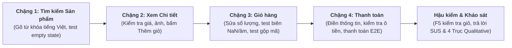
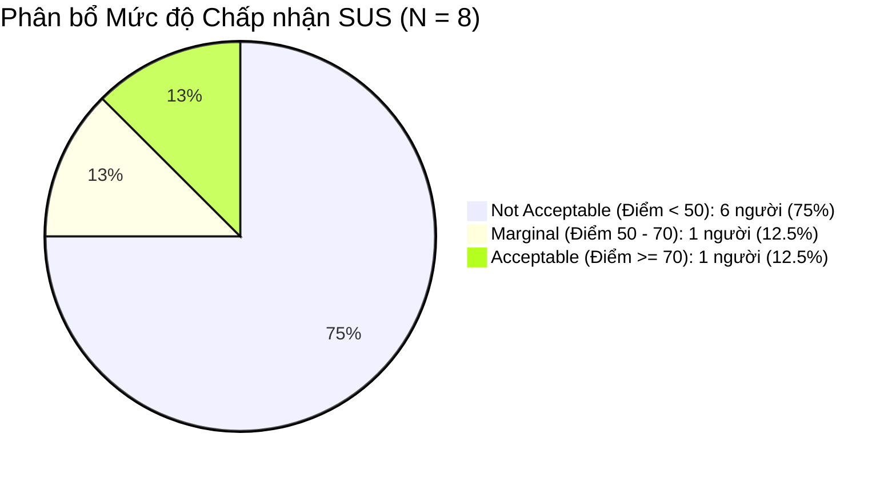
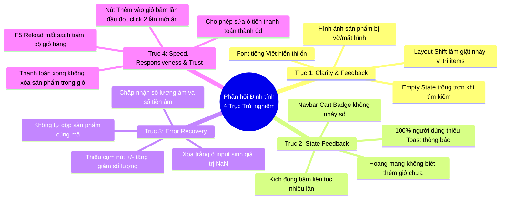

# Hồ Sơ Bằng Chứng Kiểm Thử Trải Nghiệm Người Dùng (Usability Session Evidence)
## Môn học: Kiểm thử Phần mềm — Đề tài: EShop SUT (HW03 — Task 2)
**Hệ thống thực nghiệm**: EShop E-Commerce System  
**Học viên thực hiện**: Trần Ngọc Diễm Thúy — **MSSV**: `23120367`  
**Email sinh viên**: `23120367@student.hcmus.edu.vn`  
**Cỡ mẫu thực nghiệm**: $N = 8$ người dùng thực tế (Vượt chuẩn tối thiểu 7 người theo quy định đề tài)  
**Phương pháp**: Moderated Usability Testing kết hợp Think-Aloud Protocol & Thang đo Chuẩn hóa SUS (System Usability Scale)

---

## 1. Liên Kết Thu Thập Dữ Liệu Khảo Sát Thực Nghiệm (Online Survey Instruments)

Toàn bộ dữ liệu định lượng và định tính được thu thập trực tiếp và minh bạch qua biểu mẫu Google Form và bảng tính Google Sheets trực tuyến:

- 📝 **Biểu mẫu khảo sát người dùng thực tế (Google Form)**:  
  [https://docs.google.com/forms/d/e/1FAIpQLSeHrBkrcxdLWjAc6JHq-24me8-5NaljkZyCNHYJYdq_MRxN6A/viewform](https://docs.google.com/forms/d/e/1FAIpQLSeHrBkrcxdLWjAc6JHq-24me8-5NaljkZyCNHYJYdq_MRxN6A/viewform)
- 📊 **Bảng dữ liệu phản hồi khảo sát gốc trực tuyến (Google Sheets)**:  
  [https://docs.google.com/spreadsheets/d/1nSYYvo6tOrltxSdoChTR1D403YjWw_7VKamyNYWDrOE/edit?resourcekey=&gid=1393865147#gid=1393865147](https://docs.google.com/spreadsheets/d/1nSYYvo6tOrltxSdoChTR1D403YjWw_7VKamyNYWDrOE/edit?resourcekey=&gid=1393865147#gid=1393865147)
- 🐍 **Script Python tính toán & kiểm chứng điểm SUS tự động**:  
  Tập tin mã nguồn độc lập [[calculate_sus.py](calculate_sus.py)] nằm ngay trong thư mục này.

---

## 2. Kịch Bản & Quy Trình Kiểm Thử Đầu-Cuối (Test Protocol & Task Scenario)

### 2.1. Mục tiêu & Nguyên tắc Điều phối
- **Mục tiêu**: Đánh giá khả năng tìm kiếm sản phẩm, độ trực quan khi thêm vào giỏ, độ an toàn khi chỉnh sửa giỏ hàng và mức độ tin cậy trong quy trình thanh toán trên hệ thống EShop.
- **Phương pháp**: Người điều phối (Moderator) đóng vai trò quan sát trung lập, không can thiệp hay gợi ý thao tác. Người tham gia được hướng dẫn áp dụng kỹ thuật **Think-Aloud** (nói to mọi suy nghĩ, cảm xúc, phân vân và bối rối trong quá trình thao tác). Toàn bộ màn hình và âm thanh đều được ghi hình làm minh chứng.

### 2.2. Kịch bản Nhiệm vụ Chi tiết (Task Scenario)
Mỗi người tham gia hoàn thành kịch bản tác vụ mua sắm mục tiêu (*Goal-Oriented Task Scenario*):
1. **Chặng 1 — Tìm kiếm & Lọc sản phẩm (`FR-05`)**:
   - Truy cập trang chủ EShop.
   - Thử tìm kiếm một sản phẩm bằng từ khóa tiếng Việt có dấu (ví dụ: *"Áo"*).
   - Thử gõ một từ khóa không tồn tại để kiểm tra thông báo kết quả rỗng (Empty State).
2. **Chặng 2 — Xem chi tiết & Thêm vào giỏ hàng (`FR-05` $\rightarrow$ Product Detail)**:
   - Nhấp vào một sản phẩm mong muốn để xem trang chi tiết.
   - Quan sát hình ảnh, tiêu đề, giá bán (ký hiệu tiền tệ `₫` / `VND`).
   - Nhấp nút *"Thêm vào giỏ hàng"* (ghi nhận thời gian phản hồi, trạng thái nút, phản hồi toast).
3. **Chặng 3 — Quản lý & Chỉnh sửa giỏ hàng (`FR-07`)**:
   - Chuyển sang trang Giỏ hàng từ thanh điều hướng (Navbar).
   - Thử tăng/giảm số lượng món hàng trực tiếp trong bảng.
   - Thử các giá trị biên: nhập số lượng 0, nhập số âm, dùng phím Backspace xóa trắng ô số lượng.
   - Quay lại trang chủ và thêm tiếp cùng sản phẩm đó để kiểm tra cơ chế tự động gộp số lượng.
4. **Chặng 4 — Thanh toán & Nghiệm thu sau mua (`FR-07` $\rightarrow$ Checkout)**:
   - Nhấp nút tiến hành thanh toán đơn hàng.
   - Nhập thông tin nhận hàng và kiểm tra ô số tiền thanh toán (thử kiểm tra khả năng chỉnh sửa số tiền).
   - Bấm nút xác nhận thanh toán thành công.
   - Kiểm tra lại giỏ hàng sau khi mua thành công và thử tải lại trang (F5/Reload).
5. **Hậu kiểm**: Điền biểu mẫu 10 câu hỏi chuẩn SUS và trả lời 4 nhóm câu hỏi phỏng vấn định tính chuyên sâu.

---

## 3. Bảng Danh Sách 8 Người Tham Gia & Video Minh Chứng (Participants & Video Evidence)

Tuân thủ nghiêm ngặt quy định bảo vệ dữ liệu cá nhân (**PII Masking**), 4 số điện thoại ở giữa của người tham gia đã được che bớt theo định dạng `036****234`, bảo toàn nguyên vẹn họ tên, nghề nghiệp, môi trường thiết bị và liên kết video Google Drive mở công khai:

| Mã NTG | Họ và tên Người tham gia | Số Điện thoại (PII Masked) | Nghề nghiệp / Lĩnh vực | Thiết bị & Trình duyệt Thử nghiệm | Video Minh chứng Thực tế (Google Drive) |
|:---:|---|:---:|---|:---:|:---:|
| **P01** | Ngô Thị Ngọc Lan | `036****234` | Sinh viên | PC Windows 11 — Chrome Desktop | [Xem Video P01](https://drive.google.com/open?id=1gMQcudQoSuvUuPcXTISXju_biqacMbrA) |
| **P02** | Huỳnh Lê Minh Triết | `038****024` | Sinh viên | PC Windows 11 — Chrome Desktop | [Xem Video P02](https://drive.google.com/open?id=13tgJ9UN6rFzniSGhWpRIosvCgZhFZh58) |
| **P03** | Nguyễn Ngọc Nhân Trọng | `096****717` | Sinh viên | PC Windows 11 — Chrome Desktop | [Xem Video P03](https://drive.google.com/open?id=14yzwdgDrjPa7TuTvJFCltnsDE6ApTvox) |
| **P04** | Lê Tấn Lộc | `033****018` | Sinh viên | PC Windows 11 — Chrome Desktop | [Xem Video P04](https://drive.google.com/open?id=1G37HEs-McgTB3HvFp6Ug7yU1YoWXF1Z7) |
| **P05** | Lê Nguyễn Bảo Thi | `090****449` | Sinh viên | PC Windows 11 — Chrome Desktop | [Xem Video P05](https://drive.google.com/open?id=14QWjas1y9Hy-FbFkoWLOgEpW5S2szJUi) |
| **P06** | Hồ Lê Uyên Như | `036****433` | Sinh viên | PC Windows 11 — Chrome Desktop | [Xem Video P06](https://drive.google.com/open?id=1P2yP0EUMl39dK4fYtURg9BvRhO-Vu5iM) |
| **P07** | Nguyễn Trà My | `094****437` | Hệ thống thông tin | PC Windows 11 — Chrome Desktop | [Xem Video P07](https://drive.google.com/open?id=1Y89xqSX0VOR1UOLXmAPaxbzEWsdkrGI5) |
| **P08** | Cao Thị Tú Vi | `076****005` | Sinh viên | PC Windows 11 — Chrome Desktop | [Xem Video P08](https://drive.google.com/open?id=1KlY-Nr0S4wTff3lNvNkDJg4qxq-cqAk6) |

---

## 4. Dữ Liệu Định Lượng & Bảng Điểm Thang Đo SUS (Quantitative SUS Analysis)

### 4.1. Quy tắc Tính Điểm SUS Chuẩn (Brooke, 1996)
- **Câu hỏi lẻ (Q1, Q3, Q5, Q7, Q9 — Tích cực)**: Điểm quy đổi = $\text{Điểm gốc} - 1$
- **Câu hỏi chẵn (Q2, Q4, Q6, Q8, Q10 — Tiêu cực)**: Điểm quy đổi = $5 - \text{Điểm gốc}$
- **Điểm SUS Cá nhân**: $\text{SUS} = \left(\sum_{i=1}^{10} \text{Điểm quy đổi}_i\right) \times 2.5$

### 4.2. Bảng Điểm Chi tiết 10 Câu hỏi SUS của 8 Người Dùng ($N = 8$)

| Mã NTG | Họ và tên Người tham gia | Q1 | Q2 | Q3 | Q4 | Q5 | Q6 | Q7 | Q8 | Q9 | Q10 | Tổng Điểm Quy Đổi | Điểm SUS (/100) | Xếp loại Grade (Sauro & Lewis) | Thang Tính từ (Bangor et al.) | Mức độ Chấp nhận (Acceptability) |
|:---:|---|:---:|:---:|:---:|:---:|:---:|:---:|:---:|:---:|:---:|:---:|:---:|:---:|:---:|:---:|:---:|
| **P01** | Ngô Thị Ngọc Lan | 2 | 2 | 2 | 2 | 2 | 4 | 2 | 4 | 2 | 2 | 16 / 40 | **40.0** | **Grade F** | Poor | Not Acceptable |
| **P02** | Huỳnh Lê Minh Triết | 2 | 2 | 2 | 4 | 2 | 4 | 2 | 5 | 2 | 4 | 11 / 40 | **27.5** | **Grade F** | Awful / Worst | Not Acceptable |
| **P03** | Nguyễn Ngọc Nhân Trọng | 1 | 3 | 2 | 2 | 1 | 2 | 3 | 2 | 2 | 4 | 16 / 40 | **40.0** | **Grade F** | Poor | Not Acceptable |
| **P04** | Lê Tấn Lộc | 3 | 2 | 3 | 3 | 2 | 4 | 3 | 2 | 2 | 3 | 19 / 40 | **47.5** | **Grade F** | Poor | Not Acceptable |
| **P05** | Lê Nguyễn Bảo Thi | 2 | 4 | 2 | 3 | 2 | 2 | 3 | 3 | 2 | 2 | 17 / 40 | **42.5** | **Grade F** | Poor | Not Acceptable |
| **P06** | Hồ Lê Uyên Như | 1 | 2 | 2 | 3 | 1 | 4 | 2 | 5 | 2 | 3 | 11 / 40 | **27.5** | **Grade F** | Awful / Worst | Not Acceptable |
| **P07** | Nguyễn Trà My | 2 | 1 | 5 | 1 | 5 | 4 | 4 | 2 | 5 | 1 | 32 / 40 | **80.0** | **Grade A- / B+** | Good | Acceptable |
| **P08** | Cao Thị Tú Vi | 3 | 2 | 4 | 2 | 3 | 4 | 3 | 4 | 2 | 3 | 20 / 40 | **50.0** | **Grade F** | Poor | Marginal |

*Nội dung 10 câu hỏi SUS tiêu chuẩn:*  
- **Q1**: Tôi nghĩ rằng mình sẽ thích sử dụng hệ thống này thường xuyên.  
- **Q2**: Tôi thấy hệ thống này phức tạp không cần thiết.  
- **Q3**: Tôi thấy hệ thống này dễ sử dụng.  
- **Q4**: Tôi nghĩ rằng mình sẽ cần sự hỗ trợ của một chuyên gia kỹ thuật để có thể sử dụng hệ thống.  
- **Q5**: Tôi thấy các chức năng khác nhau trong hệ thống này được tích hợp rất tốt.  
- **Q6**: Tôi nghĩ rằng có quá nhiều điều thiếu nhất quán trong hệ thống này.  
- **Q7**: Tôi tưởng tượng rằng hầu hết mọi người sẽ học cách sử dụng hệ thống này rất nhanh.  
- **Q8**: Tôi thấy hệ thống này rất cồng kềnh, bất tiện khi sử dụng.  
- **Q9**: Tôi cảm thấy rất tự tin và an tâm khi sử dụng hệ thống.  
- **Q10**: Tôi cần phải học rất nhiều điều trước khi có thể sử dụng hệ thống này một cách thành thạo.

### 4.3. Bảng Thống Kê Tổng Hợp Toàn Nhóm ($N = 8$)

| Chỉ số Thống kê | Giá trị Tính toán Thực tế | Chuẩn Ngành (Benchmark) | Đánh giá Chuyên môn & Ý nghĩa Thực tiễn |
|---|:---:|:---:|---|
| **Cỡ mẫu ($N$)** | **8** người dùng | $N \ge 5$ (Nielsen Norman Group) | Đủ điều kiện phát hiện $>85\%$ vấn đề nghiêm trọng về trải nghiệm người dùng. |
| **Điểm Trung bình (Mean)** | **44.38** | **68.00** (Sauro, 2011) | **Thấp hơn chuẩn ngành tới -23.62 điểm** (Báo động đỏ về khả năng sử dụng). |
| **Độ lệch chuẩn mẫu (Sample SD, $s$)** | **16.57** | $s \approx 10.0 - 12.0$ | Độ biến thiên rất cao do sự phân hóa giữa P07 và nhóm còn lại. |
| **Độ lệch chuẩn tổng thể (Pop SD, $\sigma$)** | **15.50** | — | Mức phân tán nội tại của 8 đối tượng tham gia. |
| **Trung vị (Median)** | **41.25** | $\ge 68.00$ | $50\%$ người tham gia đánh giá điểm số dưới 41.25. |
| **Điểm thấp nhất (Min)** | **27.50** (P02, P06) | — | Rơi vào vùng điểm tồi tệ nhất (Awful / Worst Imaginable). |
| **Điểm cao nhất (Max)** | **80.00** (P07) | — | Trường hợp ngoại lệ tích cực (Grade A- / Good). |
| **Khoảng tứ phân vị (IQR)** | **15.00** | $Q_1 = 33.75; Q_3 = 48.75$ | $50\%$ vùng trung tâm tập trung quanh ngưỡng 33.75 – 48.75. |
| **Xếp loại Học thuật (Curved Grade)** | **Grade F** | Grade C ($\ge 68.0$) | Sauro & Lewis (2016); Percentile Rank $\approx 9\%$ (Rất thấp). |
| **Thang Tính từ (Adjective Rating)** | **"Poor"** | "Good" / "Excellent" | Thang Bangor, Kortum & Miller (2009). |
| **Mức độ Chấp nhận (Acceptability)** | **Not Acceptable** | Acceptable ($>70$) | Hệ thống chưa đủ điều kiện phát hành thương mại. |

### 4.4. Phân Tích Chuyên Sâu: Tại Sao Điểm SUS Lại Thấp & Nghịch Lý Ngoại Lệ P07
1. **Sự sụp đổ niềm tin giao dịch ở nhóm người dùng phổ thông (P01–P06, P08 — $87.5\%$ cỡ mẫu)**:
   - Toàn bộ 7 người này đều chấm điểm SUS rất thấp ($27.5$ đến $50.0$).
   - **Chỉ số tự tin & an tâm (Câu Q9) chạm đáy**: Có tới 7/8 người dùng đánh giá câu Q9 ở mức **2/5 điểm**. Trong thương mại điện tử, việc giỏ hàng bị hỏng (sinh số `NaN`, số âm, F5 mất hàng) tác động trực tiếp và tiêu cực nhất đến tâm lý người mua hàng.
2. **Giải mã trường hợp ngoại lệ P07 (Nguyễn Trà My — $80.0$ điểm, Grade A-)**:
   - P07 công tác trong ngành **Hệ thống thông tin (Information Systems)**. Người làm kỹ thuật có tư duy xem xét hệ thống theo khả năng hoàn tất tác vụ ("Task Completion") thay vì sự mượt mà cảm xúc. P07 tự tin xử lý được nên chấm Q3=5, Q4=1, Q5=5, Q10=1.
   - Tuy nhiên, trong phần phỏng vấn mở, chính P07 phản ánh đầy đủ các lỗi kỹ thuật: *nút thêm giỏ bấm lần 2 mới ăn, không gộp mã trùng, không có nút sửa số lượng, giá trị rỗng gán là `NaN`*. Điều này khẳng định quy tắc UX vàng: **Không lấy góc nhìn của kỹ sư CNTT để làm thước đo cho người dùng đại chúng.**

---

## 5. Dữ Liệu Định Tính Chi Tiết Theo 4 Trục Trải Nghiệm (Qualitative Probe Synthesis)

Toàn bộ phản hồi được trích dẫn nguyên văn từ dữ liệu khảo sát Google Sheets của 8 người dùng:

### Trục 1 — Clarity & Visual Layout (Độ rõ ràng, Bố cục & Trình bày)
- **Điểm sáng**: Font tiếng Việt hiển thị có dấu, không lỗi font UTF-8.
- **Trích dẫn lỗi thực tế từ người dùng**:
  - **P04 (Dịch chuyển bố cục Layout Shift)**: *"Có, giao diện bị đẩy lên xuống các items gây khó chịu cho người dùng."*
  - **P08 (Vỡ ảnh sản phẩm)**: *"Bị mất hình."*
  - **P02 (Thiếu Empty State)**: *"Khi tìm kiếm một họ sản phẩm, không có nút nào để quay lại trang toàn bộ sản phẩm. Khi tìm kiếm sai tên chỉ 1 ký tự thì không tìm thấy được sản phẩm."*
  - **P05 (Empty State trống trơn)**: *"Khi tìm sản phẩm không có trong trang, kết quả trả về không có dòng thông báo/icon cho biết sản phẩm không tồn tại, chỉ có giao diện trống trơn."*
  - **P06 (Không thân thiện)**: *"Giao diện không thân thiện. Khi tìm kiếm sản phẩm không có trên web thì chỉ hiện text bình thường, không có những thông báo thân thiện cho người dùng."*

### Trục 2 — State Feedback (Phản hồi Trạng thái Thêm vào Giỏ hàng)
- **Tần suất ghi nhận: 8 / 8 người dùng (100%) đều gặp trở ngại nghiêm trọng.**  
- Khi nhấp "Thêm vào giỏ hàng", giao diện hoàn toàn bất động, không có Toast, không có animation, Navbar không nhảy số lượng.
- **Trích dẫn nguyên văn từ 8 người dùng**:
  - **P01**: *"Web không có thông báo thêm vào giỏ hàng. Icon giỏ hàng cũng không có hiện số lượng hiện có, phải vào giỏ hàng xem mới biết được."*
  - **P02**: *"Khi bấm Thêm giỏ hàng, trang web không có thông báo gì đến người dùng làm tôi không biết là đã thêm thành công chưa."*
  - **P03**: *"Khi nhấn nút thêm vào giỏ không hiện thông báo làm cho tôi phân vân là đã thêm được thành công chưa."*
  - **P04**: *"Không có animation nào cho việc thêm items vào giỏ hàng khiến người dùng bấm nhiều lần."*
  - **P05**: *"Click lần đầu không phản hồi, click lần hai mới thêm vào giỏ thành công. Chỗ giỏ hàng không hiện icon cho biết hiện giỏ đang có bao nhiêu món hàng."*
  - **P06**: *"Không có thông báo thêm vào giỏ hàng thành công, giỏ hàng cũng không có icon."*
  - **P07**: *"Nút thêm vào giỏ hàng click lần thứ 2 mới được."*
  - **P08**: *"Không có thông báo rõ ràng, khiến tôi cảm thấy phân vân không biết đã thêm thành công chưa."*

### Trục 3 — Error Recovery & Data Integrity (Khả năng Phục hồi Lỗi & Toàn vẹn Dữ liệu)
- **Trích dẫn nguyên văn từ 8 người dùng**:
  - **P01**: *"Trong màn hình giỏ hàng, không có button để tăng/giảm số lượng sản phẩm. Đối với cùng 1 loại sản phẩm, khi thêm vào giỏ hàng nhiều lần, hệ thống cũng không gộp số lượng của sản phẩm này lại. Khi giá trị của ô input không hợp lệ, hệ thống không báo lỗi gì hết, vẫn thêm sản phẩm vào giỏ với cột số lượng gán là 'NaN'."*
  - **P02**: *"Hệ thống hiện tại không cho đổi số lượng của sản phẩm trong giỏ hàng."*
  - **P03**: *"Số lượng không đổi được, nếu để số lượng 0 vẫn vào giỏ hàng, lúc gõ phím số không báo lỗi hay bị đơ."*
  - **P04**: *"Không có nút thay đổi số lượng items trong giỏ hàng, mỗi items bị lặp lại trong giỏ hàng."*
  - **P05**: *"Không thể thay đổi trực tiếp trong giao diện giỏ hàng. Muốn thay đổi phải lặp lại thao tác thêm vào giỏ hàng, điều chỉnh số lượng ở thao tác này. Bên cạnh đó, hệ thống cũng chấp nhận khi người dùng nhập giá trị âm và thanh toán số tiền âm."*
  - **P06**: *"Không thể thay đổi số lượng trực tiếp trong giỏ hàng. Không báo lỗi, cho phép nhập số lượng không hợp lý và vẫn xuất ra số tiền."*
  - **P07**: *"Giỏ hàng không cho phép gộp số lượng các sản phẩm cùng mã, không có nút điều chỉnh số lượng ở giỏ hàng. Khi giá trị của ô input không hợp lệ, hệ thống không báo lỗi gì hết, vẫn thêm sản phẩm vào giỏ với cột số lượng gán là 'NaN'."*
  - **P08**: *"Tôi thay đổi số lượng thì tổng tiền tự động tính lại. Nhưng lỡ tay xóa trắng ô số lượng hoặc gõ phím số, hệ thống không báo lỗi gì... Khi xóa số lượng món hàng, hệ thống không báo lỗi gì hết, vẫn thêm sản phẩm vào giỏ với cột số lượng gán là 'NaN' $\rightarrow$ Tổng tiền trở thành 'NaN' và vẫn tiến hành thanh toán được thành công."*

### Trục 4 — Speed, Responsiveness & Trust (Tốc độ, An toàn & Lòng tin Giao dịch)
- **Trích dẫn nguyên văn từ 8 người dùng**:
  - **P01**: *"Nút 'Thêm vào giỏ hàng' bấm lần đầu không phản hồi, đến lần thứ 2 mới được."*
  - **P02**: *"Thêm vào giỏ hàng ở trang xem chi tiết sản phẩm phải click 2 lần. Số lượng đơn hàng có thể chỉnh tùy ý, kể cả âm và số lẻ đều ghi nhận thành công và thành tiền cũng âm, số lượng là số lẻ thì được làm tròn xuống. Phần thanh toán có thể chỉnh tùy ý số tiền (không thể chỉnh thành âm), nhưng có thể chỉnh thành 0đ và vẫn thanh toán thành công. Thanh toán thành công nhưng sản phẩm vẫn tồn tại trong giỏ hàng. Thanh toán thành công với đơn hàng âm tiền. Không cho gộp sản phẩm cùng mã trong đơn hàng."*
  - **P03**: *"Trong thông tin của tôi chưa có địa chỉ nhưng vẫn đặt hàng thành công. Nút thêm vào giỏ hàng phải nhấn 2 lần mới được thêm vào, lúc thêm số lượng 0 vẫn thêm vào được giỏ hàng."*
  - **P04**: *"Nút thêm vào giỏ hàng ở trang items detail phải bấm 2 lần mới phản hồi. 1. F5 giỏ hàng bị trống không còn items; 2. Số lượng items thêm vào giỏ hàng có thể bị âm; 3. Số tiền thanh toán có thể sửa được; 4. Trang web không có HTTPS."*
  - **P05**: *"Nút thêm vào giỏ hàng click vào lần đầu không phản hồi, click lần hai mới phản hồi. Khi thanh toán, nếu số lượng món hàng nhập số âm thì tổng tiền cũng âm. Đã thanh toán nhưng trong giỏ hàng vẫn còn hiện sản phẩm vừa thanh toán. Hai sản phẩm thêm vào giỏ hàng giống nhau nhưng không gộp số lượng. Sau khi reload trang thì giỏ hàng trống trơn, các sản phẩm đã thêm vào giỏ trước đó mất tiêu hết."*
  - **P06**: *"Nút thêm giỏ hàng bấm 1 lần không phản hồi, tới lần thứ 2 mới chuyển trạng thái sang 'đã thêm'. Khi tìm kiếm sản phẩm không có trên web rồi bấm nút home 'EShop' thì không quay về trang chủ. Có thể sửa được số tiền thanh toán. Thanh toán thành công nhưng sản phẩm vẫn còn trong giỏ hàng. Khi reload trang giỏ hàng thì các sản phẩm trong giỏ hàng bị mất."*
  - **P07**: *"Nút thêm vào giỏ hàng click lần thứ 2 mới được."*
  - **P08**: *"Nút thêm vào giỏ hàng bấm không phản hồi, phải bấm 2 lần mới phản hồi. Chỗ 'đăng nhập' nhưng lại hiển thị là 'Đăng ký'. Giỏ hàng không gộp số lượng các sản phẩm cùng mã khi bấm thêm giỏ 2 lần khác nhau. Không có nút điều chỉnh số lượng sản phẩm ở giỏ hàng. Khi chọn số lượng món hàng âm thì số tiền cũng tính âm $\rightarrow$ dẫn đến sai số tiền thanh toán. Khi xóa số lượng món hàng, hệ thống không báo lỗi gì hết, vẫn thêm sản phẩm vào giỏ với cột số lượng gán là 'NaN' $\rightarrow$ Tổng tiền trở thành 'NaN' và vẫn tiến hành thanh toán được thành công. Đã thanh toán thành công nhưng giỏ hàng vẫn không xóa món hàng đã mua đó."*

---

## 6. Danh Mục 7 Lỗi Usability Trọng Yếu Phát Hiện Qua Khảo Sát (`BUG-U01` đến `BUG-U07`)

| Mã Khiếm khuyết | Tên Lỗi & Hành vi Bất thường | Mức độ Nghiêm trọng | Tần suất Ghi nhận ($N=8$) | Ánh xạ Checklist Task 1 / Bug Report ID | Tác động Trực tiếp đến Trải nghiệm Khách hàng (UX Impact) |
|:---:|---|:---:|:---:|---|---|
| **`BUG-U01`** | **Nút "Thêm vào giỏ" trang chi tiết bấm lần đầu đơ, click 2 lần mới nhận** | **S2 — Major** (P1 - High) | **8 / 8** (100%) | Liên kết `GUI-070` (USR-STATE-DEBOUNCE) & `GUI-026` / `BUG-GUI-026` | Gây cảm giác ứng dụng bị đơ, giật lag; kích động người dùng bấm dồn dập (click spamming) làm phát sinh nhiều sự kiện thừa. |
| **`BUG-U02`** | **Thiếu hoàn toàn Toast thông báo & Badge giỏ hàng không cập nhật** | **S2 — Major** (P1 - High) | **8 / 8** (100%) | Khớp chính xác `GUI-031` / `BUG-GUI-031` và `GUI-025` / `BUG-GUI-025` | Vi phạm Heuristic #1; người dùng hoang mang không biết sản phẩm đã vào giỏ chưa, buộc phải rời màn hình để vào giỏ kiểm tra. |
| **`BUG-U03`** | **Không thể sửa số lượng trong giỏ hàng & Không tự động gộp mã hàng** | **S2 — Major** (P1 - High) | **8 / 8** (100%) | Khớp chính xác `GUI-036` / `BUG-GUI-036`, `GUI-037` / `BUG-GUI-037`, `GUI-043` / `BUG-GUI-043` | Tước đoạt quyền tự do kiểm soát của người dùng; mỗi lần mua thêm lại tạo ra một dòng rác riêng lẻ làm rối loạn bảng giỏ hàng. |
| **`BUG-U04`** | **Cho phép nhập số lượng âm, số 0 hoặc xóa trắng sinh giá trị `NaN`** | **S1 — Blocker** (P0 - Critical) | **6 / 8** (75%) | Khớp chính xác `GUI-068` (Mục con người phản biện) & `GUI-038` / `BUG-GUI-038` | Giá trị `NaN` lan truyền làm hỏng toàn bộ phép tính tổng tiền; nhập số âm làm trừ tiền vô lý nhưng vẫn thanh toán thành công. |
| **`BUG-U05`** | **Cho phép tùy ý gõ sửa số tiền thanh toán thành 0đ hoặc số tiền bất kỳ** | **S1 — Blocker** (P0 - Critical) | **4 / 8** (50%) | **Lỗi mới phát hiện tại Luồng E2E Checkout** *(Task 1 chỉ test từng màn hình riêng lẻ)* | Lỗ hổng nghiệp vụ & an ninh cực kỳ nghiêm trọng; khách hàng có thể mua hàng miễn phí hoặc trục lợi tài chính từ hệ thống. |
| **`BUG-U06`** | **Thanh toán thành công nhưng sản phẩm vẫn nằm nguyên trong giỏ hàng** | **S2 — Major** (P1 - High) | **5 / 8** (62.5%) | **Lỗi mới phát hiện tại Luồng E2E Checkout** *(Vòng đời trạng thái đơn hàng)* | Phá vỡ tính logic nghiệp vụ; khách hàng bối rối tưởng đơn hàng bị lỗi và có nguy cơ tiến hành thanh toán trùng lặp. |
| **`BUG-U07`** | **Tải lại trang (F5/Reload) làm mất sạch toàn bộ giỏ hàng** | **S2 — Major** (P1 - High) | **3 / 8** (37.5%) | Liên kết `GUI-046` (Trạng thái Empty Cart) & Khía cạnh IA-04 (State Management) | Phá hủy toàn bộ công sức lựa chọn hàng hóa của khách hàng; gây ức chế tột độ và dẫn đến việc bỏ dở giao dịch (Cart Abandonment). |

---

## 7. Đề Xuất Giải Pháp Cải Tiến Kỹ Thuật & Thiết Kế (Actionable UX Recommendations)

1. **Phản hồi Trạng thái & Vi tương tác (State Feedback)**:
   - Tích hợp Toast notification hiện đại (`sonner` hoặc `react-hot-toast`), tự động báo *"Đã thêm [Tên sản phẩm] vào giỏ hàng thành công!"*.
   - Quản lý Badge giỏ hàng qua global state (Redux/Zustand), tự động cập nhật số lượng và hiệu ứng bounce nhẹ khi có món hàng mới.
   - Sửa sự kiện `onClick`, thêm trạng thái `isSubmitting` và debounce nút bấm trong 300ms để triệt tiêu lỗi click lần đầu bị đơ.
2. **Kiểm soát Nhập liệu Giỏ hàng An toàn (Cart Controls & Sanitization)**:
   - Bổ sung cụm nút tăng/giảm `[-] [Qty] [+]` kích thước $\ge 44 \times 44\text{px}$ trực tiếp trên từng dòng giỏ hàng.
   - Tự động gộp số lượng khi thêm sản phẩm trùng mã (`item.quantity += addedQuantity`).
   - Xử lý sự kiện `onBlur`: Nếu người dùng xóa trắng bằng Backspace hoặc nhập giá trị không hợp lệ (`NaN`, $\le 0$), tự động phục hồi về số lượng tối thiểu là 1.
3. **An toàn Giao dịch & Bảo mật Thanh toán (Checkout Security)**:
   - Đóng băng hoàn toàn ô số tiền thanh toán (`readOnly={true} tabIndex={-1}`), không cho phép client tự gõ sửa giá tiền.
   - Tính toán và xác thực giá tiền tuyệt đối tại Server-side Backend dựa trên giá niêm yết trong cơ sở dữ liệu.
   - Bắt buộc kiểm tra hợp lệ thông tin Địa chỉ nhận hàng và Số điện thoại trước khi cho phép đặt hàng.
4. **Bền vững hóa Trạng thái Phiên (Session Persistence)**:
   - Lưu trữ giỏ hàng vào `localStorage` cho khách vãng lai và đồng bộ cơ sở dữ liệu cho người dùng đăng nhập. F5 không làm mất giỏ hàng.
   - Dispatch hàm `clearCart()` dọn sạch giỏ hàng ngay khi nhận phản hồi đặt hàng thành công từ API, sau đó chuyển hướng sang trang Order Success.

---
