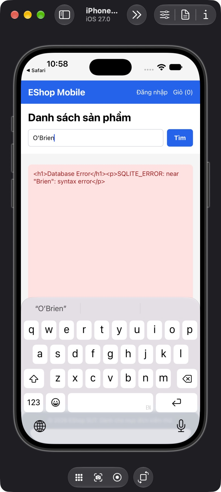
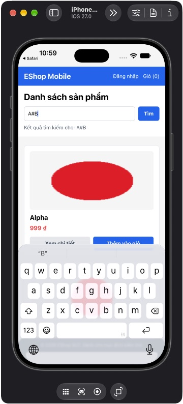
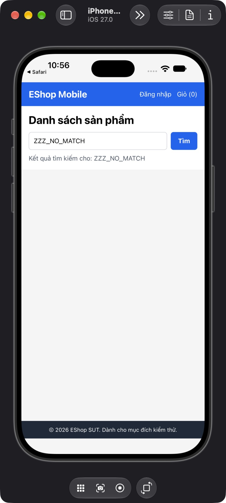
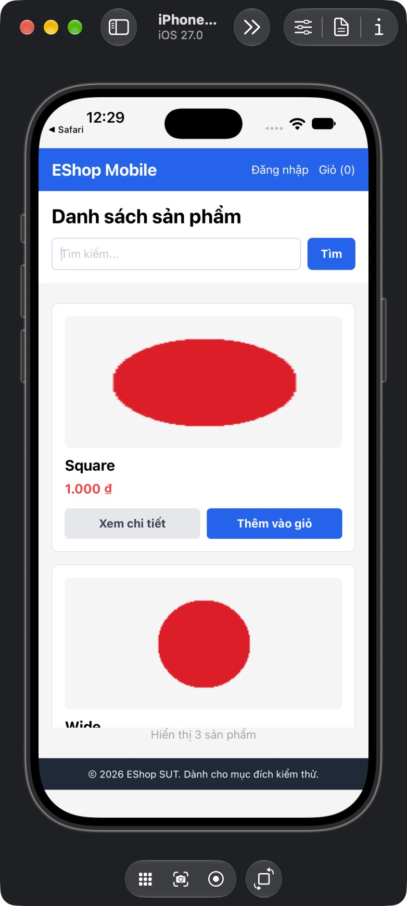
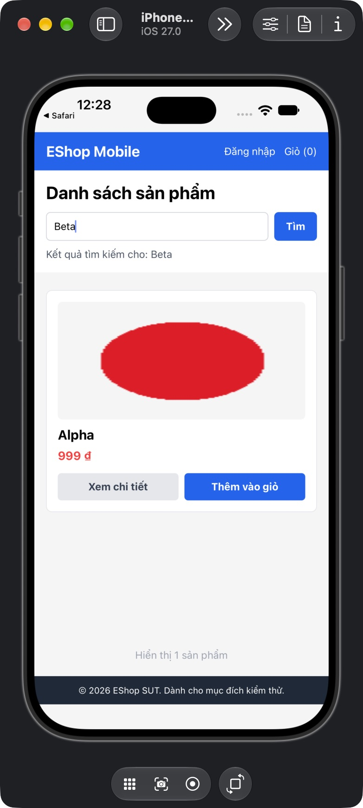

# FR-05 Mobile: Bug reports và suspected discrepancies

## Phân loại

Có **4 confirmed specification defects** (BUG001-004) và **1 observed discrepancy với derived timing oracle** (BUG005). Có thêm 2 suspected/ambiguous items, không tính confirmed bugs. Tất cả chưa publish GitHub Issues vì user chưa yêu cầu publish. Không sửa SUT.

Environment chung: run `fr05-run01`, iPhone18 Pro/iOS27.0, Expo Go54.0.7 + app SDK54, backend Express/SQLite copy từ Git SHA trong [manifest](evidence/fr05-run01/manifest.json). [Endpoint adjustment](evidence/fr05-run01/environment-adjustment.diff) chỉ ở bản mobile copy; working database/source preserved. Reset fixtures qua [runbook](../../../tests/fr05/native-runbook.md); không start backend working tree. Raw timing/request/response ở [requests.jsonl](evidence/fr05-run01/requests.jsonl), UTC có Z, chuyển +07:00 khi đọc giờ địa phương.

## FR05-BUG-001: Search tên chứa apostrophe trả Database Error

- Rule/oracle: FR05-R05, README dòng77; full-name search phải tìm được tên hiện có.
- Severity: **Major**; tên hợp lệ không tìm được và UI lộ lỗi database.
- Fixture: `full`, ID105 name `O'Brien`, giá1000000; network normal.
- Steps: (1) reset full; (2) mở native Home; (3) nhập chính xác `O'Brien`; (4) bấm Tìm. API supporting gửi GET với search URL-encoded.
- Expected: một card O'Brien/1.000.000₫; API200 JSON array ID105.
- Actual: native hiện literal `<h1>Database Error</h1>
SQLITE_ERROR: near "Brien": syntax error
`; API500 cùng body. Không gọi đây là HTML/XSS execution: screenshot thấy markup ở dạng text.
- Reproducibility: quan sát native TC006, API TC039 và HTTP reproduction độc lập; cả ba cho database error. Root cause suspicion từ SQL interpolation chỉ là hỗ trợ, failure dựa raw run.
- Cases: FR05-TC-006,039. Evidence: [native AX](evidence/fr05-run01/native/FR05-TC-006.ax.txt), [API](evidence/fr05-run01/api/FR05-TC-039.json), [HTTP repro](evidence/fr05-run01/api/quote-reproduction.txt).

## FR05-BUG-002: Mobile không bảo toàn reserved characters trong search query

- Rule/oracle: FR05-R05. Tên `A&B`, `A+B`, `A#B` tồn tại, full-name search không được đổi nghĩa input.
- Severity: **Major**; false positive/false negative khi user tìm tên có ký tự URL.
- Fixture: `full`, ID106/107/108; network normal.
- Steps: (1) reset full; (2) nhập từng full name vào native search; (3) bấm Tìm; (4) đối chiếu keyword, card set và proxy raw URL; (5) so API supporting gửi cùng query bằng URLSearchParams.
- Expected: A&B→{106}; A+B→{107}; A#B→{108}.
- Actual: A&B/A#B trả nhiều sản phẩm theo `A`; A+B trả0 card. Raw native requests lần lượt có `?search=A&B`, `?search=A+B`, `?search=A` (# fragment không được gửi). API encoded đúng trả exact IDs tương ứng.
- Reproducibility: mỗi biến thể quan sát một lần native và một lần API encoded trong cùng fixture. Chưa claim repeated native runs hay Android behavior.
- Cases: TC007/008/009; supporting TC040/041/042. Evidence: [A&B AX](evidence/fr05-run01/native/FR05-TC-007.ax.txt), [A+B AX](evidence/fr05-run01/native/FR05-TC-008.ax.txt), [A#B AX](evidence/fr05-run01/native/FR05-TC-009.ax.txt), [API encoded](evidence/fr05-run01/api/FR05-TC-040.json), raw request log chung. Một bug family transport; không kết luận ba independent root causes.

## FR05-BUG-003: Search success rỗng không có empty state

- Rule/oracle: FR05-R08, README dòng79 yêu cầu thông báo khi không có kết quả.
- Severity: **Moderate**; user không phân biệt no-match với vùng dữ liệu chưa render.
- Fixtures: `full` + q=`ZZZ_NO_MATCH` hoặc `DescriptionToken`; `empty` + q=`Alpha`. Reset catalog trước nhóm/snapshot theo runbook.
- Steps: (1) mở Home; (2) nhập q vô nghiệm và Tìm; (3) đợi response200 `[]` hoàn tất; (4) quan sát cả visible area và native AX; (5) với recovery case, đổi q=Alpha và tìm tiếp.
- Expected: không card và có thông báo empty state rõ sau success; loading kết thúc.
- Actual: vùng trống, chỉ còn nhãn keyword/footer, không có empty message. Loading đã kết thúc; API200 `[]` chứng minh đây không phải network error. Query Alpha sau đó có card đúng nên recovery hoạt động.
- Reproducibility: quan sát qua5 native cases, gồm nonempty catalog, empty catalog và pending→empty; không chỉ static-code finding.
- Cases: TC003/004/017/028/033. Evidence: [no-match AX](evidence/fr05-run01/native/FR05-TC-003.ax.txt), [BVA0 AX](evidence/fr05-run01/native/FR05-TC-028.ax.txt), [pending](evidence/fr05-run01/native/FR05-TC-017-pending.ax.txt), [after delay](evidence/fr05-run01/native/FR05-TC-017-after-delay.ax.txt).

## FR05-BUG-004: Ảnh nguồn vuông bị stretch thành hình chữ nhật

- Rule/oracle: FR05-R02, README dòng76 yêu cầu ảnh tỷ lệ chuẩn; test không tự áp card aspect ratio cụ thể mà kiểm image content không biến dạng.
- Severity: **Moderate**; thông tin hình sản phẩm bị méo.
- Fixture: `images`, Square ID301, ảnh [square.png](../../../tests/fr05/fixtures/images/square.png)120×120 có hình tròn đỏ; Wide240×120/Tall120×240 để bổ sung context. Dimensions/checksum ở catalog.json.
- Steps: (1) reset snapshot images; (2) render catalog bằng search rỗng; (3) quan sát card Square; (4) so hình tròn của asset gốc với PNG native. Đây là card-render path, không cold-start riêng.
- Expected: hình tròn vẫn tròn; không cần card phải vuông nếu ảnh được contain/crop hợp lý.
- Actual: hình tròn Square thành ellipse ngang. AX vẫn ghi Square và giá, screenshot chứng minh deformation. Wide thấy một phần; Tall chưa scroll được, không kết luận cả ba đều sai.
- Reproducibility: cùng deformation xuất hiện ở Square fixture TC012 và asset square của Alpha TC002; đây là hai observations của cùng render behavior.
- Case: TC012. Evidence: [native AX](evidence/fr05-run01/native/FR05-TC-012.ax.txt), [asset metadata](../../../tests/fr05/fixtures/catalog.json), PNG dưới đây.

## FR05-BUG-005: Response cũ ghi đè card trong khi keyword vẫn là query mới

- Classification: **Observed discrepancy, derived latest-query consistency oracle**; không gộp vào bốn confirmed explicit defects. R05 gợi ý kết quả phải tương ứng tên đang tìm; specification không nói chi tiết response-race policy.
- Severity đề xuất: **Major** vì user thấy kết quả không tương ứng nhãn; mức đánh giá coursework chờ oracle authority/learner review.
- Fixture: `full`, proxy mode race; Alpha response giữ20s, Beta immediate; proxy không sửa body.
- Steps: (1) reset full/race; (2) native search Alpha; (3) trước Alpha về, đổi q thành Beta rồi Tìm; (4) quan sát Beta về trước; (5) đợi Alpha cũ về; (6) so keyword/label/card và raw timing.
- Expected theo derived oracle: cuối cùng keyword Beta, nhãn Beta, card Beta; response Alpha cũ không làm đổi kết quả query mới.
- Actual: Beta ban đầu có card Beta; sau Alpha về, keyword/label vẫn Beta nhưng card Alpha giá999₫. Không chỉ dựa screenshot cuối để suy thứ tự: log có hai requests và response Beta trước Alpha20s.
- Reproducibility: một controlled native race; chưa generalize mọi network schedules. Không đổi application state qua debugger.
- Case: TC019. Evidence: [Beta first](evidence/fr05-run01/native/FR05-TC-019-beta-first.ax.txt), [final AX](evidence/fr05-run01/native/FR05-TC-019-final.ax.txt), [raw order](evidence/fr05-run01/requests.jsonl).

## Suspected/ambiguous, không tính confirmed bug

1. **Grid/scroll (TC001):** screenshot một cột và AX12 names; chưa có native responsive/column contract, CUA scroll lỗi noWindowsAvailable. Raw failure được sửa thành Blocked trong verdict revision. Không dùng `FlatList` thiếu `numColumns` làm oracle.
2. **Image accessibility (TC013):** ảnh hiện nhưng AX export không có image description. Chưa chứng minh tool export đầy đủ image semantics hay VoiceOver đọc gì; giữ Blocked EVIDENCE_CAPABILITY, chưa báo confirmed missing-alt bug.

Các mục này cần follow-up; không publish như confirmed defect. GitHub issue content/PNG đã có local để người dùng review; chưa gửi ra ngoài.
