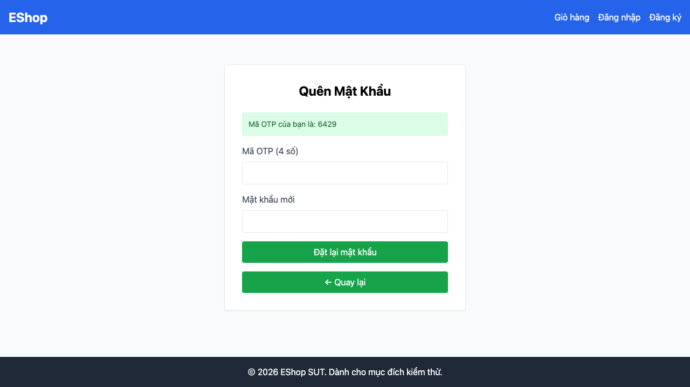

## Mô tả lỗi

| Trường | Nội dung |
|---|---|
| Bug ID | `BUG-FR03-01` |
| Feature / loại lỗi | FR-03; Functional |
| Tầng / interface | API / WEB |
| Rule ID | R02 |
| Severity | High |
| Priority đề xuất | P1 |
| Status / mức xác nhận | Observed — lỗi đã quan sát theo đặc tả |
| Case đại diện | `FR03-DT-001` — Status gốc: Failed |

OTP phát ra không đáp ứng độ dài yêu cầu.

### Tình trạng xác minh

- Nội dung dựa trên evidence lịch sử, chưa retest trên HEAD hiện tại.
- Chưa có bản sửa hoặc tỷ lệ tái hiện mới được xác nhận. Severity/priority là đề xuất triage.

## Môi trường

### Environment / build

API `http://localhost:3000`, customer WEB `http://localhost:5173/forgot-password`; Node v22.17.1 và Playwright Chromium headless theo hồ sơ gốc. SQLite/React/Vite. Chưa có manifest xác nhận build SHA, OS, browser version, viewport và locale của lượt chạy; không gán HEAD hiện tại làm build lịch sử. [API observations](https://github.com/thuytranj/eshop-sut/blob/46f7bbd7d356bc25a94f32d74fcbc4d3383d2663/docs/testing/fr03/evidence/api/observations.json), [WEB observations](https://github.com/thuytranj/eshop-sut/blob/46f7bbd7d356bc25a94f32d74fcbc4d3383d2663/docs/testing/fr03/evidence/web/observations.json).

### Preconditions / fixture

Tài khoản fr03-a@example.com tồn tại, mật khẩu hiện tại OldPass1!

### Test data / inputs

{ "email": "fr03-a@example.com" } gửi tới POST /api/forgot-password

## Steps to reproduce

1. Gửi request HTTP POST tới `/api/forgot-password` với email của tài khoản A.
2. Ghi nhận response code và body.
3. Kiểm tra mã OTP trả về và truy vấn CSDL để xác minh token được gán cho tài khoản A.
4. Xác minh mật khẩu của tài khoản A không bị thay đổi.

## Actual result

API trả OTP 7257; lượt WEB độc lập hiển thị 6429. Cả hai đều có 4 chữ số. Không dùng hai observation để kết luận chất lượng ngẫu nhiên.

HTTP 200; response=`{"message": "Mã đặt lại mật khẩu đã được tạo", "resetToken": "7257"}`
Password trước/sau: A `"OldPass1!"` → `"OldPass1!"`; B `"OldPass1!"` → `"OldPass1!"`

## Expected result

- HTTP Status: 200 OK.
- Body chứa `resetToken` là chuỗi gồm đúng 6 chữ số (`^[0-9]{6}$`).
- CSDL lưu `reset_token` khớp với mã trả về; mật khẩu của tài khoản A vẫn là `OldPass1!`.

### Requirement / test oracle

README FR-03 (và FR-01 cho chính sách mật khẩu); Quy tắc và Expected Result chi tiết trong case đại diện tại [report.md](https://github.com/thuytranj/eshop-sut/blob/46f7bbd7d356bc25a94f32d74fcbc4d3383d2663/docs/testing/report.md); xem [đặc tả nghiệp vụ](https://github.com/thuytranj/eshop-sut/blob/46f7bbd7d356bc25a94f32d74fcbc4d3383d2663/README.md), [API contract](https://github.com/thuytranj/eshop-sut/blob/46f7bbd7d356bc25a94f32d74fcbc4d3383d2663/api_specification.md).

## Evidence

- [observations.json](https://github.com/thuytranj/eshop-sut/blob/46f7bbd7d356bc25a94f32d74fcbc4d3383d2663/docs/testing/fr03/evidence/api/observations.json)
- [FR03-TC-037.png](https://github.com/thuytranj/eshop-sut/blob/46f7bbd7d356bc25a94f32d74fcbc4d3383d2663/docs/testing/fr03/evidence/web/screenshots/FR03-TC-037.png)

### Screenshot đại diện

### Related test cases (ID trong report)

`FR03-DT-001`, `FR03-DT-025`.

### Traceability — ID báo cáo và ID trong evidence

| Report case ID | Execution case ID | Technique |
|---|---|---|
| `FR03-DT-001` | `FR03-TC-001` | DT |
| `FR03-DT-025` | `FR03-TC-037` | DT |
