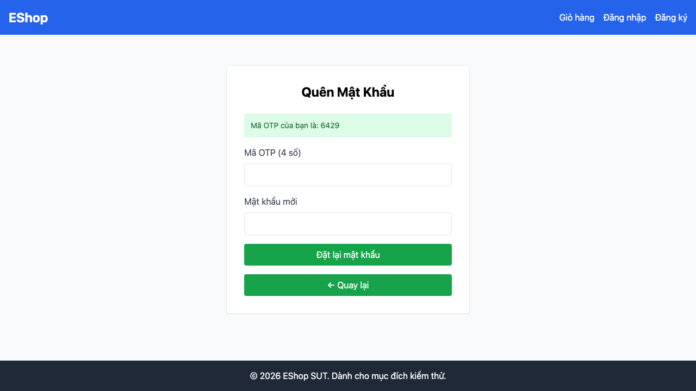

## Mô tả lỗi

| Trường | Nội dung |
|---|---|
| Bug ID | `BUG-FR03-03` |
| Feature / loại lỗi | FR-03; UI |
| Tầng / interface | WEB |
| Rule ID | R03 |
| Severity | Low |
| Priority đề xuất | P3 |
| Status / mức xác nhận | Observed — lỗi đã quan sát theo đặc tả |
| Case đại diện | `FR03-DT-025` — Status gốc: Failed |

Người dùng thiếu thông tin vị trí trong luồng hai bước.

### Tình trạng xác minh

- Nội dung dựa trên evidence lịch sử, chưa retest trên HEAD hiện tại.
- Chưa có bản sửa hoặc tỷ lệ tái hiện mới được xác nhận. Severity/priority là đề xuất triage.

## Môi trường

### Environment / build

API `http://localhost:3000`, customer WEB `http://localhost:5173/forgot-password`; Node v22.17.1 và Playwright Chromium headless theo hồ sơ gốc. SQLite/React/Vite. Chưa có manifest xác nhận build SHA, OS, browser version, viewport và locale của lượt chạy; không gán HEAD hiện tại làm build lịch sử. [API observations](https://github.com/thuytranj/eshop-sut/blob/46f7bbd7d356bc25a94f32d74fcbc4d3383d2663/docs/testing/fr03/evidence/api/observations.json), [WEB observations](https://github.com/thuytranj/eshop-sut/blob/46f7bbd7d356bc25a94f32d74fcbc4d3383d2663/docs/testing/fr03/evidence/web/observations.json).

### Preconditions / fixture

Tài khoản A tồn tại trong hệ thống

### Test data / inputs

`{"email": "fr03-a@example.com"}`

## Steps to reproduce

1. Truy cập /forgot-password, quan sát chỉ báo bước 1, nhập email A, click gửi, quan sát chỉ báo bước 2 và hiển thị OTP demo
2. Lưu dialog/screenshot và request nếu có; phân biệt control vắng mặt với submit bị từ chối.

## Actual result

Giao diện không có chỉ báo bước theo observation/DOM lịch sử.

Giao diện thiếu chỉ báo bước (Step indicator 'Bước 1 / 2' hoặc 'Bước 2 / 2'); Mã OTP demo '6429' có độ dài 4, không đúng 6 chữ số theo R02
[evidence FR03-DT-025](https://github.com/thuytranj/eshop-sut/blob/46f7bbd7d356bc25a94f32d74fcbc4d3383d2663/docs/testing/fr03/evidence/web/observations.json) [ảnh/log chi tiết](https://github.com/thuytranj/eshop-sut/blob/46f7bbd7d356bc25a94f32d74fcbc4d3383d2663/docs/testing/fr03/evidence/web/screenshots/FR03-TC-037.png)

## Expected result

Giao diện hiển thị rõ chỉ báo Bước 1 / 2 sau đó Bước 2 / 2; thông báo OTP demo hiển thị đúng định dạng 6 chữ số

### Requirement / test oracle

README FR-03 (và FR-01 cho chính sách mật khẩu); Quy tắc và Expected Result chi tiết trong case đại diện tại [report.md](https://github.com/thuytranj/eshop-sut/blob/46f7bbd7d356bc25a94f32d74fcbc4d3383d2663/docs/testing/report.md); xem [đặc tả nghiệp vụ](https://github.com/thuytranj/eshop-sut/blob/46f7bbd7d356bc25a94f32d74fcbc4d3383d2663/README.md), [API contract](https://github.com/thuytranj/eshop-sut/blob/46f7bbd7d356bc25a94f32d74fcbc4d3383d2663/api_specification.md).

## Evidence

- [FR03-TC-037.png](https://github.com/thuytranj/eshop-sut/blob/46f7bbd7d356bc25a94f32d74fcbc4d3383d2663/docs/testing/fr03/evidence/web/screenshots/FR03-TC-037.png)

### Screenshot đại diện

### Related test cases (ID trong report)

`FR03-DT-025`.

### Traceability — ID báo cáo và ID trong evidence

| Report case ID | Execution case ID | Technique |
|---|---|---|
| `FR03-DT-025` | `FR03-TC-037` | DT |
