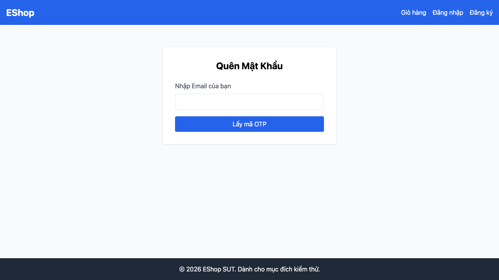

## Mô tả lỗi

| Trường | Nội dung |
|---|---|
| Bug ID | `BUG-FR03-04` |
| Feature / loại lỗi | FR-03; UI / Navigation |
| Tầng / interface | WEB |
| Rule ID | R04 |
| Severity | Medium |
| Priority đề xuất | P2 |
| Status / mức xác nhận | Suspected — chưa đủ bằng chứng xác nhận lỗi |
| Case đại diện | `FR03-DT-026` — Status gốc: Passed |

Có thể thiếu lối quay lại đăng nhập trong form; ảnh hưởng thực tế chưa được xác nhận.

### Tái lập và giới hạn

Case gốc Passed; chưa xác nhận lỗi. Cần probe riêng selector trong form và làm rõ liệu liên kết Đăng nhập chung đã đáp ứng requirement. Không dùng việc thiếu nút trong form để ghi một lỗi đã confirmed.

### Workaround / hướng xử lý

Làm rõ oracle/bằng chứng trước khi quyết định sửa.

### Tình trạng xác minh

- Nội dung dựa trên evidence lịch sử, chưa retest trên HEAD hiện tại.
- Chưa có bản sửa hoặc tỷ lệ tái hiện mới được xác nhận. Severity/priority là đề xuất triage.
- Cần xác nhận oracle hoặc bổ sung bằng chứng trước khi chuyển thành bug confirmed; giữ nguyên verdict test case nguồn.

## Môi trường

### Environment / build

API `http://localhost:3000`, customer WEB `http://localhost:5173/forgot-password`; Node v22.17.1 và Playwright Chromium headless theo hồ sơ gốc. SQLite/React/Vite. Chưa có manifest xác nhận build SHA, OS, browser version, viewport và locale của lượt chạy; không gán HEAD hiện tại làm build lịch sử. [API observations](https://github.com/thuytranj/eshop-sut/blob/46f7bbd7d356bc25a94f32d74fcbc4d3383d2663/docs/testing/fr03/evidence/api/observations.json), [WEB observations](https://github.com/thuytranj/eshop-sut/blob/46f7bbd7d356bc25a94f32d74fcbc4d3383d2663/docs/testing/fr03/evidence/web/observations.json).

### Preconditions / fixture

Đang ở trang /forgot-password

### Test data / inputs

Không có payload dữ liệu riêng; thực hiện thao tác UI theo các bước bên dưới.

## Steps to reproduce

1. Click nút/liên kết 'Quay lại đăng nhập' tại Bước 1
2. Lưu dialog/screenshot và request nếu có; phân biệt control vắng mặt với submit bị từ chối.

## Actual result

Form bước 1 không có nút riêng, nhưng test selector rộng đã điều hướng qua liên kết Đăng nhập chung và có verdict Passed. Chưa đủ căn cứ xác nhận lỗi.

Chuyển hướng về /login thành công.
Giới hạn: selector rộng có thể click link Đăng nhập trên nav; chưa xác nhận control riêng trong form.
[evidence FR03-DT-026](https://github.com/thuytranj/eshop-sut/blob/46f7bbd7d356bc25a94f32d74fcbc4d3383d2663/docs/testing/fr03/evidence/web/observations.json) [ảnh/log chi tiết](https://github.com/thuytranj/eshop-sut/blob/46f7bbd7d356bc25a94f32d74fcbc4d3383d2663/docs/testing/fr03/evidence/web/screenshots/FR03-TC-038.png)

## Expected result

Trình duyệt điều hướng thành công về URL /login

### Requirement / test oracle

README FR-03 (và FR-01 cho chính sách mật khẩu); Quy tắc và Expected Result chi tiết trong case đại diện tại [report.md](https://github.com/thuytranj/eshop-sut/blob/46f7bbd7d356bc25a94f32d74fcbc4d3383d2663/docs/testing/report.md); xem [đặc tả nghiệp vụ](https://github.com/thuytranj/eshop-sut/blob/46f7bbd7d356bc25a94f32d74fcbc4d3383d2663/README.md), [API contract](https://github.com/thuytranj/eshop-sut/blob/46f7bbd7d356bc25a94f32d74fcbc4d3383d2663/api_specification.md).

## Evidence

- [FR03-TC-038.png](https://github.com/thuytranj/eshop-sut/blob/46f7bbd7d356bc25a94f32d74fcbc4d3383d2663/docs/testing/fr03/evidence/web/screenshots/FR03-TC-038.png)

### Screenshot đại diện

### Related test cases (ID trong report)

`FR03-DT-026`.

### Traceability — ID báo cáo và ID trong evidence

| Report case ID | Execution case ID | Technique |
|---|---|---|
| `FR03-DT-026` | `FR03-TC-038` | DT |
