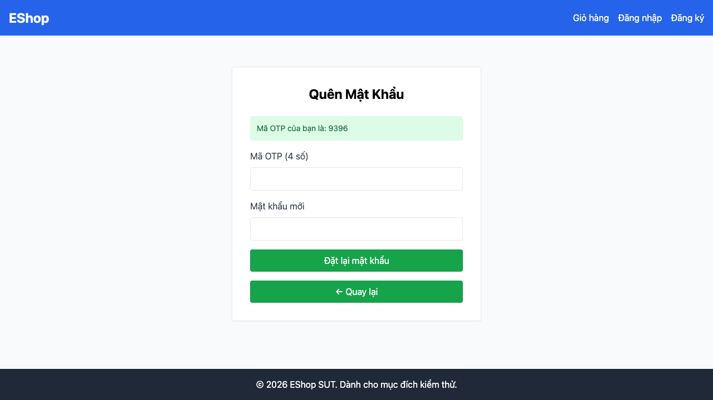

## Mô tả lỗi

| Trường | Nội dung |
|---|---|
| Bug ID | `BUG-FR03-05` |
| Feature / loại lỗi | FR-03; Functional / UI |
| Tầng / interface | WEB |
| Rule ID | R08 |
| Severity | High |
| Priority đề xuất | P1 |
| Status / mức xác nhận | Observed — lỗi đã quan sát theo đặc tả |
| Case đại diện | `FR03-DT-032` — Status gốc: Failed |

Không thể nhập và kiểm tra xác nhận mật khẩu; chặn năm case xác nhận.

### Tình trạng xác minh

- Nội dung dựa trên evidence lịch sử, chưa retest trên HEAD hiện tại.
- Chưa có bản sửa hoặc tỷ lệ tái hiện mới được xác nhận. Severity/priority là đề xuất triage.

## Môi trường

### Environment / build

API `http://localhost:3000`, customer WEB `http://localhost:5173/forgot-password`; Node v22.17.1 và Playwright Chromium headless theo hồ sơ gốc. SQLite/React/Vite. Chưa có manifest xác nhận build SHA, OS, browser version, viewport và locale của lượt chạy; không gán HEAD hiện tại làm build lịch sử. [API observations](https://github.com/thuytranj/eshop-sut/blob/46f7bbd7d356bc25a94f32d74fcbc4d3383d2663/docs/testing/fr03/evidence/api/observations.json), [WEB observations](https://github.com/thuytranj/eshop-sut/blob/46f7bbd7d356bc25a94f32d74fcbc4d3383d2663/docs/testing/fr03/evidence/web/observations.json).

### Preconditions / fixture

Tại Bước 2 giao diện ForgotPassword

### Test data / inputs

Kiểm sự hiện diện control xác nhận; không đồng nhất với một lần submit confirmation rỗng.

## Steps to reproduce

1. Kiểm tra cấu trúc DOM: kiểm tra sự hiện diện của input 'Xác nhận mật khẩu mới' và thử submit để trống
2. Lưu dialog/screenshot và request nếu có; phân biệt control vắng mặt với submit bị từ chối.

## Actual result

Form bước 2 thiếu trường Xác nhận mật khẩu mới; chỉ thấy trường OTP và Mật khẩu mới.

Trường 'Xác nhận mật khẩu mới' hoàn toàn không tồn tại trong form Bước 2 (Chỉ có trường OTP và 1 trường mật khẩu)
[evidence FR03-DT-032](https://github.com/thuytranj/eshop-sut/blob/46f7bbd7d356bc25a94f32d74fcbc4d3383d2663/docs/testing/fr03/evidence/web/observations.json) [ảnh/log chi tiết](https://github.com/thuytranj/eshop-sut/blob/46f7bbd7d356bc25a94f32d74fcbc4d3383d2663/docs/testing/fr03/evidence/web/screenshots/FR03-TC-044.png)

## Expected result

Trường input xác nhận mật khẩu hiện diện trong DOM; không thể submit nếu để trống

### Requirement / test oracle

README FR-03 (và FR-01 cho chính sách mật khẩu); Quy tắc và Expected Result chi tiết trong case đại diện tại [report.md](https://github.com/thuytranj/eshop-sut/blob/46f7bbd7d356bc25a94f32d74fcbc4d3383d2663/docs/testing/report.md); xem [đặc tả nghiệp vụ](https://github.com/thuytranj/eshop-sut/blob/46f7bbd7d356bc25a94f32d74fcbc4d3383d2663/README.md), [API contract](https://github.com/thuytranj/eshop-sut/blob/46f7bbd7d356bc25a94f32d74fcbc4d3383d2663/api_specification.md).

## Evidence

- [FR03-TC-044.png](https://github.com/thuytranj/eshop-sut/blob/46f7bbd7d356bc25a94f32d74fcbc4d3383d2663/docs/testing/fr03/evidence/web/screenshots/FR03-TC-044.png)

### Screenshot đại diện

### Related test cases (ID trong report)

`FR03-DT-027`, `FR03-DT-028`, `FR03-DT-029`, `FR03-DT-030`, `FR03-DT-031`, `FR03-DT-032`.

### Traceability — ID báo cáo và ID trong evidence

| Report case ID | Execution case ID | Technique |
|---|---|---|
| `FR03-DT-032` | `FR03-TC-044` | DT |
| `FR03-DT-027` | `FR03-TC-039` | DT |
| `FR03-DT-028` | `FR03-TC-040` | DT |
| `FR03-DT-029` | `FR03-TC-041` | DT |
| `FR03-DT-030` | `FR03-TC-042` | DT |
| `FR03-DT-031` | `FR03-TC-043` | DT |
