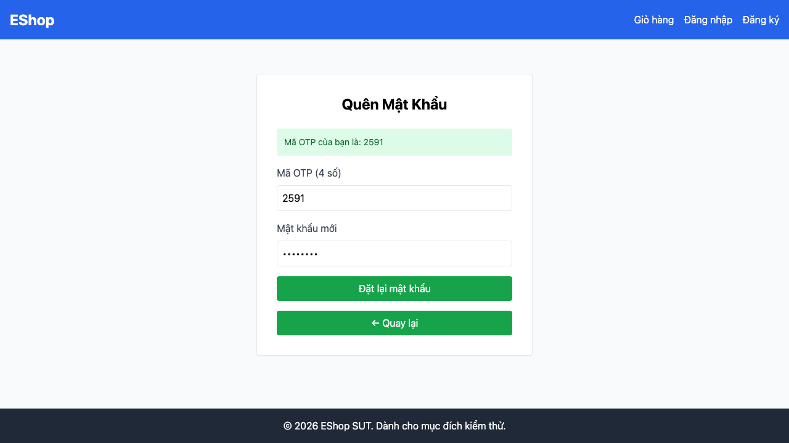

## Mô tả lỗi

| Trường | Nội dung |
|---|---|
| Bug ID | `BUG-FR03-06` |
| Feature / loại lỗi | FR-03; Functional / Validation |
| Tầng / interface | WEB |
| Rule ID | R07 |
| Severity | High |
| Priority đề xuất | P1 |
| Status / mức xác nhận | Observed — lỗi đã quan sát theo đặc tả |
| Case đại diện | `FR03-DT-033` — Status gốc: Failed |

Mật khẩu hợp lệ bị chặn; giá trị dùng khoảng trắng lại vượt qua kiểm tra WEB.

### Tình trạng xác minh

- Nội dung dựa trên evidence lịch sử, chưa retest trên HEAD hiện tại.
- Chưa có bản sửa hoặc tỷ lệ tái hiện mới được xác nhận. Severity/priority là đề xuất triage.

### Biến thể đối chiếu trong cùng nhóm

thử lần lượt `Abcdef1@`, `Abcdef1$`, `Abcdef1!`, `Abcdef1%`, `Abcdef1*`, `Abcdef1?`, `Abcdef1&` và `Abcdef1 ` (có khoảng trắng cuối). Reset fixture/token và mở lại bước 2 độc lập trước mỗi lần thử; ghi nhận alert và request thực tế. Các ca thiếu confirmPassword bị Blocked được liên kết với BUG-FR03-05, không gán kết quả của chúng cho bug này.

## Môi trường

### Environment / build

API `http://localhost:3000`, customer WEB `http://localhost:5173/forgot-password`; Node v22.17.1 và Playwright Chromium headless theo hồ sơ gốc. SQLite/React/Vite. Chưa có manifest xác nhận build SHA, OS, browser version, viewport và locale của lượt chạy; không gán HEAD hiện tại làm build lịch sử. [API observations](https://github.com/thuytranj/eshop-sut/blob/46f7bbd7d356bc25a94f32d74fcbc4d3383d2663/docs/testing/fr03/evidence/api/observations.json), [WEB observations](https://github.com/thuytranj/eshop-sut/blob/46f7bbd7d356bc25a94f32d74fcbc4d3383d2663/docs/testing/fr03/evidence/web/observations.json).

### Preconditions / fixture

Tài khoản A có token 123456

### Test data / inputs

`{"newPassword": "Abcdef1@"}`

## Steps to reproduce

1. Tại Bước 2, nhập mật khẩu có ký tự @ Abcdef1@, click Đặt lại
2. Lưu dialog/screenshot và request nếu có; phân biệt control vắng mặt với submit bị từ chối.

## Actual result

WEB chặn các mật khẩu có ký tự đặc biệt hợp lệ; Abcdef1 với khoảng trắng cuối được thông báo đổi thành công. Không suy ra snapshot DB cho mọi case UI.

Mật khẩu hợp lệ 'Abcdef1@' bị form từ chối do regex lỗi phía client đòi hỏi khoảng trắng thay vì ký tự đặc biệt (Alert: 'Mật khẩu quá yếu! Phải dài tối thiểu 8 ký tự, gồm chữ hoa, chữ thường, số và KÝ TỰ ĐẶC BIỆT.')
[evidence FR03-DT-033](https://github.com/thuytranj/eshop-sut/blob/46f7bbd7d356bc25a94f32d74fcbc4d3383d2663/docs/testing/fr03/evidence/web/observations.json) [ảnh/log chi tiết](https://github.com/thuytranj/eshop-sut/blob/46f7bbd7d356bc25a94f32d74fcbc4d3383d2663/docs/testing/fr03/evidence/web/screenshots/FR03-TC-045.png)

## Expected result

Form chấp nhận mật khẩu hợp lệ

### Requirement / test oracle

README FR-03 (và FR-01 cho chính sách mật khẩu); Quy tắc và Expected Result chi tiết trong case đại diện tại [report.md](https://github.com/thuytranj/eshop-sut/blob/46f7bbd7d356bc25a94f32d74fcbc4d3383d2663/docs/testing/report.md); xem [đặc tả nghiệp vụ](https://github.com/thuytranj/eshop-sut/blob/46f7bbd7d356bc25a94f32d74fcbc4d3383d2663/README.md), [API contract](https://github.com/thuytranj/eshop-sut/blob/46f7bbd7d356bc25a94f32d74fcbc4d3383d2663/api_specification.md).

## Evidence

- [FR03-TC-045.png](https://github.com/thuytranj/eshop-sut/blob/46f7bbd7d356bc25a94f32d74fcbc4d3383d2663/docs/testing/fr03/evidence/web/screenshots/FR03-TC-045.png)
- [FR03-TC-052.png](https://github.com/thuytranj/eshop-sut/blob/46f7bbd7d356bc25a94f32d74fcbc4d3383d2663/docs/testing/fr03/evidence/web/screenshots/FR03-TC-052.png)

### Screenshot đại diện

### Related test cases (ID trong report)

`FR03-DT-033`, `FR03-DT-034`, `FR03-DT-035`, `FR03-DT-036`, `FR03-DT-037`, `FR03-DT-038`, `FR03-DT-039`, `FR03-DT-040`.

### Traceability — ID báo cáo và ID trong evidence

| Report case ID | Execution case ID | Technique |
|---|---|---|
| `FR03-DT-033` | `FR03-TC-045` | DT |
| `FR03-DT-034` | `FR03-TC-046` | DT |
| `FR03-DT-035` | `FR03-TC-047` | DT |
| `FR03-DT-036` | `FR03-TC-048` | DT |
| `FR03-DT-037` | `FR03-TC-049` | DT |
| `FR03-DT-038` | `FR03-TC-050` | DT |
| `FR03-DT-039` | `FR03-TC-051` | DT |
| `FR03-DT-040` | `FR03-TC-052` | DT |
