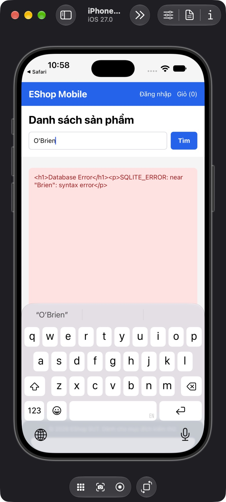

## Mô tả lỗi

| Trường | Nội dung |
|---|---|
| Bug ID | `FR05-BUG-001` |
| Feature / loại lỗi | FR-05; Functional |
| Tầng / interface | Native iOS / API hỗ trợ |
| Rule ID | FR05-R05 |
| Severity | High |
| Priority đề xuất | P1 |
| Status / mức xác nhận | Observed — lỗi đã quan sát theo đặc tả |
| Case đại diện | `FR05-DT-006` — Status gốc: Failed |

Không tìm được tên sản phẩm hợp lệ chứa dấu nháy; lộ chi tiết lỗi database.

### Tình trạng xác minh

- Nội dung dựa trên evidence lịch sử, chưa retest trên HEAD hiện tại.
- Chưa có bản sửa hoặc tỷ lệ tái hiện mới được xác nhận. Severity/priority là đề xuất triage.

## Môi trường

### Environment / build

Native iOS: iPhone 18 Pro Simulator, iOS 27.0, Expo Go 54.0.7, app SDK 54, React Native 0.81.5. Build nguồn `f74658aa9232d117ddd400e954db18b6ce81abeb`; proxy API `http://127.0.0.1:3002/api`, upstream `http://127.0.0.1:3000/api`, image server port 3001. Backend/mobile copy cô lập, endpoint được điều chỉnh trên bản copy. [Manifest run01](https://github.com/thuytranj/eshop-sut/blob/46f7bbd7d356bc25a94f32d74fcbc4d3383d2663/docs/testing/fr05/evidence/fr05-run01/manifest.json), [endpoint adjustment](https://github.com/thuytranj/eshop-sut/blob/46f7bbd7d356bc25a94f32d74fcbc4d3383d2663/docs/testing/fr05/evidence/fr05-run01/environment-adjustment.diff), [runbook](https://github.com/thuytranj/eshop-sut/blob/46f7bbd7d356bc25a94f32d74fcbc4d3383d2663/tests/fr05/native-runbook.md). Không suy kết quả native thành Android hay Expo web.

### Preconditions / fixture

Target native/build/locale/network như manifest.
Không đăng nhập, không mở detail/cart; reset q/navigation/network trước case.
Catalog snapshot=full theo FR05-F; reset riêng trước case.
Native iOS theo manifest; API supporting không thay thế UI native.

### Test data / inputs

Snapshot `full`; inputs=`{"search": "O'Brien", "mode": "search"}`

## Steps to reproduce

1. Reset backend về snapshot full; kiểm tra row count và hash fixture.
2. Mở Home từ state sạch; chờ response trước khi nhập, trừ case loading.
3. Nhập chính xác "O'Brien" vào search; bấm Tìm; đợi request hoàn tất, trừ case pending.

## Actual result

Tìm O'Brien hiển thị markup Database Error dạng text; API trả 500 với SQLITE_ERROR gần Brien. Không có bằng chứng HTML/XSS execution.

App hiển thị nguyên chuỗi &lt;h1&gt;Database Error&lt;/h1&gt;&lt;p&gt;SQLITE_ERROR: near "Brien": syntax error&lt;/p&gt; thay vì card O'Brien.
[evidence FR05-DT-006](https://github.com/thuytranj/eshop-sut/blob/46f7bbd7d356bc25a94f32d74fcbc4d3383d2663/docs/testing/fr05/evidence/fr05-run02/cumulative-observations.json)
[ảnh/log chi tiết](https://github.com/thuytranj/eshop-sut/blob/46f7bbd7d356bc25a94f32d74fcbc4d3383d2663/docs/testing/fr05/evidence/fr05-run01/native/FR05-TC-006.ax.txt)

## Expected result

Full-name search "O'Brien" trả đúng sản phẩm ID105; không lỗi/truncate/đổi ký tự.
Assertions nguồn: `{"oracleKind": "explicit", "ids": [105], "count": 1}`

### Requirement / test oracle

README FR-05; Quy tắc và Expected Result chi tiết trong case đại diện tại [report.md](https://github.com/thuytranj/eshop-sut/blob/46f7bbd7d356bc25a94f32d74fcbc4d3383d2663/docs/testing/report.md); xem [đặc tả nghiệp vụ](https://github.com/thuytranj/eshop-sut/blob/46f7bbd7d356bc25a94f32d74fcbc4d3383d2663/README.md), [API contract](https://github.com/thuytranj/eshop-sut/blob/46f7bbd7d356bc25a94f32d74fcbc4d3383d2663/api_specification.md).

## Evidence

- [native AX](https://github.com/thuytranj/eshop-sut/blob/46f7bbd7d356bc25a94f32d74fcbc4d3383d2663/docs/testing/fr05/evidence/fr05-run01/native/FR05-TC-006.ax.txt)
- [API](https://github.com/thuytranj/eshop-sut/blob/46f7bbd7d356bc25a94f32d74fcbc4d3383d2663/docs/testing/fr05/evidence/fr05-run01/api/FR05-TC-039.json)
- [HTTP repro](https://github.com/thuytranj/eshop-sut/blob/46f7bbd7d356bc25a94f32d74fcbc4d3383d2663/docs/testing/fr05/evidence/fr05-run01/api/quote-reproduction.txt)
- [Native quote search error](https://github.com/thuytranj/eshop-sut/blob/46f7bbd7d356bc25a94f32d74fcbc4d3383d2663/docs/testing/fr05/evidence/fr05-run01/native/FR05-TC-006.png)

### Screenshot đại diện

### Related test cases (ID trong report)

`FR05-DT-006`, `FR05-DT-029`.

### Traceability — ID báo cáo và ID trong evidence

| Report case ID | Execution case ID | Technique |
|---|---|---|
| `FR05-DT-006` | `FR05-TC-006` | DT |
| `FR05-DT-029` | `FR05-TC-039` | DT |
