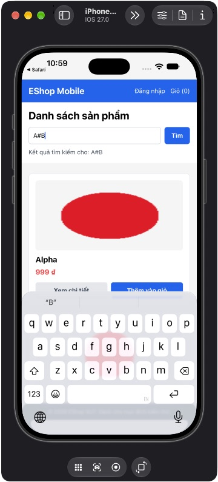

## Mô tả lỗi

| Trường | Nội dung |
|---|---|
| Bug ID | `FR05-BUG-002` |
| Feature / loại lỗi | FR-05; Functional / Integration |
| Tầng / interface | Native iOS; API encoded là đối chứng |
| Rule ID | FR05-R05 |
| Severity | High |
| Priority đề xuất | P1 |
| Status / mức xác nhận | Observed — lỗi đã quan sát theo đặc tả |
| Case đại diện | `FR05-DT-007` — Status gốc: Failed |

Tìm tên chứa ký tự URL trả sai hoặc thiếu sản phẩm.

### Tái lập và giới hạn

Đã quan sát trong case đại diện và các biến thể liên quan ở run nguồn; không có phép đo tỷ lệ tái hiện hoặc retest mới. Các case Passed/Blocked liên quan là đối chứng hoặc bị chặn, không tự đổi thành Failed.

### Workaround / hướng xử lý

Chưa xác minh workaround chung trong hồ sơ; ưu tiên sửa và regression test theo rule bị vi phạm.

### Tình trạng xác minh

- Nội dung dựa trên evidence lịch sử, chưa retest trên HEAD hiện tại.
- Chưa có bản sửa hoặc tỷ lệ tái hiện mới được xác nhận. Severity/priority là đề xuất triage.

## Môi trường

### Environment / build

Native iOS: iPhone 18 Pro Simulator, iOS 27.0, Expo Go 54.0.7, app SDK 54, React Native 0.81.5. Build nguồn `f74658aa9232d117ddd400e954db18b6ce81abeb`; proxy API `http://127.0.0.1:3002/api`, upstream `http://127.0.0.1:3000/api`, image server port 3001. Backend/mobile copy cô lập, endpoint được điều chỉnh trên bản copy. [Manifest run01](https://github.com/thuytranj/eshop-sut/blob/46f7bbd7d356bc25a94f32d74fcbc4d3383d2663/docs/testing/fr05/evidence/fr05-run01/manifest.json), [endpoint adjustment](https://github.com/thuytranj/eshop-sut/blob/46f7bbd7d356bc25a94f32d74fcbc4d3383d2663/docs/testing/fr05/evidence/fr05-run01/environment-adjustment.diff), [runbook](https://github.com/thuytranj/eshop-sut/blob/46f7bbd7d356bc25a94f32d74fcbc4d3383d2663/tests/fr05/native-runbook.md). Không suy kết quả native thành Android hay Expo web.

### Preconditions / fixture

Target native/build/locale/network như manifest.
Không đăng nhập, không mở detail/cart; reset q/navigation/network trước case.
Catalog snapshot=full theo FR05-F; reset riêng trước case.
Native iOS theo manifest; API supporting không thay thế UI native.

### Test data / inputs

Snapshot `full`; inputs=`{"search": "A&amp;B", "mode": "search"}`

## Steps to reproduce

1. Reset backend về snapshot full; kiểm tra row count và hash fixture.
2. Mở Home từ state sạch; chờ response trước khi nhập, trừ case loading.
3. Nhập chính xác 'A&amp;B' vào search; bấm Tìm; đợi request hoàn tất, trừ case pending.

## Actual result

A&B và A#B trả danh sách theo A; A+B trả rỗng. API hỗ trợ có encode đúng trả các ID tương ứng 106/107/108.

Keyword A&amp;B nhưng có Alpha/Beta/A+B/A#B và tên khác; không chỉ A&amp;B. API encode đúng case040 đã pass.
[evidence FR05-DT-007](https://github.com/thuytranj/eshop-sut/blob/46f7bbd7d356bc25a94f32d74fcbc4d3383d2663/docs/testing/fr05/evidence/fr05-run02/cumulative-observations.json)
[ảnh/log chi tiết](https://github.com/thuytranj/eshop-sut/blob/46f7bbd7d356bc25a94f32d74fcbc4d3383d2663/docs/testing/fr05/evidence/fr05-run01/native/FR05-TC-007.ax.txt)

## Expected result

Full-name search 'A&amp;B' trả đúng sản phẩm ID106; không lỗi/truncate/đổi ký tự.
Assertions nguồn: `{"oracleKind": "explicit", "ids": [106], "count": 1}`

### Requirement / test oracle

README FR-05; Quy tắc và Expected Result chi tiết trong case đại diện tại [report.md](https://github.com/thuytranj/eshop-sut/blob/46f7bbd7d356bc25a94f32d74fcbc4d3383d2663/docs/testing/report.md); xem [đặc tả nghiệp vụ](https://github.com/thuytranj/eshop-sut/blob/46f7bbd7d356bc25a94f32d74fcbc4d3383d2663/README.md), [API contract](https://github.com/thuytranj/eshop-sut/blob/46f7bbd7d356bc25a94f32d74fcbc4d3383d2663/api_specification.md).

## Evidence

- [A&B AX](https://github.com/thuytranj/eshop-sut/blob/46f7bbd7d356bc25a94f32d74fcbc4d3383d2663/docs/testing/fr05/evidence/fr05-run01/native/FR05-TC-007.ax.txt)
- [A+B AX](https://github.com/thuytranj/eshop-sut/blob/46f7bbd7d356bc25a94f32d74fcbc4d3383d2663/docs/testing/fr05/evidence/fr05-run01/native/FR05-TC-008.ax.txt)
- [A#B AX](https://github.com/thuytranj/eshop-sut/blob/46f7bbd7d356bc25a94f32d74fcbc4d3383d2663/docs/testing/fr05/evidence/fr05-run01/native/FR05-TC-009.ax.txt)
- [API encoded](https://github.com/thuytranj/eshop-sut/blob/46f7bbd7d356bc25a94f32d74fcbc4d3383d2663/docs/testing/fr05/evidence/fr05-run01/api/FR05-TC-040.json)
- [Native A#B returns unrelated products](https://github.com/thuytranj/eshop-sut/blob/46f7bbd7d356bc25a94f32d74fcbc4d3383d2663/docs/testing/fr05/evidence/fr05-run01/native/FR05-TC-009.png)

### Screenshot đại diện

### Related test cases (ID trong report)

`FR05-DT-007`, `FR05-DT-008`, `FR05-DT-009`, `FR05-DT-030`, `FR05-DT-031`, `FR05-DT-032`.

### Traceability — ID báo cáo và ID trong evidence

| Report case ID | Execution case ID | Technique |
|---|---|---|
| `FR05-DT-007` | `FR05-TC-007` | DT |
| `FR05-DT-008` | `FR05-TC-008` | DT |
| `FR05-DT-009` | `FR05-TC-009` | DT |
| `FR05-DT-030` | `FR05-TC-040` | DT |
| `FR05-DT-031` | `FR05-TC-041` | DT |
| `FR05-DT-032` | `FR05-TC-042` | DT |

### Nguồn và tình trạng retest

[Hồ sơ gốc FR-05](https://github.com/thuytranj/eshop-sut/blob/46f7bbd7d356bc25a94f32d74fcbc4d3383d2663/docs/testing/fr05/bugs.md). Chưa có bản sửa/retest được xác nhận trong tài liệu này. Phân tích code trong hồ sơ gốc là bằng chứng hỗ trợ, không tự chứng minh nguyên nhân của mọi case cùng nhóm.
