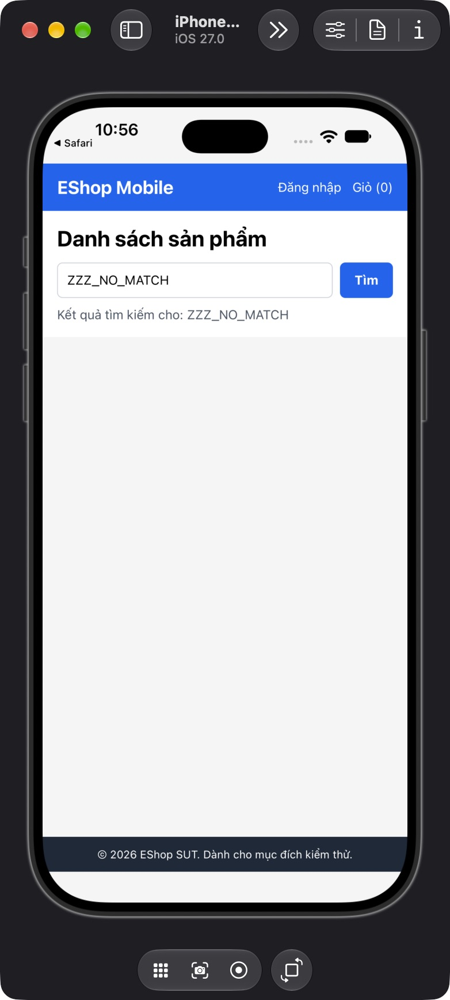

## Mô tả lỗi

| Trường | Nội dung |
|---|---|
| Bug ID | `FR05-BUG-003` |
| Feature / loại lỗi | FR-05; UI / Functional |
| Tầng / interface | Native iOS |
| Rule ID | FR05-R08 |
| Severity | Medium |
| Priority đề xuất | P2 |
| Status / mức xác nhận | Observed — lỗi đã quan sát theo đặc tả |
| Case đại diện | `FR05-DT-003` — Status gốc: Failed |

Người dùng không biết tìm kiếm đã hoàn tất nhưng không có kết quả.

### Tình trạng xác minh

- Nội dung dựa trên evidence lịch sử, chưa retest trên HEAD hiện tại.
- Chưa có bản sửa hoặc tỷ lệ tái hiện mới được xác nhận. Severity/priority là đề xuất triage.

## Môi trường

### Environment / build

Native iOS: iPhone 18 Pro Simulator, iOS 27.0, Expo Go 54.0.7, app SDK 54, React Native 0.81.5. Build nguồn `f74658aa9232d117ddd400e954db18b6ce81abeb`; proxy API `http://127.0.0.1:3002/api`, upstream `http://127.0.0.1:3000/api`, image server port 3001. Backend/mobile copy cô lập, endpoint được điều chỉnh trên bản copy. [Manifest run01](https://github.com/thuytranj/eshop-sut/blob/46f7bbd7d356bc25a94f32d74fcbc4d3383d2663/docs/testing/fr05/evidence/fr05-run01/manifest.json), [endpoint adjustment](https://github.com/thuytranj/eshop-sut/blob/46f7bbd7d356bc25a94f32d74fcbc4d3383d2663/docs/testing/fr05/evidence/fr05-run01/environment-adjustment.diff), [runbook](https://github.com/thuytranj/eshop-sut/blob/46f7bbd7d356bc25a94f32d74fcbc4d3383d2663/tests/fr05/native-runbook.md). Không suy kết quả native thành Android hay Expo web.

### Preconditions / fixture

Target native/build/locale/network như manifest.
Không đăng nhập, không mở detail/cart; reset q/navigation/network trước case.
Catalog snapshot=full theo FR05-F; reset riêng trước case.
Native iOS theo manifest; API supporting không thay thế UI native.

### Test data / inputs

Snapshot `full`; inputs=`{"search": "ZZZ_NO_MATCH", "mode": "search"}`

## Steps to reproduce

1. Reset backend về snapshot full; kiểm tra row count và hash fixture.
2. Mở Home từ state sạch; chờ response trước khi nhập, trừ case loading.
3. Nhập chính xác 'ZZZ_NO_MATCH' vào search; bấm Tìm; đợi request hoàn tất, trừ case pending.

## Actual result

Sau response 200 [] và loading kết thúc, giao diện chỉ để vùng trống, không có empty message.

Response success rỗng, vùng kết quả trống hoàn toàn; không có thông báo empty state trong screenshot/AX.
[evidence FR05-DT-003](https://github.com/thuytranj/eshop-sut/blob/46f7bbd7d356bc25a94f32d74fcbc4d3383d2663/docs/testing/fr05/evidence/fr05-run02/cumulative-observations.json)
[ảnh/log chi tiết](https://github.com/thuytranj/eshop-sut/blob/46f7bbd7d356bc25a94f32d74fcbc4d3383d2663/docs/testing/fr05/evidence/fr05-run01/native/FR05-TC-003.ax.txt)

## Expected result

Không có card; có thông báo empty state khi response thành công rỗng.
Assertions nguồn: `{"oracleKind": "explicit", "ids": [], "count": 0}`

### Requirement / test oracle

README FR-05; Quy tắc và Expected Result chi tiết trong case đại diện tại [report.md](https://github.com/thuytranj/eshop-sut/blob/46f7bbd7d356bc25a94f32d74fcbc4d3383d2663/docs/testing/report.md); xem [đặc tả nghiệp vụ](https://github.com/thuytranj/eshop-sut/blob/46f7bbd7d356bc25a94f32d74fcbc4d3383d2663/README.md), [API contract](https://github.com/thuytranj/eshop-sut/blob/46f7bbd7d356bc25a94f32d74fcbc4d3383d2663/api_specification.md).

## Evidence

- [no-match AX](https://github.com/thuytranj/eshop-sut/blob/46f7bbd7d356bc25a94f32d74fcbc4d3383d2663/docs/testing/fr05/evidence/fr05-run01/native/FR05-TC-003.ax.txt)
- [BVA0 AX](https://github.com/thuytranj/eshop-sut/blob/46f7bbd7d356bc25a94f32d74fcbc4d3383d2663/docs/testing/fr05/evidence/fr05-run01/native/FR05-TC-028.ax.txt)
- [pending](https://github.com/thuytranj/eshop-sut/blob/46f7bbd7d356bc25a94f32d74fcbc4d3383d2663/docs/testing/fr05/evidence/fr05-run01/native/FR05-TC-017-pending.ax.txt)
- [after delay](https://github.com/thuytranj/eshop-sut/blob/46f7bbd7d356bc25a94f32d74fcbc4d3383d2663/docs/testing/fr05/evidence/fr05-run01/native/FR05-TC-017-after-delay.ax.txt)
- [Native blank result without empty message](https://github.com/thuytranj/eshop-sut/blob/46f7bbd7d356bc25a94f32d74fcbc4d3383d2663/docs/testing/fr05/evidence/fr05-run01/native/FR05-TC-003.png)

### Screenshot đại diện

### Related test cases (ID trong report)

`FR05-DT-003`, `FR05-DT-004`, `FR05-DT-017`, `FR05-DT-018`, `FR05-BVA-001`, `FR05-DT-023`.

### Traceability — ID báo cáo và ID trong evidence

| Report case ID | Execution case ID | Technique |
|---|---|---|
| `FR05-DT-003` | `FR05-TC-003` | DT |
| `FR05-DT-004` | `FR05-TC-004` | DT |
| `FR05-DT-017` | `FR05-TC-017` | DT |
| `FR05-DT-018` | `FR05-TC-028` | DT |
| `FR05-BVA-001` | `FR05-TC-028` | BVA |
| `FR05-DT-023` | `FR05-TC-033` | DT |
