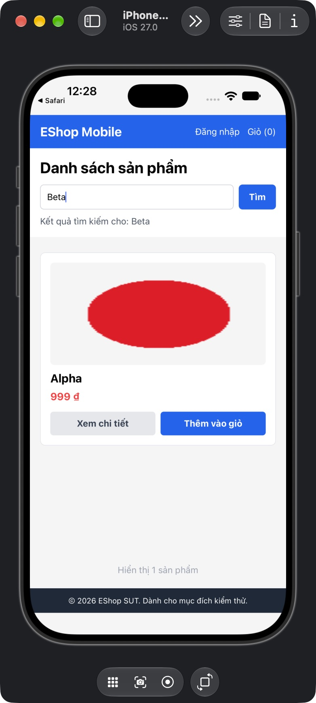

## Mô tả lỗi

| Trường | Nội dung |
|---|---|
| Bug ID | `FR05-BUG-005` |
| Feature / loại lỗi | FR-05; Functional / Concurrency |
| Tầng / interface | Native iOS |
| Rule ID | FR05-R05 (derived) |
| Severity | High |
| Priority đề xuất | P1 |
| Status / mức xác nhận | Observed discrepancy — oracle suy luận, chờ xác nhận |
| Case đại diện | `FR05-SUP-002` — Status gốc: Failed |

Danh sách không tương ứng từ khóa người dùng đang xem.

### Tình trạng xác minh

- Nội dung dựa trên evidence lịch sử, chưa retest trên HEAD hiện tại.
- Chưa có bản sửa hoặc tỷ lệ tái hiện mới được xác nhận. Severity/priority là đề xuất triage.
- Cần xác nhận oracle hoặc bổ sung bằng chứng trước khi chuyển thành bug confirmed; giữ nguyên verdict test case nguồn.

## Môi trường

### Environment / build

Native iOS: iPhone 18 Pro Simulator, iOS 27.0, Expo Go 54.0.7, app SDK 54, React Native 0.81.5. Build nguồn `f74658aa9232d117ddd400e954db18b6ce81abeb`; proxy API `http://127.0.0.1:3002/api`, upstream `http://127.0.0.1:3000/api`, image server port 3001. Backend/mobile copy cô lập, endpoint được điều chỉnh trên bản copy. [Manifest run01](https://github.com/thuytranj/eshop-sut/blob/46f7bbd7d356bc25a94f32d74fcbc4d3383d2663/docs/testing/fr05/evidence/fr05-run01/manifest.json), [endpoint adjustment](https://github.com/thuytranj/eshop-sut/blob/46f7bbd7d356bc25a94f32d74fcbc4d3383d2663/docs/testing/fr05/evidence/fr05-run01/environment-adjustment.diff), [runbook](https://github.com/thuytranj/eshop-sut/blob/46f7bbd7d356bc25a94f32d74fcbc4d3383d2663/tests/fr05/native-runbook.md). Không suy kết quả native thành Android hay Expo web.

### Preconditions / fixture

Target native/build/locale/network như manifest.
Không đăng nhập, không mở detail/cart; reset q/navigation/network trước case.
Catalog snapshot=full theo FR05-F; reset riêng trước case.
Native iOS theo manifest; API supporting không thay thế UI native.

### Test data / inputs

Snapshot `full`; inputs=`{"search": "Alpha", "mode": "search"}`

## Steps to reproduce

1. Reset backend về snapshot full; kiểm tra row count và hash fixture.
2. Mở Home từ state sạch; chờ response trước khi nhập, trừ case loading.
3. Nhập chính xác 'Alpha' vào search; bấm Tìm; đợi request hoàn tất, trừ case pending.
4. Proxy hold Alpha, gửi Beta, release Beta rồi Alpha; lưu thứ tự request/response.

## Actual result

Beta hiển thị trước; khi response Alpha cũ tới, nhãn/keyword vẫn Beta nhưng card thành Alpha giá 999₫.

Beta trả trước và từng hiển thị Beta; sau khi Alpha cũ trả về, ô/nhãn vẫn Beta nhưng card đổi thành Alpha giá 999 ₫. Đây là derived latest-query-wins oracle.
[evidence FR05-SUP-002](https://github.com/thuytranj/eshop-sut/blob/46f7bbd7d356bc25a94f32d74fcbc4d3383d2663/docs/testing/fr05/evidence/fr05-run02/cumulative-observations.json)
[ảnh/log chi tiết](https://github.com/thuytranj/eshop-sut/blob/46f7bbd7d356bc25a94f32d74fcbc4d3383d2663/docs/testing/fr05/evidence/fr05-run01/native/FR05-TC-019-beta-first.ax.txt)

## Expected result

Search Alpha rồi Beta; response Beta về trước Alpha; danh sách cuối tương ứng Beta và nhãn Beta.
Assertions nguồn: `{"oracleKind": "derived"}`

### Requirement / test oracle

README FR-05; Quy tắc và Expected Result chi tiết trong case đại diện tại [report.md](https://github.com/thuytranj/eshop-sut/blob/46f7bbd7d356bc25a94f32d74fcbc4d3383d2663/docs/testing/report.md); xem [đặc tả nghiệp vụ](https://github.com/thuytranj/eshop-sut/blob/46f7bbd7d356bc25a94f32d74fcbc4d3383d2663/README.md), [API contract](https://github.com/thuytranj/eshop-sut/blob/46f7bbd7d356bc25a94f32d74fcbc4d3383d2663/api_specification.md). Oracle latest-query-wins là suy luận; đặc tả chưa nêu chính sách response race.

## Evidence

- [Beta first](https://github.com/thuytranj/eshop-sut/blob/46f7bbd7d356bc25a94f32d74fcbc4d3383d2663/docs/testing/fr05/evidence/fr05-run01/native/FR05-TC-019-beta-first.ax.txt)
- [final AX](https://github.com/thuytranj/eshop-sut/blob/46f7bbd7d356bc25a94f32d74fcbc4d3383d2663/docs/testing/fr05/evidence/fr05-run01/native/FR05-TC-019-final.ax.txt)
- [raw order](https://github.com/thuytranj/eshop-sut/blob/46f7bbd7d356bc25a94f32d74fcbc4d3383d2663/docs/testing/fr05/evidence/fr05-run01/requests.jsonl)
- [Beta keyword with stale Alpha card](https://github.com/thuytranj/eshop-sut/blob/46f7bbd7d356bc25a94f32d74fcbc4d3383d2663/docs/testing/fr05/evidence/fr05-run01/native/FR05-TC-019-final.png)

### Screenshot đại diện

### Related test cases (ID trong report)

`FR05-SUP-002`.

### Traceability — ID báo cáo và ID trong evidence

| Report case ID | Execution case ID | Technique |
|---|---|---|
| `FR05-SUP-002` | `FR05-TC-019` | SUP |
