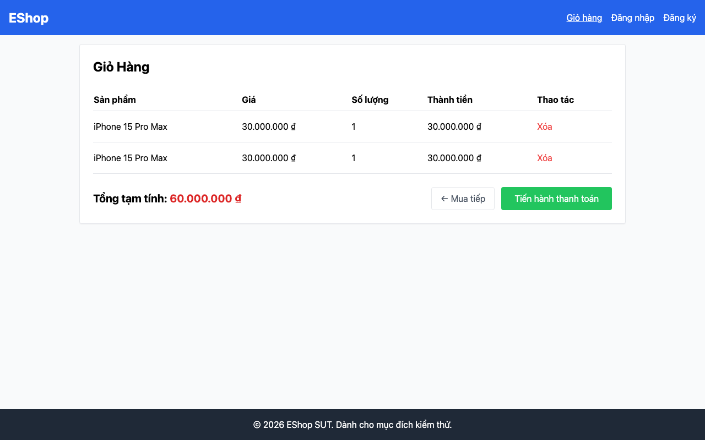

## Mô tả lỗi

| Trường | Nội dung |
|---|---|
| Bug ID | `FR07-BUG-001` |
| Feature / loại lỗi | FR-07; Functional |
| Tầng / interface | API / WEB |
| Rule ID | FR07-R02 |
| Severity | High |
| Priority đề xuất | P1 |
| Status / mức xác nhận | Observed — lỗi đã quan sát theo đặc tả |
| Case đại diện | `FR07-DT-009` — Status gốc: Failed |

Giỏ có nhiều dòng trùng sản phẩm, không đúng quy tắc cộng dồn số lượng.

### Tình trạng xác minh

- Nội dung dựa trên evidence lịch sử, chưa retest trên HEAD hiện tại.
- Chưa có bản sửa hoặc tỷ lệ tái hiện mới được xác nhận. Severity/priority là đề xuất triage.

## Môi trường

### Environment / build

Run `fr07-run01`, build `478c859708494fe411405c51d5ca5b643e1d6659`; Node v20.x HTTP runner, Python 3.11/Playwright Chromium, viewport 1280×800, locale vi-VN. API `http://localhost:3000`; WEB `http://127.0.0.1:5173`. Backend/SQLite cô lập. OS và phiên bản Chromium cụ thể chưa ghi trong [manifest](https://github.com/thuytranj/eshop-sut/blob/46f7bbd7d356bc25a94f32d74fcbc4d3383d2663/docs/testing/fr07/evidence/fr07-run01/manifest.json).

### Preconditions / fixture

User đăng nhập hợp lệ, giỏ hàng trên server đang có A với q=1 (r=1).

### Test data / inputs

Dữ liệu/thao tác nguồn: `"Sản phẩm A (id=1, price=100000)."`
Request thực tế lịch sử: `{"method": "POST", "path": "/api/cart", "body": {"id": 1, "name": "Sản phẩm A", "price": 100000, "quantity": 1}, "headers": {"Authorization": "Bearer [REDACTED]", "Content-Type": "application/json"}}`; action/giá trị thao tác theo Test Steps

## Steps to reproduce

1. POST /api/cart body {id:1, name:"Sản phẩm A", price:100000, quantity:1}
2. GET /api/cart

## Actual result

API và WEB tạo các dòng riêng cho cùng sản phẩm thay vì một dòng có tổng quantity.

Cart contains 2 rows; items: [{"id":1,"name":"Sản phẩm A","price":100000,"quantity":1},{"id":1,"name":"Sản phẩm A","price":100000,"quantity":1}]
[evidence FR07-DT-009](https://github.com/thuytranj/eshop-sut/blob/46f7bbd7d356bc25a94f32d74fcbc4d3383d2663/docs/testing/fr07/evidence/fr07-run01/api/observations.json)

## Expected result

Giỏ hàng trên server chỉ có đúng 1 dòng cho A, số lượng gộp thành 2.

### Requirement / test oracle

README FR-07; Quy tắc và Expected Result chi tiết trong case đại diện tại [report.md](https://github.com/thuytranj/eshop-sut/blob/46f7bbd7d356bc25a94f32d74fcbc4d3383d2663/docs/testing/report.md); xem [đặc tả nghiệp vụ](https://github.com/thuytranj/eshop-sut/blob/46f7bbd7d356bc25a94f32d74fcbc4d3383d2663/README.md), [API contract](https://github.com/thuytranj/eshop-sut/blob/46f7bbd7d356bc25a94f32d74fcbc4d3383d2663/api_specification.md).

## Evidence

- [FR07-TC-014_cart_state.png](https://github.com/thuytranj/eshop-sut/blob/46f7bbd7d356bc25a94f32d74fcbc4d3383d2663/docs/testing/fr07/evidence/fr07-run01/web/screenshots/FR07-TC-014_cart_state.png)
- [API observations — FR07-TC-009](https://github.com/thuytranj/eshop-sut/blob/46f7bbd7d356bc25a94f32d74fcbc4d3383d2663/docs/testing/fr07/evidence/fr07-run01/api/observations.json)

### Screenshot đại diện

### Related test cases (ID trong report)

`FR07-DT-009`, `FR07-BVA-006`, `FR07-DT-010`, `FR07-BVA-008`, `FR07-DT-012`, `FR07-BVA-009`, `FR07-DT-013`, `FR07-BVA-010`, `FR07-DT-014`.

### Traceability — ID báo cáo và ID trong evidence

| Report case ID | Execution case ID | Technique |
|---|---|---|
| `FR07-DT-009` | `FR07-TC-009` | DT |
| `FR07-BVA-006` | `FR07-TC-009` | BVA |
| `FR07-DT-010` | `FR07-TC-010` | DT |
| `FR07-BVA-008` | `FR07-TC-012` | BVA |
| `FR07-DT-012` | `FR07-TC-014` | DT |
| `FR07-BVA-009` | `FR07-TC-014` | BVA |
| `FR07-DT-013` | `FR07-TC-015` | DT |
| `FR07-BVA-010` | `FR07-TC-016` | BVA |
| `FR07-DT-014` | `FR07-TC-017` | DT |
