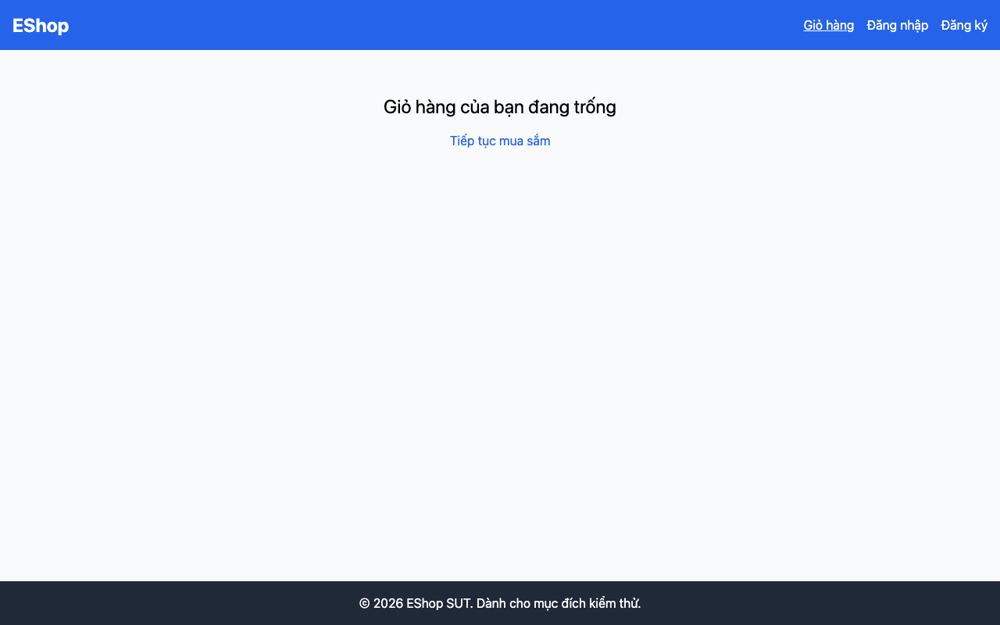

## Mô tả lỗi

| Trường | Nội dung |
|---|---|
| Bug ID | `FR07-BUG-006` |
| Feature / loại lỗi | FR-07; UI |
| Tầng / interface | WEB |
| Rule ID | FR07-R07 |
| Severity | Low |
| Priority đề xuất | P3 |
| Status / mức xác nhận | Observed — lỗi đã quan sát theo đặc tả |
| Case đại diện | `FR07-DT-001` — Status gốc: Failed |

Thiếu hình minh họa ở trạng thái giỏ trống.

### Tình trạng xác minh

- Nội dung dựa trên evidence lịch sử, chưa retest trên HEAD hiện tại.
- Chưa có bản sửa hoặc tỷ lệ tái hiện mới được xác nhận. Severity/priority là đề xuất triage.

## Môi trường

### Environment / build

Run `fr07-run01`, build `478c859708494fe411405c51d5ca5b643e1d6659`; Node v20.x HTTP runner, Python 3.11/Playwright Chromium, viewport 1280×800, locale vi-VN. API `http://localhost:3000`; WEB `http://127.0.0.1:5173`. Backend/SQLite cô lập. OS và phiên bản Chromium cụ thể chưa ghi trong [manifest](https://github.com/thuytranj/eshop-sut/blob/46f7bbd7d356bc25a94f32d74fcbc4d3383d2663/docs/testing/fr07/evidence/fr07-run01/manifest.json).

### Preconditions / fixture

Phiên duyệt mới, giỏ hàng React rỗng (n=0).

### Test data / inputs

Dữ liệu/thao tác nguồn: `"Giỏ rỗng."`; action/giá trị thao tác theo Test Steps

## Steps to reproduce

1. Mở trang chủ /
2. Điều hướng tới trang giỏ hàng /cart
3. Quan sát nội dung trang

## Actual result

Giỏ trống chỉ có thông báo chữ và liên kết, không có hình minh họa.

Message: True, Illustration: False (Missing illustration!), No Table: True
[evidence FR07-DT-001](https://github.com/thuytranj/eshop-sut/blob/46f7bbd7d356bc25a94f32d74fcbc4d3383d2663/docs/testing/fr07/evidence/fr07-run01/web/observations.json) [ảnh/log chi tiết](https://github.com/thuytranj/eshop-sut/blob/46f7bbd7d356bc25a94f32d74fcbc4d3383d2663/docs/testing/fr07/evidence/fr07-run01/web/screenshots/FR07-TC-001_view_empty.png)

## Expected result

Hiển thị hình minh họa giỏ hàng trống và thông báo rõ ràng; không hiển thị bảng sản phẩm và tổng tiền.

### Requirement / test oracle

README FR-07; Quy tắc và Expected Result chi tiết trong case đại diện tại [report.md](https://github.com/thuytranj/eshop-sut/blob/46f7bbd7d356bc25a94f32d74fcbc4d3383d2663/docs/testing/report.md); xem [đặc tả nghiệp vụ](https://github.com/thuytranj/eshop-sut/blob/46f7bbd7d356bc25a94f32d74fcbc4d3383d2663/README.md), [API contract](https://github.com/thuytranj/eshop-sut/blob/46f7bbd7d356bc25a94f32d74fcbc4d3383d2663/api_specification.md).

## Evidence

- [FR07-TC-001_view_empty.png](https://github.com/thuytranj/eshop-sut/blob/46f7bbd7d356bc25a94f32d74fcbc4d3383d2663/docs/testing/fr07/evidence/fr07-run01/web/screenshots/FR07-TC-001_view_empty.png)

### Screenshot đại diện

### Related test cases (ID trong report)

`FR07-DT-001`, `FR07-BVA-001`.

### Traceability — ID báo cáo và ID trong evidence

| Report case ID | Execution case ID | Technique |
|---|---|---|
| `FR07-DT-001` | `FR07-TC-001` | DT |
| `FR07-BVA-001` | `FR07-TC-001` | BVA |
