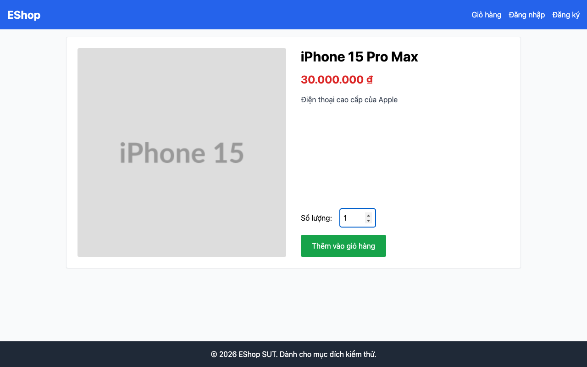

## Mô tả lỗi

| Trường | Nội dung |
|---|---|
| Bug ID | `FR07-BUG-007` |
| Feature / loại lỗi | FR-07; Functional / Dependency FR-06 |
| Tầng / interface | WEB |
| Rule ID | FR06-Q (dependency) |
| Severity | High |
| Priority đề xuất | P1 |
| Status / mức xác nhận | Observed — lỗi đã quan sát theo đặc tả |
| Case đại diện | `FR07-DT-002` — Status gốc: Failed |

Lần bấm đầu không thêm được sản phẩm.

### Tình trạng xác minh

- Nội dung dựa trên evidence lịch sử, chưa retest trên HEAD hiện tại.
- Chưa có bản sửa hoặc tỷ lệ tái hiện mới được xác nhận. Severity/priority là đề xuất triage.

## Môi trường

### Environment / build

Run `fr07-run01`, build `478c859708494fe411405c51d5ca5b643e1d6659`; Node v20.x HTTP runner, Python 3.11/Playwright Chromium, viewport 1280×800, locale vi-VN. API `http://localhost:3000`; WEB `http://127.0.0.1:5173`. Backend/SQLite cô lập. OS và phiên bản Chromium cụ thể chưa ghi trong [manifest](https://github.com/thuytranj/eshop-sut/blob/46f7bbd7d356bc25a94f32d74fcbc4d3383d2663/docs/testing/fr07/evidence/fr07-run01/manifest.json).

### Preconditions / fixture

Giỏ hàng ban đầu rỗng (n=0, r=0).

### Test data / inputs

Dữ liệu/thao tác nguồn: `"Sản phẩm A (id=1, p=100000₫)."`
Request thực tế lịch sử: `{"productId": 1, "quantityInput": 1, "clicks": 1}`; d=1

## Steps to reproduce

1. Vào /product/1
2. Nhập số lượng d=1
3. Bấm Thêm vào giỏ hàng
4. Mở /cart

## Actual result

Sau một lần bấm Thêm vào giỏ hàng, giỏ vẫn trống; observation cần lần bấm thứ hai.

Clicking 'Thêm vào giỏ hàng' 1 time did not add product to cart (Cart remains empty). Root cause: ProductDetail.jsx clickCount dependency bug.
[evidence FR07-DT-002](https://github.com/thuytranj/eshop-sut/blob/46f7bbd7d356bc25a94f32d74fcbc4d3383d2663/docs/testing/fr07/evidence/fr07-run01/web/observations.json) [ảnh/log chi tiết](https://github.com/thuytranj/eshop-sut/blob/46f7bbd7d356bc25a94f32d74fcbc4d3383d2663/docs/testing/fr07/evidence/fr07-run01/web/screenshots/FR07-TC-002_detail_before_add.png)

## Expected result

Chuyển sang bảng giỏ hàng có 1 dòng A, số lượng 1, Thành tiền 100000₫, Tổng cộng 100000₫, không còn thông báo giỏ trống.

### Requirement / test oracle

README FR-07; dependency FR-06. Quy tắc và Expected Result chi tiết trong case đại diện tại [report.md](https://github.com/thuytranj/eshop-sut/blob/46f7bbd7d356bc25a94f32d74fcbc4d3383d2663/docs/testing/report.md); xem [đặc tả nghiệp vụ](https://github.com/thuytranj/eshop-sut/blob/46f7bbd7d356bc25a94f32d74fcbc4d3383d2663/README.md), [API contract](https://github.com/thuytranj/eshop-sut/blob/46f7bbd7d356bc25a94f32d74fcbc4d3383d2663/api_specification.md).

## Evidence

- [FR07-TC-002_cart_result.png](https://github.com/thuytranj/eshop-sut/blob/46f7bbd7d356bc25a94f32d74fcbc4d3383d2663/docs/testing/fr07/evidence/fr07-run01/web/screenshots/FR07-TC-002_cart_result.png)

### Screenshot đại diện

### Related test cases (ID trong report)

`FR07-DT-002`, `FR07-BVA-002`, `FR07-DT-004`, `FR07-BVA-004`, `FR07-DT-006`.

### Traceability — ID báo cáo và ID trong evidence

| Report case ID | Execution case ID | Technique |
|---|---|---|
| `FR07-DT-002` | `FR07-TC-002` | DT |
| `FR07-BVA-002` | `FR07-TC-002` | BVA |
| `FR07-DT-004` | `FR07-TC-004` | DT |
| `FR07-BVA-004` | `FR07-TC-004` | BVA |
| `FR07-DT-006` | `FR07-TC-006` | DT |
