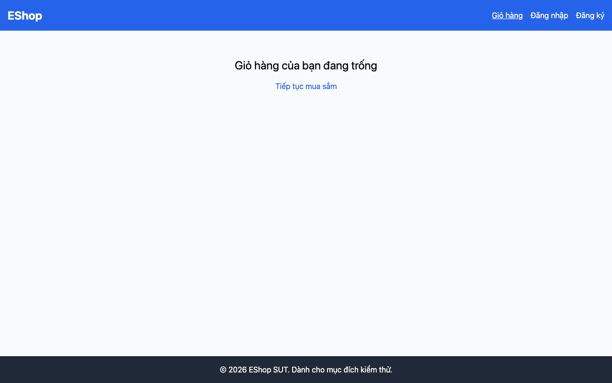

## Mô tả lỗi

| Trường | Nội dung |
|---|---|
| Bug ID | `FR07-BUG-008` |
| Feature / loại lỗi | FR-07; UI / Copy |
| Tầng / interface | WEB |
| Rule ID | FR07-R05 |
| Severity | Low |
| Priority đề xuất | P3 |
| Status / mức xác nhận | Observed — lỗi đã quan sát theo đặc tả |
| Case đại diện | `FR07-DT-025` — Status gốc: Passed |

Nhãn điều hướng không nhất quán giữa giỏ trống và có hàng.

### Tình trạng xác minh

- Nội dung dựa trên evidence lịch sử, chưa retest trên HEAD hiện tại.
- Chưa có bản sửa hoặc tỷ lệ tái hiện mới được xác nhận. Severity/priority là đề xuất triage.
- Case điều hướng có Status Passed. Sai nhãn là observation riêng trong screenshot giỏ có hàng; không đổi verdict điều hướng thành Failed.

## Môi trường

### Environment / build

Run `fr07-run01`, build `478c859708494fe411405c51d5ca5b643e1d6659`; Node v20.x HTTP runner, Python 3.11/Playwright Chromium, viewport 1280×800, locale vi-VN. API `http://localhost:3000`; WEB `http://127.0.0.1:5173`. Backend/SQLite cô lập. OS và phiên bản Chromium cụ thể chưa ghi trong [manifest](https://github.com/thuytranj/eshop-sut/blob/46f7bbd7d356bc25a94f32d74fcbc4d3383d2663/docs/testing/fr07/evidence/fr07-run01/manifest.json).

### Preconditions / fixture

Giỏ hàng WEB có ít nhất một sản phẩm; mở /cart. Giữ thêm trạng thái giỏ trống để đối chiếu nhãn.

### Test data / inputs

Dữ liệu/thao tác nguồn: `"Bất kỳ trạng thái giỏ nào."`; action/giá trị thao tác theo Test Steps

## Steps to reproduce

1. Mở /cart khi giỏ có hàng.
2. Quan sát nhãn liên kết quay về trang chủ bên dưới bảng.
3. Đối chiếu với yêu cầu nhãn và trạng thái giỏ trống; nếu bấm liên kết, kiểm tra điều hướng như một assertion riêng.

## Actual result

Giỏ có hàng dùng ← Mua tiếp; trạng thái trống dùng Tiếp tục mua sắm. Điều hướng vẫn hoạt động.

Button 'Tiếp tục mua sắm' navigated to http://127.0.0.1:5173/
[evidence FR07-DT-025](https://github.com/thuytranj/eshop-sut/blob/46f7bbd7d356bc25a94f32d74fcbc4d3383d2663/docs/testing/fr07/evidence/fr07-run01/web/observations.json) [ảnh/log chi tiết](https://github.com/thuytranj/eshop-sut/blob/46f7bbd7d356bc25a94f32d74fcbc4d3383d2663/docs/testing/fr07/evidence/fr07-run01/web/screenshots/FR07-TC-029_before_click.png)

## Expected result

Liên kết hiển thị nhãn "Tiếp tục mua sắm" và điều hướng về trang chủ /.

### Requirement / test oracle

README FR-07; Quy tắc và Expected Result chi tiết trong case đại diện tại [report.md](https://github.com/thuytranj/eshop-sut/blob/46f7bbd7d356bc25a94f32d74fcbc4d3383d2663/docs/testing/report.md); xem [đặc tả nghiệp vụ](https://github.com/thuytranj/eshop-sut/blob/46f7bbd7d356bc25a94f32d74fcbc4d3383d2663/README.md), [API contract](https://github.com/thuytranj/eshop-sut/blob/46f7bbd7d356bc25a94f32d74fcbc4d3383d2663/api_specification.md).

## Evidence

- [FR07-TC-014_cart_state.png](https://github.com/thuytranj/eshop-sut/blob/46f7bbd7d356bc25a94f32d74fcbc4d3383d2663/docs/testing/fr07/evidence/fr07-run01/web/screenshots/FR07-TC-014_cart_state.png)

### Screenshot đại diện

### Related test cases (ID trong report)

`FR07-DT-025`, `FR07-DT-012`, `FR07-BVA-009`, `FR07-DT-013`, `FR07-BVA-010`, `FR07-DT-014`, `FR07-DT-015`, `FR07-BVA-011`, `FR07-DT-016`.

### Traceability — ID báo cáo và ID trong evidence

| Report case ID | Execution case ID | Technique |
|---|---|---|
| `FR07-DT-025` | `FR07-TC-029` | DT |
| `FR07-DT-012` | `FR07-TC-014` | DT |
| `FR07-BVA-009` | `FR07-TC-014` | BVA |
| `FR07-DT-013` | `FR07-TC-015` | DT |
| `FR07-BVA-010` | `FR07-TC-016` | BVA |
| `FR07-DT-014` | `FR07-TC-017` | DT |
| `FR07-DT-015` | `FR07-TC-018` | DT |
| `FR07-BVA-011` | `FR07-TC-019` | BVA |
| `FR07-DT-016` | `FR07-TC-020` | DT |
