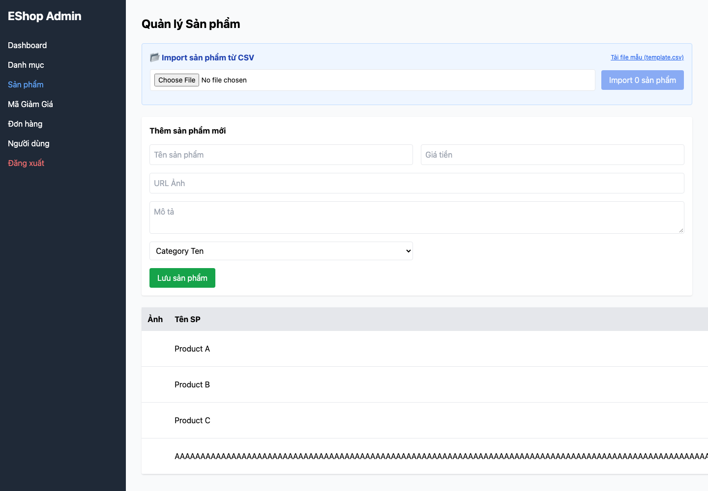

## Mô tả lỗi

| Trường | Nội dung |
|---|---|
| Bug ID | `FR15-BUG-001` |
| Feature / loại lỗi | FR-15; Functional / Validation |
| Tầng / interface | API / Admin WEB |
| Rule ID | FR15-R05 |
| Severity | High |
| Priority đề xuất | P1 |
| Status / mức xác nhận | Observed — lỗi đã quan sát theo đặc tả |
| Case đại diện | `FR15-DT-069` — Status gốc: Failed |

Lưu được tên thiếu hoặc vượt giới hạn.

### Tình trạng xác minh

- Nội dung dựa trên evidence lịch sử, chưa retest trên HEAD hiện tại.
- Chưa có bản sửa hoặc tỷ lệ tái hiện mới được xác nhận. Severity/priority là đề xuất triage.

## Môi trường

### Environment / build

Run `fr15-run03`, commit nền `5f9c73bf093c47e58188b46d20514b71149fb461`, có dirty paths/hash harness được ghi riêng; không coi commit SHA là toàn bộ trạng thái build. Node v22.17.1, Python 3.13.12; Playwright Chromium 153.0.8010.12, viewport 1440×1000, locale vi-VN. API `http://localhost:3000`; Admin `http://127.0.0.1:5174`. [Manifest](https://github.com/thuytranj/eshop-sut/blob/46f7bbd7d356bc25a94f32d74fcbc4d3383d2663/docs/testing/fr15/evidence/fr15-run03/manifest.json), [browser metadata](https://github.com/thuytranj/eshop-sut/blob/46f7bbd7d356bc25a94f32d74fcbc4d3383d2663/docs/testing/fr15/evidence/fr15-run03/web/browser.json).

### Preconditions / fixture

token partition=admin.
Target=101 phải tồn tại nếu thao tác yêu cầu, trừ probe ID vắng; snapshot toàn bộ sản phẩm trước/sau.

### Test data / inputs

Input dự định: `{"body": {"name": repeat("A",256), "price": 100000, "description": "Nominal description", "imageUrl": "data:image/png;base64,iVBORw0KGgoAAAANSUhEUgAAAAEAAAABCAQAAAC1HAwCAAAAC0lEQVR42mP8/x8AAwMCAO+ip1sAAAAASUVORK5CYII=", "category_id": 10}, "target": 101, "auth": "admin", "mode": "create"}`

## Steps to reproduce

1. Reset fixture bằng setup độc lập và snapshot tất cả sản phẩm.
2. Dùng đúng partition xác thực; mở Admin Product, chọn đúng target và thực hiện Thêm với input dự định.
3. Lưu request/response và state trước/sau; đối chiếu target cùng mọi sản phẩm khác.
4. Ghi inputEffective và UI ngay sau thao tác; reload, ghi UI lần nữa. HTML chặn input không chứng minh API đã validate.

## Actual result

Case đại diện thêm sản phẩm tên 256 ký tự, ID 304; số sản phẩm tăng 3→4 và tồn tại sau reload.

Quan sát: `{"failures": ["rejected-state-unchanged", "rejection-signaled", "ui-immediate-correct", "ui-reload-correct"], "beforeCount": 3, "afterCount": 4, "mutationCount": 1, "htmlBlocked": false, "response": {"statusCode": 200, "body": {"message": "Product created", "id": 304}}}`
Assertion: Dữ liệu thay đổi dù input phải bị từ chối
Assertion: Không có tín hiệu từ chối phù hợp
Assertion: UI ngay sau thao tác không khớp kết quả kỳ vọng
Assertion: UI sau reload không khớp kết quả kỳ vọng
Snapshot: thêm IDs=`[304]`; xóa IDs=`[]`; sửa IDs=`[]`
Input thực tế sau nhập UI: `{"name": repeat("A",256), "price": "100000", "category_id": "10"}`
[evidence FR15-DT-069](https://github.com/thuytranj/eshop-sut/blob/46f7bbd7d356bc25a94f32d74fcbc4d3383d2663/docs/testing/fr15/evidence/fr15-run03/web/observations.json)
[ảnh/log chi tiết](https://github.com/thuytranj/eshop-sut/blob/46f7bbd7d356bc25a94f32d74fcbc4d3383d2663/docs/testing/fr15/evidence/fr15-run03/web/screenshots/FR15-TC-075_immediate.png)

## Expected result

Từ chối thao tác; dữ liệu của target và các sản phẩm khác giữ nguyên.
Oracle nguồn: `{"outcome": "reject", "stateContract": "Create", "description": "Name single-boundary L=256; hold price/category/auth valid"}`; oracleStatus=`confirmed`

### Requirement / test oracle

README FR-15; Quy tắc và Expected Result chi tiết trong case đại diện tại [report.md](https://github.com/thuytranj/eshop-sut/blob/46f7bbd7d356bc25a94f32d74fcbc4d3383d2663/docs/testing/report.md); xem [đặc tả nghiệp vụ](https://github.com/thuytranj/eshop-sut/blob/46f7bbd7d356bc25a94f32d74fcbc4d3383d2663/README.md), [API contract](https://github.com/thuytranj/eshop-sut/blob/46f7bbd7d356bc25a94f32d74fcbc4d3383d2663/api_specification.md).

## Evidence

- [FR15-TC-075_immediate.png](https://github.com/thuytranj/eshop-sut/blob/46f7bbd7d356bc25a94f32d74fcbc4d3383d2663/docs/testing/fr15/evidence/fr15-run03/web/screenshots/FR15-TC-075_immediate.png)
- [FR15-TC-075_reload.png](https://github.com/thuytranj/eshop-sut/blob/46f7bbd7d356bc25a94f32d74fcbc4d3383d2663/docs/testing/fr15/evidence/fr15-run03/web/screenshots/FR15-TC-075_reload.png)
- [FR15-TC-075.json](https://github.com/thuytranj/eshop-sut/blob/46f7bbd7d356bc25a94f32d74fcbc4d3383d2663/docs/testing/fr15/evidence/fr15-run03/web/FR15-TC-075.json)

### Screenshot đại diện

### Related test cases (ID trong report)

`FR15-DT-002`, `FR15-BVA-001`, `FR15-DT-007`, `FR15-BVA-006`, `FR15-DT-013`, `FR15-DT-019`, `FR15-DT-020`, `FR15-DT-025`, `FR15-DT-026`, `FR15-DT-033`, `FR15-BVA-010`, `FR15-DT-038`, `FR15-BVA-015`, `FR15-DT-044`, `FR15-DT-050`, `FR15-DT-051`, `FR15-DT-056`, `FR15-DT-057`, `FR15-DT-069`, `FR15-BVA-024`, `FR15-DT-075`, `FR15-DT-082`, `FR15-DT-091`, `FR15-BVA-033`, `FR15-DT-097`, `FR15-DT-104`, `FR15-BVA-037`, `FR15-BVA-039`, `FR15-BVA-041`, `FR15-BVA-043`.

### Traceability — ID báo cáo và ID trong evidence

| Report case ID | Execution case ID | Technique |
|---|---|---|
| `FR15-DT-069` | `FR15-TC-075` | DT |
| `FR15-DT-002` | `FR15-TC-002` | DT |
| `FR15-BVA-001` | `FR15-TC-002` | BVA |
| `FR15-DT-007` | `FR15-TC-007` | DT |
| `FR15-BVA-006` | `FR15-TC-007` | BVA |
| `FR15-DT-013` | `FR15-TC-013` | DT |
| `FR15-DT-019` | `FR15-TC-019` | DT |
| `FR15-DT-020` | `FR15-TC-020` | DT |
| `FR15-DT-025` | `FR15-TC-025` | DT |
| `FR15-DT-026` | `FR15-TC-026` | DT |
| `FR15-DT-033` | `FR15-TC-036` | DT |
| `FR15-BVA-010` | `FR15-TC-036` | BVA |
| `FR15-DT-038` | `FR15-TC-041` | DT |
| `FR15-BVA-015` | `FR15-TC-041` | BVA |
| `FR15-DT-044` | `FR15-TC-047` | DT |
| `FR15-DT-050` | `FR15-TC-053` | DT |
| `FR15-DT-051` | `FR15-TC-054` | DT |
| `FR15-DT-056` | `FR15-TC-059` | DT |
| `FR15-DT-057` | `FR15-TC-060` | DT |
| `FR15-BVA-024` | `FR15-TC-075` | BVA |
| `FR15-DT-075` | `FR15-TC-081` | DT |
| `FR15-DT-082` | `FR15-TC-088` | DT |
| `FR15-DT-091` | `FR15-TC-098` | DT |
| `FR15-BVA-033` | `FR15-TC-098` | BVA |
| `FR15-DT-097` | `FR15-TC-104` | DT |
| `FR15-DT-104` | `FR15-TC-111` | DT |
| `FR15-BVA-037` | `FR15-TC-151` | BVA |
| `FR15-BVA-039` | `FR15-TC-153` | BVA |
| `FR15-BVA-041` | `FR15-TC-155` | BVA |
| `FR15-BVA-043` | `FR15-TC-157` | BVA |
