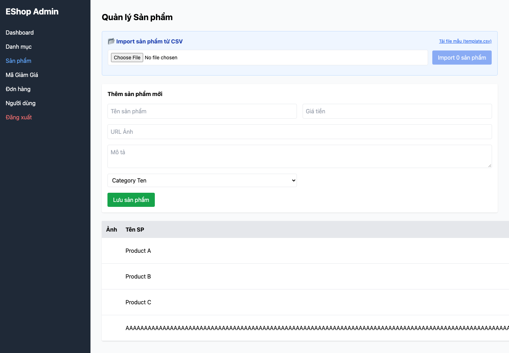

## Mô tả lỗi

| Trường | Nội dung |
|---|---|
| Bug ID | `FR15-BUG-002` |
| Feature / loại lỗi | FR-15; Functional / Validation |
| Tầng / interface | API / Admin WEB |
| Rule ID | FR15-R06 |
| Severity | High |
| Priority đề xuất | P1 |
| Status / mức xác nhận | Observed — lỗi đã quan sát theo đặc tả |
| Case đại diện | `FR15-DT-070` — Status gốc: Failed |

Lưu được giá không đáp ứng điều kiện bắt buộc và số dương.

### Tình trạng xác minh

- Nội dung dựa trên evidence lịch sử, chưa retest trên HEAD hiện tại.
- Chưa có bản sửa hoặc tỷ lệ tái hiện mới được xác nhận. Severity/priority là đề xuất triage.

## Môi trường

### Environment / build

Run `fr15-run03`, commit nền `5f9c73bf093c47e58188b46d20514b71149fb461`, có dirty paths/hash harness được ghi riêng; không coi commit SHA là toàn bộ trạng thái build. Node v22.17.1, Python 3.13.12; Playwright Chromium 153.0.8010.12, viewport 1440×1000, locale vi-VN. API `http://localhost:3000`; Admin `http://127.0.0.1:5174`. [Manifest](https://github.com/thuytranj/eshop-sut/blob/46f7bbd7d356bc25a94f32d74fcbc4d3383d2663/docs/testing/fr15/evidence/fr15-run03/manifest.json), [browser metadata](https://github.com/thuytranj/eshop-sut/blob/46f7bbd7d356bc25a94f32d74fcbc4d3383d2663/docs/testing/fr15/evidence/fr15-run03/web/browser.json).

### Preconditions / fixture

token partition=admin.
Target=101 phải tồn tại nếu thao tác yêu cầu, trừ probe ID vắng; snapshot toàn bộ sản phẩm trước/sau.

### Test data / inputs

Input dự định: `{"body": {"name": repeat("A",128), "price": -1, "description": "Nominal description", "imageUrl": "data:image/png;base64,iVBORw0KGgoAAAANSUhEUgAAAAEAAAABCAQAAAC1HAwCAAAAC0lEQVR42mP8/x8AAwMCAO+ip1sAAAAASUVORK5CYII=", "category_id": 10}, "target": 101, "auth": "admin", "mode": "create"}`

## Steps to reproduce

1. Reset fixture bằng setup độc lập và snapshot tất cả sản phẩm.
2. Dùng đúng partition xác thực; mở Admin Product, chọn đúng target và thực hiện Thêm với input dự định.
3. Lưu request/response và state trước/sau; đối chiếu target cùng mọi sản phẩm khác.
4. Ghi inputEffective và UI ngay sau thao tác; reload, ghi UI lần nữa. HTML chặn input không chứng minh API đã validate.

## Actual result

Case đại diện thêm sản phẩm giá −1, ID 304; số sản phẩm tăng 3→4.

Quan sát: `{"failures": ["rejected-state-unchanged", "rejection-signaled", "ui-immediate-correct", "ui-reload-correct"], "beforeCount": 3, "afterCount": 4, "mutationCount": 1, "htmlBlocked": false, "response": {"statusCode": 200, "body": {"message": "Product created", "id": 304}}}`
Assertion: Dữ liệu thay đổi dù input phải bị từ chối
Assertion: Không có tín hiệu từ chối phù hợp
Assertion: UI ngay sau thao tác không khớp kết quả kỳ vọng
Assertion: UI sau reload không khớp kết quả kỳ vọng
Snapshot: thêm IDs=`[304]`; xóa IDs=`[]`; sửa IDs=`[]`
Input thực tế sau nhập UI: `{"name": repeat("A",128), "price": "-1", "category_id": "10"}`
[evidence FR15-DT-070](https://github.com/thuytranj/eshop-sut/blob/46f7bbd7d356bc25a94f32d74fcbc4d3383d2663/docs/testing/fr15/evidence/fr15-run03/web/observations.json)
[ảnh/log chi tiết](https://github.com/thuytranj/eshop-sut/blob/46f7bbd7d356bc25a94f32d74fcbc4d3383d2663/docs/testing/fr15/evidence/fr15-run03/web/screenshots/FR15-TC-076_immediate.png)

## Expected result

Từ chối thao tác; dữ liệu của target và các sản phẩm khác giữ nguyên.
Oracle nguồn: `{"outcome": "reject", "stateContract": "Create", "description": "Price boundary p=-1; strict zero excludes equality"}`; oracleStatus=`confirmed`

### Requirement / test oracle

README FR-15; Quy tắc và Expected Result chi tiết trong case đại diện tại [report.md](https://github.com/thuytranj/eshop-sut/blob/46f7bbd7d356bc25a94f32d74fcbc4d3383d2663/docs/testing/report.md); xem [đặc tả nghiệp vụ](https://github.com/thuytranj/eshop-sut/blob/46f7bbd7d356bc25a94f32d74fcbc4d3383d2663/README.md), [API contract](https://github.com/thuytranj/eshop-sut/blob/46f7bbd7d356bc25a94f32d74fcbc4d3383d2663/api_specification.md).

## Evidence

- [FR15-TC-076_immediate.png](https://github.com/thuytranj/eshop-sut/blob/46f7bbd7d356bc25a94f32d74fcbc4d3383d2663/docs/testing/fr15/evidence/fr15-run03/web/screenshots/FR15-TC-076_immediate.png)
- [FR15-TC-076_reload.png](https://github.com/thuytranj/eshop-sut/blob/46f7bbd7d356bc25a94f32d74fcbc4d3383d2663/docs/testing/fr15/evidence/fr15-run03/web/screenshots/FR15-TC-076_reload.png)
- [FR15-TC-076.json](https://github.com/thuytranj/eshop-sut/blob/46f7bbd7d356bc25a94f32d74fcbc4d3383d2663/docs/testing/fr15/evidence/fr15-run03/web/FR15-TC-076.json)

### Screenshot đại diện

### Related test cases (ID trong report)

`FR15-DT-008`, `FR15-BVA-007`, `FR15-DT-009`, `FR15-BVA-008`, `FR15-DT-014`, `FR15-DT-015`, `FR15-DT-017`, `FR15-DT-018`, `FR15-DT-020`, `FR15-DT-022`, `FR15-DT-024`, `FR15-DT-027`, `FR15-DT-028`, `FR15-DT-039`, `FR15-BVA-016`, `FR15-DT-040`, `FR15-BVA-017`, `FR15-DT-045`, `FR15-DT-046`, `FR15-DT-048`, `FR15-DT-049`, `FR15-DT-051`, `FR15-DT-053`, `FR15-DT-055`, `FR15-DT-058`, `FR15-DT-059`, `FR15-DT-070`, `FR15-BVA-025`, `FR15-DT-071`, `FR15-BVA-026`, `FR15-DT-076`, `FR15-DT-077`, `FR15-DT-079`, `FR15-DT-080`, `FR15-DT-082`, `FR15-DT-084`, `FR15-DT-092`, `FR15-BVA-034`, `FR15-DT-093`, `FR15-BVA-035`, `FR15-DT-098`, `FR15-DT-099`, `FR15-DT-101`, `FR15-DT-102`, `FR15-DT-104`, `FR15-DT-106`.

### Traceability — ID báo cáo và ID trong evidence

| Report case ID | Execution case ID | Technique |
|---|---|---|
| `FR15-DT-070` | `FR15-TC-076` | DT |
| `FR15-DT-008` | `FR15-TC-008` | DT |
| `FR15-BVA-007` | `FR15-TC-008` | BVA |
| `FR15-DT-009` | `FR15-TC-009` | DT |
| `FR15-BVA-008` | `FR15-TC-009` | BVA |
| `FR15-DT-014` | `FR15-TC-014` | DT |
| `FR15-DT-015` | `FR15-TC-015` | DT |
| `FR15-DT-017` | `FR15-TC-017` | DT |
| `FR15-DT-018` | `FR15-TC-018` | DT |
| `FR15-DT-020` | `FR15-TC-020` | DT |
| `FR15-DT-022` | `FR15-TC-022` | DT |
| `FR15-DT-024` | `FR15-TC-024` | DT |
| `FR15-DT-027` | `FR15-TC-027` | DT |
| `FR15-DT-028` | `FR15-TC-028` | DT |
| `FR15-DT-039` | `FR15-TC-042` | DT |
| `FR15-BVA-016` | `FR15-TC-042` | BVA |
| `FR15-DT-040` | `FR15-TC-043` | DT |
| `FR15-BVA-017` | `FR15-TC-043` | BVA |
| `FR15-DT-045` | `FR15-TC-048` | DT |
| `FR15-DT-046` | `FR15-TC-049` | DT |
| `FR15-DT-048` | `FR15-TC-051` | DT |
| `FR15-DT-049` | `FR15-TC-052` | DT |
| `FR15-DT-051` | `FR15-TC-054` | DT |
| `FR15-DT-053` | `FR15-TC-056` | DT |
| `FR15-DT-055` | `FR15-TC-058` | DT |
| `FR15-DT-058` | `FR15-TC-061` | DT |
| `FR15-DT-059` | `FR15-TC-062` | DT |
| `FR15-BVA-025` | `FR15-TC-076` | BVA |
| `FR15-DT-071` | `FR15-TC-077` | DT |
| `FR15-BVA-026` | `FR15-TC-077` | BVA |
| `FR15-DT-076` | `FR15-TC-082` | DT |
| `FR15-DT-077` | `FR15-TC-083` | DT |
| `FR15-DT-079` | `FR15-TC-085` | DT |
| `FR15-DT-080` | `FR15-TC-086` | DT |
| `FR15-DT-082` | `FR15-TC-088` | DT |
| `FR15-DT-084` | `FR15-TC-090` | DT |
| `FR15-DT-092` | `FR15-TC-099` | DT |
| `FR15-BVA-034` | `FR15-TC-099` | BVA |
| `FR15-DT-093` | `FR15-TC-100` | DT |
| `FR15-BVA-035` | `FR15-TC-100` | BVA |
| `FR15-DT-098` | `FR15-TC-105` | DT |
| `FR15-DT-099` | `FR15-TC-106` | DT |
| `FR15-DT-101` | `FR15-TC-108` | DT |
| `FR15-DT-102` | `FR15-TC-109` | DT |
| `FR15-DT-104` | `FR15-TC-111` | DT |
| `FR15-DT-106` | `FR15-TC-113` | DT |
