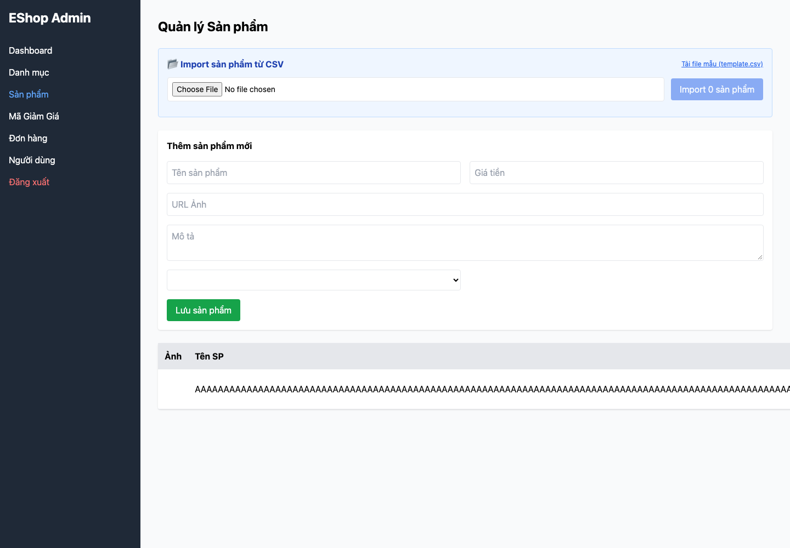

## Mô tả lỗi

| Trường | Nội dung |
|---|---|
| Bug ID | `FR15-BUG-003` |
| Feature / loại lỗi | FR-15; Functional / Data integrity |
| Tầng / interface | API / Admin WEB |
| Rule ID | FR15-R07 |
| Severity | High |
| Priority đề xuất | P1 |
| Status / mức xác nhận | Observed — lỗi đã quan sát theo đặc tả |
| Case đại diện | `FR15-DT-138` — Status gốc: Failed |

Tạo được sản phẩm không có danh mục hợp lệ.

### Tình trạng xác minh

- Nội dung dựa trên evidence lịch sử, chưa retest trên HEAD hiện tại.
- Chưa có bản sửa hoặc tỷ lệ tái hiện mới được xác nhận. Severity/priority là đề xuất triage.

## Môi trường

### Environment / build

Run `fr15-run03`, commit nền `5f9c73bf093c47e58188b46d20514b71149fb461`, có dirty paths/hash harness được ghi riêng; không coi commit SHA là toàn bộ trạng thái build. Node v22.17.1, Python 3.13.12; Playwright Chromium 153.0.8010.12, viewport 1440×1000, locale vi-VN. API `http://localhost:3000`; Admin `http://127.0.0.1:5174`. [Manifest](https://github.com/thuytranj/eshop-sut/blob/46f7bbd7d356bc25a94f32d74fcbc4d3383d2663/docs/testing/fr15/evidence/fr15-run03/manifest.json), [browser metadata](https://github.com/thuytranj/eshop-sut/blob/46f7bbd7d356bc25a94f32d74fcbc4d3383d2663/docs/testing/fr15/evidence/fr15-run03/web/browser.json).

### Preconditions / fixture

Reset snapshot empty-categories theo FR15-F trước case; token partition=admin.
Target=101 phải tồn tại nếu thao tác yêu cầu, trừ probe ID vắng; snapshot toàn bộ sản phẩm trước/sau.

### Test data / inputs

Input dự định: `{"body": {"name": repeat("A",128), "price": 100000, "description": "Nominal description", "imageUrl": "data:image/png;base64,iVBORw0KGgoAAAANSUhEUgAAAAEAAAABCAQAAAC1HAwCAAAAC0lEQVR42mP8/x8AAwMCAO+ip1sAAAAASUVORK5CYII=", "category_id": 10}, "target": 101, "auth": "admin", "mode": "create"}`

## Steps to reproduce

1. Reset fixture bằng setup độc lập và snapshot tất cả sản phẩm.
2. Dùng đúng partition xác thực; mở Admin Product, chọn đúng target và thực hiện Thêm với input dự định.
3. Lưu request/response và state trước/sau; đối chiếu target cùng mọi sản phẩm khác.
4. Ghi inputEffective và UI ngay sau thao tác; reload, ghi UI lần nữa. HTML chặn input không chứng minh API đã validate.

## Actual result

Khi danh mục rỗng, UI gửi category_id=1 không tồn tại; API vẫn tạo ID 1, số sản phẩm tăng 0→1.

Quan sát: `{"failures": ["rejected-state-unchanged", "rejection-signaled", "ui-immediate-correct", "ui-reload-correct"], "beforeCount": 0, "afterCount": 1, "mutationCount": 1, "htmlBlocked": false, "response": {"statusCode": 200, "body": {"message": "Product created", "id": 1}}}`
Assertion: Dữ liệu thay đổi dù input phải bị từ chối
Assertion: Không có tín hiệu từ chối phù hợp
Assertion: UI ngay sau thao tác không khớp kết quả kỳ vọng
Assertion: UI sau reload không khớp kết quả kỳ vọng
Snapshot: thêm IDs=`[1]`; xóa IDs=`[]`; sửa IDs=`[]`
Input thực tế sau nhập UI: `{"name": repeat("A",128), "price": "100000", "category_id": ""}`
[evidence FR15-DT-138](https://github.com/thuytranj/eshop-sut/blob/46f7bbd7d356bc25a94f32d74fcbc4d3383d2663/docs/testing/fr15/evidence/fr15-run03/web/observations.json)
[ảnh/log chi tiết](https://github.com/thuytranj/eshop-sut/blob/46f7bbd7d356bc25a94f32d74fcbc4d3383d2663/docs/testing/fr15/evidence/fr15-run03/web/screenshots/FR15-TC-146_immediate.png)

## Expected result

Từ chối thao tác; dữ liệu của target và các sản phẩm khác giữ nguyên.
Oracle nguồn: `{"outcome": "reject", "stateContract": "Create", "description": "No categories: reject creation despite valid name/price"}`; oracleStatus=`confirmed`

### Requirement / test oracle

README FR-15; Quy tắc và Expected Result chi tiết trong case đại diện tại [report.md](https://github.com/thuytranj/eshop-sut/blob/46f7bbd7d356bc25a94f32d74fcbc4d3383d2663/docs/testing/report.md); xem [đặc tả nghiệp vụ](https://github.com/thuytranj/eshop-sut/blob/46f7bbd7d356bc25a94f32d74fcbc4d3383d2663/README.md), [API contract](https://github.com/thuytranj/eshop-sut/blob/46f7bbd7d356bc25a94f32d74fcbc4d3383d2663/api_specification.md).

## Evidence

- [FR15-TC-146_immediate.png](https://github.com/thuytranj/eshop-sut/blob/46f7bbd7d356bc25a94f32d74fcbc4d3383d2663/docs/testing/fr15/evidence/fr15-run03/web/screenshots/FR15-TC-146_immediate.png)
- [FR15-TC-146_reload.png](https://github.com/thuytranj/eshop-sut/blob/46f7bbd7d356bc25a94f32d74fcbc4d3383d2663/docs/testing/fr15/evidence/fr15-run03/web/screenshots/FR15-TC-146_reload.png)
- [FR15-TC-146.json](https://github.com/thuytranj/eshop-sut/blob/46f7bbd7d356bc25a94f32d74fcbc4d3383d2663/docs/testing/fr15/evidence/fr15-run03/web/FR15-TC-146.json)

### Screenshot đại diện

### Related test cases (ID trong report)

`FR15-DT-023`, `FR15-DT-029`, `FR15-DT-030`, `FR15-DT-031`, `FR15-DT-054`, `FR15-DT-060`, `FR15-DT-061`, `FR15-DT-062`, `FR15-DT-138`, `FR15-DT-139`.

### Traceability — ID báo cáo và ID trong evidence

| Report case ID | Execution case ID | Technique |
|---|---|---|
| `FR15-DT-138` | `FR15-TC-146` | DT |
| `FR15-DT-023` | `FR15-TC-023` | DT |
| `FR15-DT-029` | `FR15-TC-029` | DT |
| `FR15-DT-030` | `FR15-TC-030` | DT |
| `FR15-DT-031` | `FR15-TC-031` | DT |
| `FR15-DT-054` | `FR15-TC-057` | DT |
| `FR15-DT-060` | `FR15-TC-063` | DT |
| `FR15-DT-061` | `FR15-TC-064` | DT |
| `FR15-DT-062` | `FR15-TC-065` | DT |
| `FR15-DT-139` | `FR15-TC-147` | DT |
