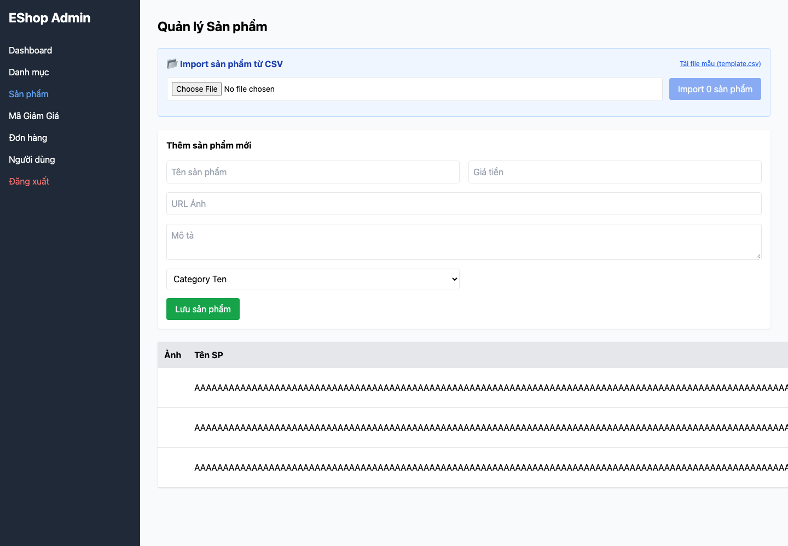

## Mô tả lỗi

| Trường | Nội dung |
|---|---|
| Bug ID | `FR15-BUG-004` |
| Feature / loại lỗi | FR-15; UI / State consistency |
| Tầng / interface | Admin WEB; API/DB là đối chứng |
| Rule ID | FR15-R08 |
| Severity | High |
| Priority đề xuất | P1 |
| Status / mức xác nhận | Observed — lỗi đã quan sát theo đặc tả |
| Case đại diện | `FR15-DT-085` — Status gốc: Failed |

Bảng quản trị hiển thị sai dữ liệu sau sửa, có thể gây thao tác nhầm.

### Tình trạng xác minh

- Nội dung dựa trên evidence lịch sử, chưa retest trên HEAD hiện tại.
- Chưa có bản sửa hoặc tỷ lệ tái hiện mới được xác nhận. Severity/priority là đề xuất triage.

## Môi trường

### Environment / build

Run `fr15-run03`, commit nền `5f9c73bf093c47e58188b46d20514b71149fb461`, có dirty paths/hash harness được ghi riêng; không coi commit SHA là toàn bộ trạng thái build. Node v22.17.1, Python 3.13.12; Playwright Chromium 153.0.8010.12, viewport 1440×1000, locale vi-VN. API `http://localhost:3000`; Admin `http://127.0.0.1:5174`. [Manifest](https://github.com/thuytranj/eshop-sut/blob/46f7bbd7d356bc25a94f32d74fcbc4d3383d2663/docs/testing/fr15/evidence/fr15-run03/manifest.json), [browser metadata](https://github.com/thuytranj/eshop-sut/blob/46f7bbd7d356bc25a94f32d74fcbc4d3383d2663/docs/testing/fr15/evidence/fr15-run03/web/browser.json).

### Preconditions / fixture

token partition=admin.
Target=101 phải tồn tại nếu thao tác yêu cầu, trừ probe ID vắng; snapshot toàn bộ sản phẩm trước/sau.

### Test data / inputs

Input dự định: `{"body": {"name": repeat("A",128), "price": 100000, "description": "Nominal description", "imageUrl": "data:image/png;base64,iVBORw0KGgoAAAANSUhEUgAAAAEAAAABCAQAAAC1HAwCAAAAC0lEQVR42mP8/x8AAwMCAO+ip1sAAAAASUVORK5CYII=", "category_id": 10}, "target": 101, "auth": "admin", "mode": "update"}`

## Steps to reproduce

1. Reset fixture bằng setup độc lập và snapshot tất cả sản phẩm.
2. Dùng đúng partition xác thực; mở Admin Product, chọn đúng target và thực hiện Sửa với input dự định.
3. Lưu request/response và state trước/sau; đối chiếu target cùng mọi sản phẩm khác.
4. Ghi inputEffective và UI ngay sau thao tác; reload, ghi UI lần nữa. HTML chặn input không chứng minh API đã validate.

## Actual result

Ngay sau sửa A, tên B/C trên UI bị đổi theo A; DB/API vẫn đúng. Reload khôi phục tên B/C. Một số ca sửa riêng field còn giữ dữ liệu UI cũ.

Quan sát: `{"failures": ["ui-immediate-correct"], "beforeCount": 3, "afterCount": 3, "mutationCount": 1, "htmlBlocked": false, "response": {"statusCode": 200, "body": {"message": "Product updated"}}}`
Assertion: UI ngay sau thao tác không khớp kết quả kỳ vọng
Snapshot: thêm IDs=`[]`; xóa IDs=`[]`; sửa IDs=`[101]`
Input thực tế sau nhập UI: `{"name": repeat("A",128), "price": "100000", "category_id": "10"}`
[evidence FR15-DT-085](https://github.com/thuytranj/eshop-sut/blob/46f7bbd7d356bc25a94f32d74fcbc4d3383d2663/docs/testing/fr15/evidence/fr15-run03/web/observations.json)
[ảnh/log chi tiết](https://github.com/thuytranj/eshop-sut/blob/46f7bbd7d356bc25a94f32d74fcbc4d3383d2663/docs/testing/fr15/evidence/fr15-run03/web/screenshots/FR15-TC-092_immediate.png)

## Expected result

Chỉ target khớp payload mới; các field không sửa và các sản phẩm khác giữ nguyên; UI đúng ngay sau lưu và sau reload.
Oracle nguồn: `{"outcome": "accept", "stateContract": "Update", "description": "Interior / valid nominal CRUD"}`; oracleStatus=`confirmed`

### Requirement / test oracle

README FR-15; Quy tắc và Expected Result chi tiết trong case đại diện tại [report.md](https://github.com/thuytranj/eshop-sut/blob/46f7bbd7d356bc25a94f32d74fcbc4d3383d2663/docs/testing/report.md); xem [đặc tả nghiệp vụ](https://github.com/thuytranj/eshop-sut/blob/46f7bbd7d356bc25a94f32d74fcbc4d3383d2663/README.md), [API contract](https://github.com/thuytranj/eshop-sut/blob/46f7bbd7d356bc25a94f32d74fcbc4d3383d2663/api_specification.md).

## Evidence

- [FR15-TC-092_immediate.png](https://github.com/thuytranj/eshop-sut/blob/46f7bbd7d356bc25a94f32d74fcbc4d3383d2663/docs/testing/fr15/evidence/fr15-run03/web/screenshots/FR15-TC-092_immediate.png)
- [FR15-TC-092_reload.png](https://github.com/thuytranj/eshop-sut/blob/46f7bbd7d356bc25a94f32d74fcbc4d3383d2663/docs/testing/fr15/evidence/fr15-run03/web/screenshots/FR15-TC-092_reload.png)
- [FR15-TC-092.json](https://github.com/thuytranj/eshop-sut/blob/46f7bbd7d356bc25a94f32d74fcbc4d3383d2663/docs/testing/fr15/evidence/fr15-run03/web/FR15-TC-092.json)

### Screenshot đại diện

### Related test cases (ID trong report)

`FR15-DT-085`, `FR15-DT-087`, `FR15-BVA-029`, `FR15-DT-088`, `FR15-BVA-030`, `FR15-DT-089`, `FR15-BVA-031`, `FR15-DT-090`, `FR15-BVA-032`, `FR15-DT-094`, `FR15-BVA-036`, `FR15-DT-095`, `FR15-DT-096`, `FR15-DT-100`, `FR15-DT-105`, `FR15-SUP-008`, `FR15-DT-123`, `FR15-DT-124`, `FR15-DT-125`, `FR15-DT-126`, `FR15-DT-127`, `FR15-DT-128`, `FR15-BVA-044`.

### Traceability — ID báo cáo và ID trong evidence

| Report case ID | Execution case ID | Technique |
|---|---|---|
| `FR15-DT-085` | `FR15-TC-092` | DT |
| `FR15-DT-087` | `FR15-TC-094` | DT |
| `FR15-BVA-029` | `FR15-TC-094` | BVA |
| `FR15-DT-088` | `FR15-TC-095` | DT |
| `FR15-BVA-030` | `FR15-TC-095` | BVA |
| `FR15-DT-089` | `FR15-TC-096` | DT |
| `FR15-BVA-031` | `FR15-TC-096` | BVA |
| `FR15-DT-090` | `FR15-TC-097` | DT |
| `FR15-BVA-032` | `FR15-TC-097` | BVA |
| `FR15-DT-094` | `FR15-TC-101` | DT |
| `FR15-BVA-036` | `FR15-TC-101` | BVA |
| `FR15-DT-095` | `FR15-TC-102` | DT |
| `FR15-DT-096` | `FR15-TC-103` | DT |
| `FR15-DT-100` | `FR15-TC-107` | DT |
| `FR15-DT-105` | `FR15-TC-112` | DT |
| `FR15-SUP-008` | `FR15-TC-114` | SUP |
| `FR15-DT-123` | `FR15-TC-131` | DT |
| `FR15-DT-124` | `FR15-TC-132` | DT |
| `FR15-DT-125` | `FR15-TC-133` | DT |
| `FR15-DT-126` | `FR15-TC-134` | DT |
| `FR15-DT-127` | `FR15-TC-135` | DT |
| `FR15-DT-128` | `FR15-TC-136` | DT |
| `FR15-BVA-044` | `FR15-TC-158` | BVA |
